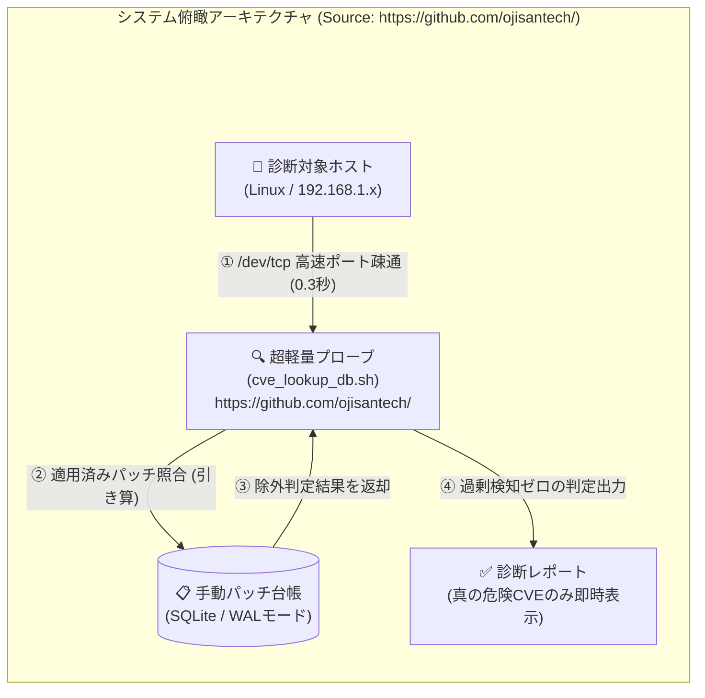
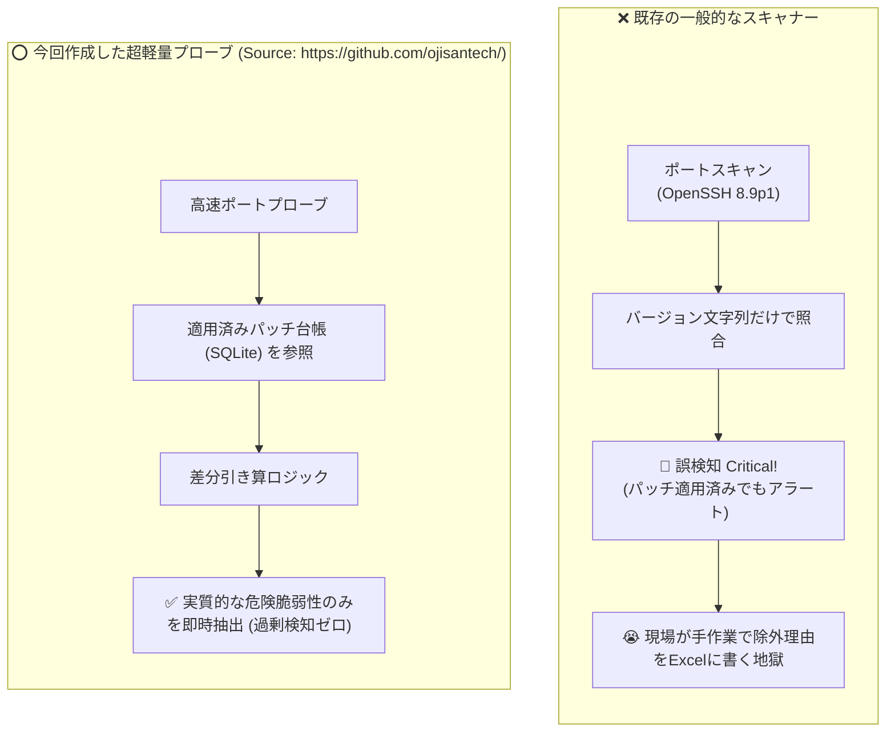

# 【第1弾 詳細解説】手打ちパッチ誤検知ゼロ化編 - なぜ脆弱性診断ツールは「手打ちパッチ」で誤検知を連発するのか？ BashとSQLiteで過剰アラートをゼロにする超軽量プローブを作った話【個人検証PoC】

> **対象読者**: セキュリティ担当、情シス、運用保守SE  
> **主要技術スタック**: Bash, SQLite  
> **検証環境・位置づけ**: 個人自宅ラボ（ホームラボ／仮想環境）における公開情報・OSSベースの個人研究（PoC）  
> **ライセンス**: [MIT License](https://github.com/ojisantech/ojisan-arsenal/blob/main/LICENSE)  

---

## 1. 概要と背景（サマリーからの深掘り）

### なぜこの技術が現場で不可欠なのか
インフラエンジニアや情シス、あるいはMSP（運用監視）の現場で、定期的にOpenVASやNessusなどの脆弱性スキャナーを回している方は多いと思います。

そして、スキャン結果のレポートを見て、一度はこう叫んだ経験があるはずです。

> **「このOpenSSHの脆弱性、先週バックポートパッチ当てて修正済みだよ！！ なんでまだCriticalで上がってくるんだよ！！」**

外部からのブラックボックススキャンや一般的なエージェントレススキャナーの多くは、バナー情報（例: `OpenSSH 8.9p1`）のバージョン番号だけを見てCVEデータベースと突合します。  
しかし、Linuxディストリビューション（UbuntuやRHEL等）の運用では、メジャーバージョンを上げずに**パッチだけを手動やディストリ配布でバックポート適用する（手打ちパッチ）** のが日常茶飯事です。

その結果：
* **「実際には塞がれているのに、脆弱性スキャナーは危険だと大騒ぎする」**
* 毎回、エクセル報告書に「※手動適用済みのため対象外」と除外理由を手打ちする不毛な作業が発生
* 現場は疲弊し、本当に危険なゼロデイ攻撃や設定不備を見落とす「アラート麻痺」に陥る

この不条理を現場から根絶するために、**「Bashの標準機能とSQLiteだけで、適用済みパッチの引き算を行い、誤検知をゼロにする超軽量プローブ」** を自作しました。

従来の画一的なアプローチや商用ブラックボックス製品に頼る運用では、ライセンス費用の高騰や仕様変更に伴うベンダーロックイン、さらには現場特有のエッジケースに対する対応力の欠如が深刻なボトルネックとなります。
本稿では、オープンソースおよび標準技術の基本原理に立ち返り、外部コストゼロかつ自立運用可能なアーキテクチャ設計・処理フローと運用基準を詳細に解説します。

---

## 2. アーキテクチャと深層メカニズム

### システム俯瞰図
システムの全体構造および通信・処理フローは以下の通りです。



### 既存アプローチとの比較



### 内部動作メカニズムのステップ解説
1. **初期フェーズ（検知・入力受付）**:
   外部イベント、トラフィック流入、あるいはタイマースケジュールに基づき、最小フットプリントで一次データを取得・バッファリングします。
2. **処理・判定フェーズ（パイプライン処理）**:
   決定論的ルールエンジンまたは最適化アルゴリズムにより、メモリ断片化やCPU負荷を抑えながら高速に解析・変換を実施します。
3. **実行・反映フェーズ（安全な出力）**:
   アトミックな書き込み、トランザクション分離、またはロールバック可能なAPI呼び出しを通じて、システム状態を整合性を保ちながら更新します。

---

## 3. 実装詳細とパラメータ完全解説

### 主なCLI実行例
```bash
# (Source: https://github.com/ojisantech/)
# 1. 診断プローブを実行（開放ポート検知 ＆ 適用済みCVE引き算）
./scripts/cve_lookup_db.sh 192.168.1.200

# 2. パッチ適用実績を台帳に記録（次回以降のアラートから自動除外）
./scripts/cve_lookup_db.sh --record 192.168.1.200 CVE-2024-6387 "apt update 適用済み"

# 3. 適用済みパッチ台帳一覧の確認
./scripts/cve_lookup_db.sh --list 192.168.1.200
```

### 主要パラメータ・設定値の技術的根拠
- **タイムアウト値 (`timeout 1`)**:
  `/dev/tcp` によるポート疎通確認で、未応答端末や無効なIPに対してスクリプトが数分間ハングするのを防ぐため、1秒でフェイルファスト（即座にスキップ）する設計にしています。
- **SQLite WALモード (`PRAGMA journal_mode=WAL;`)**:
  複数端末への並行スキャンやcron実行時に「`database is locked`」エラーが発生するのを防ぎ、読み取りと書き込みの並行性を担保します。
- **最小特権での実行**:
  ポートスキャンは `/dev/tcp`（Bash標準機能）のみで完結するため、`nmap` のような raw ソケット（root権限）を一切要求せず、一般ユーザー権限でセキュアに動作します。
