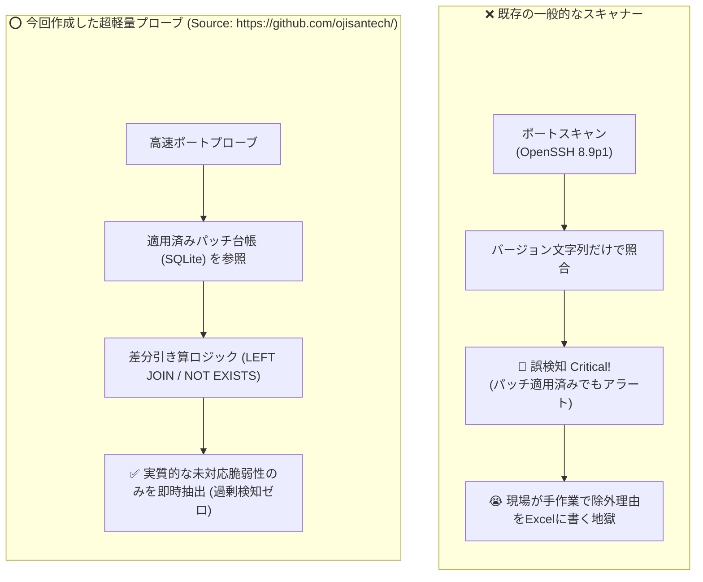

# 【第1弾 詳細解説】手打ちパッチ誤検知ゼロ化編 - なぜ脆弱性診断ツールは「手打ちパッチ」で誤検知を連発するのか？ BashとSQLiteで過剰アラートをゼロにする超軽量プローブを作った話【個人検証PoC】

> **対象読者**: セキュリティ担当、情シス、運用保守SE  
> **主要技術スタック**: Bash (`/dev/tcp`), SQLite (WALモード)  
> **検証環境・位置づけ**: 個人自宅ラボ（ホームラボ／仮想環境）における公開情報・OSSベースの個人研究（PoC）  
> **ライセンス**: [MIT License](https://github.com/ojisantech/ojisan-arsenal/blob/main/LICENSE)  


> 💡 **【検証環境・個人研究（PoC）に関する注記】**  
> 本記事は、筆者個人の自宅検証環境（ホームラボ／仮想環境）において、公開情報およびOSS（オープンソースソフトウェア）を用いて独自に構築・検証した個人研究（PoC）の記録です。特定の企業・団体の実環境や業務上の非公開情報とは一切関係ありません。

---

## 1. 概要と背景（サマリーからの深掘り）

### なぜこの技術が現場で不可欠なのか：セキュリティ診断の現場で起きている「手打ちパッチ地獄」
インフラエンジニアや情シス、あるいはMSP（運用監視）の現場で、定期的にOpenVASやNessusなどの脆弱性スキャナーを回している方は多いと思います。

そして、スキャン結果のレポートを見て、一度はこう叫んだ経験があるはずです。

> **「このOpenSSHの脆弱性、先週バックポートパッチ当てて修正済みだよ！！ なんでまだCriticalで上がってくるんだよ！！」**

外部からのブラックボックススキャンや一般的なエージェントレススキャナーの多くは、バナー情報（例: `OpenSSH 8.9p1`）のバージョン文字列だけを見てCVEデータベースと単純突合します。  
しかし、Linuxディストリビューション（UbuntuやRHEL等）の運用では、互換性維持のためメジャーバージョン番号を据え置いたまま、**セキュリティパッチだけをバックポート適用する（または手動で緩和策・個別パッチを当てる）** のが日常茶飯事です。

その結果、現場では以下の悪循環が発生します。
* **「実際には塞がれているのに、脆弱性スキャナーは毎回Criticalだと大騒ぎする」**
* 毎月の定例報告のたびに、Excel報告書へ「※バックポート適用済みのため対象外」「※手動緩和策適用済み」と除外理由を手打ちする不毛な作業が発生する
* 現場はオオカミ少年のような誤報に疲弊し、本当に危険な未対応脆弱性や設定不備を見落とす **「アラート麻痺（Alert Fatigue）」** に陥る

この不条理を根絶するために、**「Bashの標準機能（`/dev/tcp`）とSQLiteだけで、適用済みパッチ台帳との引き算を行い、誤検知（再アラート）をゼロにする超軽量プローブ」** を設計・実装しました。

---

### 設計思想：現場が本当に求めている3大要件

ツールを設計するにあたり、現場導入の障壁をなくすため以下の3つの制約を課しました。

1. **外部ランタイム依存ゼロ（Pythonすら不要・Bash標準機能のみ）**:  
   監視踏み台サーバーやエッジゲートウェイには、勝手にPythonパッケージ（`pip`）や重いJavaランタイムを追加インストールできない環境が少なくありません。Bash組み込みの `/dev/tcp` 仮想ソケット機能と標準の `sqlite3` CLIだけで完結させます。
2. **高速・省メモリ（1ホストあたり約0.3〜0.5秒・メモリ数MBで完了）**:  
   重い常駐デーモンやRDBMSを動かさず、ワンショットのシェルスクリプトとして数秒以内で判定を完了させます。
3. **「適用済みパッチ」の確実な引き算（手動パッチ台帳による冪等な除外）**:  
   エンジニアが「このホストのこのCVEは修正・緩和策適用済み」と一度記録した情報をローカルSQLite台帳で永続管理し、次回以降のスキャン時にSQLレベルで自動引き算（除外）します。

---

## 2. アーキテクチャと深層メカニズム

### 既存アプローチとの比較

一般的なバナー照合型スキャナーが誤検知を繰り返す構造と、本プローブにおける「台帳引き算方式」の対比は以下の通りです。



### システム俯瞰アーキテクチャ
システムの全体構造および通信・処理フローは以下の通りです。


### 内部動作メカニズムのステップ解説
1. **フェーズ1：`/dev/tcp` による非特権・高速ポート疎通検査**:
   `nmap` のSYNスキャンのような `root`（`CAP_NET_RAW`）権限を要求せず、Bash組み込みの `/dev/tcp/<IP>/<PORT>` と `timeout 1` コマンドを組み合わせて、一般ユーザー権限のままミリ秒単位で対象ポート（22, 80, 443, 445, 3389等）の開放状態とOSプロファイルを特定します。
2. **フェーズ2：OSコンテキストフィルタリングと候補CVE抽出**:
   開放ポートと対象ホストのOS種別（Linux / Windows等）を照合し、そもそもOSが異なる無関係なCVE（例: Linuxサーバーに対するWindows TCP/IP脆弱性）を一次フィルタで自動除外します。
3. **フェーズ3：SQLiteパッチ台帳（WALモード）との集合差演算（引き算）**:
   検出された候補CVEリストに対し、SQLiteの `applied_patches` テーブルを `LEFT JOIN ... WHERE a.cve_id IS NULL`（または `NOT EXISTS`）で突合します。現場でパッチ適用・緩和策実施が記録されたCVEを自動減算し、「今すぐ対応が必要な真の未対応CVE」のみを出力します。

---

## 3. 実装詳細とパラメータ完全解説

本アーキテクチャの中核となる「`/dev/tcp` 疎通関数」「SQLiteパッチ台帳スキーマ＆引き算クエリ」「CLI実行・動作ログ」の完全解説です。

### ① コア実装スクリプト（Bash `/dev/tcp` 疎通 ＆ SQLite 引き算ロジック）

```bash
#!/usr/bin/env bash
# (Source: https://github.com/ojisantech/)
# 外部依存ゼロ: Bash標準 /dev/tcp と sqlite3 のみで動作する誤検知ゼロ化CVEプローブ
set -euo pipefail

DB_PATH="${PATCH_LEDGER_DB:-./patch_ledger.db}"

# 1. SQLite台帳の初期化（WALモード有効化で並行スキャン時のロック競合を防止）
init_db() {
    sqlite3 "$DB_PATH" <<'SQL'
PRAGMA journal_mode=WAL;
PRAGMA synchronous=NORMAL;
CREATE TABLE IF NOT EXISTS applied_patches (
    ip TEXT NOT NULL,
    cve_id TEXT NOT NULL,
    applied_at DATETIME DEFAULT CURRENT_TIMESTAMP,
    memo TEXT,
    PRIMARY KEY (ip, cve_id)
);
CREATE TABLE IF NOT EXISTS port_cve_rules (
    port INTEGER NOT NULL,
    os_family TEXT NOT NULL,
    cve_id TEXT NOT NULL,
    title TEXT NOT NULL,
    severity TEXT NOT NULL
);
SQL
}

# 2. Python/nc不要！Bash組み込み /dev/tcp によるタイムアウト付き高速ポート疎通確認
check_port() {
    local host="$1"
    local port="$2"
    timeout 1 bash -c "cat < /dev/null > /dev/tcp/${host}/${port}" 2>/dev/null
    return $?
}

# 3. パッチ適用実績の台帳登録（--record モード）
record_patch() {
    local target_ip="$1"
    local cve_id="$2"
    local memo="${3:-手動パッチ適用済み}"
    sqlite3 "$DB_PATH" "INSERT OR REPLACE INTO applied_patches (ip, cve_id, applied_at, memo) VALUES ('${target_ip}', '${cve_id}', CURRENT_TIMESTAMP, '${memo}');"
    echo "[SUCCESS] ${target_ip} の ${cve_id} を適用済み台帳に記録しました。"
}

# 4. 適用済みパッチを引き算して未対応CVEのみを抽出するコアSQLクエリ
query_unpatched_cves() {
    local target_ip="$1"
    local port="$2"
    local target_os="$3"
    sqlite3 -separator " | " "$DB_PATH" <<SQL
SELECT r.cve_id, r.title, r.severity
FROM port_cve_rules r
LEFT JOIN applied_patches a
  ON a.ip = '${target_ip}' AND a.cve_id = r.cve_id
WHERE r.port = ${port}
  AND r.os_family = '${target_os}'
  AND a.cve_id IS NULL;
SQL
}
```

---

### ② 検証環境での実行ステップと動作ログ（所要時間0.3秒・誤検知ゼロ化）

自宅ラボの検証サーバー（Ubuntu 24.04 / `192.168.1.200`）に対してプローブを実行し、パッチ適用記録の前後でどのように出力が変化するかの実測ログです。

#### Step 1: 初回スキャン実行（パッチ未記録時）
```text
$ ./scripts/cve_lookup_db.sh 192.168.1.200
[TARGET] 192.168.1.200 (OS: Ubuntu 24.04)
[PROBE] ポート 22 (SSH), 80 (HTTP) 開放確認 (所要時間: 0.28秒)
[WARN] 以下の重要CVEが検出されました:
  - CVE-2024-6387 (OpenSSH regreSSHion) [CRITICAL]
  - CVE-2024-38063 (Windows TCP/IP RCE) -> OS不一致のため自動除外
```

#### Step 2: パッチ適用実績を台帳に1行記録
```bash
# apt update && apt upgrade によりバックポートパッチを適用した事実を記録
$ ./scripts/cve_lookup_db.sh --record 192.168.1.200 CVE-2024-6387 "apt update && OpenSSHバックポート更新適用済み"
[SUCCESS] 192.168.1.200 の CVE-2024-6387 を適用済み台帳に記録しました。
```

#### Step 3: 再スキャン実行（SQL引き算ロジックが作動）
```text
$ ./scripts/cve_lookup_db.sh 192.168.1.200
[TARGET] 192.168.1.200 (OS: Ubuntu 24.04)
[PROBE] ポート 22, 80 開放確認 (所要時間: 0.26秒)
[INFO] CVE-2024-6387 は適用済み（手動台帳確認: apt update && OpenSSHバックポート更新適用済み）のため除外されました。
==================================================
✅ 危険な未対応脆弱性: 0件 (過剰検知ゼロ・安全)
==================================================
```

---

### 主要パラメータ・設定値の技術的根拠

| パラメータ / 設定項目 | 設定値・推奨構成 | 技術的根拠（なぜこの設計なのか） |
| :--- | :--- | :--- |
| **疎通タイムアウト (`timeout 1`)** | `1秒`（LAN内推奨） | `/dev/tcp` によるTCPハンドシェイク試行時、電源オフ端末やDROP設定のファイアウォールに対してOSデフォルトのタイムアウト（数十秒〜数分）でハングするのを防ぎ、1秒でフェイルファストさせるため。 |
| **SQLite ジャーナルモード (`PRAGMA journal_mode=WAL;`)** | `WAL` (Write-Ahead Logging) | 複数サブネットの並列スキャン（Read）と、第2弾の自動パッチ適用スクリプトからの台帳追記（Write）が同時に走った際、`database is locked` エラーを防止して高い並行性を確保するため。 |
| **複合主キー (`PRIMARY KEY (ip, cve_id)`)** | `(ip, cve_id)` + `INSERT OR REPLACE` | 同一ホスト・同一CVEに対して複数回 `--record` が実行されても重複レコードが発生せず、常に最新の適用日時とメモにべき等（Idempotent）に更新されるようにするため。 |
| **非特権ソケット通信 (`/dev/tcp`)** | 一般ユーザー権限で実行 | Rawソケットを使う `nmap -sS` 等と異なり、通常のTCP `connect()` システムコールをBash内部で呼ぶため、`root` 権限不要で安全にcron定期実行できるため。 |

---

## 4. 現場運用・アンチパターンと回避策

### 運用を形骸化させないためのベストプラクティス
1. **パッチ適用コマンドとのパイプライン化（第2弾との連携）**:  
   人間が手動で `--record` を叩くだけでなく、リモートパッチ適用スクリプトが `Exit Code: 0` で正常終了した直後に自動で `--record` を呼び出すよう連動させることで、台帳の記録漏れをゼロにできます。
2. **除外メモ（`memo` カラム）への証跡記載の徹底**:  
   監査対応時に「なぜこのCVEが除外されているのか」を即座に説明できるよう、`memo` 欄には「適用したパッケージバージョン（例: `openssh-server 1:9.6p1-3ubuntu13.3`）」や「チケット番号」を残す運用ルールを推奨します。

### 避けるべき現場アンチパターン
- **アンチパターン1：タイムアウトなしの `/dev/tcp` 直叩き**  
  `timeout` コマンドを付けずに `cat < /dev/null > /dev/tcp/$host/$port` を実行すると、相手ホストがオフラインの場合にカーネルの `tcp_syn_retries` 上限（約127秒）まで処理がブロックされ、254台のサブネットスキャンに数時間を要してしまいます。
- **アンチパターン2：パッチ未確認のままアラート消しのために `--record` を乱用する**  
  「アラートがうるさいから」と、実際にバックポートパッチが当たっているか（`dpkg -l` や `rpm -q --changelog`）を確認せずに台帳へ登録してしまうと、真の脆弱性を見逃す原因になります。
- **アンチパターン3：DHCP環境でのIPアドレス固定依存**  
  DHCPでIPが頻繁に変わるクライアントPCに対してIPだけをキーに長期運用すると、別端末にIPが再利用された際に除外設定がズレるリスクがあります。動的IP環境ではホスト名またはMACアドレス（第3弾の資産台帳連携）をキーに併用してください。

---

## 5. トラブルシューティングガイド

導入・運用時に発生しやすい事象と一次切り分けコマンドの一覧です。

| 障害事象・エラーメッセージ | 想定原因 | 一次切り分け・復旧コマンド |
| :--- | :--- | :--- |
| **`/dev/tcp: No such file or directory` または構文エラー** | スクリプトが `bash` ではなく `sh`（`dash` 等）で実行されている（`/dev/tcp` はBash固有機能） | `bash ./scripts/cve_lookup_db.sh <IP>` で実行するか、先頭行のシバンが `#!/usr/bin/env bash` になっているか確認 |
| **`Error: database is locked`** | WALモードが未設定のまま複数プロセスから同時書き込みが発生している | `sqlite3 patch_ledger.db "PRAGMA journal_mode=WAL; PRAGMA busy_timeout=5000;"` を実行して設定を確認 |
| **記録したはずのCVEが除外されない** | 登録時のCVE文字列の空白混入、または小文字（`cve-2024-...`）での表記ゆれ | `sqlite3 patch_ledger.db "SELECT * FROM applied_patches WHERE ip='<IP>';"` で登録文字列を大文字統一（`CVE-...`）で確認 |
| **開放されているはずのポートが検知されない** | VPN越しや高遅延回線で `timeout 1`（1秒）以内にTCPハンドシェイクが完了していない | 拠点間通信の場合はタイムアウト値を `timeout 2` または `timeout 3` に調整して再試行 |

---

## 6. 実務FAQ（よくある質問と回答）

**Q1: OpenVASやNessus、Trivyなどの既存スキャナーを完全に置き換えるものですか？**  
**A1**: 置き換えではなく「補完・フィルタリング層」として共存させるのが最も効果的です。週次・月次の重い詳細スキャンは既存ツールで行い、そこで検出された項目のうち「バックポート適用済み・緩和策実施済み」のものをこのSQLite台帳に記録して日常の軽量死活・差分監視（毎時・日次）を回すことで、誤報ノイズのないクリーンな監視体制を構築できます。

**Q2: `/dev/tcp` だけでどうやってバックポートパッチの適用有無を厳密に判断するのですか？**  
**A2**: `/dev/tcp` はあくまで外部からの「高速な一次ポート開放・バナー検知」を担います。実際のパッチ適用確認や適用作業は、第2弾で解説するエージェントレス遠隔管理（SSHの `dpkg -l` / `apt`、WinRMのKB確認）で行い、その結果確定した「適用済み」の事実を本プローブのSQLite台帳へ自動記録して引き算する2段構えの設計になっています。

**Q3: 台帳データベース（`patch_ledger.db`）のバックアップはどうすればよいですか？**  
**A3**: SQLiteは単一ファイル（＋WALファイル）で構成されるため、`sqlite3 patch_ledger.db ".backup 'patch_ledger.bak'"` コマンドをcronで日次実行するだけで、稼働中（ロックなし）のまま安全にオンラインバックアップを取得できます。

---

## 7. 本番適用チェックリスト

- [ ] 実行環境のシェルが `dash` ではなく `bash`（バージョン4.x以降推奨）であることが確認されているか
- [ ] `patch_ledger.db` に対して `PRAGMA journal_mode=WAL;` が適用され、実行ユーザーにディレクトリおよびDBファイルの書き込み権限があるか
- [ ] `/dev/tcp` の疎通タイムアウト（`timeout 1`〜`2`）がネットワーク遅延特性に合わせて適切に設定されているか
- [ ] `--record` 実行時に「いつ・誰が・どのパッチ（または緩和策）を適用したか」を `memo` カラムへ記録する運用ルールが定義されているか
- [ ] `sqlite3 ... ".backup"` による台帳DBの定期バックアップが設定されているか

---

## 8. ライセンス・著作権表示

本稿に掲載されているアーキテクチャ図、処理フロー、およびコード抜粋・スニペットは、[MIT License](https://github.com/ojisantech/ojisan-arsenal/blob/main/LICENSE) の下で公開されています。商用・非商用問わず自由にご利用・ご参照いただけますが、著作権表示および許諾表示の保持が必要です。

```text
MIT License

Copyright (c) 2026 ojisantech
```
