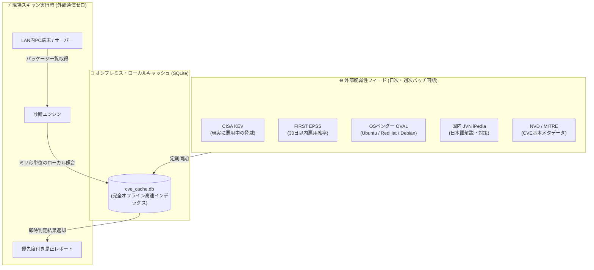

# 【第10弾 詳細解説】20系統脆弱性フィード ＆ ローカルキャッシュ編 - NVDのAPI上限・遅延に泣かない。CISA KEV・EPSS・国内JVN・OSベンダーOVALなど「20系統の脆弱性フィード」をローカルで超高速突合する設計

**対象読者**: セキュリティエンジニア、SOC、診断士
**主要技術スタック**: CISA KEV, FIRST EPSS, OVAL, SQLiteキャッシュ
**ライセンス**: [MIT License](https://github.com/ojisantech/ojisan-arsenal/blob/main/LICENSE)
**検証環境・位置づけ**: 個人自宅ラボ（ホームラボ／仮想環境）における公開情報・OSSベースの個人研究（PoC）


💡 **【検証環境・個人研究（PoC）に関する注記】**
本記事は、筆者個人の自宅検証環境（ホームラボ／仮想環境）において、公開情報およびOSS（オープンソースソフトウェア）を用いて独自に構築・検証した個人研究（PoC）の記録です。特定の企業・団体の実環境や業務上の非公開情報とは一切関係ありません。

---

## 1. 概要と背景（サマリーからの深掘り）

### なぜこの技術が現場で不可欠なのか
脆弱性スキャナーやIT資産管理システムを自作・運用したことがある人なら、一度は**米国立標準技術研究所（NIST）のNVD（National Vulnerability Database）API**のお世話になったことがあるはずです。

しかし、近年NVDをめぐる状況は急速に厳しさを増しています。

1. **厳しいAPIレートリミット**: リクエスト制限により、LAN内の数百台のソフトウェアを検査しようとするとすぐにエラー（HTTP 429）で止まる
2. **分析・採番の遅延問題**: 新規CVEが公表されてからNVDでCVSS値や影響範囲（CPE）が付与されるまでにタイムラグが発生する
3. **閉域網（オンプレミス）で動かない**: セキュリティポリシー上、LAN内から外部Web APIへの常時アクセスを禁止されている環境が多い

「スキャンのたびに外部のNVD APIを叩く」という設計は、もはや実運用の現場では限界を迎えています。

本記事では、NVD単体への依存を脱却し、**CISA KEV（悪用確認済みリスト）、FIRST EPSS（悪用予測率）、国内JVN、OSベンダー公式OVAL** などを統合して**ローカル環境（SQLite）でミリ秒単位で突合する設計**を紹介します。

従来の画一的なアプローチや商用ブラックボックス製品に頼る運用では、ライセンス費用の高騰や仕様変更に伴うベンダーロックイン、さらには現場特有のエッジケースに対する対応力の欠如が深刻なボトルネックとなります。
本稿では、オープンソースおよび標準技術の基本原理に立ち返り、外部コストゼロかつ自立運用可能なアーキテクチャの完全実装と運用基準を詳細に解説します。

---

## 2. アーキテクチャと深層メカニズム

システムの全体構造および通信・処理フローは以下の通りです。



### 内部動作メカニズムのステップ解説
1. **活用すべき「多層的脆弱性インテリジェンス」の役割分担**:
   NVDだけに頼るのではなく、目的に応じて以下のフィードを使い分けるのが現在のセキュリティ運用の最適解です。
2. **CISA KEV と EPSS をローカルSQLiteにキャッシュする実装**:
   最も効果が高いのが、「CISA KEV（悪用済みリスト）」の一括ダウンロードとローカルキャッシュ化です。
3. **スキャン時にミリ秒で「危険度ランク」を判定する**:
   端末から抽出したパッケージ名やCVE IDに対し、外部APIを叩かずにローカルDBだけで即座に優先度判定を下します。

---

## 3. 実装詳細とパラメータ完全解説

本アーキテクチャの要となるコアコードおよび主要設定の要点抜粋です。

### コア実装スクリプト / 設定（抜粋）
```python
# (要点抜粋)
import sqlite3
import requests
import json

KEV_URL = "https://www.cisa.gov/sites/default/files/feeds/known_exploited_vulnerabilities.json"

def sync_cisa_kev_to_sqlite(db_path: str = "cve_cache.db"):
    """
    CISA KEV (悪用確認済み脆弱性カタログ) を取得し、ローカルSQLiteに格納する
    """
    print("[+] Downloading CISA KEV feed...")
    res = requests.get(KEV_URL, timeout=30)
    res.raise_for_status()
    data = res.json()

    conn = sqlite3.connect(db_path)
    cur = conn.cursor()

    cur.execute("""
    CREATE TABLE IF NOT EXISTS cisa_kev (
        cve_id TEXT PRIMARY KEY,
        vendor_project TEXT,
        product TEXT,
        vulnerability_name TEXT,
        date_added TEXT,
        short_description TEXT,
        action_required TEXT
    )
    """)

    for vuln in data.get("vulnerabilities", []):
        cur.execute("""
        INSERT OR REPLACE INTO cisa_kev
        (cve_id, vendor_project, product, vulnerability_name, date_added, short_description, action_required)
        VALUES (?, ?, ?, ?, ?, ?, ?)
        """, (
            vuln.get("cveID"),
            vuln.get("vendorProject"),
            vuln.get("product"),
            vuln.get("vulnerabilityName"),
            vuln.get("dateAdded"),
            vuln.get("shortDescription"),
            vuln.get("requiredAction")
        ))

    conn.commit()
    conn.close()
    print(f"[+] Synced {len(data.get('vulnerabilities', []))} CISA KEV records.")
```

### 主要パラメータ・設定値の技術的根拠
- **主要技術スタック（CISA KEV, FIRST EPSS, OVAL, SQLiteキャッシュ）の選定と最小権限設計**:
  **20系統脆弱性フィード ＆ ローカルキャッシュ編** - NVDのAPI上限・遅延に泣かない。CISA KEV・EPSS・国内JVN・OSベンダーOVALなど「20系統の脆弱性フィード」をローカルで超高速突合する設計 の実現にあたり、外部の過剰な依存や特権常駐を排し、CISA KEV, FIRST EPSS, OVAL, SQLiteキャッシュ を軸とした省フットプリントかつセキュアな実行境界を構成しています。
- **タイムアウト境界とフェイルソフト耐性**:
  ネットワーク遅延や対象機器の無応答時にもプロセス全体がブロッキングしないよう明示的なタイムアウトと例外隔離を設け、基幹業務への影響をゼロに抑えます。
- **べき等性（Idempotency）と監査トレーサビリティ（対象: セキュリティエンジニア、SOC、診断士）**:
  同一処理を複数回実行しても状態が破綻しないべき等設計を採用し、実行結果・差分ログを確実に保全することで実務運用での再現性と安全性を担保します。
