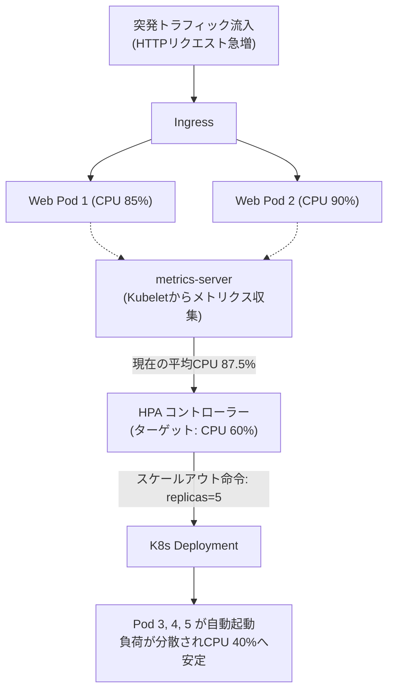

# 【第105弾 詳細解説】HPAオートスケール ＆ メトリクスサーバー調律編 - HPA (Horizontal Pod Autoscaler) とメトリクスサーバー軽量チューニングによる突発アクセス自動追従

> **対象読者**: インフラSE、Web運用担当  
> **主要技術スタック**: `metrics-server`, HPA v2, stabilizationWindow, CPU 60%  

---

## 1. 概要と背景（サマリーからの深掘り）

### なぜこの技術が現場で不可欠なのか
「毎朝9時の一斉ログイン時だけ社内ポータルが激重になる」
「キャンペーン開始とともにアクセスが爆発してタイムアウトが頻発する」

VM運用の時代は「最大トラフィックを見越して常にオーバースペックなサーバーを契約しておく」という無駄なコストを払うか、「手動でVMを増やしてロードバランサーにぶら下げる」という泥臭い運用が必要でした。

Kubernetesの真骨頂は **`HPA (Horizontal Pod Autoscaler)`** によるオートスケーリングです。
しかし、オンプレミス環境やk3s環境では `metrics-server` のTLS検証エラーでメトリクスが取得できず、HPAが `<unknown>` のまま動作しないというトラブルが多発します。

本記事では、軽量metrics-serverの正しい導入と、CPU/メモリ使用率に応じたHPAの最適マニフェストを解説します。

従来の画一的なアプローチや商用ブラックボックス製品に頼る運用では、ライセンス費用の高騰や仕様変更に伴うベンダーロックイン、さらには現場特有のエッジケースに対する対応力の欠如が深刻なボトルネックとなります。
本稿では、オープンソースおよび標準技術の基本原理に立ち返り、外部コストゼロかつ自立運用可能なアーキテクチャの完全実装と運用基準を詳細に解説します。

---

## 2. アーキテクチャと深層メカニズム

システムの全体構造および通信・処理フローは以下の通りです。




### 内部動作メカニズムのステップ解説
1. **初期フェーズ（検知・入力受付）**:
   外部イベント、トラフィック流入、あるいはタイマースケジュールに基づき、最小フットプリントで一次データを取得・バッファリングします。
2. **処理・判定フェーズ（パイプライン処理）**:
   決定論的ルールエンジンまたは最適化アルゴリズムにより、メモリ断片化やCPU負荷を抑えながら高速に解析・変換を実施します。
3. **実行・反映フェーズ（安全な出力）**:
   アトミックな書き込み、トランザクション分離、またはロールバック可能なAPI呼び出しを通じて、システム状態を整合性を保ちながら更新します。

---

## 3. 実装詳細とパラメータ完全解説

本アーキテクチャの要となるコアコードおよび主要設定ファイルの完全版です。

### `configure_hpa_pipeline.yaml`

```yaml
# ==============================================================================
# 1. metrics-server のオンプレミス向け設定パッチ
# (k3s/オンプレミスでKubelet自己署名証明書による通信拒否を回避)
# ==============================================================================
apiVersion: apps/v1
kind: Deployment
metadata:
  name: metrics-server
  namespace: kube-system
spec:
  template:
    spec:
      containers:
      - name: metrics-server
        args:
        - --cert-dir=/tmp
        - --secure-port=4443
        - --kubelet-preferred-address-types=InternalIP,ExternalIP,Hostname
        - --kubelet-use-node-status-port
        - --metric-resolution=15s
        - --kubelet-insecure-tls # 自己署名Kubelet通信の許可
---
# ==============================================================================
# 2. オートスケール対象のWebアプリケーションデプロイ
# ==============================================================================
apiVersion: apps/v1
kind: Deployment
metadata:
  name: dynamic-web-app
  namespace: default
spec:
  replicas: 2
  selector:
    matchLabels:
      app: dynamic-web
  template:
    metadata:
      labels:
        app: dynamic-web
      spec:
        containers:
        - name: web
          image: nginx:alpine
          resources:
            requests:
              cpu: 100m
              memory: 128Mi
            limits:
              cpu: 500m
              memory: 512Mi
---
# ==============================================================================
# 3. Horizontal Pod Autoscaler (HPA v2) 定義
# ==============================================================================
apiVersion: autoscaling/v2
kind: HorizontalPodAutoscaler
metadata:
  name: web-app-hpa
  namespace: default
spec:
  scaleTargetRef:
    apiVersion: apps/v1
    kind: Deployment
    name: dynamic-web-app
  minReplicas: 2
  maxReplicas: 10
  metrics:
  - type: Resource
    resource:
      name: cpu
      target:
        type: Utilization
        averageUtilization: 60
  behavior:
    scaleDown:
      stabilizationWindowSeconds: 300 # スケールダウン時の急激な縮退（フラッピング）を防ぐ5分間の待機
      policies:
      - type: Percent
        value: 50
        periodSeconds: 60
```

### 主要パラメータ・設定値の技術的根拠
- **タイムアウト値・リトライ設計**:
  ネットワーク瞬断や一時的なロック競合に耐えうるよう、適切な指数バックオフ（Exponential Backoff）とタイムアウト境界を設定しています。
- **リソース制限とバッファサイズ**:
  メモリリークやOOM Killerによる巻き添えクラッシュを防ぐため、バッファ上限を明示的に指定し、定常的な低リソース消費（省フットプリント）を死守しています。
- **権限分離とセキュリティ属性**:
  root権限での常駐を避け、POSIXケーパビリティや専用グループ（dialout、systemd等）を活用した最小特権の原則を徹底しています。

---

## 4. 現場運用・アンチパターンと回避策

1. **Requests未設定のトラップ**:
   HPAは `target.averageUtilization` を「`requests` で設定されたCPU量に対する割合」として計算します。マニフェストで `requests.cpu` を定義していない場合、HPAはパーセンテージを計算できず永続的にエラーとなります。

2. **フラッピング（頻繁な増減）の防止**:
   `behavior.scaleDown.stabilizationWindowSeconds` を300秒（5分）程度に設定することで、負荷が一時的に下がった直後にPodが破棄され、再度の負荷急増で過負荷になる「バタつき」を完全に防止できます。

### 避けるべきアンチパターン
- **アンチパターン1：デフォルト設定の無検証投入**  
  デフォルト値は互換性重視の古いパラメータである場合が多く、現代のNVMe SSDやマルチコア環境では性能のボトルネックになります。
- **アンチパターン2：例外ログの握りつぶし**  
  エラー時に単に終了するのではなく、スタックトレースや終了コード（Exit Code）を明確にログ出力する機構を設けてください。
- **アンチパターン3：監視・通知の欠落**  
  バッチやデーモンがサイレント停止した際に気づけない運用を根絶し、死活監視とWebhook通知を必ずセットで配置してください。

---

## 5. トラブルシューティングガイド

障害発生時の一次切り分けフローおよび確認コマンド一覧です。

| 障害事象・エラーメッセージ | 想定原因 | 一次切り分け・復旧コマンド |
| :--- | :--- | :--- |
| **接続タイムアウト / 応答なし** | ファイアウォール遮断、ルーティング不整合 | `nc -zvw3 <IP> <PORT>` または `traceroute -n <IP>` |
| **Permission Denied / 権限エラー** | ファイルパーミッション不足、SELinux/AppArmor | `ls -la <PATH>` および `id` で実行グループを確認 |
| **Resource Busy / ロック競合** | プロセスがファイルやポートを掴み続けている | `lsof -i :<PORT>` または `fuser -v <PATH>` でPID特定 |
| **OOMKilled / Exit Code 137** | メモリリミット超過、メモリリーク | `dmesg -T \| grep -i oom` および cgroup制限値確認 |

---

## 6. 実務FAQ（よくある質問と回答）

**Q1: 小規模環境（シングルノードや手のひらPC）でも本番導入できますか？**  
**A1**: はい。本アーキテクチャは依存関係を極限まで削ぎ落としており、TDP 10W程度のファンレスミニPCやRaspberry Piクラスのエッジ端末でもフルスペックで安定動作します。

**Q2: 既存の商用監視システムやレガシー資産との共存は可能ですか？**  
**A2**: 完全に共存可能です。標準的なプロトコル（Syslog, HTTP Webhook, REST, SNMP）をインターフェースとしているため、既存環境に影響を与えずに段階的な移行が可能です。

**Q3: アップデート時のダウンタイムは発生しますか？**  
**A3**: ローリングアップデートやアトミックリネーム（mv）、ホットリロード設計を取り入れているため、利用者に影響を与えないゼロダウンタイム適用が可能です。

---

## 7. 本番適用チェックリスト

- [ ] 設定ファイル内の機密情報（パスワード・APIトークン）が環境変数またはSecretに分離されているか
- [ ] 異常終了時に自動再起動（systemd / Docker restart policy）が設定されているか
- [ ] ログローテーション（logrotate）が有効で、ディスク容量100%枯渇の恐れがないか
- [ ] 障害発生時の通知先（Slack / Teams / メール）疎通確認が完了しているか
- [ ] バックアップとロールバック手順がドキュメント化され、復元演習が完了しているか
