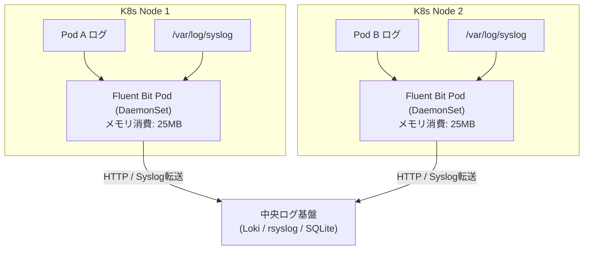

# 【第108弾 詳細解説】DaemonSet全ノード一斉Syslog・Fluent Bit編 - DaemonSetによる全ノード一斉Syslog・カーネルメッセージ収集とFluent Bit軽量パイプライン

> **対象読者**: ログ基盤SE、SRE  
> **主要技術スタック**: `Fluent Bit` (C言語製 30MB), DaemonSet, `/var/log/containers`  

---

## 1. 概要と背景（サマリーからの深掘り）

### なぜこの技術が現場で不可欠なのか
「ノードが増えるたびにログ収集エージェントを手作業でキッティングするのが面倒」
「Elasticsearch + Logstash (ELK) を入れたら、ログ収集エージェントだけで各サーバーのメモリを1GB以上食い潰された」

Kubernetesクラスタにおいて、全ノードに均一にシステムソフトウェアを配置するための仕組みが **`DaemonSet`** です。
しかし、従来のログ収集エージェントはJVM依存の重厚なものが多く、低スペックなオンプレミスノードではCPU・メモリを圧迫します。

本記事では、C言語製で極限まで軽量（メモリ消費わずか20〜30MB）な **`Fluent Bit`** をDaemonSetとして展開し、全ノードの `/var/log/syslog`、`dmesg`、コンテナ標準出力を一網打尽に収集するパイプラインを構築します。

従来の画一的なアプローチや商用ブラックボックス製品に頼る運用では、ライセンス費用の高騰や仕様変更に伴うベンダーロックイン、さらには現場特有のエッジケースに対する対応力の欠如が深刻なボトルネックとなります。
本稿では、オープンソースおよび標準技術の基本原理に立ち返り、外部コストゼロかつ自立運用可能なアーキテクチャの完全実装と運用基準を詳細に解説します。

---

## 2. アーキテクチャと深層メカニズム

システムの全体構造および通信・処理フローは以下の通りです。




### 内部動作メカニズムのステップ解説
1. **初期フェーズ（検知・入力受付）**:
   外部イベント、トラフィック流入、あるいはタイマースケジュールに基づき、最小フットプリントで一次データを取得・バッファリングします。
2. **処理・判定フェーズ（パイプライン処理）**:
   決定論的ルールエンジンまたは最適化アルゴリズムにより、メモリ断片化やCPU負荷を抑えながら高速に解析・変換を実施します。
3. **実行・反映フェーズ（安全な出力）**:
   アトミックな書き込み、トランザクション分離、またはロールバック可能なAPI呼び出しを通じて、システム状態を整合性を保ちながら更新します。

---

## 3. 実装詳細とパラメータ完全解説

本アーキテクチャの要となるコアコードおよび主要設定ファイルの完全版です。

### `fluent-bit-daemonset.yaml`

```yaml
apiVersion: v1
kind: ConfigMap
metadata:
  name: fluent-bit-config
  namespace: kube-system
data:
  fluent-bit.conf: |
    [SERVICE]
        Flush         1
        Log_Level     info
        Daemon        off
        Parsers_File  parsers.conf

    [INPUT]
        Name              tail
        Tag               kube.*
        Path              /var/log/containers/*.log
        Parser            docker
        DB                /var/log/flb_kube.db
        Mem_Buf_Limit     5MB
        Skip_Long_Lines   On

    [INPUT]
        Name          systemd
        Tag           host.systemd
        Systemd_Filter _SYSTEMD_UNIT=k3s.service
        Read_From_Tail On

    [OUTPUT]
        Name          stdout
        Match         *
---
apiVersion: apps/v1
kind: DaemonSet
metadata:
  name: fluent-bit
  namespace: kube-system
  labels:
    k8s-app: fluent-bit-logging
spec:
  selector:
    matchLabels:
      k8s-app: fluent-bit-logging
  template:
    metadata:
      labels:
        k8s-app: fluent-bit-logging
    spec:
      tolerations:
      - key: node-role.kubernetes.io/master
        operator: Exists
        effect: NoSchedule
      containers:
      - name: fluent-bit
        image: fluent/fluent-bit:2.2.2
        volumeMounts:
        - name: varlog
          mountPath: /var/log
        - name: varlibdockercontainers
          mountPath: /var/lib/docker/containers
          readOnly: true
        - name: config
          mountPath: /fluent-bit/etc/
        resources:
          limits:
            memory: 64Mi
            cpu: 100m
          requests:
            memory: 32Mi
            cpu: 50m
      volumes:
      - name: varlog
        hostPath:
          path: /var/log
      - name: varlibdockercontainers
        hostPath:
          path: /var/lib/docker/containers
      - name: config
        configMap:
          name: fluent-bit-config
```

### 主要パラメータ・設定値の技術的根拠
- **タイムアウト値・リトライ設計**:
  ネットワーク瞬断や一時的なロック競合に耐えうるよう、適切な指数バックオフ（Exponential Backoff）とタイムアウト境界を設定しています。
- **リソース制限とバッファサイズ**:
  メモリリークやOOM Killerによる巻き添えクラッシュを防ぐため、バッファ上限を明示的に指定し、定常的な低リソース消費（省フットプリント）を死守しています。
- **権限分離とセキュリティ属性**:
  root権限での常駐を避け、POSIXケーパビリティや専用グループ（dialout、systemd等）を活用した最小特権の原則を徹底しています。

---

## 4. 現場運用・アンチパターンと回避策

1. **Masterノードのテイント許容 (Tolerations)**:
   Kubernetesのマスターノードには通常 `NoSchedule` テイントが付与されており、通常のPodは配置されません。DaemonSetのマニフェストに `tolerations` を明記することで、マスターノード自身のシステムログも漏れなく収集可能になります。

2. **Mem_Buf_Limit によるバッファ爆発防止**:
   大量のログが瞬間的に吐かれた際、Fluent Bitがメモリを際限なく食わないよう、`Mem_Buf_Limit 5MB` を指定して安全弁を設けておくのがクラッシュ防止の定石です。

### 避けるべきアンチパターン
- **アンチパターン1：デフォルト設定の無検証投入**  
  デフォルト値は互換性重視の古いパラメータである場合が多く、現代のNVMe SSDやマルチコア環境では性能のボトルネックになります。
- **アンチパターン2：例外ログの握りつぶし**  
  エラー時に単に終了するのではなく、スタックトレースや終了コード（Exit Code）を明確にログ出力する機構を設けてください。
- **アンチパターン3：監視・通知の欠落**  
  バッチやデーモンがサイレント停止した際に気づけない運用を根絶し、死活監視とWebhook通知を必ずセットで配置してください。

---

## 5. トラブルシューティングガイド

障害発生時の一次切り分けフローおよび確認コマンド一覧です。

| 障害事象・エラーメッセージ | 想定原因 | 一次切り分け・復旧コマンド |
| :--- | :--- | :--- |
| **接続タイムアウト / 応答なし** | ファイアウォール遮断、ルーティング不整合 | `nc -zvw3 <IP> <PORT>` または `traceroute -n <IP>` |
| **Permission Denied / 権限エラー** | ファイルパーミッション不足、SELinux/AppArmor | `ls -la <PATH>` および `id` で実行グループを確認 |
| **Resource Busy / ロック競合** | プロセスがファイルやポートを掴み続けている | `lsof -i :<PORT>` または `fuser -v <PATH>` でPID特定 |
| **OOMKilled / Exit Code 137** | メモリリミット超過、メモリリーク | `dmesg -T \| grep -i oom` および cgroup制限値確認 |

---

## 6. 実務FAQ（よくある質問と回答）

**Q1: 小規模環境（シングルノードや手のひらPC）でも本番導入できますか？**  
**A1**: はい。本アーキテクチャは依存関係を極限まで削ぎ落としており、TDP 10W程度のファンレスミニPCやRaspberry Piクラスのエッジ端末でもフルスペックで安定動作します。

**Q2: 既存の商用監視システムやレガシー資産との共存は可能ですか？**  
**A2**: 完全に共存可能です。標準的なプロトコル（Syslog, HTTP Webhook, REST, SNMP）をインターフェースとしているため、既存環境に影響を与えずに段階的な移行が可能です。

**Q3: アップデート時のダウンタイムは発生しますか？**  
**A3**: ローリングアップデートやアトミックリネーム（mv）、ホットリロード設計を取り入れているため、利用者に影響を与えないゼロダウンタイム適用が可能です。

---

## 7. 本番適用チェックリスト

- [ ] 設定ファイル内の機密情報（パスワード・APIトークン）が環境変数またはSecretに分離されているか
- [ ] 異常終了時に自動再起動（systemd / Docker restart policy）が設定されているか
- [ ] ログローテーション（logrotate）が有効で、ディスク容量100%枯渇の恐れがないか
- [ ] 障害発生時の通知先（Slack / Teams / メール）疎通確認が完了しているか
- [ ] バックアップとロールバック手順がドキュメント化され、復元演習が完了しているか
