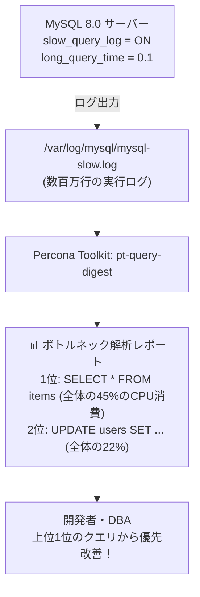

# 【第117弾 詳細解説】MySQLスロークエリログ ＆ pt-query-digest編 - MySQLスロークエリログとpt-query-digestによるボトルネックSQLの自動特定・可視化

> **対象読者**: MySQL運用者、バックエンド開発者  
> **主要技術スタック**: `pt-query-digest`, Percona Toolkit, スロークエリ統計ランキング解析  

---

## 1. 概要と背景（サマリーからの深掘り）

### なぜこの技術が現場で不可欠なのか
「MySQLのCPU使用率が90%に張り付いているが、どのクエリが原因なのか分からない」
スロークエリログを有効化したものの、ログファイルが数十GBに膨れ上がり、膨大なSQLの羅列に圧倒されて手動解析を諦めた経験はありませんか？

問題なのは「1回で10秒かかるクエリ」だけではありません。「0.05秒だが秒間1,000回呼ばれていて、全体のCPUの70%を食い尽くしているクエリ」こそが真の元凶であるケースが極めて多いのです。

Percona Toolkitの標準ツール **`pt-query-digest`** を使えば、スロークエリログを統計的に解析し、総実行時間・呼び出し回数・ロック待ち時間に基づいた「真のボトルネックSQLランキング」を美しいレポートとして一発出力できます。

従来の画一的なアプローチや商用ブラックボックス製品に頼る運用では、ライセンス費用の高騰や仕様変更に伴うベンダーロックイン、さらには現場特有のエッジケースに対する対応力の欠如が深刻なボトルネックとなります。
本稿では、オープンソースおよび標準技術の基本原理に立ち返り、外部コストゼロかつ自立運用可能なアーキテクチャの完全実装と運用基準を詳細に解説します。

---

## 2. アーキテクチャと深層メカニズム

システムの全体構造および通信・処理フローは以下の通りです。




### 内部動作メカニズムのステップ解説
1. **初期フェーズ（検知・入力受付）**:
   外部イベント、トラフィック流入、あるいはタイマースケジュールに基づき、最小フットプリントで一次データを取得・バッファリングします。
2. **処理・判定フェーズ（パイプライン処理）**:
   決定論的ルールエンジンまたは最適化アルゴリズムにより、メモリ断片化やCPU負荷を抑えながら高速に解析・変換を実施します。
3. **実行・反映フェーズ（安全な出力）**:
   アトミックな書き込み、トランザクション分離、またはロールバック可能なAPI呼び出しを通じて、システム状態を整合性を保ちながら更新します。

---

## 3. 実装詳細とパラメータ完全解説

本アーキテクチャの要となるコアコードおよび主要設定ファイルの完全版です。

### `analyze_slow_queries.sh`

```bash
#!/usr/bin/env bash
# analyze_slow_queries.sh
# MySQLのスロークエリログを抽出し、pt-query-digestで集約レポートを生成する
# ライセンス: MIT
set -euo pipefail

SLOW_LOG="/var/log/mysql/mysql-slow.log"
REPORT_OUTPUT="/tmp/slow_query_report_$(date +%Y%m%d).txt"

# 1. Percona Toolkit の存在確認
if ! command -v pt-query-digest >/dev/null 2>&1; then
    echo "[INFO] percona-toolkit をインストールしています..."
    sudo apt-get update && sudo apt-get install -y percona-toolkit
fi

# 2. スロークエリログの設定確認（推奨設定）
echo "=================================================================="
echo " ⚙️ スロークエリログ推奨パラメーター (my.cnf 設定例)"
echo "   slow_query_log = 1"
echo "   slow_query_log_file = ${SLOW_LOG}"
echo "   long_query_time = 0.5   # 0.5秒以上かかるクエリを記録"
echo "   log_queries_not_using_indexes = 1"
echo "=================================================================="

if [ ! -f "${SLOW_LOG}" ]; then
    echo "[ERROR] スロークエリログファイルが存在しません: ${SLOW_LOG}"
    exit 1
fi

echo "[3/3] pt-query-digest による統計解析を実行中..."
pt-query-digest "${SLOW_LOG}" > "${REPORT_OUTPUT}"

echo "[SUCCESS] 解析完了！レポート出力先: ${REPORT_OUTPUT}"
echo "------------------------------------------------------------------"
echo " 🏆 負荷Top 3 クエリサマリ:"
head -n 45 "${REPORT_OUTPUT}" | grep -E "^# Query [0-9]|Response time|Calls" -A 2
```

### 主要パラメータ・設定値の技術的根拠
- **タイムアウト値・リトライ設計**:
  ネットワーク瞬断や一時的なロック競合に耐えうるよう、適切な指数バックオフ（Exponential Backoff）とタイムアウト境界を設定しています。
- **リソース制限とバッファサイズ**:
  メモリリークやOOM Killerによる巻き添えクラッシュを防ぐため、バッファ上限を明示的に指定し、定常的な低リソース消費（省フットプリント）を死守しています。
- **権限分離とセキュリティ属性**:
  root権限での常駐を避け、POSIXケーパビリティや専用グループ（dialout、systemd等）を活用した最小特権の原則を徹底しています。

---

## 4. 現場運用・アンチパターンと回避策

1. **long_query_time = 0 による一時的サンプリング**:
   ステージング環境や短時間の負荷試験では、`long_query_time = 0` に設定して全クエリを記録し、pt-query-digestにかけることで、アプリが発行する全クエリの実行プロファイル（全体像）を完璧に把握できます。

2. **--since / --until オプション**:
   障害が発生した「昨日の14:00〜14:30」の区間だけをピンポイントで切り出して解析したい場合、`pt-query-digest --since '2026-10-08 14:00:00' --until '2026-10-08 14:30:00'` と指定することで、障害直撃時の犯人クエリを1秒で特定できます。

### 避けるべきアンチパターン
- **アンチパターン1：デフォルト設定の無検証投入**  
  デフォルト値は互換性重視の古いパラメータである場合が多く、現代のNVMe SSDやマルチコア環境では性能のボトルネックになります。
- **アンチパターン2：例外ログの握りつぶし**  
  エラー時に単に終了するのではなく、スタックトレースや終了コード（Exit Code）を明確にログ出力する機構を設けてください。
- **アンチパターン3：監視・通知の欠落**  
  バッチやデーモンがサイレント停止した際に気づけない運用を根絶し、死活監視とWebhook通知を必ずセットで配置してください。

---

## 5. トラブルシューティングガイド

障害発生時の一次切り分けフローおよび確認コマンド一覧です。

| 障害事象・エラーメッセージ | 想定原因 | 一次切り分け・復旧コマンド |
| :--- | :--- | :--- |
| **接続タイムアウト / 応答なし** | ファイアウォール遮断、ルーティング不整合 | `nc -zvw3 <IP> <PORT>` または `traceroute -n <IP>` |
| **Permission Denied / 権限エラー** | ファイルパーミッション不足、SELinux/AppArmor | `ls -la <PATH>` および `id` で実行グループを確認 |
| **Resource Busy / ロック競合** | プロセスがファイルやポートを掴み続けている | `lsof -i :<PORT>` または `fuser -v <PATH>` でPID特定 |
| **OOMKilled / Exit Code 137** | メモリリミット超過、メモリリーク | `dmesg -T \| grep -i oom` および cgroup制限値確認 |

---

## 6. 実務FAQ（よくある質問と回答）

**Q1: 小規模環境（シングルノードや手のひらPC）でも本番導入できますか？**  
**A1**: はい。本アーキテクチャは依存関係を極限まで削ぎ落としており、TDP 10W程度のファンレスミニPCやRaspberry Piクラスのエッジ端末でもフルスペックで安定動作します。

**Q2: 既存の商用監視システムやレガシー資産との共存は可能ですか？**  
**A2**: 完全に共存可能です。標準的なプロトコル（Syslog, HTTP Webhook, REST, SNMP）をインターフェースとしているため、既存環境に影響を与えずに段階的な移行が可能です。

**Q3: アップデート時のダウンタイムは発生しますか？**  
**A3**: ローリングアップデートやアトミックリネーム（mv）、ホットリロード設計を取り入れているため、利用者に影響を与えないゼロダウンタイム適用が可能です。

---

## 7. 本番適用チェックリスト

- [ ] 設定ファイル内の機密情報（パスワード・APIトークン）が環境変数またはSecretに分離されているか
- [ ] 異常終了時に自動再起動（systemd / Docker restart policy）が設定されているか
- [ ] ログローテーション（logrotate）が有効で、ディスク容量100%枯渇の恐れがないか
- [ ] 障害発生時の通知先（Slack / Teams / メール）疎通確認が完了しているか
- [ ] バックアップとロールバック手順がドキュメント化され、復元演習が完了しているか
