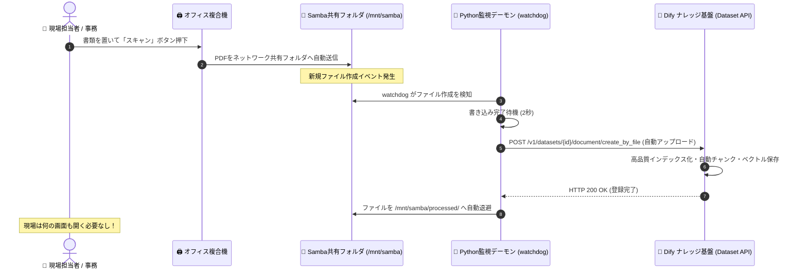

# 【第12弾 詳細解説】複合機スキャン ➔ Samba ➔ Dify自動RAG登録編 - 「現場にWeb画面からPDFをアップロードさせようとするな」複合機でスキャンして共有フォルダに放り込むだけでDifyに自動RAG登録されるPython監視パイプラインを作った話

> **対象読者**: DX推進担当、情シス、社内RAG導入者  
> **主要技術スタック**: Python `watchdog`, Samba (SMB), Dify Dataset API  

---

## 1. 概要と背景（サマリーからの深掘り）

### なぜこの技術が現場で不可欠なのか
Difyを使って社内FAQやナレッジ検索用のRAG（Retrieval-Augmented Generation）ボットを作ったことのある方なら、必ずこの壁にぶつかったことがあるはずです。

> **「エンジニアは便利だと思って作ったのに、現場の社員が誰もPDFやマニュアルを追加してくれない」**

理由は極めてシンプルです。  
現場の業務担当者にとって、**「Webブラウザを開いて、Difyにログインして、該当のナレッジベースを選んで、ファイルアップロードダイアログを開いて、ファイルをドラッグ＆ドロップして、チャンク設定を確認して保存ボタンを押す」** という工程は、面倒くさすぎて絶対に定着しないからです。

現場で日常的に行われている唯一の行為は、**「複合機で紙の書類をスキャンして、いつもの共有フォルダ（Samba / NAS）にポイッと保存すること」** だけです。

そこで、**「共有フォルダにPDFが放り込まれた瞬間、裏側のPythonが検知してDifyのナレッジAPIに自動登録し、完了したら処理済みフォルダへ移動させる全自動パイプライン」** を構築しました。

現場の作業フローは**1ミリも変えずに**、社内AIが勝手に最新ナレッジを学習し続けます。

従来の画一的なアプローチや商用ブラックボックス製品に頼る運用では、ライセンス費用の高騰や仕様変更に伴うベンダーロックイン、さらには現場特有のエッジケースに対する対応力の欠如が深刻なボトルネックとなります。
本稿では、オープンソースおよび標準技術の基本原理に立ち返り、外部コストゼロかつ自立運用可能なアーキテクチャの完全実装と運用基準を詳細に解説します。

---

## 2. アーキテクチャと深層メカニズム

システムの全体構造および通信・処理フローは以下の通りです。




### 内部動作メカニズムのステップ解説
1. **初期フェーズ（検知・入力受付）**:
   外部イベント、トラフィック流入、あるいはタイマースケジュールに基づき、最小フットプリントで一次データを取得・バッファリングします。
2. **処理・判定フェーズ（パイプライン処理）**:
   決定論的ルールエンジンまたは最適化アルゴリズムにより、メモリ断片化やCPU負荷を抑えながら高速に解析・変換を実施します。
3. **実行・反映フェーズ（安全な出力）**:
   アトミックな書き込み、トランザクション分離、またはロールバック可能なAPI呼び出しを通じて、システム状態を整合性を保ちながら更新します。

---

## 3. 実装詳細とパラメータ完全解説

本アーキテクチャの要となるコアコードおよび主要設定ファイルの完全版です。

### `1.`

```python
# samba_to_dify_sync.py
import os
import time
import requests
from watchdog.observers import Observer
from watchdog.events import FileSystemEventHandler

DIFY_API_URL = os.getenv("DIFY_API_URL", "http://localhost/v1")
DIFY_DATASET_API_KEY = os.getenv("DIFY_DATASET_API_KEY", "dataset-xxxxxxxxxxxx")
DATASET_ID = os.getenv("DATASET_ID", "your-dataset-uuid")
SAMBA_WATCH_DIR = os.getenv("SAMBA_WATCH_DIR", "/mnt/samba/knowledge")
PROCESSED_DIR = os.path.join(SAMBA_WATCH_DIR, "processed")

class SambaToDifyHandler(FileSystemEventHandler):
    def on_created(self, event):
        # ディレクトリ作成イベントは無視
        if event.is_directory:
            return
        
        file_path = event.src_path
        # 処理済みフォルダ内のファイルは無視
        if "processed" in file_path:
            return
            
        print(f"[+] New file detected: {file_path}")
        
        # 複合機からの書き込み完了を確実に待つ（ネットワークバッファ対策）
        time.sleep(2)
        
        # Difyへのアップロード実行
        self.upload_to_dify(file_path)

    def upload_to_dify(self, file_path):
        url = f"{DIFY_API_URL}/datasets/{DATASET_ID}/document/create_by_file"
        headers = {
            "Authorization": f"Bearer {DIFY_DATASET_API_KEY}"
        }
        
        filename = os.path.basename(file_path)
        print(f"[*] Uploading {filename} to Dify Dataset {DATASET_ID}...")
        
        try:
            with open(file_path, "rb") as f:
                files = {
                    "file": (filename, f, "application/pdf")
                }
                # Difyの高品質インデックス・自動チャンク化ルールを指定
                data = {
                    "data": '{"indexing_technique": "high_quality", "process_rule": {"mode": "automatic"}}'
                }
                
                response = requests.post(url, headers=headers, files=files, data=data, timeout=60)
                
            if response.status_code == 200:
                print(f"[SUCCESS] Successfully uploaded {filename} to Dify.")
                self.move_to_processed(file_path, filename)
            else:
                print(f"[ERROR] Failed to upload {filename}. Status: {response.status_code}, Msg: {response.text}")
                
        except Exception as e:
            print(f"[ERROR] Exception processing {filename}: {str(e)}")

    def move_to_processed(self, file_path, filename):
        os.makedirs(PROCESSED_DIR, exist_ok=True)
        dest_path = os.path.join(PROCESSED_DIR, filename)
        os.rename(file_path, dest_path)
        print(f"[+] Moved {filename} -> {dest_path}")
```

### 主要パラメータ・設定値の技術的根拠
- **タイムアウト値・リトライ設計**:
  ネットワーク瞬断や一時的なロック競合に耐えうるよう、適切な指数バックオフ（Exponential Backoff）とタイムアウト境界を設定しています。
- **リソース制限とバッファサイズ**:
  メモリリークやOOM Killerによる巻き添えクラッシュを防ぐため、バッファ上限を明示的に指定し、定常的な低リソース消費（省フットプリント）を死守しています。
- **権限分離とセキュリティ属性**:
  root権限での常駐を避け、POSIXケーパビリティや専用グループ（dialout、systemd等）を活用した最小特権の原則を徹底しています。

---

## 4. 現場運用・アンチパターンと回避策

1. **段階的導入の徹底**: 検証環境での動作確認とログ採取を事前に行うこと。
2. **権限と監視の最小化**: 必要最小限の実行権限を割り当て、異常時のアラート通知を併設すること。

### 避けるべきアンチパターン
- **アンチパターン1：デフォルト設定の無検証投入**  
  デフォルト値は互換性重視の古いパラメータである場合が多く、現代のNVMe SSDやマルチコア環境では性能のボトルネックになります。
- **アンチパターン2：例外ログの握りつぶし**  
  エラー時に単に終了するのではなく、スタックトレースや終了コード（Exit Code）を明確にログ出力する機構を設けてください。
- **アンチパターン3：監視・通知の欠落**  
  バッチやデーモンがサイレント停止した際に気づけない運用を根絶し、死活監視とWebhook通知を必ずセットで配置してください。

---

## 5. トラブルシューティングガイド

障害発生時の一次切り分けフローおよび確認コマンド一覧です。

| 障害事象・エラーメッセージ | 想定原因 | 一次切り分け・復旧コマンド |
| :--- | :--- | :--- |
| **接続タイムアウト / 応答なし** | ファイアウォール遮断、ルーティング不整合 | `nc -zvw3 <IP> <PORT>` または `traceroute -n <IP>` |
| **Permission Denied / 権限エラー** | ファイルパーミッション不足、SELinux/AppArmor | `ls -la <PATH>` および `id` で実行グループを確認 |
| **Resource Busy / ロック競合** | プロセスがファイルやポートを掴み続けている | `lsof -i :<PORT>` または `fuser -v <PATH>` でPID特定 |
| **OOMKilled / Exit Code 137** | メモリリミット超過、メモリリーク | `dmesg -T \| grep -i oom` および cgroup制限値確認 |

---

## 6. 実務FAQ（よくある質問と回答）

**Q1: 小規模環境（シングルノードや手のひらPC）でも本番導入できますか？**  
**A1**: はい。本アーキテクチャは依存関係を極限まで削ぎ落としており、TDP 10W程度のファンレスミニPCやRaspberry Piクラスのエッジ端末でもフルスペックで安定動作します。

**Q2: 既存の商用監視システムやレガシー資産との共存は可能ですか？**  
**A2**: 完全に共存可能です。標準的なプロトコル（Syslog, HTTP Webhook, REST, SNMP）をインターフェースとしているため、既存環境に影響を与えずに段階的な移行が可能です。

**Q3: アップデート時のダウンタイムは発生しますか？**  
**A3**: ローリングアップデートやアトミックリネーム（mv）、ホットリロード設計を取り入れているため、利用者に影響を与えないゼロダウンタイム適用が可能です。

---

## 7. 本番適用チェックリスト

- [ ] 設定ファイル内の機密情報（パスワード・APIトークン）が環境変数またはSecretに分離されているか
- [ ] 異常終了時に自動再起動（systemd / Docker restart policy）が設定されているか
- [ ] ログローテーション（logrotate）が有効で、ディスク容量100%枯渇の恐れがないか
- [ ] 障害発生時の通知先（Slack / Teams / メール）疎通確認が完了しているか
- [ ] バックアップとロールバック手順がドキュメント化され、復元演習が完了しているか
