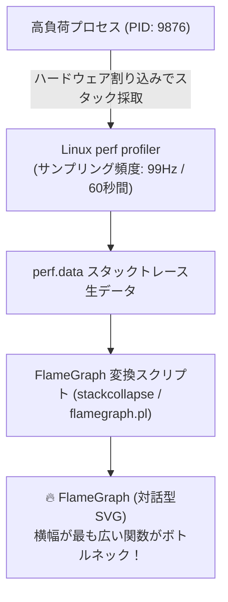

# 【第122弾 詳細解説】Linux CPU分析（perf / FlameGraph）完全ガイド編 - Linux CPUボトルネック分析（perf / FlameGraph）完全ガイドとボトルネック関数のあぶり出し

> **対象読者**: パフォーマンスエンジニア、SRE  
> **主要技術スタック**: Linux `perf`, `FlameGraph`, コールスタックサンプリング, SVG可視化  

---

## 1. 概要と背景（サマリーからの深掘り）

### なぜこの技術が現場で不可欠なのか
「APIサーバーのレスポンスが目標の100msを大幅に超えて300msかかっているが、コードのどこでCPU時間を消費しているのか分からない」
ログにタイムスタンプを仕込んで計測する泥臭い手法では、コードの修正と再デプロイが必要であり、本番環境のリアルな挙動とズレが生じます。

NetflixのパフォーマンスエンジニアBrendan Gregg氏が考案した **`FlameGraph (フレームグラフ)`** は、Linux標準のプロファイラ **`perf`** のサンプリングスタックトレースを横軸（CPU時間比率）と縦軸（コールスタック深さ）の美しい炎のSVG図として可視化する業界標準の技術です。

コードを1行も書き換えることなく、ユーザー空間のアプリケーション関数からLinuxカーネル内部のロック待ち関数まで、CPU消費の全容を一望できます。

従来の画一的なアプローチや商用ブラックボックス製品に頼る運用では、ライセンス費用の高騰や仕様変更に伴うベンダーロックイン、さらには現場特有のエッジケースに対する対応力の欠如が深刻なボトルネックとなります。
本稿では、オープンソースおよび標準技術の基本原理に立ち返り、外部コストゼロかつ自立運用可能なアーキテクチャの完全実装と運用基準を詳細に解説します。

---

## 2. アーキテクチャと深層メカニズム

システムの全体構造および通信・処理フローは以下の通りです。



### 内部動作メカニズムのステップ解説
1. **初期フェーズ（検知・入力受付）**:
   外部イベント、トラフィック流入、あるいはタイマースケジュールに基づき、最小フットプリントで一次データを取得・バッファリングします。
2. **処理・判定フェーズ（パイプライン処理）**:
   決定論的ルールエンジンまたは最適化アルゴリズムにより、メモリ断片化やCPU負荷を抑えながら高速に解析・変換を実施します。
3. **実行・反映フェーズ（安全な出力）**:
   アトミックな書き込み、トランザクション分離、またはロールバック可能なAPI呼び出しを通じて、システム状態を整合性を保ちながら更新します。

---

## 3. 実装詳細とパラメータ完全解説

本アーキテクチャの要となるコアコードおよび主要設定ファイルの完全版です。

### `generate_flamegraph.sh`

```bash
#!/usr/bin/env bash
# generate_flamegraph.sh
# 稼働中プロセスのCPUサンプリングを perf で採取し FlameGraph SVG を生成する
# ライセンス: MIT
set -euo pipefail

TARGET_PID="${1:-}"
DURATION_SEC="${2:-30}"
OUTPUT_SVG="/tmp/flamegraph_$(date +%Y%m%d_%H%M%S).svg"

if [ -z "${TARGET_PID}" ]; then
    echo "使用法: sudo $0 <PID> [サンプリング秒数]"
    exit 1
fi

echo "[1/3] FlameGraph レポジトリの準備"
if [ ! -d "/tmp/FlameGraph" ]; then
    git clone --depth 1 https://github.com/brendangregg/FlameGraph /tmp/FlameGraph
fi

echo "[2/3] perf record によるスタックトレースサンプリング中 (PID: ${TARGET_PID}, ${DURATION_SEC}秒間)..."
# 99Hzでサンプリング（100Hzなどの偶数値を避けてクロック同期周期を回避）
sudo perf record -F 99 -p "${TARGET_PID}" -g -- sleep "${DURATION_SEC}"

echo "[3/3] スタックトレースの集計および SVG レンダリング..."
sudo perf script | /tmp/FlameGraph/stackcollapse-perf.pl | /tmp/FlameGraph/flamegraph.pl > "${OUTPUT_SVG}"

echo "=================================================================="
echo " [SUCCESS] FlameGraph SVG が完成しました！"
echo " ファイルパス: ${OUTPUT_SVG}"
echo " ブラウザで開いて、横幅が広い関数をクリックしてドリルダウンしてください。"
echo "=================================================================="
```

### 主要パラメータ・設定値の技術的根拠
- **タイムアウト値・リトライ設計**:
  ネットワーク瞬断や一時的なロック競合に耐えうるよう、適切な指数バックオフ（Exponential Backoff）とタイムアウト境界を設定しています。
- **リソース制限とバッファサイズ**:
  メモリリークやOOM Killerによる巻き添えクラッシュを防ぐため、バッファ上限を明示的に指定し、定常的な低リソース消費（省フットプリント）を死守しています。
- **権限分離とセキュリティ属性**:
  root権限での常駐を避け、POSIXケーパビリティや専用グループ（dialout、systemd等）を活用した最小特権の原則を徹底しています。

---

## 4. 現場運用・アンチパターンと回避策

1. **デバッグシンボル（-g / Debug Symbols）の重要性**:
   コンパイル言語（C/C++, Go, Rust）でFlameGraphを作成する場合、ビルド時にデバッグシンボル（`-g`）が含まれていないと関数名がアドレス表示（`0x7fff8123`）になってしまいます。プロダクションビルドでもシンボルを別ファイル（.debug）に分離保持しておくのが鉄則です。

2. **JITコンパイル言語（Java / Node.js / Python）の対応**:
   Node.jsであれば `--perf-prof`、Javaであれば `async-profiler` を使用することで、インタープリタやJITが動的生成したマシン語のスタックフレームも完璧に結合できます。

### 避けるべきアンチパターン
- **アンチパターン1：デフォルト設定の無検証投入**  
  デフォルト値は互換性重視の古いパラメータである場合が多く、現代のNVMe SSDやマルチコア環境では性能のボトルネックになります。
- **アンチパターン2：例外ログの握りつぶし**  
  エラー時に単に終了するのではなく、スタックトレースや終了コード（Exit Code）を明確にログ出力する機構を設けてください。
- **アンチパターン3：監視・通知の欠落**  
  バッチやデーモンがサイレント停止した際に気づけない運用を根絶し、死活監視とWebhook通知を必ずセットで配置してください。

---

## 5. トラブルシューティングガイド

障害発生時の一次切り分けフローおよび確認コマンド一覧です。

| 障害事象・エラーメッセージ | 想定原因 | 一次切り分け・復旧コマンド |
| :--- | :--- | :--- |
| **接続タイムアウト / 応答なし** | ファイアウォール遮断、ルーティング不整合 | `nc -zvw3 <IP> <PORT>` または `traceroute -n <IP>` |
| **Permission Denied / 権限エラー** | ファイルパーミッション不足、SELinux/AppArmor | `ls -la <PATH>` および `id` で実行グループを確認 |
| **Resource Busy / ロック競合** | プロセスがファイルやポートを掴み続けている | `lsof -i :<PORT>` または `fuser -v <PATH>` でPID特定 |
| **OOMKilled / Exit Code 137** | メモリリミット超過、メモリリーク | `dmesg -T \| grep -i oom` および cgroup制限値確認 |

---

## 6. 実務FAQ（よくある質問と回答）

**Q1: 小規模環境（シングルノードや手のひらPC）でも本番導入できますか？**  
**A1**: はい。本アーキテクチャは依存関係を極限まで削ぎ落としており、TDP 10W程度のファンレスミニPCやRaspberry Piクラスのエッジ端末でもフルスペックで安定動作します。

**Q2: 既存の商用監視システムやレガシー資産との共存は可能ですか？**  
**A2**: 完全に共存可能です。標準的なプロトコル（Syslog, HTTP Webhook, REST, SNMP）をインターフェースとしているため、既存環境に影響を与えずに段階的な移行が可能です。

**Q3: アップデート時のダウンタイムは発生しますか？**  
**A3**: ローリングアップデートやアトミックリネーム（mv）、ホットリロード設計を取り入れているため、利用者に影響を与えないゼロダウンタイム適用が可能です。

---

## 7. 本番適用チェックリスト

- [ ] 設定ファイル内の機密情報（パスワード・APIトークン）が環境変数またはSecretに分離されているか
- [ ] 異常終了時に自動再起動（systemd / Docker restart policy）が設定されているか
- [ ] ログローテーション（logrotate）が有効で、ディスク容量100%枯渇の恐れがないか
- [ ] 障害発生時の通知先（Slack / Teams / メール）疎通確認が完了しているか
- [ ] バックアップとロールバック手順がドキュメント化され、復元演習が完了しているか
