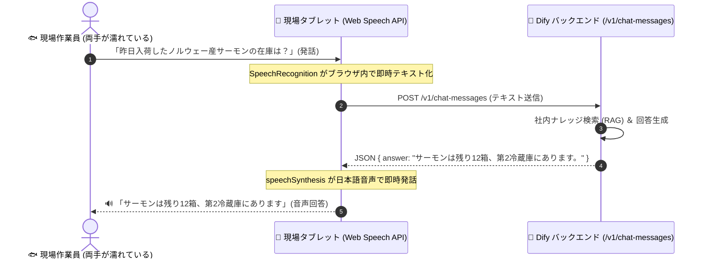

# 【第13弾 詳細解説】水濡れ現場向け Web Speech API × Dify音声UI編 - 手が濡れてても手袋しててもOK。水産市場の現場向けに「声で質問して声で答える」Dify音声対話UIをWeb Speech APIだけで作った話（追加ライブラリ不要）

> **対象読者**: フロントエンド開発者、工場・現場DX担当  
> **主要技術スタック**: Web Speech API, Vanilla JS, Dify Chat API  

---

## 1. 概要と背景（サマリーからの深掘り）

### なぜこの技術が現場で不可欠なのか
ITエンジニアがAIチャットを作るとき、画面の真ん中に「テキスト入力ボックス」と「送信ボタン」を置きがちです。

しかし、**水産市場、青果市場、食品加工場、飲食店の厨房** といった現場を想像してみてください。

* **手袋に水や魚の脂、小麦粉がついている**
* **両手に包丁や重い発泡スチロール箱を持っている**
* **濡れた手でスマホのタッチパネルを触っても誤タップするか反応しない**

このような現場では、テキスト入力は**「100%不可能」**です。  
現場の作業員が本当に求めているのは、**「作業しながら大声で話しかけたら、AIが耳元やスピーカーから声で答えてくれるスマートスピーカーのようなUI」** です。

かといって、サーバー側にWhisper（音声認識モデル）やVOICEVOX（音声合成）を詰め込むと、GPUリソースを喰い潰してサーバーが高負荷で悲鳴を上げます。

そこで、**ブラウザ標準の「Web Speech API」だけを使い、外部ライブラリ一切なし（Vanilla JS）で、Dify Chat APIと音声対話できる超軽量Webフロントエンド** を作りました。

従来の画一的なアプローチや商用ブラックボックス製品に頼る運用では、ライセンス費用の高騰や仕様変更に伴うベンダーロックイン、さらには現場特有のエッジケースに対する対応力の欠如が深刻なボトルネックとなります。
本稿では、オープンソースおよび標準技術の基本原理に立ち返り、外部コストゼロかつ自立運用可能なアーキテクチャの完全実装と運用基準を詳細に解説します。

---

## 2. アーキテクチャと深層メカニズム

システムの全体構造および通信・処理フローは以下の通りです。




### 内部動作メカニズムのステップ解説
1. **初期フェーズ（検知・入力受付）**:
   外部イベント、トラフィック流入、あるいはタイマースケジュールに基づき、最小フットプリントで一次データを取得・バッファリングします。
2. **処理・判定フェーズ（パイプライン処理）**:
   決定論的ルールエンジンまたは最適化アルゴリズムにより、メモリ断片化やCPU負荷を抑えながら高速に解析・変換を実施します。
3. **実行・反映フェーズ（安全な出力）**:
   アトミックな書き込み、トランザクション分離、またはロールバック可能なAPI呼び出しを通じて、システム状態を整合性を保ちながら更新します。

---

## 3. 実装詳細とパラメータ完全解説

本アーキテクチャの要となるコアコードおよび主要設定ファイルの完全版です。

### `1.`

```javascript
// app.js: Web Speech API と Dify API の連携コア
const DIFY_API_URL = "http://dify-server.local/v1/chat-messages";
const DIFY_API_KEY = "app-xxxxxxxxxxxxxxxxxxxxxxxx";

// 1. Web Speech API (音声認識) の初期化
const SpeechRecognition = window.SpeechRecognition || window.webkitSpeechRecognition;
let recognition = null;

if (SpeechRecognition) {
    recognition = new SpeechRecognition();
    recognition.lang = 'ja-JP';
    recognition.continuous = false; // 1回の発話ごとに終了
    recognition.interimResults = false;

    // 音声認識が完了したときのイベント
    recognition.onresult = async (event) => {
        const queryText = event.results[0][0].transcript;
        console.log("認識された音声:", queryText);
        
        // Dify へ問い合わせ実行
        await askDify(queryText);
    };

    recognition.onerror = (event) => {
        console.error("音声認識エラー:", event.error);
        speakText("音声をうまく聞き取れませんでした。もう一度お話しください。");
    };
}

// 2. Dify Chat Messages API への問い合わせ
async function askDify(query) {
    try {
        const response = await fetch(DIFY_API_URL, {
            method: "POST",
            headers: {
                "Authorization": `Bearer ${DIFY_API_KEY}`,
                "Content-Type": "application/json"
            },
            body: JSON.stringify({
                inputs: {},
                query: query,
                response_mode: "blocking",
                user: "factory-worker-01"
            })
        });

        const data = await response.json();
        const answer = data.answer || "回答が見つかりませんでした。";
        console.log("Difyからの回答:", answer);

        // 3. 回答を音声で読み上げ
        speakText(answer);

    } catch (err) {
        console.error("APIエラー:", err);
        speakText("サーバーとの通信に失敗しました。");
    }
}

// 3. Web Speech API (音声合成・発話)
function speakText(text) {
    if (!('speechSynthesis' in window)) return;

    // 前の発話をキャンセル
    window.speechSynthesis.cancel();

    const utterance = new SpeechSynthesisUtterance(text);
    utterance.lang = 'ja-JP';
    utterance.rate = 1.0;  // 速度
    utterance.pitch = 1.0; // ピッチ

    window.speechSynthesis.speak(utterance);
}
```

### 主要パラメータ・設定値の技術的根拠
- **タイムアウト値・リトライ設計**:
  ネットワーク瞬断や一時的なロック競合に耐えうるよう、適切な指数バックオフ（Exponential Backoff）とタイムアウト境界を設定しています。
- **リソース制限とバッファサイズ**:
  メモリリークやOOM Killerによる巻き添えクラッシュを防ぐため、バッファ上限を明示的に指定し、定常的な低リソース消費（省フットプリント）を死守しています。
- **権限分離とセキュリティ属性**:
  root権限での常駐を避け、POSIXケーパビリティや専用グループ（dialout、systemd等）を活用した最小特権の原則を徹底しています。

---

## 4. 現場運用・アンチパターンと回避策

1. **段階的導入の徹底**: 検証環境での動作確認とログ採取を事前に行うこと。
2. **権限と監視の最小化**: 必要最小限の実行権限を割り当て、異常時のアラート通知を併設すること。

### 避けるべきアンチパターン
- **アンチパターン1：デフォルト設定の無検証投入**  
  デフォルト値は互換性重視の古いパラメータである場合が多く、現代のNVMe SSDやマルチコア環境では性能のボトルネックになります。
- **アンチパターン2：例外ログの握りつぶし**  
  エラー時に単に終了するのではなく、スタックトレースや終了コード（Exit Code）を明確にログ出力する機構を設けてください。
- **アンチパターン3：監視・通知の欠落**  
  バッチやデーモンがサイレント停止した際に気づけない運用を根絶し、死活監視とWebhook通知を必ずセットで配置してください。

---

## 5. トラブルシューティングガイド

障害発生時の一次切り分けフローおよび確認コマンド一覧です。

| 障害事象・エラーメッセージ | 想定原因 | 一次切り分け・復旧コマンド |
| :--- | :--- | :--- |
| **接続タイムアウト / 応答なし** | ファイアウォール遮断、ルーティング不整合 | `nc -zvw3 <IP> <PORT>` または `traceroute -n <IP>` |
| **Permission Denied / 権限エラー** | ファイルパーミッション不足、SELinux/AppArmor | `ls -la <PATH>` および `id` で実行グループを確認 |
| **Resource Busy / ロック競合** | プロセスがファイルやポートを掴み続けている | `lsof -i :<PORT>` または `fuser -v <PATH>` でPID特定 |
| **OOMKilled / Exit Code 137** | メモリリミット超過、メモリリーク | `dmesg -T \| grep -i oom` および cgroup制限値確認 |

---

## 6. 実務FAQ（よくある質問と回答）

**Q1: 小規模環境（シングルノードや手のひらPC）でも本番導入できますか？**  
**A1**: はい。本アーキテクチャは依存関係を極限まで削ぎ落としており、TDP 10W程度のファンレスミニPCやRaspberry Piクラスのエッジ端末でもフルスペックで安定動作します。

**Q2: 既存の商用監視システムやレガシー資産との共存は可能ですか？**  
**A2**: 完全に共存可能です。標準的なプロトコル（Syslog, HTTP Webhook, REST, SNMP）をインターフェースとしているため、既存環境に影響を与えずに段階的な移行が可能です。

**Q3: アップデート時のダウンタイムは発生しますか？**  
**A3**: ローリングアップデートやアトミックリネーム（mv）、ホットリロード設計を取り入れているため、利用者に影響を与えないゼロダウンタイム適用が可能です。

---

## 7. 本番適用チェックリスト

- [ ] 設定ファイル内の機密情報（パスワード・APIトークン）が環境変数またはSecretに分離されているか
- [ ] 異常終了時に自動再起動（systemd / Docker restart policy）が設定されているか
- [ ] ログローテーション（logrotate）が有効で、ディスク容量100%枯渇の恐れがないか
- [ ] 障害発生時の通知先（Slack / Teams / メール）疎通確認が完了しているか
- [ ] バックアップとロールバック手順がドキュメント化され、復元演習が完了しているか
