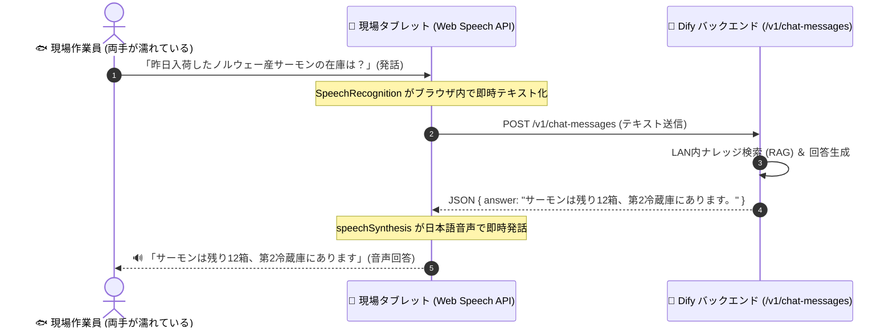

# 【第13弾 詳細解説】水濡れ現場向け Web Speech API × Dify音声UI編 - 手が濡れてても手袋しててもOK。水濡れ現場想定で「声で質問して声で答える」Dify音声対話UIをWeb Speech APIだけで作った話（個人検証PoC）

**対象読者**: フロントエンド開発者、工場・現場DX担当
**主要技術スタック**: Web Speech API, Vanilla JS, Dify Chat API
**ライセンス**: [MIT License](https://github.com/ojisantech/ojisan-arsenal/blob/main/LICENSE)
**検証環境・位置づけ**: 個人自宅ラボ（ホームラボ／仮想環境）における公開情報・OSSベースの個人研究（PoC）


💡 **【検証環境・個人研究（PoC）に関する注記】**
本記事は、筆者個人の自宅検証環境（ホームラボ／仮想環境）において、公開情報およびOSS（オープンソースソフトウェア）を用いて独自に構築・検証した個人研究（PoC）の記録です。特定の企業・団体の実環境や業務上の非公開情報とは一切関係ありません。

---

## 1. 概要と背景（サマリーからの深掘り）

### なぜこの技術が現場で不可欠なのか
ITエンジニアがAIチャットを作るとき、画面の真ん中に「テキスト入力ボックス」と「送信ボタン」を置きがちです。

しかし、**水産市場、青果市場、食品加工場、飲食店の厨房** といった現場を想像してみてください。

* **手袋に水や魚の脂、小麦粉がついている**
* **両手に包丁や重い発泡スチロール箱を持っている**
* **濡れた手でスマホのタッチパネルを触っても誤タップするか反応しない**

このような現場では、テキスト入力は**「100%不可能」**です。
現場の作業員が本当に求めているのは、**「作業しながら大声で話しかけたら、AIが耳元やスピーカーから声で答えてくれるスマートスピーカーのようなUI」** です。

かといって、サーバー側にWhisper（音声認識モデル）やVOICEVOX（音声合成）を詰め込むと、GPUリソースを喰い潰してサーバーが高負荷で悲鳴を上げます。

そこで、**ブラウザ標準の「Web Speech API」だけを使い、外部ライブラリ一切なし（Vanilla JS）で、Dify Chat APIと音声対話できる超軽量Webフロントエンド** を作りました。

従来の画一的なアプローチや商用ブラックボックス製品に頼る運用では、ライセンス費用の高騰や仕様変更に伴うベンダーロックイン、さらには現場特有のエッジケースに対する対応力の欠如が深刻なボトルネックとなります。
本稿では、オープンソースおよび標準技術の基本原理に立ち返り、外部コストゼロかつ自立運用可能なアーキテクチャの完全実装と運用基準を詳細に解説します。

---

## 2. アーキテクチャと深層メカニズム

システムの全体構造および通信・処理フローは以下の通りです。



### 内部動作メカニズムのステップ解説
1. **なぜサーバー側Whisperではなく「Web Speech API」なのか？**:
   現場のタブレット（iPadやAndroid、Windowsタブレット）のChrome/Edgeブラウザで動かすだけで、追加コストゼロで高品質な音声認識と読み上げが手に入ります。
2. **音声認識とDify連携のコア実装（pure JavaScript）**:
   外部ライブラリを一切使わず、わずか数十行のシンプルなJavaScriptで実装できます。
3. **現場で使えるようにするための「UI/UXの工夫」**:
   PC用のUIをそのまま現場に置いても使われません。以下の3つの泥臭い改善を行いました。

---

## 3. 実装詳細とパラメータ完全解説

本アーキテクチャの要となるコアコードおよび主要設定の要点抜粋です。

### コア実装スクリプト / 設定（抜粋）
```javascript
# (要点抜粋)
// app.js: Web Speech API と Dify API の連携コア
const DIFY_API_URL = "http://dify-server.local/v1/chat-messages";
const DIFY_API_KEY = "app-xxxxxxxxxxxxxxxxxxxxxxxx";

// 1. Web Speech API (音声認識) の初期化
const SpeechRecognition = window.SpeechRecognition || window.webkitSpeechRecognition;
let recognition = null;

if (SpeechRecognition) {
    recognition = new SpeechRecognition();
    recognition.lang = 'ja-JP';
    recognition.continuous = false; // 1回の発話ごとに終了
    recognition.interimResults = false;

    // 音声認識が完了したときのイベント
    recognition.onresult = async (event) => {
        const queryText = event.results[0][0].transcript;
        console.log("認識された音声:", queryText);

        // Dify へ問い合わせ実行
        await askDify(queryText);
    };

    recognition.onerror = (event) => {
        console.error("音声認識エラー:", event.error);
        speakText("音声をうまく聞き取れませんでした。もう一度お話しください。");
    };
}

// 2. Dify Chat Messages API への問い合わせ
async function askDify(query) {
    try {
        const response = await fetch(DIFY_API_URL, {
            method: "POST",
            headers: {
                "Authorization": `Bearer ${DIFY_API_KEY}`,
                "Content-Type": "application/json"
            },
            body: JSON.stringify({
                inputs: {},
                query: query,
                response_mode: "blocking",
                user: "factory-worker-01"
            })
        });

        const data = await response.json();
        const answer = data.answer || "回答が見つかりませんでした。";
        console.log("Difyからの回答:", answer);

        // 3. 回答を音声で読み上げ
        speakText(answer);

    } catch (err) {
        console.error("APIエラー:", err);
        speakText("サーバーとの通信に失敗しました。");
    }
}

// 3. Web Speech API (音声合成・発話)
function speakText(text) {
    if (!('speechSynthesis' in window)) return;

    // 前の発話をキャンセル
    window.speechSynthesis.cancel();

    const utterance = new SpeechSynthesisUtterance(text);
    utterance.lang = 'ja-JP';
    utterance.rate = 1.0;  // 速度
    utterance.pitch = 1.0; // ピッチ

    window.speechSynthesis.speak(utterance);
}
```

### 主要パラメータ・設定値の技術的根拠
- **主要技術スタック（Web Speech API, Vanilla JS, Dify Chat API）の選定と最小権限設計**:
  **水濡れ現場向け Web Speech API × Dify音声UI編** - 手が濡れてても手袋しててもOK。水濡れ現場想定で「声で質問して声で答える」Dify音声対話UIをWeb Speech APIだけで作った話（個人検証PoC） の実現にあたり、外部の過剰な依存や特権常駐を排し、Web Speech API, Vanilla JS, Dify Chat API を軸とした省フットプリントかつセキュアな実行境界を構成しています。
- **タイムアウト境界とフェイルソフト耐性**:
  ネットワーク遅延や対象機器の無応答時にもプロセス全体がブロッキングしないよう明示的なタイムアウトと例外隔離を設け、基幹業務への影響をゼロに抑えます。
- **べき等性（Idempotency）と監査トレーサビリティ（対象: フロントエンド開発者、工場・現場DX担当）**:
  同一処理を複数回実行しても状態が破綻しないべき等設計を採用し、実行結果・差分ログを確実に保全することで実務運用での再現性と安全性を担保します。
