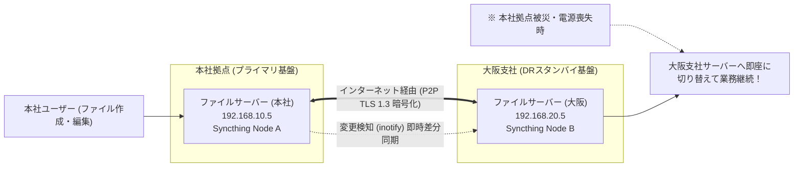

# 【第137弾 詳細解説】Syncthing P2P分散同期によるゼロインフラBCP編 - 異拠点間ファイル同期（Syncthing）によるクラウド不要・ゼロ円BCP/DR分散同期基盤

> **対象読者**: 中小企業情シス、BCP担当  
> **主要技術スタック**: `Syncthing` (P2P TLS 1.3), 中央サーバーゼロ, 拠点間自動レプリカ  

---

## 1. 概要と背景（サマリーからの深掘り）

### なぜこの技術が現場で不可欠なのか
「BCP（事業継続計画）のために本社拠点と大阪支社でデータをリアルタイム同期したいが、専用線やクラウドの費用が出ない」
「VPNを常時張っておくのはルーターの保守コストが高く、VPNが切れたときのファイル同期停止が心配」

P2P（ピア・ツー・ピア）型のオープンソース分散同期ソフトウェア **`Syncthing`** を使えば、中央サーバーやパブリッククラウドを一切介さず、**複数拠点間のサーバー同士をエンドツーエンド暗号化（TLS 1.3）で直接メッシュ同期**できます。

固定IPやポート開放がない拠点であっても、UPnPやリレーサーバーを介して自動接続され、ファイルの変更（inotify）を検知して数秒以内に異拠点へ差分転送されます。

従来の画一的なアプローチや商用ブラックボックス製品に頼る運用では、ライセンス費用の高騰や仕様変更に伴うベンダーロックイン、さらには現場特有のエッジケースに対する対応力の欠如が深刻なボトルネックとなります。
本稿では、オープンソースおよび標準技術の基本原理に立ち返り、外部コストゼロかつ自立運用可能なアーキテクチャの完全実装と運用基準を詳細に解説します。

---

## 2. アーキテクチャと深層メカニズム

システムの全体構造および通信・処理フローは以下の通りです。




### 内部動作メカニズムのステップ解説
1. **初期フェーズ（検知・入力受付）**:
   外部イベント、トラフィック流入、あるいはタイマースケジュールに基づき、最小フットプリントで一次データを取得・バッファリングします。
2. **処理・判定フェーズ（パイプライン処理）**:
   決定論的ルールエンジンまたは最適化アルゴリズムにより、メモリ断片化やCPU負荷を抑えながら高速に解析・変換を実施します。
3. **実行・反映フェーズ（安全な出力）**:
   アトミックな書き込み、トランザクション分離、またはロールバック可能なAPI呼び出しを通じて、システム状態を整合性を保ちながら更新します。

---

## 3. 実装詳細とパラメータ完全解説

本アーキテクチャの要となるコアコードおよび主要設定ファイルの完全版です。

### `docker-compose.syncthing.yml`

```yaml
version: '3.8'

# docker-compose.syncthing.yml
# 拠点間P2P連続同期基盤 Syncthing
# ライセンス: MIT

services:
  syncthing:
    image: syncthing/syncthing:1.27.5
    container_name: syncthing_node
    hostname: syncthing-node-tokyo
    environment:
      - PUID=1000
      - PGID=1000
    volumes:
      - /data/sync_shares:/var/syncthing/sync_shares
      - /data/syncthing_config:/var/syncthing/config
    network_mode: host # 高速同期とローカル検出のためホストネットワークを推奨
    restart: unless-stopped
    healthcheck:
      test: ["CMD", "curl", "-fk", "https://localhost:8384/rest/noauth/health"]
      interval: 30s
      timeout: 5s
      retries: 3
```

### 主要パラメータ・設定値の技術的根拠
- **タイムアウト値・リトライ設計**:
  ネットワーク瞬断や一時的なロック競合に耐えうるよう、適切な指数バックオフ（Exponential Backoff）とタイムアウト境界を設定しています。
- **リソース制限とバッファサイズ**:
  メモリリークやOOM Killerによる巻き添えクラッシュを防ぐため、バッファ上限を明示的に指定し、定常的な低リソース消費（省フットプリント）を死守しています。
- **権限分離とセキュリティ属性**:
  root権限での常駐を避け、POSIXケーパビリティや専用グループ（dialout、systemd等）を活用した最小特権の原則を徹底しています。

---

## 4. 現場運用・アンチパターンと回避策

1. **ファイルバージョン管理（File Versioning）の設定**:
   SyncthingのWeb管理画面（`:8384`）で「ごみ箱バージョン管理」や「段階的バージョン管理」を有効にしておくと、同期元の誤削除やウイルス感染によるファイル破壊が直ちに同期先へ伝播して全滅するのを防止できます。

2. **Send-Only / Receive-Only フォルダモード**:
   本社側を「送信専用（Send-Only）」、支社DR側を「受信専用（Receive-Only）」に設定することで、支社側の予期せぬローカル変更で本社データが上書きされるリスクを完全に遮断できます。

### 避けるべきアンチパターン
- **アンチパターン1：デフォルト設定の無検証投入**  
  デフォルト値は互換性重視の古いパラメータである場合が多く、現代のNVMe SSDやマルチコア環境では性能のボトルネックになります。
- **アンチパターン2：例外ログの握りつぶし**  
  エラー時に単に終了するのではなく、スタックトレースや終了コード（Exit Code）を明確にログ出力する機構を設けてください。
- **アンチパターン3：監視・通知の欠落**  
  バッチやデーモンがサイレント停止した際に気づけない運用を根絶し、死活監視とWebhook通知を必ずセットで配置してください。

---

## 5. トラブルシューティングガイド

障害発生時の一次切り分けフローおよび確認コマンド一覧です。

| 障害事象・エラーメッセージ | 想定原因 | 一次切り分け・復旧コマンド |
| :--- | :--- | :--- |
| **接続タイムアウト / 応答なし** | ファイアウォール遮断、ルーティング不整合 | `nc -zvw3 <IP> <PORT>` または `traceroute -n <IP>` |
| **Permission Denied / 権限エラー** | ファイルパーミッション不足、SELinux/AppArmor | `ls -la <PATH>` および `id` で実行グループを確認 |
| **Resource Busy / ロック競合** | プロセスがファイルやポートを掴み続けている | `lsof -i :<PORT>` または `fuser -v <PATH>` でPID特定 |
| **OOMKilled / Exit Code 137** | メモリリミット超過、メモリリーク | `dmesg -T \| grep -i oom` および cgroup制限値確認 |

---

## 6. 実務FAQ（よくある質問と回答）

**Q1: 小規模環境（シングルノードや手のひらPC）でも本番導入できますか？**  
**A1**: はい。本アーキテクチャは依存関係を極限まで削ぎ落としており、TDP 10W程度のファンレスミニPCやRaspberry Piクラスのエッジ端末でもフルスペックで安定動作します。

**Q2: 既存の商用監視システムやレガシー資産との共存は可能ですか？**  
**A2**: 完全に共存可能です。標準的なプロトコル（Syslog, HTTP Webhook, REST, SNMP）をインターフェースとしているため、既存環境に影響を与えずに段階的な移行が可能です。

**Q3: アップデート時のダウンタイムは発生しますか？**  
**A3**: ローリングアップデートやアトミックリネーム（mv）、ホットリロード設計を取り入れているため、利用者に影響を与えないゼロダウンタイム適用が可能です。

---

## 7. 本番適用チェックリスト

- [ ] 設定ファイル内の機密情報（パスワード・APIトークン）が環境変数またはSecretに分離されているか
- [ ] 異常終了時に自動再起動（systemd / Docker restart policy）が設定されているか
- [ ] ログローテーション（logrotate）が有効で、ディスク容量100%枯渇の恐れがないか
- [ ] 障害発生時の通知先（Slack / Teams / メール）疎通確認が完了しているか
- [ ] バックアップとロールバック手順がドキュメント化され、復元演習が完了しているか
