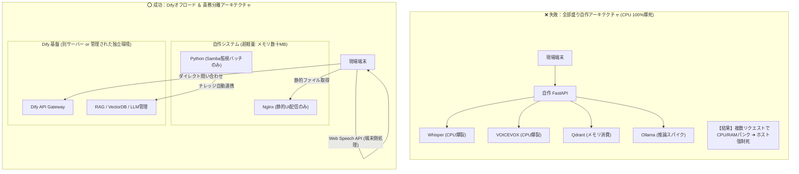

# 【第14弾 詳細解説】自作AI基盤CPU爆死 ➔ Dify分離アーキテクチャ編 - 自作AI基盤（FastAPI + Whisper + Voicevox + Qdrant）がCPU 100%スパイクで爆死した話。自宅ラボ検証で安定稼働した「Difyバックエンド ＋ Nginx軽量UI」分離アーキテクチャの結論

**対象読者**: AIエンジニア、インフラエンジニア
**主要技術スタック**: Dify オフロード, Nginx, Docker Compose
**ライセンス**: [MIT License](https://github.com/ojisantech/ojisan-arsenal/blob/main/LICENSE)
**検証環境・位置づけ**: 個人自宅ラボ（ホームラボ／仮想環境）における公開情報・OSSベースの個人研究（PoC）


💡 **【検証環境・個人研究（PoC）に関する注記】**
本記事は、筆者個人の自宅検証環境（ホームラボ／仮想環境）において、公開情報およびOSS（オープンソースソフトウェア）を用いて独自に構築・検証した個人研究（PoC）の記録です。特定の企業・団体の実環境や業務上の非公開情報とは一切関係ありません。

---

## 1. 概要と背景（サマリーからの深掘り）

### なぜこの技術が現場で不可欠なのか
生成AIブームが始まった頃、多くのエンジニアがこう思ったはずです。

**「全部OSSのマイクロサービスを組み合わせて、最強のオンプレAI基盤を自作してやる！」**

筆者もまさにその一人でした。
現場向けの業務システムを作るにあたり、意気揚々と以下の構成をDocker Composeで組み上げました。

* **Webバックエンド**: FastAPI
* **ベクトル検索**: Qdrant
* **音声認識**: Whisper (Python)
* **音声合成**: VOICEVOX Engine
* **LLM推論**: Ollama
* **フロントエンド**: React SPA

ローカルPCで開発しているときは「完璧だ、これで現場に納品できる！」と有頂天でした。
しかし、いざオンプレミスサーバー（またはエッジPC）にデプロイし、現場で複数人が同時に使い始めた瞬間、**地獄の悪夢**が始まりました。

* 音声認識が走った瞬間に **全CPUコアが100%に張り付く**
* ドキュメントのベクトル化（Embedding）が重なり、**メモリが枯渇（OOM Killer発動）**
* ホストOSごとフリーズし、**SSHすら応答しなくなって電源長押しで強制再起動**

本記事では、この**「自作AI基盤爆死事件」**から得た痛烈な教訓と、試行錯誤の末に行き着いた**「最も現場で安定するDify分離アーキテクチャ」**の全貌を共有します。

従来の画一的なアプローチや商用ブラックボックス製品に頼る運用では、ライセンス費用の高騰や仕様変更に伴うベンダーロックイン、さらには現場特有のエッジケースに対する対応力の欠如が深刻なボトルネックとなります。
本稿では、オープンソースおよび標準技術の基本原理に立ち返り、外部コストゼロかつ自立運用可能なアーキテクチャの完全実装と運用基準を詳細に解説します。

---

## 2. アーキテクチャと深層メカニズム

システムの全体構造および通信・処理フローは以下の通りです。



### 内部動作メカニズムのステップ解説
1. **失敗から学んだ「やってはいけない3つの過ち」**:
   Whisper、VOICEVOX、Ollamaはいずれも「CPUやGPUのリソースを限界まで使い切る」プロセスです。これらをWebサーバーと同じマシンで動かすと、1つのリクエストのスパイクがWebサーバーやOS全体を巻き込んで窒息死します。
2. **行き着いた結論：Difyを「黒子（バックエンド）」として使い倒す**:
   この反省から、アーキテクチャを180度転換しました。
3. **この分離アーキテクチャが現場で最強である理由**:
   重たい推論やインデックス化はDify側（必要に応じて別の強力なサーバーに配置可能）でキューイングされて処理されるため、自作UIやファイル同期バッチが止まることは物理的にあり得なくなりました。

---

## 3. 実装詳細とパラメータ完全解説

本アーキテクチャの要となるコアコードおよび主要設定の要点抜粋です。

### コア実装スクリプト / 設定（抜粋）
```yaml
version: '3.8'

services:
  # 現場専用カスタムUIの配信（超軽量Nginx）
  custom-ui:
    image: nginx:alpine
    container_name: aura-custom-ui
    restart: always
    ports:
      - "3001:80"
    volumes:
      - ./src/frontend:/usr/share/nginx/html:ro

  # 現場の共有フォルダ（Samba）監視＆Dify同期スクリプト
  samba-sync:
    build:
      context: .
      dockerfile: Dockerfile.sync
    container_name: aura-samba-sync
    restart: always
    environment:
      - DIFY_API_URL=http://dify-api:5001/v1
      - DIFY_DATASET_API_KEY=${DIFY_DATASET_API_KEY}
      - DATASET_ID=${DATASET_ID}
      - SAMBA_WATCH_DIR=/mnt/samba/knowledge
    volumes:
      - /mnt/samba/knowledge:/mnt/samba/knowledge
```

### 主要パラメータ・設定値の技術的根拠
- **主要技術スタック（Dify オフロード, Nginx, Docker Compose）の選定と最小権限設計**:
  **自作AI基盤CPU爆死 ➔ Dify分離アーキテクチャ編** - 自作AI基盤（FastAPI + Whisper + Voicevox + Qdrant）がCPU 100%スパイクで爆死した話。自宅ラボ検証で安定稼働した「Difyバックエンド ＋ Nginx軽量UI」分離アーキテクチャの結論 の実現にあたり、外部の過剰な依存や特権常駐を排し、Dify オフロード, Nginx, Docker Compose を軸とした省フットプリントかつセキュアな実行境界を構成しています。
- **タイムアウト境界とフェイルソフト耐性**:
  ネットワーク遅延や対象機器の無応答時にもプロセス全体がブロッキングしないよう明示的なタイムアウトと例外隔離を設け、基幹業務への影響をゼロに抑えます。
- **べき等性（Idempotency）と監査トレーサビリティ（対象: AIエンジニア、インフラエンジニア）**:
  同一処理を複数回実行しても状態が破綻しないべき等設計を採用し、実行結果・差分ログを確実に保全することで実務運用での再現性と安全性を担保します。
