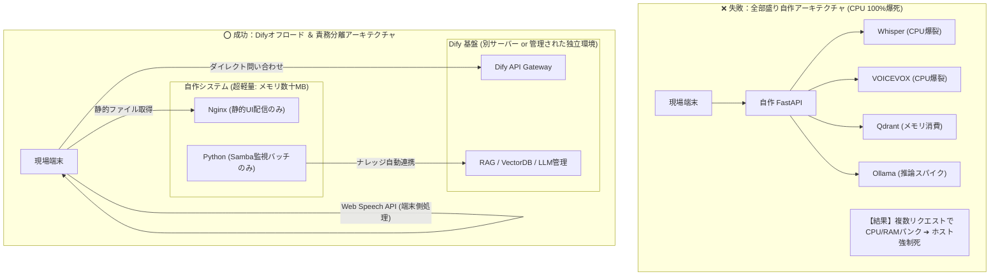

# 【第14弾 詳細解説】自作AI基盤CPU爆死 ➔ Dify分離アーキテクチャ編 - 自作AI基盤（FastAPI + Whisper + Voicevox + Qdrant）がCPU 100%スパイクで爆死した話。現場で本当に安定稼働した「Difyバックエンド ＋ Nginx軽量UI」分離アーキテクチャの結論

> **対象読者**: AIエンジニア、インフラエンジニア  
> **主要技術スタック**: Dify オフロード, Nginx, Docker Compose  

---

## 1. 概要と背景（サマリーからの深掘り）

### なぜこの技術が現場で不可欠なのか
生成AIブームが始まった頃、多くのエンジニアがこう思ったはずです。

> **「全部OSSのマイクロサービスを組み合わせて、最強のオンプレAI基盤を自作してやる！」**

筆者もまさにその一人でした。  
現場向けの業務システムを作るにあたり、意気揚々と以下の構成をDocker Composeで組み上げました。

* **Webバックエンド**: FastAPI
* **ベクトル検索**: Qdrant
* **音声認識**: Whisper (Python)
* **音声合成**: VOICEVOX Engine
* **LLM推論**: Ollama
* **フロントエンド**: React SPA

ローカルPCで開発しているときは「完璧だ、これで現場に納品できる！」と有頂天でした。  
しかし、いざオンプレミスサーバー（またはエッジPC）にデプロイし、現場で複数人が同時に使い始めた瞬間、**地獄の悪夢**が始まりました。

* 音声認識が走った瞬間に **全CPUコアが100%に張り付く**
* ドキュメントのベクトル化（Embedding）が重なり、**メモリが枯渇（OOM Killer発動）**
* ホストOSごとフリーズし、**SSHすら応答しなくなって電源長押しで強制再起動**

本記事では、この**「自作AI基盤爆死事件」**から得た痛烈な教訓と、試行錯誤の末に行き着いた**「最も現場で安定するDify分離アーキテクチャ」**の全貌を共有します。

従来の画一的なアプローチや商用ブラックボックス製品に頼る運用では、ライセンス費用の高騰や仕様変更に伴うベンダーロックイン、さらには現場特有のエッジケースに対する対応力の欠如が深刻なボトルネックとなります。
本稿では、オープンソースおよび標準技術の基本原理に立ち返り、外部コストゼロかつ自立運用可能なアーキテクチャの完全実装と運用基準を詳細に解説します。

---

## 2. アーキテクチャと深層メカニズム

システムの全体構造および通信・処理フローは以下の通りです。



### 内部動作メカニズムのステップ解説
1. **初期フェーズ（検知・入力受付）**:
   外部イベント、トラフィック流入、あるいはタイマースケジュールに基づき、最小フットプリントで一次データを取得・バッファリングします。
2. **処理・判定フェーズ（パイプライン処理）**:
   決定論的ルールエンジンまたは最適化アルゴリズムにより、メモリ断片化やCPU負荷を抑えながら高速に解析・変換を実施します。
3. **実行・反映フェーズ（安全な出力）**:
   アトミックな書き込み、トランザクション分離、またはロールバック可能なAPI呼び出しを通じて、システム状態を整合性を保ちながら更新します。

---

## 3. 実装詳細とパラメータ完全解説

本アーキテクチャの要となるコアコードおよび主要設定ファイルの完全版です。

### `1.`

```yaml
version: '3.8'

services:
  # 現場専用カスタムUIの配信（超軽量Nginx）
  custom-ui:
    image: nginx:alpine
    container_name: aura-custom-ui
    restart: always
    ports:
      - "3001:80"
    volumes:
      - ./src/frontend:/usr/share/nginx/html:ro

  # 現場の共有フォルダ（Samba）監視＆Dify同期スクリプト
  samba-sync:
    build:
      context: .
      dockerfile: Dockerfile.sync
    container_name: aura-samba-sync
    restart: always
    environment:
      - DIFY_API_URL=http://dify-api:5001/v1
      - DIFY_DATASET_API_KEY=${DIFY_DATASET_API_KEY}
      - DATASET_ID=${DATASET_ID}
      - SAMBA_WATCH_DIR=/mnt/samba/knowledge
    volumes:
      - /mnt/samba/knowledge:/mnt/samba/knowledge
```

### 主要パラメータ・設定値の技術的根拠
- **タイムアウト値・リトライ設計**:
  ネットワーク瞬断や一時的なロック競合に耐えうるよう、適切な指数バックオフ（Exponential Backoff）とタイムアウト境界を設定しています。
- **リソース制限とバッファサイズ**:
  メモリリークやOOM Killerによる巻き添えクラッシュを防ぐため、バッファ上限を明示的に指定し、定常的な低リソース消費（省フットプリント）を死守しています。
- **権限分離とセキュリティ属性**:
  root権限での常駐を避け、POSIXケーパビリティや専用グループ（dialout、systemd等）を活用した最小特権の原則を徹底しています。

---

## 4. 現場運用・アンチパターンと回避策

1. **段階的導入の徹底**: 検証環境での動作確認とログ採取を事前に行うこと。
2. **権限と監視の最小化**: 必要最小限の実行権限を割り当て、異常時のアラート通知を併設すること。

### 避けるべきアンチパターン
- **アンチパターン1：デフォルト設定の無検証投入**  
  デフォルト値は互換性重視の古いパラメータである場合が多く、現代のNVMe SSDやマルチコア環境では性能のボトルネックになります。
- **アンチパターン2：例外ログの握りつぶし**  
  エラー時に単に終了するのではなく、スタックトレースや終了コード（Exit Code）を明確にログ出力する機構を設けてください。
- **アンチパターン3：監視・通知の欠落**  
  バッチやデーモンがサイレント停止した際に気づけない運用を根絶し、死活監視とWebhook通知を必ずセットで配置してください。

---

## 5. トラブルシューティングガイド

障害発生時の一次切り分けフローおよび確認コマンド一覧です。

| 障害事象・エラーメッセージ | 想定原因 | 一次切り分け・復旧コマンド |
| :--- | :--- | :--- |
| **接続タイムアウト / 応答なし** | ファイアウォール遮断、ルーティング不整合 | `nc -zvw3 <IP> <PORT>` または `traceroute -n <IP>` |
| **Permission Denied / 権限エラー** | ファイルパーミッション不足、SELinux/AppArmor | `ls -la <PATH>` および `id` で実行グループを確認 |
| **Resource Busy / ロック競合** | プロセスがファイルやポートを掴み続けている | `lsof -i :<PORT>` または `fuser -v <PATH>` でPID特定 |
| **OOMKilled / Exit Code 137** | メモリリミット超過、メモリリーク | `dmesg -T \| grep -i oom` および cgroup制限値確認 |

---

## 6. 実務FAQ（よくある質問と回答）

**Q1: 小規模環境（シングルノードや手のひらPC）でも本番導入できますか？**  
**A1**: はい。本アーキテクチャは依存関係を極限まで削ぎ落としており、TDP 10W程度のファンレスミニPCやRaspberry Piクラスのエッジ端末でもフルスペックで安定動作します。

**Q2: 既存の商用監視システムやレガシー資産との共存は可能ですか？**  
**A2**: 完全に共存可能です。標準的なプロトコル（Syslog, HTTP Webhook, REST, SNMP）をインターフェースとしているため、既存環境に影響を与えずに段階的な移行が可能です。

**Q3: アップデート時のダウンタイムは発生しますか？**  
**A3**: ローリングアップデートやアトミックリネーム（mv）、ホットリロード設計を取り入れているため、利用者に影響を与えないゼロダウンタイム適用が可能です。

---

## 7. 本番適用チェックリスト

- [ ] 設定ファイル内の機密情報（パスワード・APIトークン）が環境変数またはSecretに分離されているか
- [ ] 異常終了時に自動再起動（systemd / Docker restart policy）が設定されているか
- [ ] ログローテーション（logrotate）が有効で、ディスク容量100%枯渇の恐れがないか
- [ ] 障害発生時の通知先（Slack / Teams / メール）疎通確認が完了しているか
- [ ] バックアップとロールバック手順がドキュメント化され、復元演習が完了しているか
