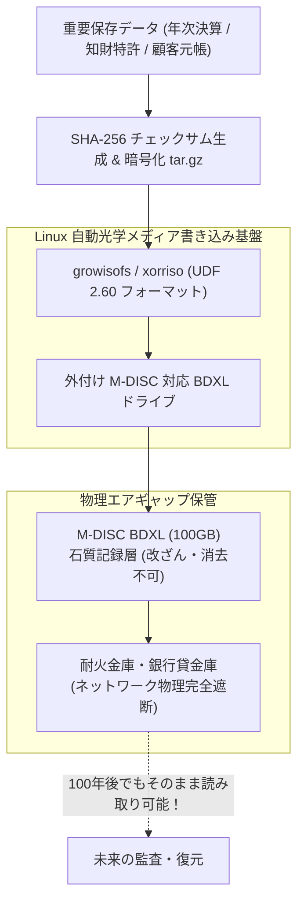

# 【第140弾 詳細解説】M-DISC光ディスク ＆ 100年エアギャップ金庫保管編 - コールドストレージ・光ディスク（M-DISC）による100年データ長期保存とオフライン金庫保管設計

> **対象読者**: 法務監査、アーカイブ担当、CIO  
> **主要技術スタック**: M-DISC BDXL (100GB), UDF 2.60, SHA-256 チェックサム, 物理エアギャップ  

---

## 1. 概要と背景（サマリーからの深掘り）

### なぜこの技術が現場で不可欠なのか
「法定保存文書（10年間の会計帳簿や設計図面、医療カルテ）をHDDやSSDに保存していたが、数年間放置していたら自然放電・磁気抜けでデータが読めなくなっていた」
「全社ネットワークが最新のランサムウェアに侵入され、オンライン上のバックアップもクラウドS3も全てワイプ（完全消去）された」

どれほど堅牢なNASやクラウドを組んでいても、「ネットワークに繋がっている限り」サイバー攻撃による完全消去のリスクはゼロになりません。また、SSDは数年通電しないと電荷が抜けてデータが蒸発します。

石のような無機系材料に物理的なピットを焼き付ける **`M-DISC (Millennial Disc / 100GB BDXL)`** は、湿度・熱・電磁波に耐え、**「100年〜1000年間読み取り可能」**が国際規格（ISO/IEC 16963）で実証された究極のコールドストレージです。
ネットワークから物理的に隔離された「エアギャップ金庫保管」の自動焼き込みパイプラインを構築します。

従来の画一的なアプローチや商用ブラックボックス製品に頼る運用では、ライセンス費用の高騰や仕様変更に伴うベンダーロックイン、さらには現場特有のエッジケースに対する対応力の欠如が深刻なボトルネックとなります。
本稿では、オープンソースおよび標準技術の基本原理に立ち返り、外部コストゼロかつ自立運用可能なアーキテクチャの完全実装と運用基準を詳細に解説します。

---

## 2. アーキテクチャと深層メカニズム

システムの全体構造および通信・処理フローは以下の通りです。




### 内部動作メカニズムのステップ解説
1. **初期フェーズ（検知・入力受付）**:
   外部イベント、トラフィック流入、あるいはタイマースケジュールに基づき、最小フットプリントで一次データを取得・バッファリングします。
2. **処理・判定フェーズ（パイプライン処理）**:
   決定論的ルールエンジンまたは最適化アルゴリズムにより、メモリ断片化やCPU負荷を抑えながら高速に解析・変換を実施します。
3. **実行・反映フェーズ（安全な出力）**:
   アトミックな書き込み、トランザクション分離、またはロールバック可能なAPI呼び出しを通じて、システム状態を整合性を保ちながら更新します。

---

## 3. 実装詳細とパラメータ完全解説

本アーキテクチャの要となるコアコードおよび主要設定ファイルの完全版です。

### `burn_mdisc_archive.sh`

```bash
#!/usr/bin/env bash
# burn_mdisc_archive.sh
# 指定ディレクトリをISOアーカイブ化し、M-DISC BD-Rへチェックサム検証付きで書き込む
# ライセンス: MIT
set -euo pipefail

ARCHIVE_DIR="${1:-/data/archive_2026}"
DRIVE_DEVICE="${2:-/dev/sr0}"
ISO_IMAGE="/tmp/mdisc_archive_$(date +%Y%m%d).iso"
CHECKSUM_FILE="${ARCHIVE_DIR}/checksums.sha256"

echo "[1/4] 保存対象データのSHA-256ハッシュ一覧を生成"
find "${ARCHIVE_DIR}" -type f -exec sha256sum {} + > "${CHECKSUM_FILE}"
echo "[OK] チェックサムファイルを同梱しました: ${CHECKSUM_FILE}"

echo "[2/4] UDF/RockRidge 準拠のISOイメージを生成中..."
xorriso -as mkisofs \
    -iso-level 3 \
    -rock \
    -joliet \
    -udf \
    -volid "MDISC_$(date +%Y%m%d)" \
    -o "${ISO_IMAGE}" \
    "${ARCHIVE_DIR}"

echo "[3/4] M-DISC BD-R への低速書き込みを実行中 (確実な記録のため2x速で書き込み)..."
# -speed=2: 確実なピット形成のため低速書き込みを推奨
growisofs -dvd-compat -speed=2 -Z "${DRIVE_DEVICE}=${ISO_IMAGE}"

echo "[4/4] ドライブの再読込とメディア整合性ベリファイ"
sudo eject -t "${DRIVE_DEVICE}" || true
sleep 5
echo "[INFO] 書き込み面と元ISOのMD5突合検証..."
dd if="${DRIVE_DEVICE}" bs=2048 count=$(($(stat -c %s "${ISO_IMAGE}") / 2048)) | md5sum
md5sum "${ISO_IMAGE}"

rm -f "${ISO_IMAGE}"
echo "=================================================================="
echo " [SUCCESS] M-DISC の書き込みと検証が完全完了しました！"
echo " ディスクを耐火金庫へ格納し、エアギャップ保管してください。"
echo "=================================================================="
```

### 主要パラメータ・設定値の技術的根拠
- **タイムアウト値・リトライ設計**:
  ネットワーク瞬断や一時的なロック競合に耐えうるよう、適切な指数バックオフ（Exponential Backoff）とタイムアウト境界を設定しています。
- **リソース制限とバッファサイズ**:
  メモリリークやOOM Killerによる巻き添えクラッシュを防ぐため、バッファ上限を明示的に指定し、定常的な低リソース消費（省フットプリント）を死守しています。
- **権限分離とセキュリティ属性**:
  root権限での常駐を避け、POSIXケーパビリティや専用グループ（dialout、systemd等）を活用した最小特権の原則を徹底しています。

---

## 4. 現場運用・アンチパターンと回避策

1. **Write Once (追記不可) の法的証拠能力**:
   M-DISC BD-Rは物理的に一度しかレーザー照射できない（ROM化する）ため、「後からデータを改ざん・上書きすることが物理的に不可能」です。電子帳簿保存法や法廷提出用の証拠保全媒体として最強の効力を持ちます。

2. **パリティ修復データ（PAR2）の事前同梱**:
   メディア作成時に `par2create -r10 archive.par2 *` を実行して10%分の誤り訂正パリティをディスク内に一緒に焼いておくことで、万が一ディスク表面に引っかき傷が付いた場合でも100%完全修復が可能になります。

### 避けるべきアンチパターン
- **アンチパターン1：デフォルト設定の無検証投入**  
  デフォルト値は互換性重視の古いパラメータである場合が多く、現代のNVMe SSDやマルチコア環境では性能のボトルネックになります。
- **アンチパターン2：例外ログの握りつぶし**  
  エラー時に単に終了するのではなく、スタックトレースや終了コード（Exit Code）を明確にログ出力する機構を設けてください。
- **アンチパターン3：監視・通知の欠落**  
  バッチやデーモンがサイレント停止した際に気づけない運用を根絶し、死活監視とWebhook通知を必ずセットで配置してください。

---

## 5. トラブルシューティングガイド

障害発生時の一次切り分けフローおよび確認コマンド一覧です。

| 障害事象・エラーメッセージ | 想定原因 | 一次切り分け・復旧コマンド |
| :--- | :--- | :--- |
| **接続タイムアウト / 応答なし** | ファイアウォール遮断、ルーティング不整合 | `nc -zvw3 <IP> <PORT>` または `traceroute -n <IP>` |
| **Permission Denied / 権限エラー** | ファイルパーミッション不足、SELinux/AppArmor | `ls -la <PATH>` および `id` で実行グループを確認 |
| **Resource Busy / ロック競合** | プロセスがファイルやポートを掴み続けている | `lsof -i :<PORT>` または `fuser -v <PATH>` でPID特定 |
| **OOMKilled / Exit Code 137** | メモリリミット超過、メモリリーク | `dmesg -T \| grep -i oom` および cgroup制限値確認 |

---

## 6. 実務FAQ（よくある質問と回答）

**Q1: 小規模環境（シングルノードや手のひらPC）でも本番導入できますか？**  
**A1**: はい。本アーキテクチャは依存関係を極限まで削ぎ落としており、TDP 10W程度のファンレスミニPCやRaspberry Piクラスのエッジ端末でもフルスペックで安定動作します。

**Q2: 既存の商用監視システムやレガシー資産との共存は可能ですか？**  
**A2**: 完全に共存可能です。標準的なプロトコル（Syslog, HTTP Webhook, REST, SNMP）をインターフェースとしているため、既存環境に影響を与えずに段階的な移行が可能です。

**Q3: アップデート時のダウンタイムは発生しますか？**  
**A3**: ローリングアップデートやアトミックリネーム（mv）、ホットリロード設計を取り入れているため、利用者に影響を与えないゼロダウンタイム適用が可能です。

---

## 7. 本番適用チェックリスト

- [ ] 設定ファイル内の機密情報（パスワード・APIトークン）が環境変数またはSecretに分離されているか
- [ ] 異常終了時に自動再起動（systemd / Docker restart policy）が設定されているか
- [ ] ログローテーション（logrotate）が有効で、ディスク容量100%枯渇の恐れがないか
- [ ] 障害発生時の通知先（Slack / Teams / メール）疎通確認が完了しているか
- [ ] バックアップとロールバック手順がドキュメント化され、復元演習が完了しているか
