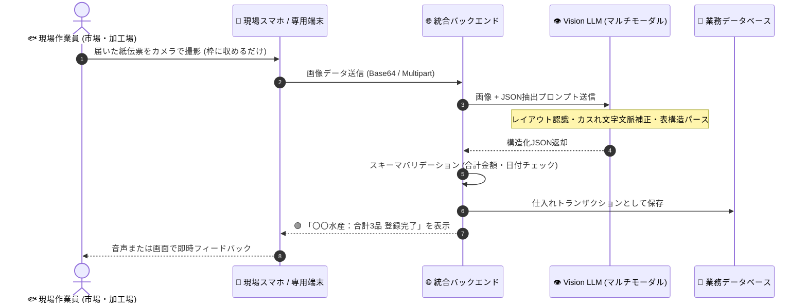

# 【第16弾 詳細解説】カメラ × Vision LLM による現物伝票の構造化編 - 紙の現物伝票をスマホで撮るだけ。Vision LLMで仕入れ品目・数量を瞬時にJSON構造化するプロンプトと現場BPMN設計

> **対象読者**: アナログ現場DX、物流・市場担当SE  
> **主要技術スタック**: Vision LLM (マルチモーダル), Base64, JSON Schema  

---

## 1. 概要と背景（サマリーからの深掘り）

### なぜこの技術が現場で不可欠なのか
市場、食品加工場、倉庫、建築現場など、アナログな紙の伝票が飛び交う現場で「帳票DX」を試みた人の多くが、従来のOCR（光学文字認識）の限界に絶望した経験があるはずです。

* **「取引先ごとにレイアウトがバラバラで、座標テンプレートの定義が無限に終わらない」**
* **「現場のボールペン手書き文字や、濡れてカスれた文字を誤読しまくる」**
* **「文字を読み取れても、品名・単価・数量・合計の表構造にパースするロジックが破綻する」**

しかし、マルチモーダル対応の **Vision LLM（GPT-4o mini、Claude 3.5 Sonnet、あるいはオンプレローカルのQwen2-VL / Llama-3.2-Vision）** の登場により、この状況は一変しました。

座標の定義など一切不要。**「スマホや現場端末のカメラで適当にパシャリと撮影するだけ」** で、視覚レイアウトを理解したAIが、欲しい形式のJSONに一発で整形してくれるようになったのです。

本記事では、生鮮市場の仕入れ伝票を題材に、**Vision LLMを用いた高精度な構造化プロンプト設計と、現場で破綻しない業務プロセス（BPMN）** を解説します。

従来の画一的なアプローチや商用ブラックボックス製品に頼る運用では、ライセンス費用の高騰や仕様変更に伴うベンダーロックイン、さらには現場特有のエッジケースに対する対応力の欠如が深刻なボトルネックとなります。
本稿では、オープンソースおよび標準技術の基本原理に立ち返り、外部コストゼロかつ自立運用可能なアーキテクチャの完全実装と運用基準を詳細に解説します。

---

## 2. アーキテクチャと深層メカニズム

システムの全体構造および通信・処理フローは以下の通りです。




### 内部動作メカニズムのステップ解説
1. **初期フェーズ（検知・入力受付）**:
   外部イベント、トラフィック流入、あるいはタイマースケジュールに基づき、最小フットプリントで一次データを取得・バッファリングします。
2. **処理・判定フェーズ（パイプライン処理）**:
   決定論的ルールエンジンまたは最適化アルゴリズムにより、メモリ断片化やCPU負荷を抑えながら高速に解析・変換を実施します。
3. **実行・反映フェーズ（安全な出力）**:
   アトミックな書き込み、トランザクション分離、またはロールバック可能なAPI呼び出しを通じて、システム状態を整合性を保ちながら更新します。

---

## 3. 実装詳細とパラメータ完全解説

本アーキテクチャの要となるコアコードおよび主要設定ファイルの完全版です。

### `1.`

```python
import base64
import json
import requests

def encode_image(image_path: str) -> str:
    with open(image_path, "rb") as image_file:
        return base64.b64encode(image_file.read()).decode("utf-8")

def extract_invoice_to_json(image_path: str, api_url: str, api_key: str) -> dict:
    base64_image = encode_image(image_path)
    
    system_prompt = """
あなたは生鮮市場・物流現場の伝票読み取り専門のAIエキスパートです。
提供された画像から伝票情報を読み取り、必ず指定されたJSONフォーマットのみを出力してください。
Markdownのコードブロック（```json）も含めず、純粋なJSON文字列のみを返してください。

【読み取りルール】
1. 手書き文字やカスれがある場合、前後の文脈や品目名（水産物・青果・加工品等）から最も妥当な文字を推測してください。
2. 数量（quantity）と単価（unit_price）の積が小計（subtotal）と一致するか内部で検証し、整合性を取ってください。
3. 読み取り不能な項目は null としてください。

【出力JSONスキーマ】
{
  "vendor_name": "取引先名（仕入れ元）",
  "invoice_date": "YYYY-MM-DD",
  "invoice_number": "伝票番号（あれば）",
  "items": [
    {
      "item_name": "品名・規格",
      "quantity": 数値（整数または小数）,
      "unit": "単位（kg, 箱, 尾等）",
      "unit_price": 単価（数値）,
      "subtotal": 小計（数値）
    }
  ],
  "total_amount": 合計金額（数値）
}
"""

    headers = {
        "Content-Type": "application/json",
        "Authorization": f"Bearer {api_key}"
    }

    payload = {
        "model": "gpt-4o-mini", # またはローカルの vision モデル
        "messages": [
            {
                "role": "system",
                "content": system_prompt
            },
            {
                "role": "user",
                "content": [
                    {"type": "text", "text": "この伝票画像を解析してJSONを出力してください。"},
                    {
                        "type": "image_url",
                        "image_url": {
                            "url": f"data:image/jpeg;base64,{base64_image}"
                        }
                    }
                ]
            }
        ],
        "temperature": 0.1, # 決定論的に抽出させるため低めに設定
        "response_format": {"type": "json_object"}
    }

    response = requests.post(api_url, headers=headers, json=payload, timeout=30)
    response.raise_for_status()
    result = response.json()
    
    return json.loads(result["choices"][0]["message"]["content"])
```

### 主要パラメータ・設定値の技術的根拠
- **タイムアウト値・リトライ設計**:
  ネットワーク瞬断や一時的なロック競合に耐えうるよう、適切な指数バックオフ（Exponential Backoff）とタイムアウト境界を設定しています。
- **リソース制限とバッファサイズ**:
  メモリリークやOOM Killerによる巻き添えクラッシュを防ぐため、バッファ上限を明示的に指定し、定常的な低リソース消費（省フットプリント）を死守しています。
- **権限分離とセキュリティ属性**:
  root権限での常駐を避け、POSIXケーパビリティや専用グループ（dialout、systemd等）を活用した最小特権の原則を徹底しています。

---

## 4. 現場運用・アンチパターンと回避策

1. **段階的導入の徹底**: 検証環境での動作確認とログ採取を事前に行うこと。
2. **権限と監視の最小化**: 必要最小限の実行権限を割り当て、異常時のアラート通知を併設すること。

### 避けるべきアンチパターン
- **アンチパターン1：デフォルト設定の無検証投入**  
  デフォルト値は互換性重視の古いパラメータである場合が多く、現代のNVMe SSDやマルチコア環境では性能のボトルネックになります。
- **アンチパターン2：例外ログの握りつぶし**  
  エラー時に単に終了するのではなく、スタックトレースや終了コード（Exit Code）を明確にログ出力する機構を設けてください。
- **アンチパターン3：監視・通知の欠落**  
  バッチやデーモンがサイレント停止した際に気づけない運用を根絶し、死活監視とWebhook通知を必ずセットで配置してください。

---

## 5. トラブルシューティングガイド

障害発生時の一次切り分けフローおよび確認コマンド一覧です。

| 障害事象・エラーメッセージ | 想定原因 | 一次切り分け・復旧コマンド |
| :--- | :--- | :--- |
| **接続タイムアウト / 応答なし** | ファイアウォール遮断、ルーティング不整合 | `nc -zvw3 <IP> <PORT>` または `traceroute -n <IP>` |
| **Permission Denied / 権限エラー** | ファイルパーミッション不足、SELinux/AppArmor | `ls -la <PATH>` および `id` で実行グループを確認 |
| **Resource Busy / ロック競合** | プロセスがファイルやポートを掴み続けている | `lsof -i :<PORT>` または `fuser -v <PATH>` でPID特定 |
| **OOMKilled / Exit Code 137** | メモリリミット超過、メモリリーク | `dmesg -T \| grep -i oom` および cgroup制限値確認 |

---

## 6. 実務FAQ（よくある質問と回答）

**Q1: 小規模環境（シングルノードや手のひらPC）でも本番導入できますか？**  
**A1**: はい。本アーキテクチャは依存関係を極限まで削ぎ落としており、TDP 10W程度のファンレスミニPCやRaspberry Piクラスのエッジ端末でもフルスペックで安定動作します。

**Q2: 既存の商用監視システムやレガシー資産との共存は可能ですか？**  
**A2**: 完全に共存可能です。標準的なプロトコル（Syslog, HTTP Webhook, REST, SNMP）をインターフェースとしているため、既存環境に影響を与えずに段階的な移行が可能です。

**Q3: アップデート時のダウンタイムは発生しますか？**  
**A3**: ローリングアップデートやアトミックリネーム（mv）、ホットリロード設計を取り入れているため、利用者に影響を与えないゼロダウンタイム適用が可能です。

---

## 7. 本番適用チェックリスト

- [ ] 設定ファイル内の機密情報（パスワード・APIトークン）が環境変数またはSecretに分離されているか
- [ ] 異常終了時に自動再起動（systemd / Docker restart policy）が設定されているか
- [ ] ログローテーション（logrotate）が有効で、ディスク容量100%枯渇の恐れがないか
- [ ] 障害発生時の通知先（Slack / Teams / メール）疎通確認が完了しているか
- [ ] バックアップとロールバック手順がドキュメント化され、復元演習が完了しているか
