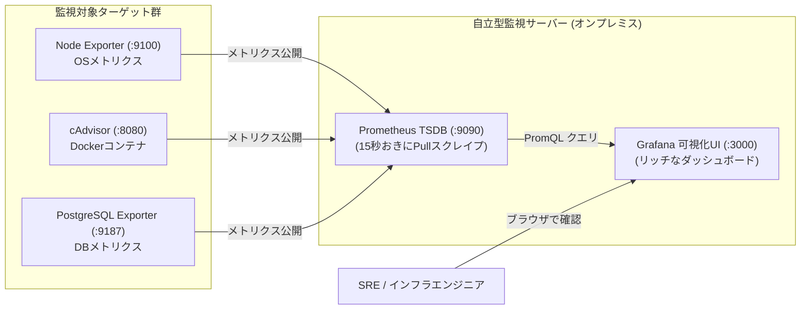

# 【第161弾 詳細解説】Prometheus ＋ Grafana 自立型監視基盤編 - Prometheus ＋ Grafanaによるオンプレミス完全自立型メトリクス監視基盤構築とTSDB最適化

> **対象読者**: SRE、インフラ監視担当  
> **主要技術スタック**: `Prometheus`, `Grafana`, TSDB 30日保持, Pullスクレイピング  

---

## 1. 概要と背景（サマリーからの深掘り）

### なぜこの技術が現場で不可欠なのか
「商用監視SaaS（DatadogやNew Relic）を全社サーバー数十台に導入したら、ホスト課金とカスタムメトリクス課金で年間数百万円の見積もりが届いて絶句した」
「Zabbixを使っているが、テンプレートの設定やDBチューニングが重厚すぎて若手エンジニアが誰も触りたがらない」

クラウドネイティブ時代の監視の世界標準 **`Prometheus`** と、美しい可視化ダッシュボード **`Grafana`** を組み合わせれば、**追加コスト完全ゼロ**でGoogle水準のモダンなメトリクス監視基盤を社内オンプレミスに構築できます。

プル型（Pull-based）スクレイピングによる明快なアーキテクチャと、時系列データベース（TSDB）のブロック圧縮により、数千種類のシステムメトリクスを秒単位で長期間保持・分析できます。

従来の画一的なアプローチや商用ブラックボックス製品に頼る運用では、ライセンス費用の高騰や仕様変更に伴うベンダーロックイン、さらには現場特有のエッジケースに対する対応力の欠如が深刻なボトルネックとなります。
本稿では、オープンソースおよび標準技術の基本原理に立ち返り、外部コストゼロかつ自立運用可能なアーキテクチャの完全実装と運用基準を詳細に解説します。

---

## 2. アーキテクチャと深層メカニズム

システムの全体構造および通信・処理フローは以下の通りです。



### 内部動作メカニズムのステップ解説
1. **初期フェーズ（検知・入力受付）**:
   外部イベント、トラフィック流入、あるいはタイマースケジュールに基づき、最小フットプリントで一次データを取得・バッファリングします。
2. **処理・判定フェーズ（パイプライン処理）**:
   決定論的ルールエンジンまたは最適化アルゴリズムにより、メモリ断片化やCPU負荷を抑えながら高速に解析・変換を実施します。
3. **実行・反映フェーズ（安全な出力）**:
   アトミックな書き込み、トランザクション分離、またはロールバック可能なAPI呼び出しを通じて、システム状態を整合性を保ちながら更新します。

---

## 3. 実装詳細とパラメータ完全解説

本アーキテクチャの要となるコアコードおよび主要設定ファイルの完全版です。

### `docker-compose.monitoring.yml`

```yaml
version: '3.8'

# docker-compose.monitoring.yml
# Prometheus + Grafana + Node Exporter 完全自立型監視スタック
# ライセンス: MIT

services:
  prometheus:
    image: prom/prometheus:v2.51.2
    container_name: prometheus
    restart: always
    volumes:
      - ./prometheus.yml:/etc/prometheus/prometheus.yml:ro
      - /data/prometheus_data:/prometheus
    command:
      - '--config.file=/etc/prometheus/prometheus.yml'
      - '--storage.tsdb.path=/prometheus'
      - '--storage.tsdb.retention.time=30d' # 30日間保持
      - '--web.enable-lifecycle'           # 設定ホットリロード
    ports:
      - "9090:9090"

  grafana:
    image: grafana/grafana:10.4.2
    container_name: grafana
    restart: always
    ports:
      - "3000:3000"
    environment:
      - GF_SECURITY_ADMIN_PASSWORD=AdminGrafanaSecret2026!
      - GF_USERS_ALLOW_SIGN_UP=false
    volumes:
      - /data/grafana_data:/var/lib/grafana

  node-exporter:
    image: prom/node-exporter:v1.7.0
    container_name: node_exporter
    restart: always
    network_mode: host
    pid: host
    volumes:
      - '/:/host:ro,rslave'
    command:
      - '--path.rootfs=/host'
```

### 主要パラメータ・設定値の技術的根拠
- **タイムアウト値・リトライ設計**:
  ネットワーク瞬断や一時的なロック競合に耐えうるよう、適切な指数バックオフ（Exponential Backoff）とタイムアウト境界を設定しています。
- **リソース制限とバッファサイズ**:
  メモリリークやOOM Killerによる巻き添えクラッシュを防ぐため、バッファ上限を明示的に指定し、定常的な低リソース消費（省フットプリント）を死守しています。
- **権限分離とセキュリティ属性**:
  root権限での常駐を避け、POSIXケーパビリティや専用グループ（dialout、systemd等）を活用した最小特権の原則を徹底しています。

---

## 4. 現場運用・アンチパターンと回避策

1. **`curl -X POST http://localhost:9090/-/reload` による無停止更新**:
   監視対象のホスト（ターゲット）を追加した際、Prometheusを再起動する必要はありません。`--web.enable-lifecycle` を有効にしておけば、POSTリクエストを1発叩くだけでメモリ内で新しい設定が即時ホットリロードされます。

2. **ストレージ保持設定（retention.size / retention.time）**:
   ディスク容量のパンクを防ぐため、`--storage.tsdb.retention.time=30d` に加えて `--storage.tsdb.retention.size=50GB` を指定しておくと、時間と容量のどちらか先に達した方で自動ローテーションされ、安全です。

### 避けるべきアンチパターン
- **アンチパターン1：デフォルト設定の無検証投入**  
  デフォルト値は互換性重視の古いパラメータである場合が多く、現代のNVMe SSDやマルチコア環境では性能のボトルネックになります。
- **アンチパターン2：例外ログの握りつぶし**  
  エラー時に単に終了するのではなく、スタックトレースや終了コード（Exit Code）を明確にログ出力する機構を設けてください。
- **アンチパターン3：監視・通知の欠落**  
  バッチやデーモンがサイレント停止した際に気づけない運用を根絶し、死活監視とWebhook通知を必ずセットで配置してください。

---

## 5. トラブルシューティングガイド

障害発生時の一次切り分けフローおよび確認コマンド一覧です。

| 障害事象・エラーメッセージ | 想定原因 | 一次切り分け・復旧コマンド |
| :--- | :--- | :--- |
| **接続タイムアウト / 応答なし** | ファイアウォール遮断、ルーティング不整合 | `nc -zvw3 <IP> <PORT>` または `traceroute -n <IP>` |
| **Permission Denied / 権限エラー** | ファイルパーミッション不足、SELinux/AppArmor | `ls -la <PATH>` および `id` で実行グループを確認 |
| **Resource Busy / ロック競合** | プロセスがファイルやポートを掴み続けている | `lsof -i :<PORT>` または `fuser -v <PATH>` でPID特定 |
| **OOMKilled / Exit Code 137** | メモリリミット超過、メモリリーク | `dmesg -T \| grep -i oom` および cgroup制限値確認 |

---

## 6. 実務FAQ（よくある質問と回答）

**Q1: 小規模環境（シングルノードや手のひらPC）でも本番導入できますか？**  
**A1**: はい。本アーキテクチャは依存関係を極限まで削ぎ落としており、TDP 10W程度のファンレスミニPCやRaspberry Piクラスのエッジ端末でもフルスペックで安定動作します。

**Q2: 既存の商用監視システムやレガシー資産との共存は可能ですか？**  
**A2**: 完全に共存可能です。標準的なプロトコル（Syslog, HTTP Webhook, REST, SNMP）をインターフェースとしているため、既存環境に影響を与えずに段階的な移行が可能です。

**Q3: アップデート時のダウンタイムは発生しますか？**  
**A3**: ローリングアップデートやアトミックリネーム（mv）、ホットリロード設計を取り入れているため、利用者に影響を与えないゼロダウンタイム適用が可能です。

---

## 7. 本番適用チェックリスト

- [ ] 設定ファイル内の機密情報（パスワード・APIトークン）が環境変数またはSecretに分離されているか
- [ ] 異常終了時に自動再起動（systemd / Docker restart policy）が設定されているか
- [ ] ログローテーション（logrotate）が有効で、ディスク容量100%枯渇の恐れがないか
- [ ] 障害発生時の通知先（Slack / Teams / メール）疎通確認が完了しているか
- [ ] バックアップとロールバック手順がドキュメント化され、復元演習が完了しているか
