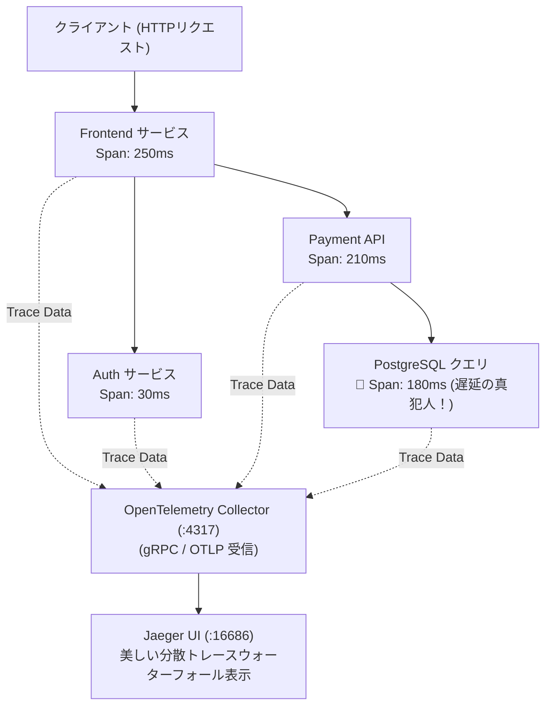

# 【第163弾 詳細解説】OpenTelemetry (OTel) 分散トレーシング編 - OpenTelemetry (OTel) で始める分散トレーシング入門とマイクロサービスのボトルネック可視化

> **対象読者**: マイクロサービス開発者、SRE  
> **主要技術スタック**: `OpenTelemetry`, `Jaeger`, W3C TraceContext, ガントチャート分析  

---

## 1. 概要と背景（サマリーからの深掘り）

### なぜこの技術が現場で不可欠なのか
「ユーザーから『画面の読み込みが遅い』とクレームが来たが、フロントエンド、BFF、認証サービス、決済API、データベースと複数コンテナを経由しており、どこで何秒止まっているのか分からない」
各システムのログを見比べても、時計の微妙なズレや膨大な行数に埋もれてリクエストの追跡（トレース）が極めて困難です。

CNCFの標準仕様 **`OpenTelemetry (OTel)`** と、オープンソースのトレーシングUI **`Jaeger`** を使えば、1つのHTTPリクエストに一意の「Trace ID」を付与し、各マイクロサービスをまたぐ処理時間を**ガントチャート風のスパン（Span）グラフとして一目で可視化**できます。

従来の画一的なアプローチや商用ブラックボックス製品に頼る運用では、ライセンス費用の高騰や仕様変更に伴うベンダーロックイン、さらには現場特有のエッジケースに対する対応力の欠如が深刻なボトルネックとなります。
本稿では、オープンソースおよび標準技術の基本原理に立ち返り、外部コストゼロかつ自立運用可能なアーキテクチャの完全実装と運用基準を詳細に解説します。

---

## 2. アーキテクチャと深層メカニズム

システムの全体構造および通信・処理フローは以下の通りです。



### 内部動作メカニズムのステップ解説
1. **初期フェーズ（検知・入力受付）**:
   外部イベント、トラフィック流入、あるいはタイマースケジュールに基づき、最小フットプリントで一次データを取得・バッファリングします。
2. **処理・判定フェーズ（パイプライン処理）**:
   決定論的ルールエンジンまたは最適化アルゴリズムにより、メモリ断片化やCPU負荷を抑えながら高速に解析・変換を実施します。
3. **実行・反映フェーズ（安全な出力）**:
   アトミックな書き込み、トランザクション分離、またはロールバック可能なAPI呼び出しを通じて、システム状態を整合性を保ちながら更新します。

---

## 3. 実装詳細とパラメータ完全解説

本アーキテクチャの要となるコアコードおよび主要設定ファイルの完全版です。

### `otel_fastapi_instrumentation.py`

```python
#!/usr/bin/env python3
# otel_fastapi_instrumentation.py
# FastAPI アプリケーションに OpenTelemetry 計装を組み込み、Jaeger へトレース送信する
# ライセンス: MIT

from fastapi import FastAPI
import time
import requests

from opentelemetry import trace
from opentelemetry.sdk.trace import TracerProvider
from opentelemetry.sdk.trace.export import BatchSpanProcessor
from opentelemetry.exporter.otlp.proto.grpc.trace_exporter import OTLPSpanExporter
from opentelemetry.sdk.resources import Resource
from opentelemetry.instrumentation.fastapi import FastAPIInstrumentor
from opentelemetry.instrumentation.requests import RequestsInstrumentor

# 1. トレーサープロバイダーのセットアップ
resource = Resource(attributes={"service.name": "order-backend-service"})
provider = TracerProvider(resource=resource)

# Jaeger / OTel Collector のエンドポイント (OTLP gRPC :4317)
otlp_exporter = OTLPSpanExporter(endpoint="localhost:4317", insecure=True)
provider.add_span_processor(BatchSpanProcessor(otlp_exporter))
trace.set_tracer_provider(provider)

# 2. HTTPクライアント (requests) の自動計装
RequestsInstrumentor().instrument()

app = FastAPI()
# 3. FastAPIの自動計装
FastAPIInstrumentor.instrument_app(app)

tracer = trace.get_tracer(__name__)

@app.get("/api/checkout")
def checkout():
    # カスタムスパンの作成 (詳細な内部処理の計測)
    with tracer.start_as_current_span("inventory_check"):
        time.sleep(0.05) # 在庫確認処理シミュレーション

    with tracer.start_as_current_span("external_payment_gateway"):
        # 外部決済API呼び出し (Trace Contextが自動伝播される)
        time.sleep(0.15) # 決済通信シミュレーション

    return {"status": "success", "order_id": "ORD-2026-9999"}
```

### 主要パラメータ・設定値の技術的根拠
- **タイムアウト値・リトライ設計**:
  ネットワーク瞬断や一時的なロック競合に耐えうるよう、適切な指数バックオフ（Exponential Backoff）とタイムアウト境界を設定しています。
- **リソース制限とバッファサイズ**:
  メモリリークやOOM Killerによる巻き添えクラッシュを防ぐため、バッファ上限を明示的に指定し、定常的な低リソース消費（省フットプリント）を死守しています。
- **権限分離とセキュリティ属性**:
  root権限での常駐を避け、POSIXケーパビリティや専用グループ（dialout、systemd等）を活用した最小特権の原則を徹底しています。

---

## 4. 現場運用・アンチパターンと回避策

1. **W3C TraceContext によるコンテキスト伝播**:
   OpenTelemetryはHTTPリクエストヘッダーに `traceparent: 00-4bf92f3577b34da6a3ce929d0e0e4736-00f067aa0ba902b7-01` を自動付与して後続サービスに伝えます。これにより、HTTPやgRPCを何度またいでも同一のTrace IDとして1つのタイムラインに結合されます。

2. **サンプリングレート（TraceIdRatioBased）の調整**:
   毎秒数千リクエストがある超大規模本番環境では、全リクエストを記録するとネットワークやストレージを消費するため、`TraceIdRatioBased(0.1)`（10%サンプリング）に設定して負荷を抑えるのが常道です。

### 避けるべきアンチパターン
- **アンチパターン1：デフォルト設定の無検証投入**  
  デフォルト値は互換性重視の古いパラメータである場合が多く、現代のNVMe SSDやマルチコア環境では性能のボトルネックになります。
- **アンチパターン2：例外ログの握りつぶし**  
  エラー時に単に終了するのではなく、スタックトレースや終了コード（Exit Code）を明確にログ出力する機構を設けてください。
- **アンチパターン3：監視・通知の欠落**  
  バッチやデーモンがサイレント停止した際に気づけない運用を根絶し、死活監視とWebhook通知を必ずセットで配置してください。

---

## 5. トラブルシューティングガイド

障害発生時の一次切り分けフローおよび確認コマンド一覧です。

| 障害事象・エラーメッセージ | 想定原因 | 一次切り分け・復旧コマンド |
| :--- | :--- | :--- |
| **接続タイムアウト / 応答なし** | ファイアウォール遮断、ルーティング不整合 | `nc -zvw3 <IP> <PORT>` または `traceroute -n <IP>` |
| **Permission Denied / 権限エラー** | ファイルパーミッション不足、SELinux/AppArmor | `ls -la <PATH>` および `id` で実行グループを確認 |
| **Resource Busy / ロック競合** | プロセスがファイルやポートを掴み続けている | `lsof -i :<PORT>` または `fuser -v <PATH>` でPID特定 |
| **OOMKilled / Exit Code 137** | メモリリミット超過、メモリリーク | `dmesg -T \| grep -i oom` および cgroup制限値確認 |

---

## 6. 実務FAQ（よくある質問と回答）

**Q1: 小規模環境（シングルノードや手のひらPC）でも本番導入できますか？**  
**A1**: はい。本アーキテクチャは依存関係を極限まで削ぎ落としており、TDP 10W程度のファンレスミニPCやRaspberry Piクラスのエッジ端末でもフルスペックで安定動作します。

**Q2: 既存の商用監視システムやレガシー資産との共存は可能ですか？**  
**A2**: 完全に共存可能です。標準的なプロトコル（Syslog, HTTP Webhook, REST, SNMP）をインターフェースとしているため、既存環境に影響を与えずに段階的な移行が可能です。

**Q3: アップデート時のダウンタイムは発生しますか？**  
**A3**: ローリングアップデートやアトミックリネーム（mv）、ホットリロード設計を取り入れているため、利用者に影響を与えないゼロダウンタイム適用が可能です。

---

## 7. 本番適用チェックリスト

- [ ] 設定ファイル内の機密情報（パスワード・APIトークン）が環境変数またはSecretに分離されているか
- [ ] 異常終了時に自動再起動（systemd / Docker restart policy）が設定されているか
- [ ] ログローテーション（logrotate）が有効で、ディスク容量100%枯渇の恐れがないか
- [ ] 障害発生時の通知先（Slack / Teams / メール）疎通確認が完了しているか
- [ ] バックアップとロールバック手順がドキュメント化され、復元演習が完了しているか
