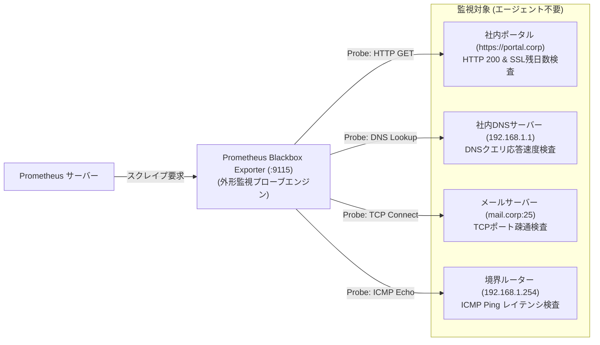

# 【第165弾 詳細解説】Blackbox Exporter 外形死活・SSL期限監視編 - 黒番監視（Blackbox Exporter）によるHTTP / DNS / TCP / ICMP外形監視完全網羅

> **対象読者**: Webマスター、インフラ保守担当  
> **主要技術スタック**: `Blackbox Exporter`, SSL残日数監視, HTTP 2xxプローブ  

---

## 1. 概要と背景（サマリーからの深掘り）

### なぜこの技術が現場で不可欠なのか
「サーバーのCPUもメモリも正常でプロセスも起動しているのに、SSL証明書の期限切れやリバースプロキシのバグで、外部ユーザーから見ると502エラーでサイトが完全に死んでいた」
エージェント監視（内部メトリクス）だけでは、「ユーザーのブラウザから実際にアクセスできるか」という**真のユーザー体験（外形品質）**を担保できません。

Prometheus公式の **`Blackbox Exporter`** は、対象サーバーにエージェントを一切入れることなく、外部からプローブ（探針）パケットを飛ばして**「HTTPステータスコード」「SSL証明書の残り有効日数」「DNS名前解決時間」「TCPポートの応答性」「ICMP PingのRTT」**を完璧に外形監視します。

従来の画一的なアプローチや商用ブラックボックス製品に頼る運用では、ライセンス費用の高騰や仕様変更に伴うベンダーロックイン、さらには現場特有のエッジケースに対する対応力の欠如が深刻なボトルネックとなります。
本稿では、オープンソースおよび標準技術の基本原理に立ち返り、外部コストゼロかつ自立運用可能なアーキテクチャの完全実装と運用基準を詳細に解説します。

---

## 2. アーキテクチャと深層メカニズム

システムの全体構造および通信・処理フローは以下の通りです。




### 内部動作メカニズムのステップ解説
1. **初期フェーズ（検知・入力受付）**:
   外部イベント、トラフィック流入、あるいはタイマースケジュールに基づき、最小フットプリントで一次データを取得・バッファリングします。
2. **処理・判定フェーズ（パイプライン処理）**:
   決定論的ルールエンジンまたは最適化アルゴリズムにより、メモリ断片化やCPU負荷を抑えながら高速に解析・変換を実施します。
3. **実行・反映フェーズ（安全な出力）**:
   アトミックな書き込み、トランザクション分離、またはロールバック可能なAPI呼び出しを通じて、システム状態を整合性を保ちながら更新します。

---

## 3. 実装詳細とパラメータ完全解説

本アーキテクチャの要となるコアコードおよび主要設定ファイルの完全版です。

### `blackbox.yml`

```yaml
modules:
  # 1. 安全なHTTPS外形監視 (ステータス2xx、TLS検証、証明書期限監視)
  http_2xx:
    prober: http
    timeout: 5s
    http:
      valid_status_codes: [200, 201, 204]
      method: GET
      fail_if_ssl: false
      fail_if_not_ssl: true
      tls_config:
        insecure_skip_verify: false

  # 2. 社内DNSサーバーの健全性プローブ
  dns_corp:
    prober: dns
    timeout: 3s
    dns:
      query_name: "internal.service.local"
      query_type: "A"
      valid_rcodes: ["NOERROR"]

  # 3. TCPポート疎通監視 (DBやカスタムプロトコル用)
  tcp_connect:
    prober: tcp
    timeout: 3s

  # 4. ICMP Ping 監視
  icmp_ping:
    prober: icmp
    timeout: 3s
    icmp:
      preferred_ip_protocol: "ip4"
```

### 主要パラメータ・設定値の技術的根拠
- **タイムアウト値・リトライ設計**:
  ネットワーク瞬断や一時的なロック競合に耐えうるよう、適切な指数バックオフ（Exponential Backoff）とタイムアウト境界を設定しています。
- **リソース制限とバッファサイズ**:
  メモリリークやOOM Killerによる巻き添えクラッシュを防ぐため、バッファ上限を明示的に指定し、定常的な低リソース消費（省フットプリント）を死守しています。
- **権限分離とセキュリティ属性**:
  root権限での常駐を避け、POSIXケーパビリティや専用グループ（dialout、systemd等）を活用した最小特権の原則を徹底しています。

---

## 4. 現場運用・アンチパターンと回避策

1. **`probe_ssl_earliest_cert_expiry` による証明書切れ死守**:
   Blackbox ExporterのHTTPモジュールは、対象URLのSSL証明書の失効タイムスタンプを自動取得します。Prometheusで `(probe_ssl_earliest_cert_expiry - time()) / 86400 < 14` というアラートルールを1行書いておくだけで、「証明書の有効期限が残り14日未満」になった瞬間に自動警告が飛びます。

2. **マルチターゲット・リラベリング（relabel_configs）**:
   Prometheus側の設定で `relabel_configs` を使うことで、Prometheus設定ファイル内にURLのリストを並べるだけで、単一のBlackbox Exporterインスタンスが何百ものWebサイトを巡回して外形監視できます。

### 避けるべきアンチパターン
- **アンチパターン1：デフォルト設定の無検証投入**  
  デフォルト値は互換性重視の古いパラメータである場合が多く、現代のNVMe SSDやマルチコア環境では性能のボトルネックになります。
- **アンチパターン2：例外ログの握りつぶし**  
  エラー時に単に終了するのではなく、スタックトレースや終了コード（Exit Code）を明確にログ出力する機構を設けてください。
- **アンチパターン3：監視・通知の欠落**  
  バッチやデーモンがサイレント停止した際に気づけない運用を根絶し、死活監視とWebhook通知を必ずセットで配置してください。

---

## 5. トラブルシューティングガイド

障害発生時の一次切り分けフローおよび確認コマンド一覧です。

| 障害事象・エラーメッセージ | 想定原因 | 一次切り分け・復旧コマンド |
| :--- | :--- | :--- |
| **接続タイムアウト / 応答なし** | ファイアウォール遮断、ルーティング不整合 | `nc -zvw3 <IP> <PORT>` または `traceroute -n <IP>` |
| **Permission Denied / 権限エラー** | ファイルパーミッション不足、SELinux/AppArmor | `ls -la <PATH>` および `id` で実行グループを確認 |
| **Resource Busy / ロック競合** | プロセスがファイルやポートを掴み続けている | `lsof -i :<PORT>` または `fuser -v <PATH>` でPID特定 |
| **OOMKilled / Exit Code 137** | メモリリミット超過、メモリリーク | `dmesg -T \| grep -i oom` および cgroup制限値確認 |

---

## 6. 実務FAQ（よくある質問と回答）

**Q1: 小規模環境（シングルノードや手のひらPC）でも本番導入できますか？**  
**A1**: はい。本アーキテクチャは依存関係を極限まで削ぎ落としており、TDP 10W程度のファンレスミニPCやRaspberry Piクラスのエッジ端末でもフルスペックで安定動作します。

**Q2: 既存の商用監視システムやレガシー資産との共存は可能ですか？**  
**A2**: 完全に共存可能です。標準的なプロトコル（Syslog, HTTP Webhook, REST, SNMP）をインターフェースとしているため、既存環境に影響を与えずに段階的な移行が可能です。

**Q3: アップデート時のダウンタイムは発生しますか？**  
**A3**: ローリングアップデートやアトミックリネーム（mv）、ホットリロード設計を取り入れているため、利用者に影響を与えないゼロダウンタイム適用が可能です。

---

## 7. 本番適用チェックリスト

- [ ] 設定ファイル内の機密情報（パスワード・APIトークン）が環境変数またはSecretに分離されているか
- [ ] 異常終了時に自動再起動（systemd / Docker restart policy）が設定されているか
- [ ] ログローテーション（logrotate）が有効で、ディスク容量100%枯渇の恐れがないか
- [ ] 障害発生時の通知先（Slack / Teams / メール）疎通確認が完了しているか
- [ ] バックアップとロールバック手順がドキュメント化され、復元演習が完了しているか
