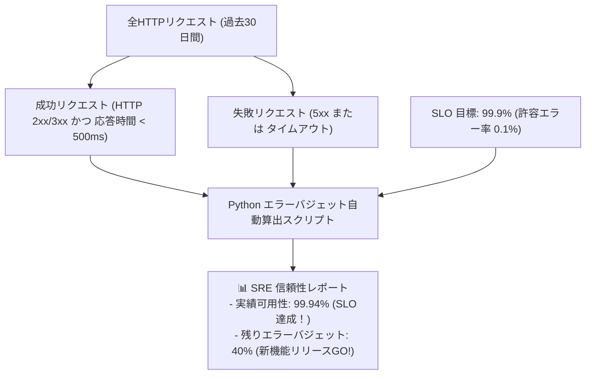

# 【第166弾 詳細解説】SLO / SLI 設計 ＆ エラーバジェット自動算出編 - SLO / SLI 設計とエラーバジェット算出スクリプトの実装（SRE信頼性エンジニアリング実践）

> **対象読者**: SRE、プロダクトマネージャー  
> **主要技術スタック**: SLO (99.9%), SLI, Error Budget, PromQL 30日ローリング算出  

---

## 1. 概要と背景（サマリーからの深掘り）

### なぜこの技術が現場で不可欠なのか
「経営層や顧客から『システムの稼働率は何％ですか？』と聞かれても、正確な根拠数字を答えられない」
「障害が起きるたびに『100%止まらないシステムを作れ』と理不尽に怒られ、新機能のリリースを止められて開発と運用が対立している」

Googleが提唱したSRE（Site Reliability Engineering）の基本原則は、**「100%の信頼性を目指すのは誤りであり、莫大な無駄コストを生む」**ということです。

**SLI (サービスレベル指標)** と **SLO (サービスレベル目標: 例 99.9%)** を定義し、許容されるダウンタイムの枠**「エラーバジェット（Error Budget: 例 99.9%なら月43分28秒）」**をPrometheusメトリクスから自動算出することで、「バジェットが残っていれば果敢にリリースし、枯渇したら信頼性改善に専念する」という科学的な合意形成が可能になります。

従来の画一的なアプローチや商用ブラックボックス製品に頼る運用では、ライセンス費用の高騰や仕様変更に伴うベンダーロックイン、さらには現場特有のエッジケースに対する対応力の欠如が深刻なボトルネックとなります。
本稿では、オープンソースおよび標準技術の基本原理に立ち返り、外部コストゼロかつ自立運用可能なアーキテクチャの完全実装と運用基準を詳細に解説します。

---

## 2. アーキテクチャと深層メカニズム

システムの全体構造および通信・処理フローは以下の通りです。




### 内部動作メカニズムのステップ解説
1. **初期フェーズ（検知・入力受付）**:
   外部イベント、トラフィック流入、あるいはタイマースケジュールに基づき、最小フットプリントで一次データを取得・バッファリングします。
2. **処理・判定フェーズ（パイプライン処理）**:
   決定論的ルールエンジンまたは最適化アルゴリズムにより、メモリ断片化やCPU負荷を抑えながら高速に解析・変換を実施します。
3. **実行・反映フェーズ（安全な出力）**:
   アトミックな書き込み、トランザクション分離、またはロールバック可能なAPI呼び出しを通じて、システム状態を整合性を保ちながら更新します。

---

## 3. 実装詳細とパラメータ完全解説

本アーキテクチャの要となるコアコードおよび主要設定ファイルの完全版です。

### `calculate_error_budget.py`

```python
#!/usr/bin/env python3
# calculate_error_budget.py
# Prometheus API を叩き、過去30日間のSLI実績値と残りエラーバジェット消費率を算出する
# ライセンス: MIT

import urllib.request
import urllib.parse
import json
import sys

PROM_URL = "http://localhost:9090"
SLO_TARGET = 0.999 # 99.9%

def query_prometheus(query: str) -> float:
    url = f"{PROM_URL}/api/v1/query?query={urllib.parse.quote(query)}"
    req = urllib.request.Request(url)
    try:
        with urllib.request.urlopen(req, timeout=10) as res:
            data = json.loads(res.read().decode())
            result = data.get("data", {}).get("result", [])
            if result:
                return float(result[0]["value"][1])
            return 0.0
    except Exception as e:
        print(f"[ERROR] PromQL 問い合わせ失敗: {e}")
        sys.exit(1)

def main():
    print("==================================================")
    print(" 📊 SRE サービス信頼性 & エラーバジェット分析 (過去30日間)")
    print("==================================================")

    # 1. 成功リクエスト数 (HTTP 200系 かつ 500ms未満)
    q_good = 'sum(increase(http_requests_total{status=~"2..", le="0.5"}[30d]))'
    # 2. 全リクエスト数
    q_total = 'sum(increase(http_requests_total[30d]))'

    good_requests = query_prometheus(q_good)
    total_requests = query_prometheus(q_total)

    if total_requests == 0:
        print("[WARN] 計測期間内のリクエストが0件です。")
        return

    # SLI可用性 (実績)
    actual_sli = good_requests / total_requests
    actual_sli_pct = actual_sli * 100.0

    # 許容される最大失敗数 (エラーバジェット総枠)
    allowed_bad_requests = total_requests * (1.0 - SLO_TARGET)
    actual_bad_requests = total_requests - good_requests

    # バジェット消費率
    budget_consumed_pct = (actual_bad_requests / (allowed_bad_requests + 1e-9)) * 100.0
    budget_remaining_pct = max(0.0, 100.0 - budget_consumed_pct)

    print(f"総リクエスト数: {int(total_requests):,} 件")
    print(f"目標可用性 (SLO): {SLO_TARGET * 100:.2f} %")
    print(f"実績可用性 (SLI): {actual_sli_pct:.4f} %")
    print(f"--------------------------------------------------")
    print(f"許容エラー総数: {int(allowed_bad_requests):,} 件")
    print(f"実発生エラー数: {int(actual_bad_requests):,} 件")
    print(f"残りエラーバジェット: {budget_remaining_pct:.1f} %")

    if actual_sli >= SLO_TARGET:
        print("🎉 [RESULT] SLO 達成中！新機能リリースを安全に推進できます。")
    else:
        print("🚨 [RESULT] SLO 違反（バジェット枯渇）！リリースを凍結し信頼性向上タスクに専念してください。")

if __name__ == "__main__":
    main()
```

### 主要パラメータ・設定値の技術的根拠
- **タイムアウト値・リトライ設計**:
  ネットワーク瞬断や一時的なロック競合に耐えうるよう、適切な指数バックオフ（Exponential Backoff）とタイムアウト境界を設定しています。
- **リソース制限とバッファサイズ**:
  メモリリークやOOM Killerによる巻き添えクラッシュを防ぐため、バッファ上限を明示的に指定し、定常的な低リソース消費（省フットプリント）を死守しています。
- **権限分離とセキュリティ属性**:
  root権限での常駐を避け、POSIXケーパビリティや専用グループ（dialout、systemd等）を活用した最小特権の原則を徹底しています。

---

## 4. 現場運用・アンチパターンと回避策

1. **ローリングウィンドウ（Rolling 30 days）の採用**:
   月初リセット（カレンダー月）にすると「月末にバジェットが余っているから雑にリリースする」という歪みが生じます。常に「直近30日間の移動窓」でSLIを計算するのがSREの鉄則です。

2. **マルチウィンドウ・マルチバーンレートアラート**:
   バジェットが「1時間で全体の2%消費された」「6時間で5%消費された」という急激な消費速度（Burn Rate）を検知してアラートを発報することで、深夜の誤報を減らしつつ致命的インシデントだけを正確に拾い上げられます。

### 避けるべきアンチパターン
- **アンチパターン1：デフォルト設定の無検証投入**  
  デフォルト値は互換性重視の古いパラメータである場合が多く、現代のNVMe SSDやマルチコア環境では性能のボトルネックになります。
- **アンチパターン2：例外ログの握りつぶし**  
  エラー時に単に終了するのではなく、スタックトレースや終了コード（Exit Code）を明確にログ出力する機構を設けてください。
- **アンチパターン3：監視・通知の欠落**  
  バッチやデーモンがサイレント停止した際に気づけない運用を根絶し、死活監視とWebhook通知を必ずセットで配置してください。

---

## 5. トラブルシューティングガイド

障害発生時の一次切り分けフローおよび確認コマンド一覧です。

| 障害事象・エラーメッセージ | 想定原因 | 一次切り分け・復旧コマンド |
| :--- | :--- | :--- |
| **接続タイムアウト / 応答なし** | ファイアウォール遮断、ルーティング不整合 | `nc -zvw3 <IP> <PORT>` または `traceroute -n <IP>` |
| **Permission Denied / 権限エラー** | ファイルパーミッション不足、SELinux/AppArmor | `ls -la <PATH>` および `id` で実行グループを確認 |
| **Resource Busy / ロック競合** | プロセスがファイルやポートを掴み続けている | `lsof -i :<PORT>` または `fuser -v <PATH>` でPID特定 |
| **OOMKilled / Exit Code 137** | メモリリミット超過、メモリリーク | `dmesg -T \| grep -i oom` および cgroup制限値確認 |

---

## 6. 実務FAQ（よくある質問と回答）

**Q1: 小規模環境（シングルノードや手のひらPC）でも本番導入できますか？**  
**A1**: はい。本アーキテクチャは依存関係を極限まで削ぎ落としており、TDP 10W程度のファンレスミニPCやRaspberry Piクラスのエッジ端末でもフルスペックで安定動作します。

**Q2: 既存の商用監視システムやレガシー資産との共存は可能ですか？**  
**A2**: 完全に共存可能です。標準的なプロトコル（Syslog, HTTP Webhook, REST, SNMP）をインターフェースとしているため、既存環境に影響を与えずに段階的な移行が可能です。

**Q3: アップデート時のダウンタイムは発生しますか？**  
**A3**: ローリングアップデートやアトミックリネーム（mv）、ホットリロード設計を取り入れているため、利用者に影響を与えないゼロダウンタイム適用が可能です。

---

## 7. 本番適用チェックリスト

- [ ] 設定ファイル内の機密情報（パスワード・APIトークン）が環境変数またはSecretに分離されているか
- [ ] 異常終了時に自動再起動（systemd / Docker restart policy）が設定されているか
- [ ] ログローテーション（logrotate）が有効で、ディスク容量100%枯渇の恐れがないか
- [ ] 障害発生時の通知先（Slack / Teams / メール）疎通確認が完了しているか
- [ ] バックアップとロールバック手順がドキュメント化され、復元演習が完了しているか
