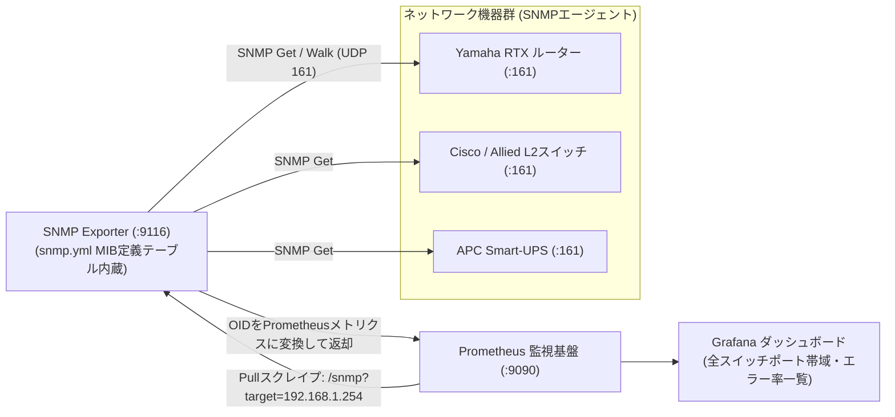

# 【第168弾 詳細解説】SNMP Exporter 異種NW機器統合Prometheus編 - SNMP Exporterによる異種ネットワーク機器の一括Prometheusメトリクス化とMIBコンパイル

> **対象読者**: ネットワーク監視担当、情シス  
> **主要技術スタック**: `SNMP Exporter`, MIBコンパイル, 64bit カウンタ (ifHCInOctets)  

---

## 1. 概要と背景（サマリーからの深掘り）

### なぜこの技術が現場で不可欠なのか
「ルーターやスイッチ、UPSなどのネットワーク機器はエージェントを入れられないため、サーバー監視（Prometheus）とは別にZabbixや専用NMSを二重運用していて管理が面倒」
「SNMPのOID（オブジェクトID: `1.3.6.1.4.1...`）の数字の羅列が暗号のようで、Prometheusのメトリクスに変換する方法が分からない」

ネットワーク機器をモダンなPrometheus監視に統合する公式ブリッジが **`SNMP Exporter`** です。

メーカー各社（Yamaha, Cisco, Fortinet等）が提供する **`MIB (Management Information Base)` ファイルをジェネレーターツールでコンパイル**することで、暗号のようなOIDを人間が読めるPrometheusメトリクス（例: `ifInOctets{ifName="ge-0/0/1"}`）に自動変換し、トラフィックやCPU使用率を美しく一元監視できます。

従来の画一的なアプローチや商用ブラックボックス製品に頼る運用では、ライセンス費用の高騰や仕様変更に伴うベンダーロックイン、さらには現場特有のエッジケースに対する対応力の欠如が深刻なボトルネックとなります。
本稿では、オープンソースおよび標準技術の基本原理に立ち返り、外部コストゼロかつ自立運用可能なアーキテクチャの完全実装と運用基準を詳細に解説します。

---

## 2. アーキテクチャと深層メカニズム

システムの全体構造および通信・処理フローは以下の通りです。



### 内部動作メカニズムのステップ解説
1. **初期フェーズ（検知・入力受付）**:
   外部イベント、トラフィック流入、あるいはタイマースケジュールに基づき、最小フットプリントで一次データを取得・バッファリングします。
2. **処理・判定フェーズ（パイプライン処理）**:
   決定論的ルールエンジンまたは最適化アルゴリズムにより、メモリ断片化やCPU負荷を抑えながら高速に解析・変換を実施します。
3. **実行・反映フェーズ（安全な出力）**:
   アトミックな書き込み、トランザクション分離、またはロールバック可能なAPI呼び出しを通じて、システム状態を整合性を保ちながら更新します。

---

## 3. 実装詳細とパラメータ完全解説

本アーキテクチャの要となるコアコードおよび主要設定ファイルの完全版です。

### `snmp_scrape_config.yml`

```yaml
# prometheus.yml に追加する SNMP Exporter スクレイプジョブ定義
scrape_jobs:
  - job_name: 'snmp_switches'
    scrape_interval: 30s
    scrape_timeout: 10s
    static_configs:
      - targets:
          - 192.168.1.254 # コアルーター
          - 192.168.1.253 # フロアスイッチA
          - 192.168.1.252 # フロアスイッチB
    metrics_path: /snmp
    params:
      module: [if_mib] # 標準インターフェースMIB (帯域・エラー・リンクステータス)
    relabel_configs:
      - source_labels: [__address__]
        target_label: __param_target
      - source_labels: [__param_target]
        target_label: instance
      - target_label: __address__
        replacement: 127.0.0.1:9116 # SNMP Exporter の待ち受けアドレス
```

### 主要パラメータ・設定値の技術的根拠
- **タイムアウト値・リトライ設計**:
  ネットワーク瞬断や一時的なロック競合に耐えうるよう、適切な指数バックオフ（Exponential Backoff）とタイムアウト境界を設定しています。
- **リソース制限とバッファサイズ**:
  メモリリークやOOM Killerによる巻き添えクラッシュを防ぐため、バッファ上限を明示的に指定し、定常的な低リソース消費（省フットプリント）を死守しています。
- **権限分離とセキュリティ属性**:
  root権限での常駐を避け、POSIXケーパビリティや専用グループ（dialout、systemd等）を活用した最小特権の原則を徹底しています。

---

## 4. 現場運用・アンチパターンと回避策

1. **64ビットカウンタ（ifHCInOctets / ifHCOutOctets）の必須利用**:
   1Gbpsや10Gbpsの高速回線では、従来の32ビットカウンタ（`ifInOctets`）はわずか数十秒〜数分で上限（4GB）に達してロールオーバー（周回）してしまい、グラフが異常な値に壊れます。必ず64ビットのハイキャパシティカウンタ（`ifHCInOctets`）が定義された `if_mib` モジュールを使用してください。

2. **SNMPv3 暗号化の適用**:
   平文でコミュニティ名が流れるSNMPv2cを社内LANで使うのは盗聴リスクがあります。`authPriv`（SHA認証 ＋ AES暗号化）によるSNMPv3を設定することで、セキュアな監視を実現できます。

### 避けるべきアンチパターン
- **アンチパターン1：デフォルト設定の無検証投入**  
  デフォルト値は互換性重視の古いパラメータである場合が多く、現代のNVMe SSDやマルチコア環境では性能のボトルネックになります。
- **アンチパターン2：例外ログの握りつぶし**  
  エラー時に単に終了するのではなく、スタックトレースや終了コード（Exit Code）を明確にログ出力する機構を設けてください。
- **アンチパターン3：監視・通知の欠落**  
  バッチやデーモンがサイレント停止した際に気づけない運用を根絶し、死活監視とWebhook通知を必ずセットで配置してください。

---

## 5. トラブルシューティングガイド

障害発生時の一次切り分けフローおよび確認コマンド一覧です。

| 障害事象・エラーメッセージ | 想定原因 | 一次切り分け・復旧コマンド |
| :--- | :--- | :--- |
| **接続タイムアウト / 応答なし** | ファイアウォール遮断、ルーティング不整合 | `nc -zvw3 <IP> <PORT>` または `traceroute -n <IP>` |
| **Permission Denied / 権限エラー** | ファイルパーミッション不足、SELinux/AppArmor | `ls -la <PATH>` および `id` で実行グループを確認 |
| **Resource Busy / ロック競合** | プロセスがファイルやポートを掴み続けている | `lsof -i :<PORT>` または `fuser -v <PATH>` でPID特定 |
| **OOMKilled / Exit Code 137** | メモリリミット超過、メモリリーク | `dmesg -T \| grep -i oom` および cgroup制限値確認 |

---

## 6. 実務FAQ（よくある質問と回答）

**Q1: 小規模環境（シングルノードや手のひらPC）でも本番導入できますか？**  
**A1**: はい。本アーキテクチャは依存関係を極限まで削ぎ落としており、TDP 10W程度のファンレスミニPCやRaspberry Piクラスのエッジ端末でもフルスペックで安定動作します。

**Q2: 既存の商用監視システムやレガシー資産との共存は可能ですか？**  
**A2**: 完全に共存可能です。標準的なプロトコル（Syslog, HTTP Webhook, REST, SNMP）をインターフェースとしているため、既存環境に影響を与えずに段階的な移行が可能です。

**Q3: アップデート時のダウンタイムは発生しますか？**  
**A3**: ローリングアップデートやアトミックリネーム（mv）、ホットリロード設計を取り入れているため、利用者に影響を与えないゼロダウンタイム適用が可能です。

---

## 7. 本番適用チェックリスト

- [ ] 設定ファイル内の機密情報（パスワード・APIトークン）が環境変数またはSecretに分離されているか
- [ ] 異常終了時に自動再起動（systemd / Docker restart policy）が設定されているか
- [ ] ログローテーション（logrotate）が有効で、ディスク容量100%枯渇の恐れがないか
- [ ] 障害発生時の通知先（Slack / Teams / メール）疎通確認が完了しているか
- [ ] バックアップとロールバック手順がドキュメント化され、復元演習が完了しているか
