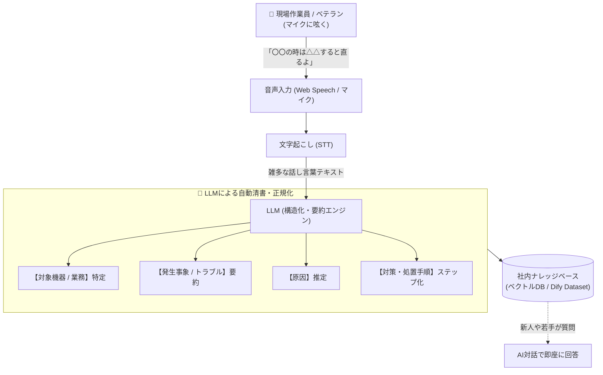

# 【第17弾 詳細解説】職人の暗黙知・ボイスナレッジ化編 - 「あのベテランにしか分からない」をなくす。現場でボソッと呟いたノウハウ音声をAIが自動で構造化・ベクトル蓄積する業務フロー

> **対象読者**: 業務継承・ナレッジマネジメント  
> **主要技術スタック**: 音声認識 (STT), LLM正規化, VectorDB (RAG)  

---

## 1. 概要と背景（サマリーからの深掘り）

### なぜこの技術が現場で不可欠なのか
日本の製造業、保守現場、市場、インフラ運用の現場には、長年の経験に裏打ちされた膨大な「神ノウハウ」が存在します。

* 「この機械、異音がするときは右下のボルトを半回転緩めると直る」
* 「〇〇水産の冷凍マグロは、この解凍温度にしないと身割れする」
* 「あの古いルーターは、再起動時にLANケーブルを抜いておかないとループする」

しかし、これらの貴重なノウハウは**マニュアルやWikiに1行も書かれません。**  
現場のベテランに「ナレッジをNotionや社内Wikiに書いてください」と頼んでも、**「そんな文章を打っている暇があったら作業を進める」** と断られるのがオチです。

結果として、ベテランの定年退職とともに貴重な知見が永遠に失われる「属人化の危機」が全国で起きています。

解決策は一つしかありません。**「文章を書かせるのをやめ、現場で作業しながらボソッと音声で呟くだけで、AIが勝手に体系的なマニュアルに清書してナレッジDBへ保存する仕組み」** を作ることです。

従来の画一的なアプローチや商用ブラックボックス製品に頼る運用では、ライセンス費用の高騰や仕様変更に伴うベンダーロックイン、さらには現場特有のエッジケースに対する対応力の欠如が深刻なボトルネックとなります。
本稿では、オープンソースおよび標準技術の基本原理に立ち返り、外部コストゼロかつ自立運用可能なアーキテクチャの完全実装と運用基準を詳細に解説します。

---

## 2. アーキテクチャと深層メカニズム

システムの全体構造および通信・処理フローは以下の通りです。




### 内部動作メカニズムのステップ解説
1. **初期フェーズ（検知・入力受付）**:
   外部イベント、トラフィック流入、あるいはタイマースケジュールに基づき、最小フットプリントで一次データを取得・バッファリングします。
2. **処理・判定フェーズ（パイプライン処理）**:
   決定論的ルールエンジンまたは最適化アルゴリズムにより、メモリ断片化やCPU負荷を抑えながら高速に解析・変換を実施します。
3. **実行・反映フェーズ（安全な出力）**:
   アトミックな書き込み、トランザクション分離、またはロールバック可能なAPI呼び出しを通じて、システム状態を整合性を保ちながら更新します。

---

## 3. 実装詳細とパラメータ完全解説

本アーキテクチャの要となるコアコードおよび主要設定ファイルの完全版です。

### `1.`

```python
import json
import requests

def transform_voice_note_to_knowledge(transcript_text: str, api_url: str, api_key: str) -> dict:
    """
    現場作業員の乱雑な音声メモを、体系的な社内ナレッジ形式に正規化する
    """
    system_prompt = """
あなたは過酷な現場のベテランの知恵を記録・継承する「プロのテクニカルライターAI」です。
現場作業員が音声入力した雑多な話し言葉（呟き、方言、口語）を受け取り、
将来の作業員やAIが参照しやすい「高品質な業務ノウハウレコード（JSON）」へ変換してください。

【出力要件】
1. 指示語（あれ、これ）は文脈から推測して具体的な名詞に補正してください。
2. 対策手順は箇条書きで誰でも再現できるように明確化してください。
3. 検索キーワード（tags）を最低5個生成してください。

【出力フォーマット (JSON)】
{
  "title": "簡潔で検索しやすいノウハウのタイトル",
  "category": "設備保守 / 調理加工 / 配送 / 安全管理 など",
  "target_item": "対象となる機器名、製品名、品目名",
  "symptom": "どのような状況・問題が発生したか",
  "cause": "考えられる原因",
  "solution_steps": [
    "ステップ1: ...",
    "ステップ2: ..."
  ],
  "caution": "作業上の注意点・危険事項",
  "tags": ["タグ1", "タグ2", "タグ3"]
}
"""

    payload = {
        "model": "gpt-4o-mini",
        "messages": [
            {"role": "system", "content": system_prompt},
            {"role": "user", "content": f"以下の音声文字起こしをナレッジ化してください:\n\n{transcript_text}"}
        ],
        "temperature": 0.2,
        "response_format": {"type": "json_object"}
    }

    headers = {
        "Authorization": f"Bearer {api_key}",
        "Content-Type": "application/json"
    }

    res = requests.post(api_url, headers=headers, json=payload, timeout=30)
    res.raise_for_status()
    return json.loads(res.json()["choices"][0]["message"]["content"])
```

### 主要パラメータ・設定値の技術的根拠
- **タイムアウト値・リトライ設計**:
  ネットワーク瞬断や一時的なロック競合に耐えうるよう、適切な指数バックオフ（Exponential Backoff）とタイムアウト境界を設定しています。
- **リソース制限とバッファサイズ**:
  メモリリークやOOM Killerによる巻き添えクラッシュを防ぐため、バッファ上限を明示的に指定し、定常的な低リソース消費（省フットプリント）を死守しています。
- **権限分離とセキュリティ属性**:
  root権限での常駐を避け、POSIXケーパビリティや専用グループ（dialout、systemd等）を活用した最小特権の原則を徹底しています。

---

## 4. 現場運用・アンチパターンと回避策

1. **段階的導入の徹底**: 検証環境での動作確認とログ採取を事前に行うこと。
2. **権限と監視の最小化**: 必要最小限の実行権限を割り当て、異常時のアラート通知を併設すること。

### 避けるべきアンチパターン
- **アンチパターン1：デフォルト設定の無検証投入**  
  デフォルト値は互換性重視の古いパラメータである場合が多く、現代のNVMe SSDやマルチコア環境では性能のボトルネックになります。
- **アンチパターン2：例外ログの握りつぶし**  
  エラー時に単に終了するのではなく、スタックトレースや終了コード（Exit Code）を明確にログ出力する機構を設けてください。
- **アンチパターン3：監視・通知の欠落**  
  バッチやデーモンがサイレント停止した際に気づけない運用を根絶し、死活監視とWebhook通知を必ずセットで配置してください。

---

## 5. トラブルシューティングガイド

障害発生時の一次切り分けフローおよび確認コマンド一覧です。

| 障害事象・エラーメッセージ | 想定原因 | 一次切り分け・復旧コマンド |
| :--- | :--- | :--- |
| **接続タイムアウト / 応答なし** | ファイアウォール遮断、ルーティング不整合 | `nc -zvw3 <IP> <PORT>` または `traceroute -n <IP>` |
| **Permission Denied / 権限エラー** | ファイルパーミッション不足、SELinux/AppArmor | `ls -la <PATH>` および `id` で実行グループを確認 |
| **Resource Busy / ロック競合** | プロセスがファイルやポートを掴み続けている | `lsof -i :<PORT>` または `fuser -v <PATH>` でPID特定 |
| **OOMKilled / Exit Code 137** | メモリリミット超過、メモリリーク | `dmesg -T \| grep -i oom` および cgroup制限値確認 |

---

## 6. 実務FAQ（よくある質問と回答）

**Q1: 小規模環境（シングルノードや手のひらPC）でも本番導入できますか？**  
**A1**: はい。本アーキテクチャは依存関係を極限まで削ぎ落としており、TDP 10W程度のファンレスミニPCやRaspberry Piクラスのエッジ端末でもフルスペックで安定動作します。

**Q2: 既存の商用監視システムやレガシー資産との共存は可能ですか？**  
**A2**: 完全に共存可能です。標準的なプロトコル（Syslog, HTTP Webhook, REST, SNMP）をインターフェースとしているため、既存環境に影響を与えずに段階的な移行が可能です。

**Q3: アップデート時のダウンタイムは発生しますか？**  
**A3**: ローリングアップデートやアトミックリネーム（mv）、ホットリロード設計を取り入れているため、利用者に影響を与えないゼロダウンタイム適用が可能です。

---

## 7. 本番適用チェックリスト

- [ ] 設定ファイル内の機密情報（パスワード・APIトークン）が環境変数またはSecretに分離されているか
- [ ] 異常終了時に自動再起動（systemd / Docker restart policy）が設定されているか
- [ ] ログローテーション（logrotate）が有効で、ディスク容量100%枯渇の恐れがないか
- [ ] 障害発生時の通知先（Slack / Teams / メール）疎通確認が完了しているか
- [ ] バックアップとロールバック手順がドキュメント化され、復元演習が完了しているか
