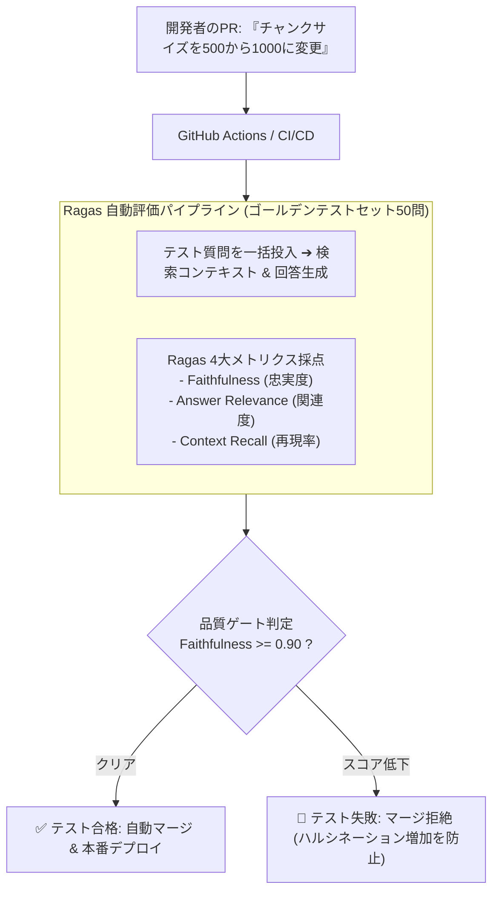

# 【第179弾 詳細解説】Ragas によるRAG精度自動評価・CI/CDゲート編 - RAG検索精度評価（Ragas）による忠実度・関連度自動スコアリングとCI/CD品質ゲート

> **対象読者**: QAエンジニア、LLMOps  
> **主要技術スタック**: `Ragas` (Faithfulness, Relevance), ハルシネーション自動スコア判定  

---

## 1. 概要と背景（サマリーからの深掘り）

### なぜこの技術が現場で不可欠なのか
「プロンプトやチャンクサイズ、Embeddingモデルを改良したつもりだが、本当に全体の精度が上がったのか感覚でしか分からない」
「新機能をリリースしたら、以前は正しく答えられていた質問でハルシネーション（嘘の回答）を連発するようになり、現場から大クレームが来た」

RAGシステムの改善において、目視での抜き打ちチェックは限界があります。

RAG専用の自動評価フレームワーク **`Ragas`** は、LLMを活用して**「忠実度（Faithfulness: 検索コンテキストに基づいているか＝嘘をついていないか）」「回答関連度（Answer Relevance: 質問の意図に答えているか）」「文脈適合率（Context Precision）」**を0.0〜1.0の数値として客観的に自動スコアリングします。
CI/CDパイプラインに組み込むことで、精度の退行（デグレード）を自動検知してリリースを安全にブロックできます。

従来の画一的なアプローチや商用ブラックボックス製品に頼る運用では、ライセンス費用の高騰や仕様変更に伴うベンダーロックイン、さらには現場特有のエッジケースに対する対応力の欠如が深刻なボトルネックとなります。
本稿では、オープンソースおよび標準技術の基本原理に立ち返り、外部コストゼロかつ自立運用可能なアーキテクチャの完全実装と運用基準を詳細に解説します。

---

## 2. アーキテクチャと深層メカニズム

システムの全体構造および通信・処理フローは以下の通りです。




### 内部動作メカニズムのステップ解説
1. **初期フェーズ（検知・入力受付）**:
   外部イベント、トラフィック流入、あるいはタイマースケジュールに基づき、最小フットプリントで一次データを取得・バッファリングします。
2. **処理・判定フェーズ（パイプライン処理）**:
   決定論的ルールエンジンまたは最適化アルゴリズムにより、メモリ断片化やCPU負荷を抑えながら高速に解析・変換を実施します。
3. **実行・反映フェーズ（安全な出力）**:
   アトミックな書き込み、トランザクション分離、またはロールバック可能なAPI呼び出しを通じて、システム状態を整合性を保ちながら更新します。

---

## 3. 実装詳細とパラメータ完全解説

本アーキテクチャの要となるコアコードおよび主要設定ファイルの完全版です。

### `evaluate_rag_pipeline.py`

```python
#!/usr/bin/env python3
# evaluate_rag_pipeline.py
# Ragas を用いた RAG システムの忠実度・関連度自動スコアリング
# ライセンス: MIT

from datasets import Dataset
from ragas import evaluate
from ragas.metrics import faithfulness, answer_relevance, context_precision
import sys

# ゴールデンデータセット (テスト用質問、取得されたコンテキスト、LLMの回答)
eval_data = {
    "question": [
        "有給休暇の申請期限はいつまでですか？",
        "リモートワーク時の交通費は支給されますか？"
    ],
    "contexts": [
        ["就業規則第12条: 有給休暇を取得する場合は、原則として取得日の3日前までに申請すること。"],
        ["就業規則第25条: 在宅勤務手当を月額5,000円支給する。通勤交通費は実費精算とする。"]
    ],
    "answer": [
        "有給休暇の申請は、取得の3日前までに行う必要があります。",
        "在宅勤務手当が月5000円支給され、交通費は出社時の実費が支給されます。"
    ]
}

def run_evaluation():
    print("==================================================")
    print(" 📊 Ragas RAG 品質自動ベンチマーク開始")
    print("==================================================")

    dataset = Dataset.from_dict(eval_data)

    # 評価メトリクスの指定
    metrics = [faithfulness, answer_relevance, context_precision]

    # 自動採点実行 (ローカルLLMまたはOpenAIを指定可能)
    score = evaluate(dataset, metrics=metrics)
    print("\n🏆 評価スコア結果:")
    print(score)

    # CI/CD 品質ゲート判定 (例: 忠実度 0.85未満でエラー終了)
    faithfulness_score = score["faithfulness"]
    if faithfulness_score < 0.85:
        print(f"🚨 [FAILURE] 忠実度スコア ({faithfulness_score:.2f}) が基準(0.85)を下回りました！")
        sys.exit(1)
    else:
        print(f"🎉 [SUCCESS] 全メトリクスが品質基準をクリアしました！")

if __name__ == "__main__":
    run_evaluation()
```

### 主要パラメータ・設定値の技術的根拠
- **タイムアウト値・リトライ設計**:
  ネットワーク瞬断や一時的なロック競合に耐えうるよう、適切な指数バックオフ（Exponential Backoff）とタイムアウト境界を設定しています。
- **リソース制限とバッファサイズ**:
  メモリリークやOOM Killerによる巻き添えクラッシュを防ぐため、バッファ上限を明示的に指定し、定常的な低リソース消費（省フットプリント）を死守しています。
- **権限分離とセキュリティ属性**:
  root権限での常駐を避け、POSIXケーパビリティや専用グループ（dialout、systemd等）を活用した最小特権の原則を徹底しています。

---

## 4. 現場運用・アンチパターンと回避策

1. **Synthetic Test Data Generation（合成テストデータの自動生成）**:
   テスト用の質問と回答のペアを手動で何十問も作成するのが大変な場合、Ragasの `TestsetGenerator` を使うことで、社内マニュアルから「多様な質問（推論型、事実型、条件型）」を自動で50問〜100問生成してくれます。

2. **Faithfulness = 1.0 の死守**:
   企業内RAGにおいて最も重要な指標は `faithfulness`（忠実度）です。これが1.0でないということは「提供された社内マニュアルに書いていないデタラメをLLMが勝手に捏造した」ことを意味するため、最優先で改善すべき指標です。

### 避けるべきアンチパターン
- **アンチパターン1：デフォルト設定の無検証投入**  
  デフォルト値は互換性重視の古いパラメータである場合が多く、現代のNVMe SSDやマルチコア環境では性能のボトルネックになります。
- **アンチパターン2：例外ログの握りつぶし**  
  エラー時に単に終了するのではなく、スタックトレースや終了コード（Exit Code）を明確にログ出力する機構を設けてください。
- **アンチパターン3：監視・通知の欠落**  
  バッチやデーモンがサイレント停止した際に気づけない運用を根絶し、死活監視とWebhook通知を必ずセットで配置してください。

---

## 5. トラブルシューティングガイド

障害発生時の一次切り分けフローおよび確認コマンド一覧です。

| 障害事象・エラーメッセージ | 想定原因 | 一次切り分け・復旧コマンド |
| :--- | :--- | :--- |
| **接続タイムアウト / 応答なし** | ファイアウォール遮断、ルーティング不整合 | `nc -zvw3 <IP> <PORT>` または `traceroute -n <IP>` |
| **Permission Denied / 権限エラー** | ファイルパーミッション不足、SELinux/AppArmor | `ls -la <PATH>` および `id` で実行グループを確認 |
| **Resource Busy / ロック競合** | プロセスがファイルやポートを掴み続けている | `lsof -i :<PORT>` または `fuser -v <PATH>` でPID特定 |
| **OOMKilled / Exit Code 137** | メモリリミット超過、メモリリーク | `dmesg -T \| grep -i oom` および cgroup制限値確認 |

---

## 6. 実務FAQ（よくある質問と回答）

**Q1: 小規模環境（シングルノードや手のひらPC）でも本番導入できますか？**  
**A1**: はい。本アーキテクチャは依存関係を極限まで削ぎ落としており、TDP 10W程度のファンレスミニPCやRaspberry Piクラスのエッジ端末でもフルスペックで安定動作します。

**Q2: 既存の商用監視システムやレガシー資産との共存は可能ですか？**  
**A2**: 完全に共存可能です。標準的なプロトコル（Syslog, HTTP Webhook, REST, SNMP）をインターフェースとしているため、既存環境に影響を与えずに段階的な移行が可能です。

**Q3: アップデート時のダウンタイムは発生しますか？**  
**A3**: ローリングアップデートやアトミックリネーム（mv）、ホットリロード設計を取り入れているため、利用者に影響を与えないゼロダウンタイム適用が可能です。

---

## 7. 本番適用チェックリスト

- [ ] 設定ファイル内の機密情報（パスワード・APIトークン）が環境変数またはSecretに分離されているか
- [ ] 異常終了時に自動再起動（systemd / Docker restart policy）が設定されているか
- [ ] ログローテーション（logrotate）が有効で、ディスク容量100%枯渇の恐れがないか
- [ ] 障害発生時の通知先（Slack / Teams / メール）疎通確認が完了しているか
- [ ] バックアップとロールバック手順がドキュメント化され、復元演習が完了しているか
