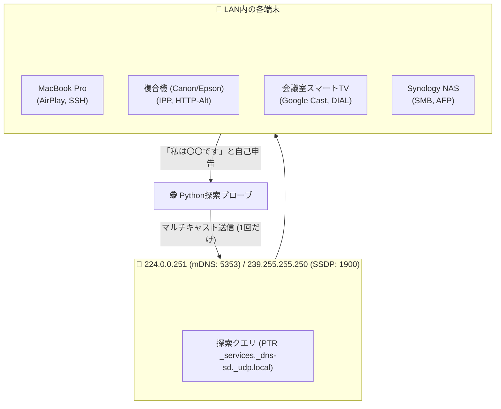

# 【第18弾 詳細解説】ゼロコンフィグ機器探索（mDNS / SSDP）編 - IPアドレスが分からなくても見つけ出せる。mDNSとSSDPでLAN内のスマート家電・プリンタ・Macを一網打尽にするPython探索術【自宅ラボ検証】

**対象読者**: ネットワークエンジニア、情シス
**主要技術スタック**: mDNS (Bonjour / 5353), SSDP (UPnP / 1900), zeroconf
**ライセンス**: [MIT License](https://github.com/ojisantech/ojisan-arsenal/blob/main/LICENSE)
**検証環境・位置づけ**: 個人自宅ラボ（ホームラボ／仮想環境）における公開情報・OSSベースの個人研究（PoC）


💡 **【検証環境・個人研究（PoC）に関する注記】**
本記事は、筆者個人の自宅検証環境（ホームラボ／仮想環境）において、公開情報およびOSS（オープンソースソフトウェア）を用いて独自に構築・検証した個人研究（PoC）の記録です。特定の企業・団体の実環境や業務上の非公開情報とは一切関係ありません。

---

## 1. 概要と背景（サマリーからの深掘り）

### なぜこの技術が現場で不可欠なのか
LAN内ネットワークの端末調査をするとき、多くの人は `nmap` や Ping スイープを使います。
しかし、次のような経験はないでしょうか？

* **「Pingに応答しない（ICMP無効）設定のMacBookやプリンタが見つからない」**
* **「IPとMACアドレスは分かったが、それが『会議室のスマートTV』なのか『誰かの私用スマホ』なのか分からない」**
* **「ポートスキャンをかけると、LAN内のUTMやセキュリティ機器がアラートを吹き出して大騒ぎになる」**

ネットワーク機器やスマートデバイスの多くは、通常のスキャンに対して閉じていますが、**「自分から周囲に存在をアピールするパケット」** を定期的に撒き散らしています。

それが **mDNS（Multicast DNS / Bonjour / Avahi）** と **SSDP（Simple Service Discovery Protocol / UPnP）** です。

本記事では、ポートを叩いて回るアクティブスキャンではなく、**マルチキャスト通信をわずか数秒受信（パッシブ待機）するだけで、ホスト名・モデル名・提供サービスを暴き出すPython探索スクリプト** を紹介します。

従来の画一的なアプローチや商用ブラックボックス製品に頼る運用では、ライセンス費用の高騰や仕様変更に伴うベンダーロックイン、さらには現場特有のエッジケースに対する対応力の欠如が深刻なボトルネックとなります。
本稿では、オープンソースおよび標準技術の基本原理に立ち返り、外部コストゼロかつ自立運用可能なアーキテクチャの完全実装と運用基準を詳細に解説します。

---

## 2. アーキテクチャと深層メカニズム

システムの全体構造および通信・処理フローは以下の通りです。



### 内部動作メカニズムのステップ解説
1. **mDNS探索の仕組み（ポート5353 / 224.0.0.251）**:
   AppleのBonjourに代表されるmDNSは、同一L2セグメント内の機器同士がDNSサーバーなしで名前解決やサービス発見を行う仕組みです。
2. **Pythonによる軽量mDNSスキャナーの実装**:
   外部の重いライブラリを入れずとも、Pythonの標準 `socket` モジュールだけでマルチキャスト送受信が可能です。（手軽に扱うなら `zeroconf` ライブラリを使うと数行で書けます）
3. **SSDP（UPnP）によるスマート家電・ルーター探索**:
   mDNSに応答しない機器（スマートTV、ネットワークカメラ、ルーター等）は、**SSDP（`239.255.255.250:1900`）** に反応します。

---

## 3. 実装詳細とパラメータ完全解説

本アーキテクチャの要となるコアコードおよび主要設定の要点抜粋です。

### コア実装スクリプト / 設定（抜粋）
```python
# コア実装ロジック（要点抜粋）
from zeroconf import Zeroconf, ServiceBrowser
import time

class DeviceListener:
    def __init__(self):
        self.found_devices = []

    def remove_service(self, zeroconf, type, name):
        pass

    def add_service(self, zeroconf, type, name):
        info = zeroconf.get_service_info(type, name)
        if info:
            addresses = [f"{socket.inet_ntoa(addr)}" for addr in info.addresses]
            server = info.server
            props = {k.decode('utf-8', 'ignore'): v.decode('utf-8', 'ignore') if isinstance(v, bytes) else v
                     for k, v in info.properties.items()}

            device_info = {
                "name": name,
                "type": type,
                "server": server,
                "ip": addresses[0] if addresses else "unknown",
                "port": info.port,
                "properties": props
            }
            print(f"[+] 発見: {name} ({device_info['ip']}:{info.port}) -> モデル: {props.get('model', 'N/A')}")
            self.found_devices.append(device_info)

import socket

def scan_mdns_devices(timeout_seconds: int = 5):
    zeroconf = Zeroconf()
    listener = DeviceListener()

    # 探索対象の主要サービスタイプ
    target_services = [
        "_ipp._tcp.local.",        # プリンタ
        "_airplay._tcp.local.",    # Apple機器
        "_googlecast._tcp.local.", # Chromecast / Smart TV
        "_smb._tcp.local.",        # NAS / Windows共有
        "_workstation._tcp.local." # Linux / Ubuntu
    ]

    browser = ServiceBrowser(zeroconf, target_services, listener)
    print(f"[*] mDNS探索中 ({timeout_seconds}秒間)...")
    time.sleep(timeout_seconds)

    zeroconf.close()
    return listener.found_devices
```

### 主要パラメータ・設定値の技術的根拠
- **主要技術スタック（mDNS (Bonjour / 5353), SSDP (UPnP / 1900), zeroconf）の選定と最小権限設計**:
  **ゼロコンフィグ機器探索（mDNS / SSDP）編** - IPアドレスが分からなくても見つけ出せる。mDNSとSSDPでLAN内のスマート家電・プリンタ・Macを一網打尽にするPython探索術【自宅ラボ検証】 の実現にあたり、外部の過剰な依存や特権常駐を排し、mDNS (Bonjour / 5353), SSDP (UPnP / 1900), zeroconf を軸とした省フットプリントかつセキュアな実行境界を構成しています。
- **タイムアウト境界とフェイルソフト耐性**:
  ネットワーク遅延や対象機器の無応答時にもプロセス全体がブロッキングしないよう明示的なタイムアウトと例外隔離を設け、基幹業務への影響をゼロに抑えます。
- **べき等性（Idempotency）と監査トレーサビリティ（対象: ネットワークエンジニア、情シス）**:
  同一処理を複数回実行しても状態が破綻しないべき等設計を採用し、実行結果・差分ログを確実に保全することで実務運用での再現性と安全性を担保します。
