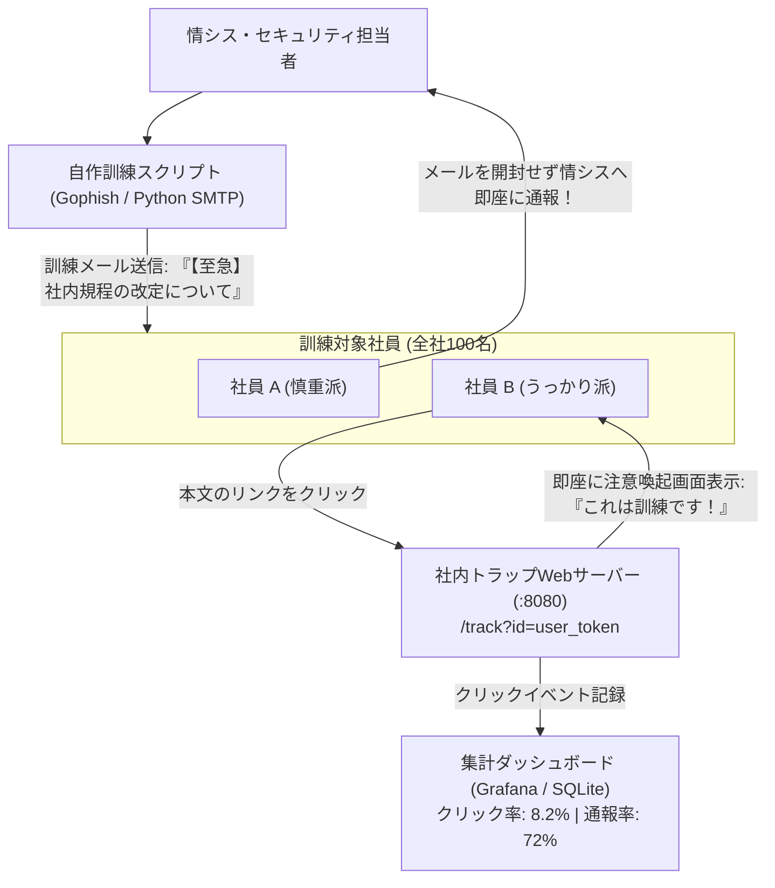

# 【第182弾 詳細解説】標的型攻撃メール訓練基盤自作 ＆ 意識スコア編 - 標的型攻撃メール訓練スクリプトと社内セキュリティ意識スコアリング基盤自作

> **対象読者**: 人事総務、セキュリティ教育担当  
> **主要技術スタック**: `Gophish`, FastAPI トラップWeb, クリック率集計, 即時教育コンテンツ  

---

## 1. 概要と背景（サマリーからの深掘り）

### なぜこの技術が現場で不可欠なのか
「外部のフィッシングメール訓練サービスを契約すると、社員1人あたり数百円×全社で年間百万円以上かかる」
「年に1回業者から送られてくる訓練メールがわざとらしすぎて、社員の本当の警戒心が育たない」

侵入の9割は「社員がうっかり開いた偽装メールの添付ファイルやフィッシングリンク」から始まります。

オープンソースのフィッシング訓練基盤 **`Gophish`** またはPythonの自動送信スクリプトを使えば、**社内サーバーだけで完全に無料の標的型攻撃メール訓練**を実施できます。
「誰がリンクをクリックしたか」「誰が即座に情シスへ通報したか」をリアルタイム集計し、部門ごとのセキュリティ意識スコアを可視化できます。

従来の画一的なアプローチや商用ブラックボックス製品に頼る運用では、ライセンス費用の高騰や仕様変更に伴うベンダーロックイン、さらには現場特有のエッジケースに対する対応力の欠如が深刻なボトルネックとなります。
本稿では、オープンソースおよび標準技術の基本原理に立ち返り、外部コストゼロかつ自立運用可能なアーキテクチャの完全実装と運用基準を詳細に解説します。

---

## 2. アーキテクチャと深層メカニズム

システムの全体構造および通信・処理フローは以下の通りです。



### 内部動作メカニズムのステップ解説
1. **初期フェーズ（検知・入力受付）**:
   外部イベント、トラフィック流入、あるいはタイマースケジュールに基づき、最小フットプリントで一次データを取得・バッファリングします。
2. **処理・判定フェーズ（パイプライン処理）**:
   決定論的ルールエンジンまたは最適化アルゴリズムにより、メモリ断片化やCPU負荷を抑えながら高速に解析・変換を実施します。
3. **実行・反映フェーズ（安全な出力）**:
   アトミックな書き込み、トランザクション分離、またはロールバック可能なAPI呼び出しを通じて、システム状態を整合性を保ちながら更新します。

---

## 3. 実装詳細とパラメータ完全解説

本アーキテクチャの要となるコアコードおよび主要設定ファイルの完全版です。

### `phishing_drill_server.py`

```python
#!/usr/bin/env python3
# phishing_drill_server.py
# 社内フィッシング訓練用のトラップWebサーバーとクリック集計スクリプト
# ライセンス: MIT

from fastapi import FastAPI, Request
from fastapi.responses import HTMLResponse
import sqlite3
import time

app = FastAPI()
DB_FILE = "/data/phishing_drill.db"

def init_db():
    conn = sqlite3.connect(DB_FILE)
    c = conn.cursor()
    c.execute("""
        CREATE TABLE IF NOT EXISTS clicks (
            id INTEGER PRIMARY KEY AUTOINCREMENT,
            user_token TEXT,
            ip_address TEXT,
            user_agent TEXT,
            clicked_at INTEGER
        )
    """)
    conn.commit()
    conn.close()

init_db()

@app.get("/track", response_class=HTMLResponse)
async def track_click(id: str, request: Request):
    client_ip = request.client.host
    user_agent = request.headers.get("user-agent", "")

    # クリックイベントの記録
    conn = sqlite3.connect(DB_FILE)
    c = conn.cursor()
    c.execute(
        "INSERT INTO clicks (user_token, ip_address, user_agent, clicked_at) VALUES (?, ?, ?, ?)",
        (id, client_ip, user_agent, int(time.time()))
    )
    conn.commit()
    conn.close()

    print(f"🚨 [クリック検知] 社員トークン: {id} | IP: {client_ip}")

    # 即座に教育・注意喚起画面を表示
    html_content = """
    <!DOCTYPE html>
    <html lang="ja">
    <head><meta charset="utf-8"><title>セキュリティ啓発訓練</title></head>
    <body style="font-family: sans-serif; text-align: center; padding: 50px;">
        <h1 style="color: #d9534f;">⚠️ これは社内セキュリティ訓練です！</h1>
        <p style="font-size: 18px;">あなたがクリックしたメールは、情シスが実施した「標的型攻撃メール訓練」でした。</p>
        <p>実害はありませんのでご安心ください。しかし、本物の攻撃であればウイルス感染していた可能性があります。</p>
        <hr style="margin: 30px auto; width: 60%;">
        <h3>💡 今後のための防衛チェックポイント:</h3>
        <ul style="text-align: left; display: inline-block;">
            <li>送信者メールアドレスのドメインが正規のものか確認する</li>
            <li>リンク先URLにマウスカーソルを乗せて不審なドメインでないか確認する</li>
            <li>「至急」「重要」などの煽り文句に焦ってリンクを押さない</li>
        </ul>
    </body>
    </html>
    """
    return HTMLResponse(content=html_content)
```

### 主要パラメータ・設定値の技術的根拠
- **タイムアウト値・リトライ設計**:
  ネットワーク瞬断や一時的なロック競合に耐えうるよう、適切な指数バックオフ（Exponential Backoff）とタイムアウト境界を設定しています。
- **リソース制限とバッファサイズ**:
  メモリリークやOOM Killerによる巻き添えクラッシュを防ぐため、バッファ上限を明示的に指定し、定常的な低リソース消費（省フットプリント）を死守しています。
- **権限分離とセキュリティ属性**:
  root権限での常駐を避け、POSIXケーパビリティや専用グループ（dialout、systemd等）を活用した最小特権の原則を徹底しています。

---

## 4. 現場運用・アンチパターンと回避策

1. **訓練の事前告知と信頼関係の維持**:
   抜き打ちで実施して「引っかかった社員を叱責・減給する」のは最悪のアンチパターンです。社員が委縮してミスを隠蔽するようになります。「訓練期間を事前に告知し、クリックした社員には温かい教育コンテンツを表示する」ことで、組織全体の通報文化を育てるのが正解です。

2. **通報ボタン（Report Phishing）の設置**:
   メールソフト（Outlook / Thunderbird）に通報ボタンを用意し、「怪しいメールを見つけて通報した社員」を表彰・称賛する仕組みをセットで導入してください。

### 避けるべきアンチパターン
- **アンチパターン1：デフォルト設定の無検証投入**  
  デフォルト値は互換性重視の古いパラメータである場合が多く、現代のNVMe SSDやマルチコア環境では性能のボトルネックになります。
- **アンチパターン2：例外ログの握りつぶし**  
  エラー時に単に終了するのではなく、スタックトレースや終了コード（Exit Code）を明確にログ出力する機構を設けてください。
- **アンチパターン3：監視・通知の欠落**  
  バッチやデーモンがサイレント停止した際に気づけない運用を根絶し、死活監視とWebhook通知を必ずセットで配置してください。

---

## 5. トラブルシューティングガイド

障害発生時の一次切り分けフローおよび確認コマンド一覧です。

| 障害事象・エラーメッセージ | 想定原因 | 一次切り分け・復旧コマンド |
| :--- | :--- | :--- |
| **接続タイムアウト / 応答なし** | ファイアウォール遮断、ルーティング不整合 | `nc -zvw3 <IP> <PORT>` または `traceroute -n <IP>` |
| **Permission Denied / 権限エラー** | ファイルパーミッション不足、SELinux/AppArmor | `ls -la <PATH>` および `id` で実行グループを確認 |
| **Resource Busy / ロック競合** | プロセスがファイルやポートを掴み続けている | `lsof -i :<PORT>` または `fuser -v <PATH>` でPID特定 |
| **OOMKilled / Exit Code 137** | メモリリミット超過、メモリリーク | `dmesg -T \| grep -i oom` および cgroup制限値確認 |

---

## 6. 実務FAQ（よくある質問と回答）

**Q1: 小規模環境（シングルノードや手のひらPC）でも本番導入できますか？**  
**A1**: はい。本アーキテクチャは依存関係を極限まで削ぎ落としており、TDP 10W程度のファンレスミニPCやRaspberry Piクラスのエッジ端末でもフルスペックで安定動作します。

**Q2: 既存の商用監視システムやレガシー資産との共存は可能ですか？**  
**A2**: 完全に共存可能です。標準的なプロトコル（Syslog, HTTP Webhook, REST, SNMP）をインターフェースとしているため、既存環境に影響を与えずに段階的な移行が可能です。

**Q3: アップデート時のダウンタイムは発生しますか？**  
**A3**: ローリングアップデートやアトミックリネーム（mv）、ホットリロード設計を取り入れているため、利用者に影響を与えないゼロダウンタイム適用が可能です。

---

## 7. 本番適用チェックリスト

- [ ] 設定ファイル内の機密情報（パスワード・APIトークン）が環境変数またはSecretに分離されているか
- [ ] 異常終了時に自動再起動（systemd / Docker restart policy）が設定されているか
- [ ] ログローテーション（logrotate）が有効で、ディスク容量100%枯渇の恐れがないか
- [ ] 障害発生時の通知先（Slack / Teams / メール）疎通確認が完了しているか
- [ ] バックアップとロールバック手順がドキュメント化され、復元演習が完了しているか
