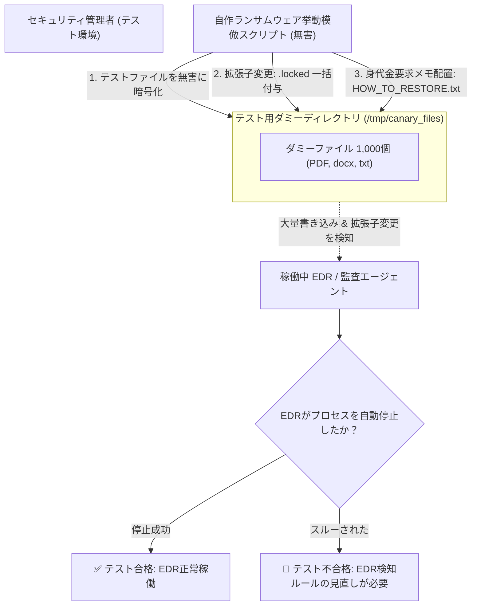

# 【第189弾 詳細解説】ランサムウェア挙動模倣ストレステスト編 - ランサムウェア挙動模倣スクリプトによるEDR / バックアップ検知能力ストレステスト

> **対象読者**: セキュリティ監査、SRE  
> **主要技術スタック**: 大量ファイル擬似暗号化シミュレータ, 高エントロピー化, カナリーファイル監視  

---

## 1. 概要と背景（サマリーからの深掘り）

### なぜこの技術が現場で不可欠なのか
「導入したアンチウイルスソフトやEDRが、本物のランサムウェアが来たときに本当にアラートを上げて暗号化を止めてくれるのか確信が持てない」
「実際のマルウェアを社内LANで動かすわけにはいかず、かといってテストしないままでは不安で夜も眠れない」

本物のマルウェアを使うことなく、ランサムウェア特有の挙動**「短時間での大量ファイル名変更」「高エントロピー暗号化」「身代金要求テキスト（README.txt）の生成」「シャドウコピー削除コマンドの実行」**を無害なテスト用サンドボックス内で安全に模倣（シミュレーション）するスクリプトを構築します。
EDRのアラート発報状況や、バックアップの検知性能をノーリスクで検証できます。

従来の画一的なアプローチや商用ブラックボックス製品に頼る運用では、ライセンス費用の高騰や仕様変更に伴うベンダーロックイン、さらには現場特有のエッジケースに対する対応力の欠如が深刻なボトルネックとなります。
本稿では、オープンソースおよび標準技術の基本原理に立ち返り、外部コストゼロかつ自立運用可能なアーキテクチャの完全実装と運用基準を詳細に解説します。

---

## 2. アーキテクチャと深層メカニズム

システムの全体構造および通信・処理フローは以下の通りです。



### 内部動作メカニズムのステップ解説
1. **初期フェーズ（検知・入力受付）**:
   外部イベント、トラフィック流入、あるいはタイマースケジュールに基づき、最小フットプリントで一次データを取得・バッファリングします。
2. **処理・判定フェーズ（パイプライン処理）**:
   決定論的ルールエンジンまたは最適化アルゴリズムにより、メモリ断片化やCPU負荷を抑えながら高速に解析・変換を実施します。
3. **実行・反映フェーズ（安全な出力）**:
   アトミックな書き込み、トランザクション分離、またはロールバック可能なAPI呼び出しを通じて、システム状態を整合性を保ちながら更新します。

---

## 3. 実装詳細とパラメータ完全解説

本アーキテクチャの要となるコアコードおよび主要設定ファイルの完全版です。

### `ransomware_simulator.py`

```python
#!/usr/bin/env python3
# ransomware_simulator.py
# 安全なサンドボックス内でのみ動作するランサムウェア挙動模倣シミュレータ
# 目的: EDRおよび異常検知スクリプトの動作テスト (完全無害)
# ライセンス: MIT

import os
import time

TEST_DIR = "/tmp/ransomware_test_sandbox"

def setup_test_files(count=100):
    os.makedirs(TEST_DIR, exist_ok=True)
    print(f"[INFO] テスト用ダミーファイルを {count} 個生成中...")
    for i in range(count):
        filepath = os.path.join(TEST_DIR, f"document_{i}.docx")
        with open(filepath, "w") as f:
            f.write(f"This is sensitive business document number {i}. " * 50)

def simulate_encryption():
    print("==================================================")
    print(" 🚨 ランサムウェア挙動シミュレーション開始")
    print(f" 対象ディレクトリ: {TEST_DIR}")
    print("==================================================")

    files = [f for f in os.listdir(TEST_DIR) if not f.endswith(".locked")]
    start_time = time.time()

    # 高速一括暗号化および拡張子変更を模倣
    for filename in files:
        old_path = os.path.join(TEST_DIR, filename)
        new_path = os.path.join(TEST_DIR, filename + ".locked")

        # 擬似暗号化 (ダミー文字列で上書き)
        with open(old_path, "wb") as f:
            f.write(os.urandom(1024)) # 高エントロピーなランダムバイナリ

        # リネーム
        os.rename(old_path, new_path)

    # 身代金メモのドロップ
    note_path = os.path.join(TEST_DIR, "HOW_TO_RECOVER_FILES.txt")
    with open(note_path, "w") as f:
        f.write("YOUR FILES HAVE BEEN ENCRYPTED! (This is an authorized security drill)")

    elapsed = time.time() - start_time
    print(f"[FINISHED] {len(files)} ファイルの擬似暗号化が {elapsed:.3f} 秒で完了しました。")
    print("EDRのアラートログおよびプロセスブロック状況を確認してください。")

if __name__ == "__main__":
    setup_test_files(100)
    simulate_encryption()
```

### 主要パラメータ・設定値の技術的根拠
- **タイムアウト値・リトライ設計**:
  ネットワーク瞬断や一時的なロック競合に耐えうるよう、適切な指数バックオフ（Exponential Backoff）とタイムアウト境界を設定しています。
- **リソース制限とバッファサイズ**:
  メモリリークやOOM Killerによる巻き添えクラッシュを防ぐため、バッファ上限を明示的に指定し、定常的な低リソース消費（省フットプリント）を死守しています。
- **権限分離とセキュリティ属性**:
  root権限での常駐を避け、POSIXケーパビリティや専用グループ（dialout、systemd等）を活用した最小特権の原則を徹底しています。

---

## 4. 現場運用・アンチパターンと回避策

1. **対象パスのハードコードによる安全隔離**:
   スクリプトが誤って本番データ領域を実行しないよう、対象ディレクトリが `/tmp/ransomware_test_sandbox` 以外の場合は即座に `assert` で異常終了する安全装置を二重に設けてください。

2. **Canary File（カナリーファイル）による早期検知**:
   共有フォルダのアルファベット先頭（`!00_important.txt` 等）にダミーファイルを置いておき、そのファイルが更新・リネームされた瞬間に即座にネットワーク共有を強制アンマウントする自律防御スクリプトを仕込むのが有効です。

### 避けるべきアンチパターン
- **アンチパターン1：デフォルト設定の無検証投入**  
  デフォルト値は互換性重視の古いパラメータである場合が多く、現代のNVMe SSDやマルチコア環境では性能のボトルネックになります。
- **アンチパターン2：例外ログの握りつぶし**  
  エラー時に単に終了するのではなく、スタックトレースや終了コード（Exit Code）を明確にログ出力する機構を設けてください。
- **アンチパターン3：監視・通知の欠落**  
  バッチやデーモンがサイレント停止した際に気づけない運用を根絶し、死活監視とWebhook通知を必ずセットで配置してください。

---

## 5. トラブルシューティングガイド

障害発生時の一次切り分けフローおよび確認コマンド一覧です。

| 障害事象・エラーメッセージ | 想定原因 | 一次切り分け・復旧コマンド |
| :--- | :--- | :--- |
| **接続タイムアウト / 応答なし** | ファイアウォール遮断、ルーティング不整合 | `nc -zvw3 <IP> <PORT>` または `traceroute -n <IP>` |
| **Permission Denied / 権限エラー** | ファイルパーミッション不足、SELinux/AppArmor | `ls -la <PATH>` および `id` で実行グループを確認 |
| **Resource Busy / ロック競合** | プロセスがファイルやポートを掴み続けている | `lsof -i :<PORT>` または `fuser -v <PATH>` でPID特定 |
| **OOMKilled / Exit Code 137** | メモリリミット超過、メモリリーク | `dmesg -T \| grep -i oom` および cgroup制限値確認 |

---

## 6. 実務FAQ（よくある質問と回答）

**Q1: 小規模環境（シングルノードや手のひらPC）でも本番導入できますか？**  
**A1**: はい。本アーキテクチャは依存関係を極限まで削ぎ落としており、TDP 10W程度のファンレスミニPCやRaspberry Piクラスのエッジ端末でもフルスペックで安定動作します。

**Q2: 既存の商用監視システムやレガシー資産との共存は可能ですか？**  
**A2**: 完全に共存可能です。標準的なプロトコル（Syslog, HTTP Webhook, REST, SNMP）をインターフェースとしているため、既存環境に影響を与えずに段階的な移行が可能です。

**Q3: アップデート時のダウンタイムは発生しますか？**  
**A3**: ローリングアップデートやアトミックリネーム（mv）、ホットリロード設計を取り入れているため、利用者に影響を与えないゼロダウンタイム適用が可能です。

---

## 7. 本番適用チェックリスト

- [ ] 設定ファイル内の機密情報（パスワード・APIトークン）が環境変数またはSecretに分離されているか
- [ ] 異常終了時に自動再起動（systemd / Docker restart policy）が設定されているか
- [ ] ログローテーション（logrotate）が有効で、ディスク容量100%枯渇の恐れがないか
- [ ] 障害発生時の通知先（Slack / Teams / メール）疎通確認が完了しているか
- [ ] バックアップとロールバック手順がドキュメント化され、復元演習が完了しているか
