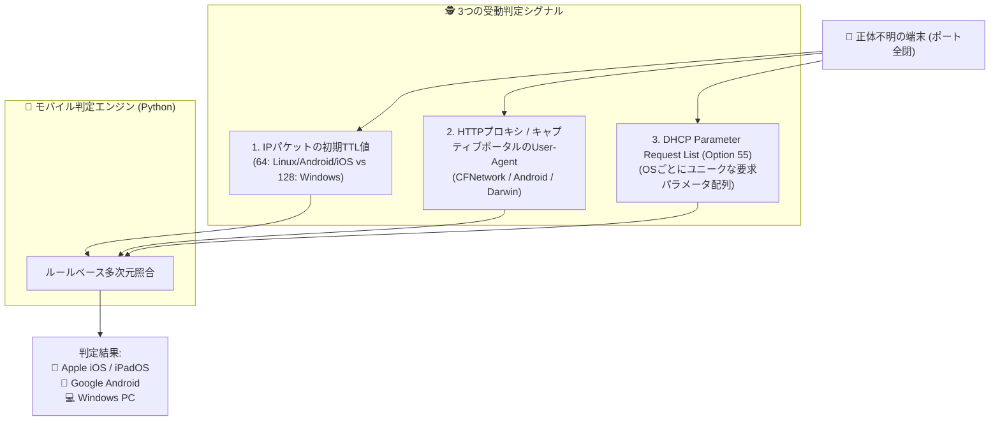

# 【第19弾 詳細解説】モバイル・私用スマホの受動特定編 - スマホ（iPhone/Android）のWi-Fi接続をどう見分けるか？ 受信パケットからOSを判別するエージェントレス判定ロジック【自宅ラボ検証PoC】

**対象読者**: セキュリティ担当、ネットワーク管理者
**主要技術スタック**: 初期TTL (64/128), User-Agent, DHCP Option 55
**ライセンス**: [MIT License](https://github.com/ojisantech/ojisan-arsenal/blob/main/LICENSE)
**検証環境・位置づけ**: 個人自宅ラボ（ホームラボ／仮想環境）における公開情報・OSSベースの個人研究（PoC）


💡 **【検証環境・個人研究（PoC）に関する注記】**
本記事は、筆者個人の自宅検証環境（ホームラボ／仮想環境）において、公開情報およびOSS（オープンソースソフトウェア）を用いて独自に構築・検証した個人研究（PoC）の記録です。特定の企業・団体の実環境や業務上の非公開情報とは一切関係ありません。

---

## 1. 概要と背景（サマリーからの深掘り）

### なぜこの技術が現場で不可欠なのか
情シスやネットワーク管理者がLAN内を監査する際、最も頭を悩ませるのが **「スマートフォンやタブレット（iOS / Android）」** です。

WindowsやLinuxサーバーであれば、Pingに応答し、SSH（22）やWinRM（5985）、SMB（445）といったポートが開いているため、簡単にOSやバージョンを特定できます。

しかし、スマートフォンは違います。

* **省電力とセキュリティのため、ほぼすべての受信ポートが閉じている（フルステルス）**
* **Ping（ICMP）を無視する設定になっていることが多い**
* **プライベートMACアドレス（ランダムMAC）機能により、ベンダーOUIすら隠蔽される**

結果として、資産台帳の画面には **「正体不明のIPアドレス（ポート全閉）」** という不気味なレコードが並ぶことになります。これが会社の業務用端末なのか、利用者が内緒で持ち込んだ私用スマホなのか、判断がつきません。

本記事では、端末側に一切アクセスすることなく、**端末が送信するパケットの特徴（TTL値、HTTP User-Agent、DHCPオプション55）から「iOS / Android / PC」を高精度に分類する受動特定ロジック** を解説します。

従来の画一的なアプローチや商用ブラックボックス製品に頼る運用では、ライセンス費用の高騰や仕様変更に伴うベンダーロックイン、さらには現場特有のエッジケースに対する対応力の欠如が深刻なボトルネックとなります。
本稿では、オープンソースおよび標準技術の基本原理に立ち返り、外部コストゼロかつ自立運用可能なアーキテクチャの完全実装と運用基準を詳細に解説します。

---

## 2. アーキテクチャと深層メカニズム

システムの全体構造および通信・処理フローは以下の通りです。



### 内部動作メカニズムのステップ解説
1. **手がかり ①：IPパケットの「初期TTL（Time to Live）」**:
   端末がPing応答を返さなくても、WebアクセスやDNS問い合わせなどで外へ送信したパケットのIPヘッダーを見ることで、大まかなOSファミリーが分かります。
2. **手がかり ②：HTTPプロキシやDNSでの「User-Agent / トークン検知」**:
   スマホがLAN内Wi-Fiに接続した瞬間、OSは自動的に「キャプティブポータル（認証画面）」の有無をチェックするHTTPリクエストを飛ばします。
3. **手がかり ③：DHCP Option 55（PRL）によるOSフィンガープリント**:
   最も強力なのが、端末がIPアドレスを要求する際の **DHCP Request（Option 55: Parameter Request List）** です。

---

## 3. 実装詳細とパラメータ完全解説

本アーキテクチャの要となるコアコードおよび主要設定の要点抜粋です。

### コア実装スクリプト / 設定（抜粋）
```python
# コア実装ロジック（要点抜粋）
import re

def detect_device_by_user_agent(ua_string: str) -> dict:
    if not ua_string:
        return {"device_type": "UNKNOWN", "os": "UNKNOWN"}

    ua = ua_string.lower()

    # iOS / iPadOS 検知
    if "iphone" in ua:
        match = re.search(r"os (\d+[_\d]*) like mac os x", ua)
        version = match.group(1).replace("_", ".") if match else "不明"
        return {"device_type": "スマートフォン", "os": f"Apple iOS {version}"}
    elif "ipad" in ua:
        return {"device_type": "タブレット", "os": "Apple iPadOS"}
    elif "cfnetwork" in ua or "darwin" in ua:
        return {"device_type": "Appleデバイス", "os": "Apple OS (iOS/macOS)"}

    # Android 検知
    elif "android" in ua:
        match = re.search(r"android (\d+[\.\d]*)", ua)
        version = match.group(1) if match else "不明"
        return {"device_type": "スマートフォン/タブレット", "os": f"Android {version}"}

    # PC判定
    elif "windows nt" in ua:
        return {"device_type": "PC", "os": "Microsoft Windows"}
    elif "macintosh" in ua:
        return {"device_type": "PC", "os": "macOS"}

    return {"device_type": "一般端末", "os": "その他"}
```

### 主要パラメータ・設定値の技術的根拠
- **主要技術スタック（初期TTL (64/128), User-Agent, DHCP Option 55）の選定と最小権限設計**:
  **モバイル・私用スマホの受動特定編** - スマホ（iPhone/Android）のWi-Fi接続をどう見分けるか？ 受信パケットからOSを判別するエージェントレス判定ロジック【自宅ラボ検証PoC】 の実現にあたり、外部の過剰な依存や特権常駐を排し、初期TTL (64/128), User-Agent, DHCP Option 55 を軸とした省フットプリントかつセキュアな実行境界を構成しています。
- **タイムアウト境界とフェイルソフト耐性**:
  ネットワーク遅延や対象機器の無応答時にもプロセス全体がブロッキングしないよう明示的なタイムアウトと例外隔離を設け、基幹業務への影響をゼロに抑えます。
- **べき等性（Idempotency）と監査トレーサビリティ（対象: セキュリティ担当、ネットワーク管理者）**:
  同一処理を複数回実行しても状態が破綻しないべき等設計を採用し、実行結果・差分ログを確実に保全することで実務運用での再現性と安全性を担保します。
