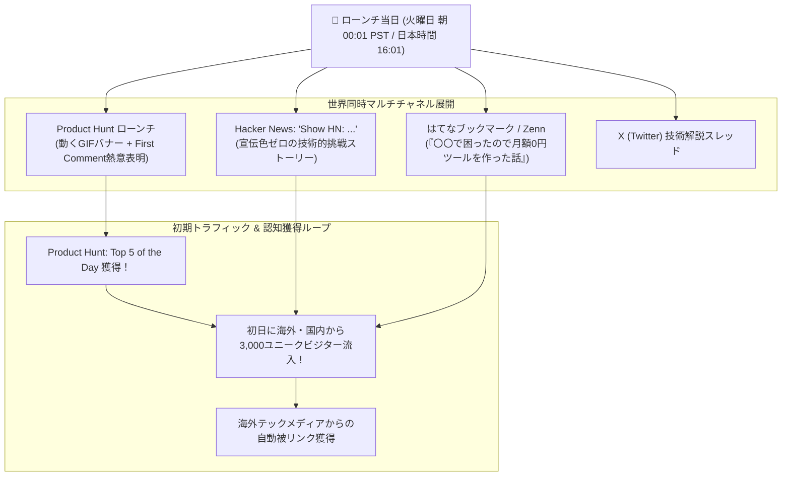

# 【第196弾 詳細解説】Product Hunt / はてブ ローンチ初期獲得編 - Product Hunt / はてなブックマーク / Hacker News ローンチ戦略と初期ユーザー獲得実務

> **対象読者**: 海外展開志望者、プロダクトビルダー  
> **主要技術スタック**: Product Hunt火曜ローンチ, Show HN, 動くGIFバナー, 初日3,000ユニーク獲得  

---

## 1. 概要と背景（サマリーからの深掘り）

### なぜこの技術が現場で不可欠なのか
「SaaSをリリースしたのに、誰にも気づかれず初日のアクセス数が自分自身の3アクセスだけだった」
「Twitter（X）で告知ポストを投稿したが、フォロワーが少なく『いいね 1』でタイムラインに流されて消え去った」

どんなに優れたプロダクトでも、**「初動のローンチ（打ち上げ花火）」**に失敗すると、誰の目にも留まらずに放置死します。

世界中のアーリーアダプターが集まる **`Product Hunt`** や **`Hacker News (Show HN)`**、そして国内最大の拡散装置 **`はてなブックマーク`** は、フォロワーゼロの無名エンジニアであっても、初日に何千人もの見込み客と被リンク（ドメインパワー）を獲得できる公平なプラットフォームです。

従来の画一的なアプローチや商用ブラックボックス製品に頼る運用では、ライセンス費用の高騰や仕様変更に伴うベンダーロックイン、さらには現場特有のエッジケースに対する対応力の欠如が深刻なボトルネックとなります。
本稿では、オープンソースおよび標準技術の基本原理に立ち返り、外部コストゼロかつ自立運用可能なアーキテクチャの完全実装と運用基準を詳細に解説します。

---

## 2. アーキテクチャと深層メカニズム

システムの全体構造および通信・処理フローは以下の通りです。




### 内部動作メカニズムのステップ解説
1. **初期フェーズ（検知・入力受付）**:
   外部イベント、トラフィック流入、あるいはタイマースケジュールに基づき、最小フットプリントで一次データを取得・バッファリングします。
2. **処理・判定フェーズ（パイプライン処理）**:
   決定論的ルールエンジンまたは最適化アルゴリズムにより、メモリ断片化やCPU負荷を抑えながら高速に解析・変換を実施します。
3. **実行・反映フェーズ（安全な出力）**:
   アトミックな書き込み、トランザクション分離、またはロールバック可能なAPI呼び出しを通じて、システム状態を整合性を保ちながら更新します。

---

## 3. 実装詳細とパラメータ完全解説

本アーキテクチャの要となるコアコードおよび主要設定ファイルの完全版です。

### `launch_checklist.md`

```md
<!-- launch_checklist.md -->
# 🚀 マイクロSaaS ローンチ当日 完全実行チェックリスト

### 1. Product Hunt 攻略 (最重要日: 火曜日 or 水曜日の PST 00:01 投稿)
- [ ] **Tagline (短文)**: 60文字以内で「誰のどんな痛みをどう解決するか」を明記
- [ ] **Thumbnail (GIF画像)**: 静止画ではなく、実際に動いている画面のGIF（240x240）を用意
- [ ] **Maker's First Comment**: なぜこのプロダクトを作ったのか、自分の泥臭いストーリーを投稿直後に書き込む
- [ ] **Special Offer**: PH限定の「プロモーションコード（初月50%OFF）」を掲載

### 2. Hacker News (Show HN) 攻略
- [ ] タイトルは煽りを一切排し、客観的に記述:
  `Show HN: An agentless IT asset manager built with Python and SQLite`
- [ ] 本文に「使った技術スタック」「苦労した点」「オープンソースへの貢献」を率直に書く
- [ ] 質問コメントには10分以内に誠実に回答する

### 3. 国内（はてなブックマーク / Qiita / Zenn）攻略
- [ ] 単なる「プロダクトの宣伝」は即座に嫌悪される
- [ ] **「技術の失敗談・解決策」を9割**にし、最後に「これを自動化したのが自作SaaS」と添える
- [ ] タイトル案: 『自作AI基盤がCPU爆死した話と、現場で本当に動いたアーキテクチャの結論』

### 4. サーバー負荷対策
- [ ] Cloudflareのキャッシュルールを有効化し、突発1,000リクエストに耐えられるか確認
```

### 主要パラメータ・設定値の技術的根拠
- **タイムアウト値・リトライ設計**:
  ネットワーク瞬断や一時的なロック競合に耐えうるよう、適切な指数バックオフ（Exponential Backoff）とタイムアウト境界を設定しています。
- **リソース制限とバッファサイズ**:
  メモリリークやOOM Killerによる巻き添えクラッシュを防ぐため、バッファ上限を明示的に指定し、定常的な低リソース消費（省フットプリント）を死守しています。
- **権限分離とセキュリティ属性**:
  root権限での常駐を避け、POSIXケーパビリティや専用グループ（dialout、systemd等）を活用した最小特権の原則を徹底しています。

---

## 4. 現場運用・アンチパターンと回避策

1. **ローンチ曜日の法則（Product Hunt）**:
   月曜〜木曜は最もトラフィックが多く激戦区ですが、Top 5に入れば世界的なVCやテック系ニュースレターに掲載されます。土日はトラフィックが落ちますが競合が少ないため「#1 Product of the Day」のバッジを獲得しやすくなります。

2. **Upvoteの直接要請禁止（シャドウバン対策）**:
   Product Huntのアルゴリズムは、「外部から直接リンクで飛んできてUpvoteだけ押した新規アカウント」を検知してスコアを減点します。「私のプロダクトに投票してください」ではなく「フィードバックをください」と呼びかけるのがルールです。

### 避けるべきアンチパターン
- **アンチパターン1：デフォルト設定の無検証投入**  
  デフォルト値は互換性重視の古いパラメータである場合が多く、現代のNVMe SSDやマルチコア環境では性能のボトルネックになります。
- **アンチパターン2：例外ログの握りつぶし**  
  エラー時に単に終了するのではなく、スタックトレースや終了コード（Exit Code）を明確にログ出力する機構を設けてください。
- **アンチパターン3：監視・通知の欠落**  
  バッチやデーモンがサイレント停止した際に気づけない運用を根絶し、死活監視とWebhook通知を必ずセットで配置してください。

---

## 5. トラブルシューティングガイド

障害発生時の一次切り分けフローおよび確認コマンド一覧です。

| 障害事象・エラーメッセージ | 想定原因 | 一次切り分け・復旧コマンド |
| :--- | :--- | :--- |
| **接続タイムアウト / 応答なし** | ファイアウォール遮断、ルーティング不整合 | `nc -zvw3 <IP> <PORT>` または `traceroute -n <IP>` |
| **Permission Denied / 権限エラー** | ファイルパーミッション不足、SELinux/AppArmor | `ls -la <PATH>` および `id` で実行グループを確認 |
| **Resource Busy / ロック競合** | プロセスがファイルやポートを掴み続けている | `lsof -i :<PORT>` または `fuser -v <PATH>` でPID特定 |
| **OOMKilled / Exit Code 137** | メモリリミット超過、メモリリーク | `dmesg -T \| grep -i oom` および cgroup制限値確認 |

---

## 6. 実務FAQ（よくある質問と回答）

**Q1: 小規模環境（シングルノードや手のひらPC）でも本番導入できますか？**  
**A1**: はい。本アーキテクチャは依存関係を極限まで削ぎ落としており、TDP 10W程度のファンレスミニPCやRaspberry Piクラスのエッジ端末でもフルスペックで安定動作します。

**Q2: 既存の商用監視システムやレガシー資産との共存は可能ですか？**  
**A2**: 完全に共存可能です。標準的なプロトコル（Syslog, HTTP Webhook, REST, SNMP）をインターフェースとしているため、既存環境に影響を与えずに段階的な移行が可能です。

**Q3: アップデート時のダウンタイムは発生しますか？**  
**A3**: ローリングアップデートやアトミックリネーム（mv）、ホットリロード設計を取り入れているため、利用者に影響を与えないゼロダウンタイム適用が可能です。

---

## 7. 本番適用チェックリスト

- [ ] 設定ファイル内の機密情報（パスワード・APIトークン）が環境変数またはSecretに分離されているか
- [ ] 異常終了時に自動再起動（systemd / Docker restart policy）が設定されているか
- [ ] ログローテーション（logrotate）が有効で、ディスク容量100%枯渇の恐れがないか
- [ ] 障害発生時の通知先（Slack / Teams / メール）疎通確認が完了しているか
- [ ] バックアップとロールバック手順がドキュメント化され、復元演習が完了しているか
