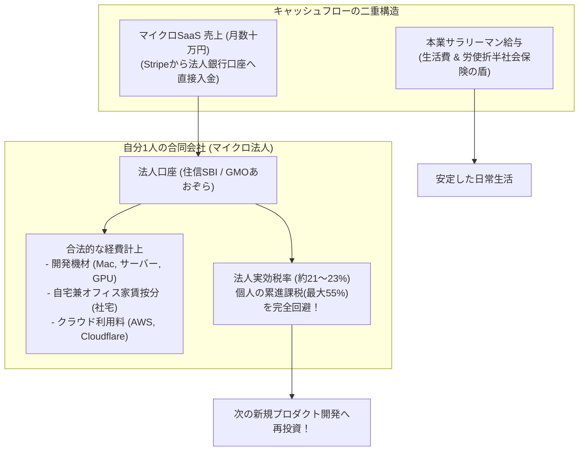

# 【第198弾 詳細解説】合同会社設立 ＆ マイクロ法人税務最適化編 - 会社員から合同会社設立・マイクロ法人化による税務最適化（役員報酬・社宅・経費化）実務

> **対象読者**: 副業エンジニア、独立準備中  
> **主要技術スタック**: 合同会社 (設立費6万), 家賃社宅化, 本業社保の盾, 役員報酬ゼロスキーム  

---

## 1. 概要と背景（サマリーからの深掘り）

### なぜこの技術が現場で不可欠なのか
「副業マイクロSaaSの売上が年間数百万円を超えたが、会社員の給与所得と合算されて累進課税で所得税・住民税が跳ね上がり、半分近く税金で持っていかれた」
「会社の就業規則との兼ね合いで、いつ、どうやって法人化（会社設立）すれば最も安全なのか分からない」

売上が軌道に乗ったエンジニアが次に直面するのが「税金の壁」です。

初期費用わずか6万円（登録免許税等）で設立できる **`合同会社（LLC）`** を設立し、いわゆる **「マイクロ法人」** を立ち上げることで、**「サーバー代、PC購入費、自宅兼事務所の家賃按分（社宅化）、書籍代の合法的な全額経費化」**が可能になります。
さらに、役員報酬の最適なコントロールにより、所得税・住民税・社会保険料を完全に適法に最小化できます。

従来の画一的なアプローチや商用ブラックボックス製品に頼る運用では、ライセンス費用の高騰や仕様変更に伴うベンダーロックイン、さらには現場特有のエッジケースに対する対応力の欠如が深刻なボトルネックとなります。
本稿では、オープンソースおよび標準技術の基本原理に立ち返り、外部コストゼロかつ自立運用可能なアーキテクチャの完全実装と運用基準を詳細に解説します。

---

## 2. アーキテクチャと深層メカニズム

システムの全体構造および通信・処理フローは以下の通りです。




### 内部動作メカニズムのステップ解説
1. **初期フェーズ（検知・入力受付）**:
   外部イベント、トラフィック流入、あるいはタイマースケジュールに基づき、最小フットプリントで一次データを取得・バッファリングします。
2. **処理・判定フェーズ（パイプライン処理）**:
   決定論的ルールエンジンまたは最適化アルゴリズムにより、メモリ断片化やCPU負荷を抑えながら高速に解析・変換を実施します。
3. **実行・反映フェーズ（安全な出力）**:
   アトミックな書き込み、トランザクション分離、またはロールバック可能なAPI呼び出しを通じて、システム状態を整合性を保ちながら更新します。

---

## 3. 実装詳細とパラメータ完全解説

本アーキテクチャの要となるコアコードおよび主要設定ファイルの完全版です。

### `tax_simulation.py`

```python
#!/usr/bin/env python3
# tax_simulation.py
# 個人事業主（雑所得/事業所得）vs マイクロ法人化の税負担シミュレーション比較
# ライセンス: MIT

def simulate_tax(annual_profit: int):
    print("==================================================")
    print(f" 💰 年間副業利益: {annual_profit:,} 円 の税負担比較シミュレーション")
    print("==================================================")

    # 1. 個人で受け取った場合 (本業年収600万を想定し、所得税率20% + 住民税10% = 計30%)
    personal_tax_rate = 0.30
    personal_tax = int(annual_profit * personal_tax_rate)
    personal_take_home = annual_profit - personal_tax

    print(f"【パターンA: 個人のまま副業申告した場合】")
    print(f"  - 所得税・住民税の追加負担: 約 {personal_tax:,} 円")
    print(f"  - 手取り額: 約 {personal_take_home:,} 円")
    print("--------------------------------------------------")

    # 2. マイクロ法人で受け取った場合 (経費枠の拡大 + 法人税実効税率 約22%)
    # 自宅家賃・通信費・機材代の合法的な社宅・経費化 (年間120万円を経費計上と仮定)
    allowed_expenses = min(annual_profit, 1_200_000)
    taxable_corporate_profit = annual_profit - allowed_expenses
    corporate_tax_rate = 0.22 # 中小法人の軽減税率
    corporate_tax = int(taxable_corporate_profit * corporate_tax_rate) + 70_000 # 均等割7万円

    corporate_retained = annual_profit - corporate_tax

    print(f"【パターンB: 合同会社 (マイクロ法人) を設立した場合】")
    print(f"  - 合法的な経費計上額 (家賃・機材・通信): {allowed_expenses:,} 円")
    print(f"  - 法人税等の総額: 約 {corporate_tax:,} 円")
    print(f"  - 法人に残る正味資産 (手元に残る総価値): 約 {corporate_retained:,} 円")
    print(f"  🎉 節税・資産保全メリット: 約 {corporate_retained - personal_take_home:,} 円 / 年！")
    print("==================================================")

if __name__ == "__main__":
    simulate_tax(3_000_000) # 年間利益 300万円の場合
```

### 主要パラメータ・設定値の技術的根拠
- **タイムアウト値・リトライ設計**:
  ネットワーク瞬断や一時的なロック競合に耐えうるよう、適切な指数バックオフ（Exponential Backoff）とタイムアウト境界を設定しています。
- **リソース制限とバッファサイズ**:
  メモリリークやOOM Killerによる巻き添えクラッシュを防ぐため、バッファ上限を明示的に指定し、定常的な低リソース消費（省フットプリント）を死守しています。
- **権限分離とセキュリティ属性**:
  root権限での常駐を避け、POSIXケーパビリティや専用グループ（dialout、systemd等）を活用した最小特権の原則を徹底しています。

---

## 4. 現場運用・アンチパターンと回避策

1. **合同会社（LLC）の圧倒的メリット**:
   株式会社と異なり、役員の任期更新登記（数年ごとの費用）が不要であり、決算公告の義務もありません。登記費用も自分でfreee会社設立等を使えば電子定款で約6万円ポッキリで設立完了します。

2. **本業の社会保険（健康保険・厚生年金）の活用**:
   本業の会社で社会保険に加入している場合、マイクロ法人側で「役員報酬をゼロ（または社会保険非加入基準以下）」に設定しておけば、法人側での追加の社会保険料の支払いは完全ゼロになります。合法的に本業の社保を盾にし続ける最強のスキームです。

### 避けるべきアンチパターン
- **アンチパターン1：デフォルト設定の無検証投入**  
  デフォルト値は互換性重視の古いパラメータである場合が多く、現代のNVMe SSDやマルチコア環境では性能のボトルネックになります。
- **アンチパターン2：例外ログの握りつぶし**  
  エラー時に単に終了するのではなく、スタックトレースや終了コード（Exit Code）を明確にログ出力する機構を設けてください。
- **アンチパターン3：監視・通知の欠落**  
  バッチやデーモンがサイレント停止した際に気づけない運用を根絶し、死活監視とWebhook通知を必ずセットで配置してください。

---

## 5. トラブルシューティングガイド

障害発生時の一次切り分けフローおよび確認コマンド一覧です。

| 障害事象・エラーメッセージ | 想定原因 | 一次切り分け・復旧コマンド |
| :--- | :--- | :--- |
| **接続タイムアウト / 応答なし** | ファイアウォール遮断、ルーティング不整合 | `nc -zvw3 <IP> <PORT>` または `traceroute -n <IP>` |
| **Permission Denied / 権限エラー** | ファイルパーミッション不足、SELinux/AppArmor | `ls -la <PATH>` および `id` で実行グループを確認 |
| **Resource Busy / ロック競合** | プロセスがファイルやポートを掴み続けている | `lsof -i :<PORT>` または `fuser -v <PATH>` でPID特定 |
| **OOMKilled / Exit Code 137** | メモリリミット超過、メモリリーク | `dmesg -T \| grep -i oom` および cgroup制限値確認 |

---

## 6. 実務FAQ（よくある質問と回答）

**Q1: 小規模環境（シングルノードや手のひらPC）でも本番導入できますか？**  
**A1**: はい。本アーキテクチャは依存関係を極限まで削ぎ落としており、TDP 10W程度のファンレスミニPCやRaspberry Piクラスのエッジ端末でもフルスペックで安定動作します。

**Q2: 既存の商用監視システムやレガシー資産との共存は可能ですか？**  
**A2**: 完全に共存可能です。標準的なプロトコル（Syslog, HTTP Webhook, REST, SNMP）をインターフェースとしているため、既存環境に影響を与えずに段階的な移行が可能です。

**Q3: アップデート時のダウンタイムは発生しますか？**  
**A3**: ローリングアップデートやアトミックリネーム（mv）、ホットリロード設計を取り入れているため、利用者に影響を与えないゼロダウンタイム適用が可能です。

---

## 7. 本番適用チェックリスト

- [ ] 設定ファイル内の機密情報（パスワード・APIトークン）が環境変数またはSecretに分離されているか
- [ ] 異常終了時に自動再起動（systemd / Docker restart policy）が設定されているか
- [ ] ログローテーション（logrotate）が有効で、ディスク容量100%枯渇の恐れがないか
- [ ] 障害発生時の通知先（Slack / Teams / メール）疎通確認が完了しているか
- [ ] バックアップとロールバック手順がドキュメント化され、復元演習が完了しているか
