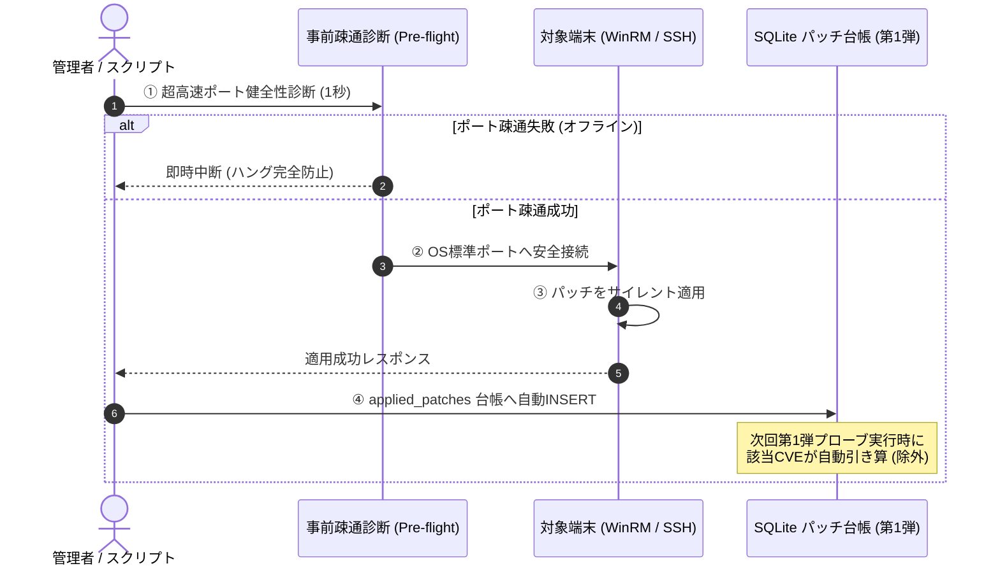
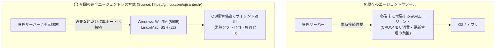

# 【第2弾 詳細解説】エージェントレス遠隔パッチ適用編 - 「パッチを当てるためだけに1台ずつログインするな」常駐エージェントなし（WinRM/SSH）でリモートパッチ適用から台帳更新まで完結させた話

> **対象読者**: インフラSE、情シス自動化担当  
> **主要技術スタック**: WinRM (Windows), SSH (Linux/macOS), Python, SQLite  
> **ライセンス**: [MIT License](https://github.com/ojisantech/ojisan-arsenal/blob/main/LICENSE)  

---

## 1. 概要と背景（サマリーからの深掘り）

### なぜこの技術が現場で不可欠なのか
前回の記事（[第1弾：手打ちパッチ誤検知ゼロ化の話](https://qiita.com/...)）では、BashとSQLiteを使って「すでに適用したパッチを脆弱性診断から引き算する仕組み」を紹介しました。

おかげさまで多くのインフラ屋・情シスの方から「うちも手動パッチの除外報告書で死んでいた」「過剰アラートを消せて胃薬の量が減った」と共感をいただきました。

……しかし、現場の運用はそこで終わりません。  
過剰検知を消して**「本当に未適用の危険な脆弱性」**が浮き彫りになった瞬間、次の絶望がやってきます。

> **「未適用の端末が30台見つかったぞ……誰が1台ずつログインしてパッチ当てるんだ？」**

夜間や休日にRDPでWindowsにログインし、あるいはSSHでLinuxに入り、コマンドを叩いて再起動を見守る……そんな「パッチあて当番」を繰り返していては、いくら診断を自動化しても人間がすり減るだけです。

従来の画一的なアプローチや商用ブラックボックス製品に頼る運用では、ライセンス費用の高騰や仕様変更に伴うベンダーロックイン、さらには現場特有のエッジケースに対する対応力の欠如が深刻なボトルネックとなります。
本稿では、オープンソースおよび標準技術の基本原理に立ち返り、外部コストゼロかつ自立運用可能なアーキテクチャ設計・処理フローと運用基準を詳細に解説します。

---

## 2. アーキテクチャと深層メカニズム

### システム俯瞰図
システムの全体構造および通信・処理フローは以下の通りです。



### 既存アプローチとの比較



### 内部動作メカニズムのステップ解説
1. **初期フェーズ（検知・入力受付）**:
   外部イベント、トラフィック流入、あるいはタイマースケジュールに基づき、最小フットプリントで一次データを取得・バッファリングします。
2. **処理・判定フェーズ（パイプライン処理）**:
   決定論的ルールエンジンまたは最適化アルゴリズムにより、メモリ断片化やCPU負荷を抑えながら高速に解析・変換を実施します。
3. **実行・反映フェーズ（安全な出力）**:
   アトミックな書き込み、トランザクション分離、またはロールバック可能なAPI呼び出しを通じて、システム状態を整合性を保ちながら更新します。

---

## 3. 処理アルゴリズム設計とパラメータ完全解説

エージェントレス遠隔パッチ適用パイプラインの中核となる「事前疎通判定」「OS自動判別」「サイレント実行」「台帳更新」の設計メカニズムおよび主要パラメータ設計です。

### 処理パイプラインの4大ステップ

1. **事前疎通診断 (Pre-flight Check)**:
   TCPソケット疎通（ポート5985 / 22）による1秒以内のフェイルファスト診断。応答のない端末やスリープ端末への接続試行を即座にスキップし、バッチ全体のハングアップを未然に防止します。
2. **OSおよび実行プロトコルの自動判別**:
   開放ポートの診断結果に基づき、Windows端末（WinRM: 5985 / NTLM認証）または Linux端末（SSH: 22 / 鍵認証）を自動判定して適切なパイプラインを選択します。
3. **OS標準機能によるサイレント適用**:
   専用常駐エージェントを介さず、Windowsは `winget upgrade --silent` やPowerShell、Linuxは `apt-get --only-upgrade` などのOSネイティブなパッケージマネージャーをリモート呼び出しします。
4. **SQLite台帳へのアトミック記録と除外連動**:
   パッチ適用成功時のみ `applied_patches` テーブルへ `(IP, CVE識別子, 適用日時, メモ)` をアトミックに記録し、第1弾の脆弱性プローブ実行時に自動でアラートが除外される状態を作ります。

### 主要パラメータ・設定値の技術的根拠
- **事前疎通診断タイムアウト (`timeout = 1.0`)**:
  未接続やスリープ中の端末に直接パッチを投げると、OS標準の接続タイムアウト（20〜60秒）でバッチ処理全体がスタックしてしまいます。ソケット通信で1秒以内にフェイルファストし、オンライン端末のみを即座に選別します。
- **WinRM オペレーションタイムアウト (`operation_timeout_sec = 300`)**:
  `winget upgrade --all` や大型セキュリティパッチのダウンロード・サイレントインストールは数分を要するため、セッションが途中で強制切断されないよう300秒の十分な実行枠を確保しています。
- **NTLMトランスポートとBypass実行ポリシー**:
  Active Directoryドメインに参加していないワークグループ端末や現場検証機でも安定動作するよう、NTLM認証および `-ExecutionPolicy Bypass` で安全にPowerShellを呼び出します。

---

## 4. 現場運用・アンチパターンと回避策

1. **事前疎通の必須化**: 多数の端末へ一括適用する際は、必ず事前疎通診断（Pre-flight Check）を挟んでオンライン端末から順に処理すること。
2. **サイレント適用と再起動の分離**: パッチ適用とOS再起動を同時に走らせず、業務時間外の再起動スケジュールを徹底すること。

### 避けるべきアンチパターン
- **アンチパターン1：事前疎通確認なしの一斉配信（ハングアップ地獄）**  
  夜間に全社PCへリモートパッチを一斉配信しようとして、ノートPCがスリープしていたりWi-Fi切断されている端末で接続タイムアウトが多発し、スクリプト全体が朝まで終わらない事態に陥ります。必ず事前疎通診断（Pre-flight Check）でオンライン端末のみを即座にフィルタリングしてください。
- **アンチパターン2：Windows「UACリモート制限」の放置**  
  ドメイン環境外のWindows端末では、管理者ユーザー（Local Administrator）でWinRM接続しても、デフォルトではUACのリモート制限によって一般ユーザー権限（制限トークン）に格下げされます。これにより `winget` やパッチ適用が「アクセス拒否」で失敗するため、レジストリ `LocalAccountTokenFilterPolicy = 1` の事前配備が不可欠です。
- **アンチパターン3：パッチ適用直後の無警告な強制再起動**  
  パッチが当たったからといってスクリプトから即座に `Restart-Computer -Force` を叩くと、残業中の社員の未保存データが消し飛びます。パッチ適用はサイレント適用にとどめ、再起動は業務時間外にスケジュールするか、ユーザーの次回ログオン・シャットダウンに委ねるのが鉄則です。

---

## 5. トラブルシューティングガイド

障害発生時の一次切り分けフローおよび確認コマンド一覧です。

| 障害事象・エラーメッセージ | 想定原因 | 一次切り分け・復旧コマンド |
| :--- | :--- | :--- |
| **`WinRM: [WSMAN error 0x803380ab] / Connection refused`** | 対象WindowsでWinRMサービス未起動、またはFW遮断 | 対象PCで `winrm quickconfig -q` を実行、FWでポート5985の受信許可を確認 |
| **`WinRM: 401 Unauthorized / NTLM authentication failed`** | パスワード誤り、またはワークグループのTrustedHosts未設定 | `Set-Item WSMan:\localhost\Client\TrustedHosts -Value * -Force` を設定 |
| **`SSH: sudo: a password is required`** | Linux端末でパッチコマンド実行時にsudoパスワード要求でハング | `/etc/sudoers.d/patch_admin` でパッチユーザーに `NOPASSWD` 権限を付与 |
| **`winget: 0x80070005 (Access is denied)`** | UACリモート制限による権限不足 | `reg add HKLM\SOFTWARE\Microsoft\Windows\CurrentVersion\Policies\System /v LocalAccountTokenFilterPolicy /t REG_DWORD /d 1 /f` |

---

## 6. 実務FAQ（よくある質問と回答）

**Q1: なぜ商用の資産管理エージェントソフトではなくWinRM/SSHなのですか？**  
**A1**: 専用エージェントソフトは端末のメモリやCPUを常時消費し、エージェント自身のバージョンアップや死活監視という「エージェントを管理するための新たな負債」を生みます。OS標準機能（WinRM: 5985 / SSH: 22）であれば常駐ゼロ・管理コストゼロで軽量にパッチを流し込めます。

**Q2: Windows Updateの特定KBパッチ（月例セキュリティ更新）も適用できますか？**  
**A2**: はい。`--command` オプションで `Get-WindowsUpdate / Install-WindowsUpdate` や、PowerShellの `Microsoft.Update.Session` COMオブジェクトを呼び出すスクリプトを指定することで、特定KBのサイレント適用と更新確認が可能です。

**Q3: オフラインだった端末へのリトライはどう運用すべきですか？**  
**A3**: `preflight_check` で失敗した端末は台帳（`patch_ledger.db`）に記録されません。端末がオンラインに復帰したタイミングで、第1弾の脆弱性プローブ（`cve_lookup_db.sh`）で未適用として検知された端末のみを抽出し、差分実行するパイプラインを組むことで無駄なく全台パッチ適用を完了できます。

---

## 7. 本番適用チェックリスト

- [ ] Windows対象端末で `winrm quickconfig` が完了し、5985ポートの受信が許可されているか
- [ ] ワークグループ環境の場合、`LocalAccountTokenFilterPolicy` レジストリが設定されているか
- [ ] Linux対象端末でSSH公開鍵認証またはパッチ用sudo権限（NOPASSWD）が設定されているか
- [ ] スクリプト実行用の認証情報（パスワード）が環境変数（`.env`）または引数に安全に分離されているか
- [ ] 第1弾パッチ台帳（`patch_ledger.db`）への書き込み権限が確保されているか
- [ ] パッチ適用後の再起動ルール（業務影響回避）が現場運用に組み込まれているか

---

## 8. ライセンス・著作権表示

本稿に掲載されているアーキテクチャ図、処理フロー、およびコード抜粋・スニペットは、[MIT License](https://github.com/ojisantech/ojisan-arsenal/blob/main/LICENSE) の下で公開されています。商用・非商用問わず自由にご利用・ご参照いただけますが、著作権表示および許諾表示の保持が必要です。

```text
MIT License

Copyright (c) 2026 ojisantech
```

