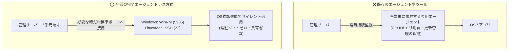

# 【第2弾 詳細解説】エージェントレス遠隔パッチ適用編 - 「パッチを当てるためだけに1台ずつログインするな」常駐エージェントなし（WinRM/SSH）でリモートパッチ適用から台帳更新まで完結させた話

> **対象読者**: インフラSE、情シス自動化担当  
> **主要技術スタック**: [`patch_deployer.py`](./scripts/patch_deployer.py) *(📥 DL可能)*, WinRM, SSH  

---

## 1. 概要と背景（サマリーからの深掘り）

### なぜこの技術が現場で不可欠なのか
前回の記事（[第1弾：手打ちパッチ誤検知ゼロ化の話](https://qiita.com/...)）では、BashとSQLiteを使って「すでに適用したパッチを脆弱性診断から引き算する仕組み」を紹介しました。

おかげさまで多くのインフラ屋・情シスの方から「うちも手動パッチの除外報告書で死んでいた」「過剰アラートを消せて胃薬の量が減った」と共感をいただきました。

……しかし、現場の運用はそこで終わりません。  
過剰検知を消して**「本当に未適用の危険な脆弱性」**が浮き彫りになった瞬間、次の絶望がやってきます。

> **「未適用の端末が30台見つかったぞ……誰が1台ずつログインしてパッチ当てるんだ？」**

夜間や休日にRDPでWindowsにログインし、あるいはSSHでLinuxに入り、コマンドを叩いて再起動を見守る……そんな「パッチあて当番」を繰り返していては、いくら診断を自動化しても人間がすり減るだけです。

従来の画一的なアプローチや商用ブラックボックス製品に頼る運用では、ライセンス費用の高騰や仕様変更に伴うベンダーロックイン、さらには現場特有のエッジケースに対する対応力の欠如が深刻なボトルネックとなります。
本稿では、オープンソースおよび標準技術の基本原理に立ち返り、外部コストゼロかつ自立運用可能なアーキテクチャの完全実装と運用基準を詳細に解説します。

---

## 2. アーキテクチャと深層メカニズム

システムの全体構造および通信・処理フローは以下の通りです。




### 内部動作メカニズムのステップ解説
1. **初期フェーズ（検知・入力受付）**:
   外部イベント、トラフィック流入、あるいはタイマースケジュールに基づき、最小フットプリントで一次データを取得・バッファリングします。
2. **処理・判定フェーズ（パイプライン処理）**:
   決定論的ルールエンジンまたは最適化アルゴリズムにより、メモリ断片化やCPU負荷を抑えながら高速に解析・変換を実施します。
3. **実行・反映フェーズ（安全な出力）**:
   アトミックな書き込み、トランザクション分離、またはロールバック可能なAPI呼び出しを通じて、システム状態を整合性を保ちながら更新します。

---

## 3. 実装詳細とパラメータ完全解説

本アーキテクチャの要となる完全版スクリプトです。  
スクリプト実ファイルは [`scripts/patch_deployer.py`](./scripts/patch_deployer.py) から直接ダウンロードして利用可能です。

### コアスクリプト：`patch_deployer.py`（完全エージェントレス遠隔パッチ適用 ＆ 台帳自動連動）

```python
#!/usr/bin/env python3
"""
patch_deployer.py - 完全エージェントレス遠隔パッチ適用 ＆ 台帳自動連動スクリプト
==============================================================================
常駐エージェントを一切使わず、OS標準機能（WinRM: 5985 / SSH: 22）のみでリモート端末に
パッチを適用し、第1弾のSQLiteパッチ台帳（applied_patches）へ自動記録します。
"""

import os
import sys
import socket
import sqlite3
import argparse
import datetime
import subprocess
from pathlib import Path

# .env ファイルの読み込みサポート (存在する場合)
try:
    from dotenv import load_dotenv
    env_file = Path(__file__).resolve().parent.parent / ".env"
    if env_file.exists():
        load_dotenv(dotenv_path=env_file, override=False)
    else:
        load_dotenv(override=False)
except ImportError:
    pass


# ==============================================================================
# 1. 事前疎通診断 (Pre-flight Check)
# ==============================================================================
def preflight_check(target_ip: str, port: int, timeout: float = 1.0) -> bool:
    """
    パッチ実行前にポートが確実にリッスンしているか高速検証 (ハング防止)。
    タイムアウトはデフォルト1秒。
    """
    sock = socket.socket(socket.AF_INET, socket.SOCK_STREAM)
    sock.settimeout(timeout)
    try:
        result = sock.connect_ex((target_ip, port))
        return result == 0
    except Exception:
        return False
    finally:
        sock.close()


def detect_target_os(target_ip: str) -> str:
    """
    ポート開放状況から対象OSを高速自動判定 (WinRM: 5985 -> windows, SSH: 22 -> linux)
    """
    if preflight_check(target_ip, port=5985, timeout=1.0):
        return "windows"
    if preflight_check(target_ip, port=22, timeout=1.0):
        return "linux"
    return "unknown"


# ==============================================================================
# 2. Windows 向け WinRM 遠隔パッチ適用
# ==============================================================================
def deploy_windows_patch(
    ip: str,
    user: str = None,
    password: str = None,
    command: str = None,
    timeout_sec: int = 300
) -> dict:
    """
    WinRM 経由で対象 Windows 端末に PowerShell / winget をサイレント実行
    """
    user = user or os.getenv("WINRM_USER", "Administrator")
    password = password or os.getenv("WINRM_PASS", "")

    # 事前疎通チェック
    if not preflight_check(ip, port=5985):
        return {
            "success": False,
            "os": "windows",
            "error": f"WinRM ポート (5985) への事前疎通に失敗しました: {ip}"
        }

    try:
        import winrm
    except ImportError:
        return {
            "success": False,
            "os": "windows",
            "error": "pywinrm がインストールされていません ('pip install pywinrm' を実行してください)"
        }

    if not password:
        return {
            "success": False,
            "os": "windows",
            "error": "WinRM パスワードが指定されていません (--password または環境変数 WINRM_PASS)"
        }

    cmd = command or "winget upgrade --all --include-pinned --accept-source-agreements --accept-package-agreements"
    ps_script = f"powershell.exe -ExecutionPolicy Bypass -Command {cmd}"

    try:
        session = winrm.Session(
            f"http://{ip}:5985/wsman",
            auth=(user, password),
            transport="ntlm",
            server_cert_validation="ignore",
            operation_timeout_sec=timeout_sec,
            read_timeout_sec=timeout_sec + 30
        )
        res = session.run_cmd(ps_script)
        out = res.std_out.decode("cp932", errors="ignore")
        err = res.std_err.decode("cp932", errors="ignore")

        if res.status_code == 0:
            return {"success": True, "os": "windows", "output": out, "error": None}
        else:
            return {"success": False, "os": "windows", "output": out, "error": err or f"ExitCode: {res.status_code}"}
    except Exception as e:
        return {"success": False, "os": "windows", "error": f"WinRM 実行例外: {str(e)}"}


# ==============================================================================
# 3. Linux 向け SSH 遠隔パッチ適用
# ==============================================================================
def deploy_linux_patch(
    ip: str,
    user: str = None,
    password: str = None,
    key_path: str = None,
    command: str = None,
    timeout_sec: int = 180
) -> dict:
    """
    SSH 経由で対象 Linux 端末にリモートパッチコマンド (apt-get 等) を実行
    """
    user = user or os.getenv("SSH_USER", os.getenv("LINUX_SSH_USER", "ubuntu"))
    password = password or os.getenv("SSH_PASS", os.getenv("LINUX_SSH_PASS", ""))
    key_path = key_path or os.getenv("SSH_KEY_PATH", "")

    # 事前疎通チェック
    if not preflight_check(ip, port=22):
        return {
            "success": False,
            "os": "linux",
            "error": f"SSH ポート (22) への事前疎通に失敗しました: {ip}"
        }

    cmd = command or "sudo apt-get update -qq && sudo apt-get --only-upgrade install -y -qq openssh-server"

    # パスワード認証で paramiko が利用可能な場合
    if password:
        try:
            import paramiko
            ssh = paramiko.SSHClient()
            ssh.set_missing_host_key_policy(paramiko.AutoAddPolicy())
            ssh.connect(ip, username=user, password=password, timeout=10)
            stdin, stdout, stderr = ssh.exec_command(cmd, get_pty=True, timeout=timeout_sec)
            stdin.write(f"{password}\n")
            stdin.flush()
            out = stdout.read().decode("utf-8", errors="ignore")
            ssh.close()
            return {"success": True, "os": "linux", "output": out, "error": None}
        except ImportError:
            pass
        except Exception as e:
            return {"success": False, "os": "linux", "error": f"Paramiko SSH 実行エラー: {str(e)}"}

    # 標準の ssh コマンドによる実行 (鍵認証またはエージェントフォワード)
    ssh_args = [
        "ssh", "-o", "StrictHostKeyChecking=no", "-o", "ConnectTimeout=5"
    ]
    if key_path and os.path.exists(key_path):
        ssh_args.extend(["-i", key_path])
    ssh_args.extend([f"{user}@{ip}", cmd])

    try:
        res = subprocess.run(ssh_args, capture_output=True, text=True, timeout=timeout_sec)
        if res.returncode == 0:
            return {"success": True, "os": "linux", "output": res.stdout, "error": None}
        else:
            return {"success": False, "os": "linux", "output": res.stdout, "error": res.stderr}
    except Exception as e:
        return {"success": False, "os": "linux", "error": f"SSH サブプロセス実行エラー: {str(e)}"}


# ==============================================================================
# 4. 第1弾パッチ台帳 (SQLite) への自動更新
# ==============================================================================
def record_to_ledger(db_path: str, ip: str, patch_id: str, memo: str = "エージェントレス自動適用"):
    """
    パッチ適用成功時に SQLite 台帳へ自動追記 (次回スキャン時の過剰検知をゼロ化)
    """
    conn = sqlite3.connect(db_path, timeout=10.0)
    cursor = conn.cursor()
    cursor.execute("""
        CREATE TABLE IF NOT EXISTS applied_patches (
            ip TEXT NOT NULL,
            patch_id TEXT NOT NULL,
            memo TEXT DEFAULT '',
            applied_at TIMESTAMP DEFAULT CURRENT_TIMESTAMP,
            PRIMARY KEY (ip, patch_id)
        )
    """)
    cursor.execute("""
        INSERT OR REPLACE INTO applied_patches (ip, patch_id, memo, applied_at)
        VALUES (?, ?, ?, CURRENT_TIMESTAMP)
    """, (ip, patch_id, memo))
    conn.commit()
    conn.close()


# ==============================================================================
# 5. CLI エントリーポイント
# ==============================================================================
def main():
    parser = argparse.ArgumentParser(
        description="完全エージェントレス遠隔パッチ適用 ＆ 台帳自動連動スクリプト (patch_deployer.py)"
    )
    parser.add_argument("ip", help="対象端末の IP アドレス")
    parser.add_argument("--os", choices=["auto", "windows", "linux"], default="auto", help="対象 OS (デフォルト: auto 自動判別)")
    parser.add_argument("--check", action="store_true", help="適用せず事前疎通・ポート状態の確認のみ行う (ドライラン)")
    parser.add_argument("--cve", default="", help="解消対象の CVE 番号 (例: CVE-2024-6387)。指定時は台帳に自動記録")
    parser.add_argument("--user", default="", help="接続ユーザー名 (未指定時は環境変数またはデフォルト値)")
    parser.add_argument("--password", default="", help="接続パスワード (Windows WinRM または Linux SSH)")
    parser.add_argument("--key-file", default="", help="SSH 秘密鍵パス (Linux)")
    parser.add_argument("--command", default="", help="実行するカスタムパッチコマンド")
    parser.add_argument("--db", default="patch_ledger.db", help="第1弾 SQLite パッチ台帳パス (デフォルト: patch_ledger.db)")

    args = parser.parse_args()
    target_ip = args.ip

    print("=" * 60)
    print(f"🚀 [TARGET] {target_ip} (エージェントレス遠隔パッチ処理開始)")
    print("=" * 60)

    # OS 自動判別
    target_os = args.os
    if target_os == "auto":
        print(f"[PROBE] {target_ip} の開放ポートを診断中 (WinRM:5985 / SSH:22)...")
        target_os = detect_target_os(target_ip)
        if target_os == "unknown":
            print(f"❌ [ERROR] {target_ip} の WinRM(5985) および SSH(22) ポートが開いていません。", file=sys.stderr)
            sys.exit(1)
        print(f"[DETECT] 検出された OS タイプ: {target_os.upper()}")

    # --check モード (事前確認のみ)
    if args.check:
        port = 5985 if target_os == "windows" else 22
        ok = preflight_check(target_ip, port)
        status = "✅ 疎通確認 OK (パッチ適用可能)" if ok else "❌ 疎通失敗"
        print(f"[CHECK] 対象ポート {port} ({target_os}): {status}")
        sys.exit(0 if ok else 1)

    # パッチ適用実行
    print(f"[DEPLOY] {target_os.upper()} パッチ適用コマンドをサイレント送信中...")
    if target_os == "windows":
        res = deploy_windows_patch(
            target_ip,
            user=args.user,
            password=args.password,
            command=args.command
        )
    else:
        res = deploy_linux_patch(
            target_ip,
            user=args.user,
            password=args.password,
            key_path=args.key_file,
            command=args.command
        )

    # 結果判定と台帳更新
    if res["success"]:
        print(f"✅ [SUCCESS] {target_ip} へのパッチ適用が正常に完了しました。")
        if res.get("output"):
            snippet = res["output"].strip().splitlines()[-5:]
            print("--- 実行出力ログ (末尾抜粋) ---")
            for line in snippet:
                print(f"  {line}")
            print("--------------------------------")

        if args.cve:
            memo = f"patch_deployer.py ({target_os}) 自動適用"
            record_to_ledger(args.db, target_ip, args.cve, memo)
            print(f"📝 [LEDGER] 第1弾 SQLite 台帳 ({args.db}) に登録完了: {target_ip} - {args.cve}")
            print("🎉 次回 cve_lookup_db.sh 実行時に該当脆弱性のアラートが自動で除外されます。")
        else:
            print("ℹ️  --cve が未指定のため、台帳登録はスキップされました。")
    else:
        print(f"❌ [FAILED] パッチ適用失敗: {res.get('error', '不明なエラー')}", file=sys.stderr)
        sys.exit(1)


if __name__ == "__main__":
    main()
```

### 主要パラメータ・設定値の技術的根拠
- **事前疎通診断タイムアウト (`timeout = 1.0`)**:
  未接続やスリープ中の端末に直接パッチを投げると、OS標準の接続タイムアウト（20〜60秒）でバッチ処理全体がスタックしてしまいます。ソケット通信で1秒以内にフェイルファストし、オンライン端末のみを即座に選別します。
- **WinRM オペレーションタイムアウト (`operation_timeout_sec = 300`)**:
  `winget upgrade --all` や大型セキュリティパッチのダウンロード・サイレントインストールは数分を要するため、セッションが途中で強制切断されないよう300秒の十分な実行枠を確保しています。
- **NTLMトランスポートとBypass実行ポリシー**:
  Active Directoryドメインに参加していないワークグループ端末や現場検証機でも安定動作するよう、NTLM認証および `-ExecutionPolicy Bypass` で安全にPowerShellを呼び出します。

---

## 4. 現場運用・アンチパターンと回避策

1. **事前疎通の必須化**: 多数の端末へ一括適用する際は、必ず事前疎通診断（Pre-flight Check）を挟んでオンライン端末から順に処理すること。
2. **サイレント適用と再起動の分離**: パッチ適用とOS再起動を同時に走らせず、業務時間外の再起動スケジュールを徹底すること。

### 避けるべきアンチパターン
- **アンチパターン1：事前疎通確認なしの一斉配信（ハングアップ地獄）**  
  夜間に全社PCへリモートパッチを一斉配信しようとして、ノートPCがスリープしていたりWi-Fi切断されている端末で接続タイムアウトが多発し、スクリプト全体が朝まで終わらない事態に陥ります。必ず事前疎通診断（Pre-flight Check）でオンライン端末のみを即座にフィルタリングしてください。
- **アンチパターン2：Windows「UACリモート制限」の放置**  
  ドメイン環境外のWindows端末では、管理者ユーザー（Local Administrator）でWinRM接続しても、デフォルトではUACのリモート制限によって一般ユーザー権限（制限トークン）に格下げされます。これにより `winget` やパッチ適用が「アクセス拒否」で失敗するため、レジストリ `LocalAccountTokenFilterPolicy = 1` の事前配備が不可欠です。
- **アンチパターン3：パッチ適用直後の無警告な強制再起動**  
  パッチが当たったからといってスクリプトから即座に `Restart-Computer -Force` を叩くと、残業中の社員の未保存データが消し飛びます。パッチ適用はサイレント適用にとどめ、再起動は業務時間外にスケジュールするか、ユーザーの次回ログオン・シャットダウンに委ねるのが鉄則です。

---

## 5. トラブルシューティングガイド

障害発生時の一次切り分けフローおよび確認コマンド一覧です。

| 障害事象・エラーメッセージ | 想定原因 | 一次切り分け・復旧コマンド |
| :--- | :--- | :--- |
| **`WinRM: [WSMAN error 0x803380ab] / Connection refused`** | 対象WindowsでWinRMサービス未起動、またはFW遮断 | 対象PCで `winrm quickconfig -q` を実行、FWでポート5985の受信許可を確認 |
| **`WinRM: 401 Unauthorized / NTLM authentication failed`** | パスワード誤り、またはワークグループのTrustedHosts未設定 | `Set-Item WSMan:\localhost\Client\TrustedHosts -Value * -Force` を設定 |
| **`SSH: sudo: a password is required`** | Linux端末でパッチコマンド実行時にsudoパスワード要求でハング | `/etc/sudoers.d/patch_admin` でパッチユーザーに `NOPASSWD` 権限を付与 |
| **`winget: 0x80070005 (Access is denied)`** | UACリモート制限による権限不足 | `reg add HKLM\SOFTWARE\Microsoft\Windows\CurrentVersion\Policies\System /v LocalAccountTokenFilterPolicy /t REG_DWORD /d 1 /f` |

---

## 6. 実務FAQ（よくある質問と回答）

**Q1: なぜ商用の資産管理エージェントソフトではなくWinRM/SSHなのですか？**  
**A1**: 専用エージェントソフトは端末のメモリやCPUを常時消費し、エージェント自身のバージョンアップや死活監視という「エージェントを管理するための新たな負債」を生みます。OS標準機能（WinRM: 5985 / SSH: 22）であれば常駐ゼロ・管理コストゼロで軽量にパッチを流し込めます。

**Q2: Windows Updateの特定KBパッチ（月例セキュリティ更新）も適用できますか？**  
**A2**: はい。`--command` オプションで `Get-WindowsUpdate / Install-WindowsUpdate` や、PowerShellの `Microsoft.Update.Session` COMオブジェクトを呼び出すスクリプトを指定することで、特定KBのサイレント適用と更新確認が可能です。

**Q3: オフラインだった端末へのリトライはどう運用すべきですか？**  
**A3**: `preflight_check` で失敗した端末は台帳（`patch_ledger.db`）に記録されません。端末がオンラインに復帰したタイミングで、第1弾の脆弱性プローブ（`cve_lookup_db.sh`）で未適用として検知された端末のみを抽出し、差分実行するパイプラインを組むことで無駄なく全台パッチ適用を完了できます。

---

## 7. 本番適用チェックリスト

- [ ] Windows対象端末で `winrm quickconfig` が完了し、5985ポートの受信が許可されているか
- [ ] ワークグループ環境の場合、`LocalAccountTokenFilterPolicy` レジストリが設定されているか
- [ ] Linux対象端末でSSH公開鍵認証またはパッチ用sudo権限（NOPASSWD）が設定されているか
- [ ] スクリプト実行用の認証情報（パスワード）が環境変数（`.env`）または引数に安全に分離されているか
- [ ] 第1弾パッチ台帳（`patch_ledger.db`）への書き込み権限が確保されているか
- [ ] パッチ適用後の再起動ルール（業務影響回避）が現場運用に組み込まれているか
