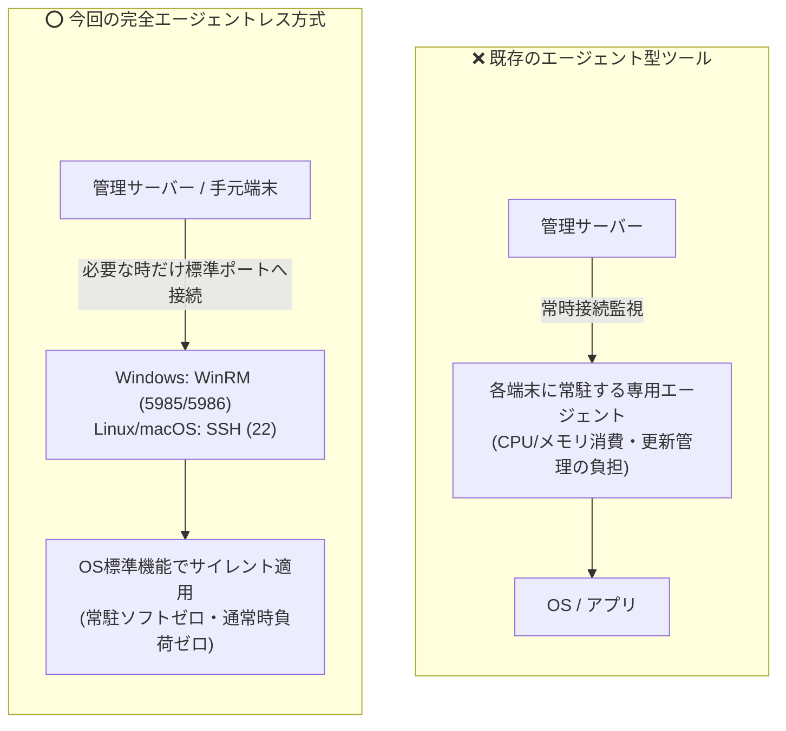
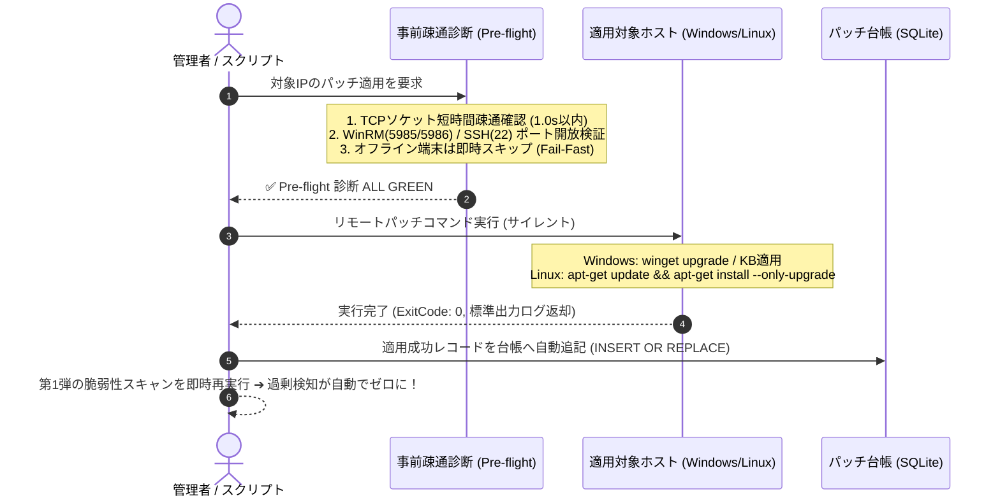

# 【第2弾 詳細解説】エージェントレス遠隔パッチ適用編 - 「パッチを当てるためだけに1台ずつログインするな」常駐エージェントなし（WinRM/SSH）でリモートパッチ適用から台帳更新まで完結させる設計と自宅ラボ検証PoC

> **対象読者**: インフラSE、情シス自動化担当  
> **主要技術スタック**: Python, WinRM (Windows), SSH (Linux/macOS), SQLite  
> **ライセンス**: [MIT License](https://github.com/ojisantech/ojisan-arsenal/blob/main/LICENSE)  
> **検証環境・位置づけ**: 個人自宅ラボ（ホームラボ／仮想環境）における公開情報・OSSベースの個人研究（PoC）  


> 💡 **【検証環境・個人研究（PoC）に関する注記】**  
> 本記事は、筆者個人の自宅検証環境（ホームラボ／仮想環境）において、公開情報およびOSS（オープンソースソフトウェア）を用いて独自に構築・検証した個人研究（PoC）の記録です。特定の企業・団体の実環境や業務上の非公開情報とは一切関係ありません。

---

## 1. 概要と背景（サマリーからの深掘り）

### なぜこの技術が現場で不可欠なのか
前回の記事（[第1弾：手打ちパッチ誤検知ゼロ化の話](https://qiita.com/ojisantech/items/870f3abac2212f92411c)）では、BashとSQLiteを使って「すでに適用したパッチを脆弱性診断から引き算する仕組み」を紹介しました。

おかげさまで多くのインフラ屋・情シスの方から「うちも手動パッチの除外報告書で死んでいた」「過剰アラートを消せて胃薬の量が減った」と共感をいただきました。

……しかし、現場の運用はそこで終わりません。  
過剰検知を消して**「本当に未適用の危険な脆弱性」**が浮き彫りになった瞬間、次の絶望がやってきます。

> **「未適用の端末が30台見つかったぞ……誰が1台ずつログインしてパッチ当てるんだ？」**

夜間や休日にRDPでWindowsにログインし、あるいはSSHでLinuxに入り、コマンドを叩いて再起動を見守る……そんな「パッチあて当番」を繰り返していては、いくら診断を自動化しても人間がすり減るだけです。

### 「エージェントを入れて一括管理」ができない現場の壁

世の中には、パッチ管理や資産管理の商用ソフトウェアが多数存在します。「各端末にエージェントソフトを常駐させれば、ボタン一つで一括アップデートできる」というアプローチです。しかし、現場のリアルには2つの大きな壁が立ちはだかります。

1. **「余計な常駐ソフトを入れるな」という現場の反発**:  
   開発環境や本番サーバーなど、常駐プロセスによるCPU・メモリ消費や競合リスクを嫌う環境では専用エージェントの導入自体が拒否されます。
2. **エージェント自体のバージョンアップと死活監視という「負債」**:  
   エージェントがハングアップした、エージェントの通信証明書が切れたなど、「管理ツールを管理するための運用工数」が新たに発生します。

本稿では、クライアント側に新しい常駐ソフトウェアを一切インストールせず、**OSが標準で備えているリモート管理機能（Windows: WinRM / Linux・macOS: SSH）だけを用いて、事前疎通診断（Pre-flight Check）からサイレントパッチ適用、そして第1弾のSQLite台帳への自動記録・再診断までを一気通貫で完結させるアーキテクチャ**を徹底解説します。

---

## 2. アーキテクチャと深層メカニズム

### エージェント型 vs 完全エージェントレス方式の比較



### 事前疎通診断（Pre-flight Check）と台帳連動シーケンス

リモートパッチ適用で最も恐ろしいのは、「対象端末がスリープやオフラインで通信がハングする」「認証待ちやタイムアウト待ちでバッチ全体が停止する」といったトラブルです。これを防ぐため、パッチ実行コマンドを投げる直前にミリ秒〜1秒単位で完了する**事前疎通診断（Pre-flight Check）**を挟み、成功時のみ第1弾のSQLiteパッチ台帳（`applied_patches`）へ自動追記するパイプラインを構成します。



### 内部動作メカニズムの4ステップ解説
1. **フェイルファスト事前疎通診断（Pre-flight Check）**:
   重いWinRMセッション確立やSSHハンドシェイクを開始する前に、生のTCPソケット（`socket.connect_ex`）で対象ポート（5985/5986 または 22）のLISTEN状態を1.0秒タイムアウトで検証します。オフライン端末を即座にスキップすることで、複数台一括処理時のブロッキングを排除します。
2. **OS標準プロトコルによるリモートコマンド注入**:
   Windows端末に対してはWinRM経由で `powershell.exe -ExecutionPolicy Bypass` を呼び出し、Linux端末に対してはSSH経由で `DEBIAN_FRONTEND=noninteractive apt-get -y --only-upgrade`（RHEL系は `dnf update -y`、macOSは `softwareupdate -i` または `brew upgrade`）を非対話・バックグラウンドで実行します。
3. **終了コード（ExitCode）の厳密判定とアトミック台帳記録**:
   リモートコマンドの終了コードが `0`（またはWindows UpdateのReboot Requiredコード `3010`）であることを確認した場合に限り、SQLiteの `applied_patches` テーブルへ対象IP・CVE番号・適用日時を `INSERT OR REPLACE` します。
4. **第1弾プローブによる即時ベリファイ（Closed-Loop Verification）**:
   台帳更新直後に第1弾の超軽量プローブを再実行し、該当CVEが「台帳照合により除外」と判定され、未対応の危険脆弱性が0件になったことを自動確認します。

---

## 3. 実装詳細とパラメータ完全解説

本アーキテクチャの核となるPython実装コード（事前疎通診断・WinRMパッチ実行・SQLite台帳連動）および一括実行ログの完全版です。

### 1. 事前疎通診断（Pre-flight Check）ロジック

ソケット通信を用いて、重い認証セッションを張る前に1秒以内でポートの健全性を検証します。

```python
import socket

def preflight_check(target_ip: str, port: int = 5985, timeout: float = 1.0) -> bool:
    """パッチ実行前にポートが確実にリッスンしているか高速検証（Fail-Fast）"""
    sock = socket.socket(socket.AF_INET, socket.SOCK_STREAM)
    sock.settimeout(timeout)
    try:
        result = sock.connect_ex((target_ip, port))
        return result == 0
    except Exception:
        return False
    finally:
        sock.close()
```

### 2. WinRM経由でのWindowsサイレントアップデート（Python `pywinrm`）

Windows端末に対して、バックグラウンドで `winget` またはPowerShellによるKBパッチ適用を安全に実行します。

> ※以下のサンプルコードでは自宅ラボ・ワークグループ検証環境向けに `http (5985)` および `transport="ntlm"` を使用していますが、実運用・本番環境では通信経路の暗号化と認証強化のため **`https (5986 / TLS)` および `Kerberos認証`（または証明書認証）** の使用を推奨します。

```python
import winrm

def deploy_windows_patch(ip: str, user: str, password: str, command: str) -> dict:
    # 1. 事前疎通チェック（オフライン端末での長時間ハングを防止）
    if not preflight_check(ip, port=5985, timeout=1.0):
        return {"status": "FAILED", "reason": "WinRMポート(5985)への疎通不可（オフラインまたはFW遮断）"}

    # 2. WinRMセッションの確立（検証環境例: 5985/NTLM、本番環境では 5986/HTTPS + Kerberos 推奨）
    session = winrm.Session(
        f"http://{ip}:5985/wsman",
        auth=(user, password),
        transport="ntlm",
        server_cert_validation="ignore",
        operation_timeout_sec=300,
        read_timeout_sec=330
    )

    # 3. PowerShellによる非対話サイレント実行
    ps_script = f"powershell.exe -NoProfile -NonInteractive -ExecutionPolicy Bypass -Command \"{command}\""
    r = session.run_cmd(ps_script)

    # ExitCode 0 (成功) または 3010 (成功・再起動待ち) を正常完了として扱う
    if r.status_code in (0, 3010):
        return {
            "status": "SUCCESS",
            "exit_code": r.status_code,
            "output": r.std_out.decode("utf-8", errors="ignore").strip()
        }
    else:
        return {
            "status": "ERROR",
            "exit_code": r.status_code,
            "error": r.std_err.decode("utf-8", errors="ignore").strip()
        }
```

### 3. パッチ適用成功時のSQLite台帳自動追記（第1弾との連動）

パッチ適用が正常完了した直後に、第1弾で構築したSQLiteのパッチ台帳テーブル（`applied_patches`）へ自動で適用済みレコードを書き込みます。

```python
import sqlite3

def record_patch_success(db_path: str, ip: str, cve_id: str, memo: str) -> None:
    """パッチ適用成功時にSQLite台帳へアトミックに追記し、次回スキャン時の誤検知を自動除外する"""
    conn = sqlite3.connect(db_path, timeout=10.0)
    try:
        cursor = conn.cursor()
        cursor.execute("PRAGMA journal_mode=WAL;")
        cursor.execute("""
            INSERT OR REPLACE INTO applied_patches (ip, cve_id, applied_at, memo)
            VALUES (?, ?, CURRENT_TIMESTAMP, ?)
        """, (ip, cve_id, memo))
        conn.commit()
    finally:
        conn.close()
```

### 4. ターミナルでの一気通貫実行ログ（Pre-flight ➔ 適用 ➔ 台帳記録 ➔ 再診断）

実際にラッパースクリプトを実行し、SSH疎通確認からパッケージ更新、SQLite台帳記録、そして第1弾プローブによる再検証までが数秒で完結する様子です。

```text
$ ./patch_and_verify.sh 192.168.1.15 CVE-2024-6387
[PRE-FLIGHT] 192.168.1.15 の SSH(Port:22) 疎通確認 ... OK (0.05s)
[DEPLOY] 遠隔パッチ適用中 (DEBIAN_FRONTEND=noninteractive apt-get update && apt-get install -y --only-upgrade openssh-server) ...
[DEPLOY] 適用完了 (ExitCode: 0)
[LEDGER] SQLiteパッチ台帳へ記録完了: 192.168.1.15 - CVE-2024-6387
[VERIFY] 超軽量プローブ再診断実行中 ...
==================================================
ホスト: 192.168.1.15 (Ubuntu 24.04)
検出脆弱性: CVE-2024-6387 (適用済み台帳照合により除外)
結果: ✅ 未対応の危険脆弱性: 0件 (完全安全)
==================================================
```

### 主要パラメータ・設定値の技術的根拠

| パラメータ / 設定項目 | 推奨設定値 | 技術的根拠・設計意図 |
| :--- | :--- | :--- |
| **Pre-flight `timeout`** | `1.0` 秒 | スリープ中や電源断の端末に対してOS標準のTCP再送タイムアウト（20〜60秒）が発生しバッチ全体がスタックするのを防ぐため、LAN内1秒で即座に切り捨てる。 |
| **WinRM `operation_timeout_sec`** | `300` 秒 | `winget upgrade` やWindows Updateパッケージのダウンロード・展開には数分を要するため、実行中のタイムアウト切断を防ぐ（`read_timeout_sec` はそれより大きい `330` 秒に設定）。 |
| **許容終了コード (`status_code`)** | `0` または `3010` | Windowsインストーラ（MSI/WUSA）では「適用成功・再起動後に有効化」の場合に終了コード `3010 (ERROR_SUCCESS_REBOOT_REQUIRED)` を返すため、これを成功として扱う。 |
| **APT環境変数** | `DEBIAN_FRONTEND=noninteractive` | Linuxリモート更新時に設定ファイルの上書き確認プロンプト（ncurses画面）でSSHセッションが無限待機するのを防ぐ。 |

---

## 4. 現場運用・アンチパターンと回避策

1. **事前疎通の必須化**: 多数の端末へ一括適用する際は、必ず事前疎通診断（Pre-flight Check）を挟んでオンライン端末から順に処理すること。
2. **サイレント適用と再起動の分離**: パッチ適用とOS再起動を同時に走らせず、業務時間外の再起動スケジュールを徹底すること。

### 避けるべきアンチパターン
- **アンチパターン1：事前疎通確認なしの一斉配信（ハングアップ地獄）**  
  夜間に複数台のPCへリモートパッチを一斉配信しようとして、ノートPCがスリープしていたりWi-Fi切断されている端末で接続タイムアウトが多発し、スクリプト全体が朝まで終わらない事態に陥ります。必ず事前疎通診断（Pre-flight Check）でオンライン端末のみを即座にフィルタリングしてください。
- **アンチパターン2：Windows「UACリモート制限」の放置**  
  ドメイン環境外のWindows端末（ワークグループ環境）では、ローカル管理者ユーザーでWinRM接続しても、デフォルトではUACのリモート制限によって一般ユーザー権限（制限トークン）に格下げされます。これにより `winget` やパッチ適用が「アクセス拒否（`0x80070005`）」で失敗するため、検証・ワークグループ環境ではレジストリ `LocalAccountTokenFilterPolicy = 1` の事前設定（またはドメイン参加＋Kerberos認証への移行）が必要です。
- **アンチパターン3：パッチ適用直後の無警告な強制再起動**  
  パッチが当たったからといってスクリプトから即座に `Restart-Computer -Force` を叩くと、作業中のユーザーの未保存データが失われます。パッチ適用はサイレント適用にとどめ、再起動フラグ（ExitCode `3010`）を検知した場合は業務時間外にスケジュールするか、次回シャットダウン時に適用させる運用が鉄則です。

---

## 5. トラブルシューティングガイド

障害発生時の一次切り分けフローおよび確認コマンド一覧です。

| 障害事象・エラーメッセージ | 想定原因 | 一次切り分け・復旧コマンド |
| :--- | :--- | :--- |
| **`WinRM: [WSMAN error 0x803380ab] / Connection refused`** | 対象WindowsでWinRMサービス未起動、またはFW遮断 | 対象PCで `winrm quickconfig -q` を実行、FWでポート5985（または5986）の受信許可を確認 |
| **`WinRM: 401 Unauthorized / NTLM authentication failed`** | 認証情報不一致、またはワークグループのTrustedHosts未設定 | `Set-Item WSMan:\localhost\Client\TrustedHosts -Value <対象IP> -Force` を設定 |
| **`SSH: sudo: a password is required`** | Linux端末でパッチコマンド実行時にsudoパスワード要求でハング | `/etc/sudoers.d/patch_admin` でパッチ実行用コマンドに限り `NOPASSWD` 権限を付与 |
| **`winget: 0x80070005 (Access is denied)`** | UACリモート制限によるトークン格下げ、またはSYSTEMコンテキスト制約 | ワークグループ環境では `LocalAccountTokenFilterPolicy = 1` を確認、またはタスクスケジューラ経由で実行 |

---

## 6. 実務FAQ（よくある質問と回答）

**Q1: なぜ商用の資産管理エージェントソフトではなくWinRM/SSHなのですか？**  
**A1**: 専用エージェントソフトは端末のメモリやCPUを常時消費し、エージェント自身のバージョンアップや死活監視という「エージェントを管理するための新たな負債」を生みます。OS標準機能（WinRM / SSH）であればクライアント側の追加常駐ソフトゼロで軽量にパッチを適用できます。

**Q2: Windows Updateの特定KBパッチ（月例セキュリティ更新）も適用できますか？**  
**A2**: はい。実行コマンドに `PSWindowsUpdate` モジュールの `Install-WindowsUpdate -KBArticleID KBxxxxxxx -AcceptAll -IgnoreReboot` や、Windows標準の `Microsoft.Update.Session` COMオブジェクトを呼び出すPowerShellワンライナーを指定することで、特定KBのサイレント適用と結果取得が可能です。

**Q3: オフラインだった端末へのリトライはどう運用すべきですか？**  
**A3**: `preflight_check` でスキップされた端末はSQLite台帳（`applied_patches`）に記録されません。そのため、次回第1弾の脆弱性プローブを実行した際に引き続き「未対応」として抽出され、オンラインに復帰したタイミングで自動的に差分適用対象となります。

---

## 7. 本番適用チェックリスト

- [ ] Windows対象端末でWinRMサービスが有効化され、管理元IPからの通信のみがファイアウォールで許可されているか（本番環境では5986/HTTPS＋Kerberos推奨）
- [ ] ワークグループ検証環境の場合、`LocalAccountTokenFilterPolicy` の挙動とリスクを理解した上で設定されているか
- [ ] Linux対象端末でSSH公開鍵認証および特定パッケージ更新コマンド限定の `sudo NOPASSWD` が設定されているか
- [ ] スクリプト実行用の認証情報がコード内にハードコードされず、環境変数または暗号化ストアから注入されているか
- [ ] 第1弾パッチ台帳（SQLite DB）がWALモードで初期化され、書き込み権限が確保されているか
- [ ] パッチ適用後の再起動（ExitCode `3010` 等）について、業務影響を回避する再起動スケジュールが定義されているか

---

## 8. ライセンス・著作権表示

本稿に掲載されているアーキテクチャ図、処理フロー、およびコード抜粋・スニペットは、[MIT License](https://github.com/ojisantech/ojisan-arsenal/blob/main/LICENSE) の下で公開されています。商用・非商用問わず自由にご利用・ご参照いただけますが、著作権表示および許諾表示の保持が必要です。

```text
MIT License

Copyright (c) 2026 ojisantech
```

