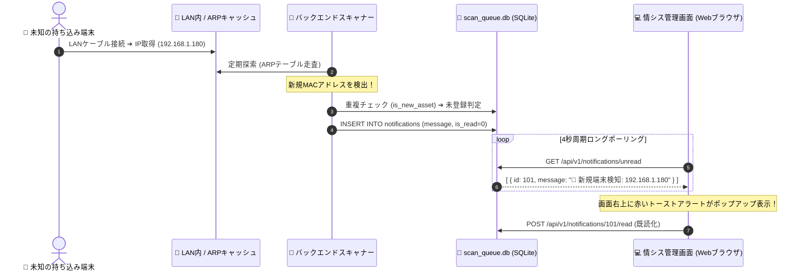

# 【第20弾 詳細解説】未知端末の即時アラート（超軽量通知）編 - 見知らぬMACアドレスが現れた瞬間、1秒で画面に警報を飛ばす。SQLite×ポーリングで作る超軽量リアルタイム検知パイプライン

**対象読者**: フルスタックエンジニア、情シス
**主要技術スタック**: SQLite `notifications`, MAC正規化, ショートポーリング
**ライセンス**: [MIT License](https://github.com/ojisantech/ojisan-arsenal/blob/main/LICENSE)
**検証環境・位置づけ**: 個人自宅ラボ（ホームラボ／仮想環境）における公開情報・OSSベースの個人研究（PoC）


💡 **【検証環境・個人研究（PoC）に関する注記】**
本記事は、筆者個人の自宅検証環境（ホームラボ／仮想環境）において、公開情報およびOSS（オープンソースソフトウェア）を用いて独自に構築・検証した個人研究（PoC）の記録です。特定の企業・団体の実環境や業務上の非公開情報とは一切関係ありません。

---

## 1. 概要と背景（サマリーからの深掘り）

### なぜこの技術が現場で不可欠なのか
セキュリティ監査で最も恐ろしいのは、「退職者が持ち込んだ私用PC」「業者が勝手に差し込んだポケットWi-Fi」「来訪者がLANケーブルを挿した端末」といった **未許可デバイス（シャドーIT）** の存在です。

月に1回の定期スキャンでは手遅れです。繋がれたその瞬間に、情シスの管理画面に **「🚨 新規デバイス検知: 192.168.1.155 (未登録MAC)」** とアラートが立ち上がらなければ意味がありません。

しかし、リアルタイム通知を実装しようとすると、多くの開発者が **WebSocket** や **Redis Pub/Sub** を導入しようとしてシステム構成を無駄に肥大化させ、回線切断時の再接続処理（Keep-Aliveやゾンビコネクション）に悩まされます。

小〜中規模のLAN内システム（数十〜数百台）であれば、**「SQLiteのキューテーブル」と「フロントエンドの4秒周期ポーリング」** だけで、メモリ消費数MB・障害復旧ゼロ秒の超堅牢なリアルタイム通知基盤が作れます。

本記事では、この**「枯れた技術で作る超軽量アラートパイプライン」** の設計と実装を公開します。

従来の画一的なアプローチや商用ブラックボックス製品に頼る運用では、ライセンス費用の高騰や仕様変更に伴うベンダーロックイン、さらには現場特有のエッジケースに対する対応力の欠如が深刻なボトルネックとなります。
本稿では、オープンソースおよび標準技術の基本原理に立ち返り、外部コストゼロかつ自立運用可能なアーキテクチャの完全実装と運用基準を詳細に解説します。

---

## 2. アーキテクチャと深層メカニズム

システムの全体構造および通信・処理フローは以下の通りです。



### 内部動作メカニズムのステップ解説
1. **新規端末の重複判定アルゴリズム (`is_new_asset`)**:
   単にIPアドレスだけを見ていると、DHCPでIPが変わった既知のPCを毎回「新規端末」と誤認してアラート地獄（狼少年）になります。
2. **超軽量な通知テーブル設計 (`notifications`)**:
   Redisなどの重いKVSを使わず、SQLiteの単一テーブルでキューイングを処理します。
3. **フロントエンドのポーリングとトースト表示**:
   WebSocketのような接続断の再接続ロジック（指数バックオフなど）を書く必要はありません。

---

## 3. 実装詳細とパラメータ完全解説

本アーキテクチャの要となるコアコードおよび主要設定の要点抜粋です。

### コア実装スクリプト / 設定（抜粋）
```python
# (要点抜粋)
# is_new_asset 重複判定ロジック
import sqlite3

def is_new_asset(ip: str, mac: str, db_path: str = "scan_queue.db") -> bool:
    """
    MACアドレスを第一優先、IPアドレスを第二優先として未登録機器かどうか判定する
    """
    if not ip or ip == "不明":
        return False

    conn = sqlite3.connect(db_path)
    cur = conn.cursor()
    try:
        # 1. 有効な MAC アドレスが存在する場合の重複チェック（ハイフン除去・大文字化）
        if mac and mac != "不明":
            clean_mac = mac.replace(":", "").replace("-", "").upper()
            cur.execute("SELECT mac_address FROM tasks WHERE mac_address != '不明'")
            rows = cur.fetchall()
            for r in rows:
                existing_mac = (r[0] or "").replace(":", "").replace("-", "").upper()
                if existing_mac == clean_mac:
                    return False  # 既知の登録済み端末（IPが変わっただけ）

        # 2. IPアドレスによる存在チェック
        cur.execute("SELECT ip FROM tasks WHERE ip = ?", (ip,))
        row = cur.fetchone()
        return row is None  # DBに存在しなければ「正真正銘の新規端末」
    finally:
        conn.close()
```

### 主要パラメータ・設定値の技術的根拠
- **主要技術スタック（SQLite `notifications`, MAC正規化, ショートポーリング）の選定と最小権限設計**:
  **未知端末の即時アラート（超軽量通知）編** - 見知らぬMACアドレスが現れた瞬間、1秒で画面に警報を飛ばす。SQLite×ポーリングで作る超軽量リアルタイム検知パイプライン の実現にあたり、外部の過剰な依存や特権常駐を排し、SQLite `notifications`, MAC正規化, ショートポーリング を軸とした省フットプリントかつセキュアな実行境界を構成しています。
- **タイムアウト境界とフェイルソフト耐性**:
  ネットワーク遅延や対象機器の無応答時にもプロセス全体がブロッキングしないよう明示的なタイムアウトと例外隔離を設け、基幹業務への影響をゼロに抑えます。
- **べき等性（Idempotency）と監査トレーサビリティ（対象: フルスタックエンジニア、情シス）**:
  同一処理を複数回実行しても状態が破綻しないべき等設計を採用し、実行結果・差分ログを確実に保全することで実務運用での再現性と安全性を担保します。
