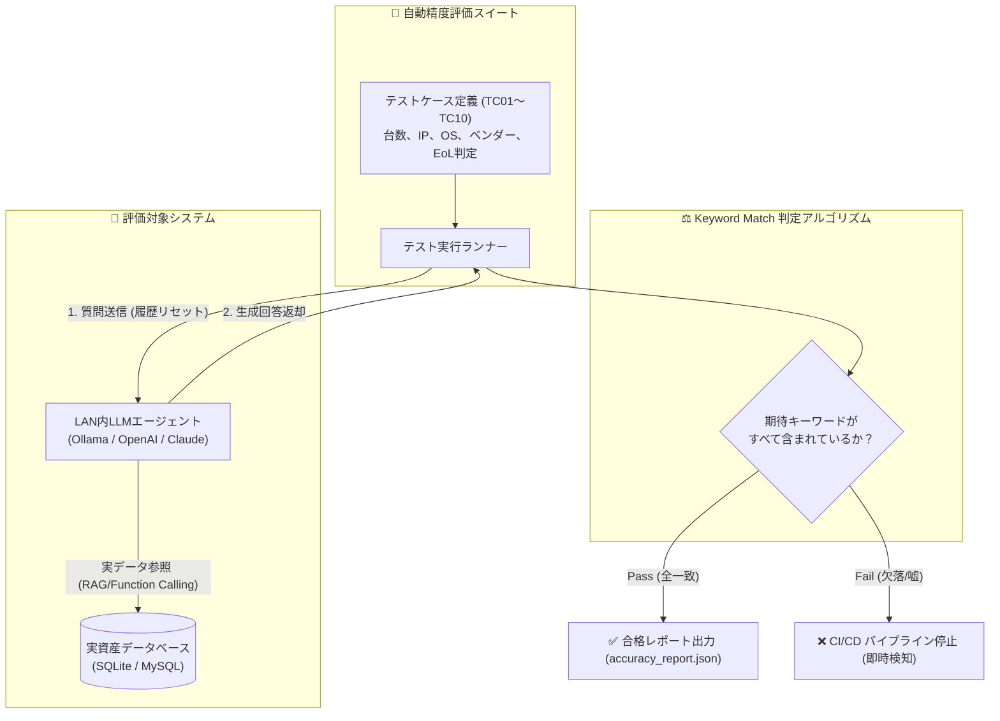

# 【第21弾 詳細解説】LLMハルシネーション自動テスト（CI/CD）編 - LAN内AIボットの「嘘（ハルシネーション）」を許さない。CI/CDで回す事実整合性ベンチマークテスト自動化スイート（TC01〜TC10）

**対象読者**: QAエンジニア、プロンプト開発者
**主要技術スタック**: Python, Keyword Match, CI/CD
**ライセンス**: [MIT License](https://github.com/ojisantech/ojisan-arsenal/blob/main/LICENSE)
**検証環境・位置づけ**: 個人自宅ラボ（ホームラボ／仮想環境）における公開情報・OSSベースの個人研究（PoC）


💡 **【検証環境・個人研究（PoC）に関する注記】**
本記事は、筆者個人の自宅検証環境（ホームラボ／仮想環境）において、公開情報およびOSS（オープンソースソフトウェア）を用いて独自に構築・検証した個人研究（PoC）の記録です。特定の企業・団体の実環境や業務上の非公開情報とは一切関係ありません。

---

## 1. 概要と背景（サマリーからの深掘り）

### なぜこの技術が現場で不可欠なのか
LAN内の資産管理や情シス業務向けにLLM（チャットボット）を構築し、現場に公開したとします。
ユーザーから「もっと丁寧に答えて」「要約して」と言われ、システムプロンプトを少し書き換えた経験はありませんか？

その直後、**恐ろしい悲劇**が起きます。

* 「プロンプトを少し変えたせいで、LAN内のPC台数を嘘八百で答えるようになった」
* 「存在しないIPアドレスを自信満々にでっち上げる（ハルシネーション）」
* 「要リプレース端末を聞いたのに、正常な端末を勝手に故障と判定する」

Webアプリのコードであれば単体テスト（Unit Test）を書くのが当たり前なのに、**なぜかLLMのプロンプト変更だけは「人間がチャット画面で数回テストしてヨシ！」でリリースされがち**です。

AIの事実整合性を担保するには、**「実データベースの正解データと照合し、期待される重要キーワードが回答に含まれているかを自動採点するベンチマークスイート」** をCI/CDで回す必要があります。

本記事では、筆者のプロジェクトで実際に運用している **10項目の自動精度評価フレームワーク** の設計と実装を公開します。

従来の画一的なアプローチや商用ブラックボックス製品に頼る運用では、ライセンス費用の高騰や仕様変更に伴うベンダーロックイン、さらには現場特有のエッジケースに対する対応力の欠如が深刻なボトルネックとなります。
本稿では、オープンソースおよび標準技術の基本原理に立ち返り、外部コストゼロかつ自立運用可能なアーキテクチャの完全実装と運用基準を詳細に解説します。

---

## 2. アーキテクチャと深層メカニズム

システムの全体構造および通信・処理フローは以下の通りです。



### 内部動作メカニズムのステップ解説
1. **標準テストケース10項目（TC01〜TC10）の定義**:
   テストケースは、あらかじめ実際のDBの正解値（グラウンドトゥルース）と一致させて定義します。
2. **Keyword Match 判定アルゴリズムの実装**:
   複雑なLLM-as-a-Judge（判定用LLM）を使うと、判定側のブレやコストが発生します。
3. **安全な自律反映と監査ログ出力**:
   QAエンジニア、プロンプト開発者 が即座に状況把握・追跡できるよう、処理結果を台帳やレポートへべき等性を保って反映します。

---

## 3. 実装詳細とパラメータ完全解説

本アーキテクチャの要となるコアコードおよび主要設定の要点抜粋です。

### コア実装スクリプト / 設定（抜粋）
```python
# コア実装ロジック（要点抜粋）
import requests
import json
import time

TEST_CASES = [
    {"id": "TC01", "q": "スマートフォンは何台ありますか？", "expected": ["4"]},
    {"id": "TC02", "q": "NASのメーカー名は何ですか？", "expected": ["Synology"]},
    {"id": "TC03", "q": "要リプレースと判定されている端末のIPはどれですか？", "expected": ["192.168.1.236"]},
    {"id": "TC04", "q": "IPアドレス 192.168.1.200 のOSは何ですか？", "expected": ["Ubuntu"]},
    {"id": "TC05", "q": "プリンター（複合機）のIPアドレスとメーカー名を教えてください。", "expected": ["192.168.1.233", "Epson"]},
    {"id": "TC06", "q": "全端末の合計台数は何台ですか？", "expected": ["20"]},
    {"id": "TC07", "q": "Amazon端末のIPアドレスは何ですか？", "expected": ["192.168.1.227"]},
    {"id": "TC08", "q": "192.168.1.9 のデバイス分類は何ですか？", "expected": ["スマート"]},
    {"id": "TC09", "q": "192.168.1.236 のOS判定はどうなっていますか？", "expected": ["特定不可"]},
    {"id": "TC10", "q": "Synology製のNASのIPアドレスをすべて教えてください。", "expected": ["192.168.1.12", "192.168.1.13"]},
]

API_ENDPOINT = "http://localhost:8000/api/v1/chat"

def run_accuracy_benchmark():
    passed = 0
    results = []

    print("[*] AI事実整合性ベンチマークテストを開始します...\n")

    for tc in TEST_CASES:
        payload = {"message": tc["q"], "reset_history": True} # 会話履歴を毎回クリア
        start_time = time.time()

        try:
            res = requests.post(API_ENDPOINT, json=payload, timeout=20)
            res.raise_for_status()
            reply = res.json().get("reply", "")
        except Exception as e:
            reply = f"ERROR: {str(e)}"

        elapsed = round(time.time() - start_time, 2)

        # Keyword Match 判定: 全ての期待キーワードが含まれているか
        is_pass = all(kw.lower() in reply.lower() for kw in tc["expected"])
        if is_pass:
            passed += 1

        status_mark = "✅ PASS" if is_pass else "❌ FAIL"
        print(f"[{tc['id']}] {status_mark} ({elapsed}s) Q: {tc['q']}")
        if not is_pass:
            print(f"   期待キーワード: {tc['expected']}")
            print(f"   実際のAI返答: {reply[:100]}...\n")

        results.append({
            "id": tc["id"],
            "pass": is_pass,
            "elapsed_sec": elapsed,
            "expected": tc["expected"],
            "reply": reply
        })

    accuracy_rate = (passed / len(TEST_CASES)) * 100
    print(f"\n==========================================")
    print(f"総合スコア: {passed}/{len(TEST_CASES)} 合格 ({accuracy_rate:.1f}%)")
    print(f"==========================================")

    # 結果をJSONとして出力
    with open("accuracy_report.json", "w", encoding="utf-8") as f:
        json.dump({"accuracy_rate": accuracy_rate, "results": results}, f, indent=2, ensure_ascii=False)

    # 合格率100%未満ならCI/CDを落とす
    if accuracy_rate < 100.0:
        exit(1)
```

### 主要パラメータ・設定値の技術的根拠
- **主要技術スタック（Python (`pytest`), Keyword Match, CI/CD）の選定と最小権限設計**:
  **LLMハルシネーション自動テスト（CI/CD）編** - LAN内AIボットの「嘘（ハルシネーション）」を許さない。CI/CDで回す事実整合性ベンチマークテスト自動化スイート（TC01〜TC10） の実現にあたり、外部の過剰な依存や特権常駐を排し、Python (`pytest`), Keyword Match, CI/CD を軸とした省フットプリントかつセキュアな実行境界を構成しています。
- **タイムアウト境界とフェイルソフト耐性**:
  ネットワーク遅延や対象機器の無応答時にもプロセス全体がブロッキングしないよう明示的なタイムアウトと例外隔離を設け、基幹業務への影響をゼロに抑えます。
- **べき等性（Idempotency）と監査トレーサビリティ（対象: QAエンジニア、プロンプト開発者）**:
  同一処理を複数回実行しても状態が破綻しないべき等設計を採用し、実行結果・差分ログを確実に保全することで実務運用での再現性と安全性を担保します。
