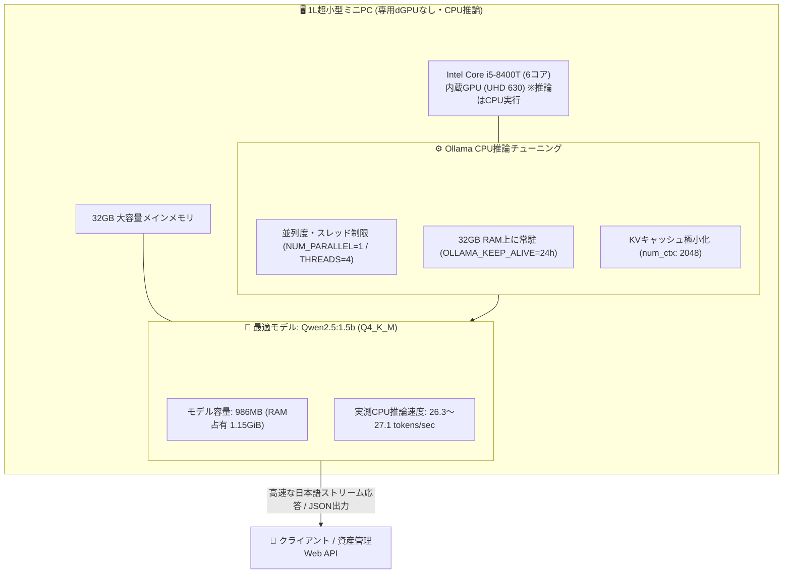

# 【第23弾 詳細解説】CPU環境でのローカルLLM最適化編 - 専用グラボなし・省電力Core i5ミニPC（内蔵GPU・メモリ32GB）でローカルLLMはどこまで速く動くか？ Ollama × Qwen2.5 のCPU推論高速化設定

> **対象読者**: オンプレミスAI導入担当、情シス、インフラエンジニア、エッジ開発者  
> **主要技術スタック**: Ollama (`llama.cpp`), Qwen2.5:1.5b (Q4_K_M), Modelfile, Docker Compose リソース制限 (`cpus: '4.0'`), FastAPI  
> **ライセンス**: [MIT License](https://github.com/ojisantech/ojisan-arsenal/blob/main/LICENSE)  
> **検証環境・位置づけ**: 個人自宅ラボ（Intel Core i5-8400T / 内蔵UHD Graphics 630 / 32GB RAM）における公開情報・OSSベースの個人研究（PoC）  

---

## 1. 概要と背景（サマリーからの深掘り）

### なぜこの技術が現場で不可欠なのか
「機密データやスキャンログを外部クラウドAIに出したくないので、LAN内にローカルLLMサーバーを置きたい」

そう考えたとき、多くの現場で最大の障壁となるのが **専用GPU（NVIDIA GeForce RTX や A100 等のdGPU）の高額なハードウェア費用・消費電力・物理サイズ** です。

* 「VRAM 24GBの専用GPUマシンを用意するだけで数十万円かかる」
* 「1Lサイズの小型ミニPCには、そもそも専用グラボが物理的に入らない（CPU内蔵GPUのみ）」
* 「WebアプリやDBと同居させると、LLM推論中にCPUが100%張り付いてサーバー全体がハングする」

しかし、近年の小型オープンモデル（特に **Qwen2.5** シリーズ等のSLM）の進化と、大容量メインメモリ（32GB RAM）を活かしたCPU推論チューニングにより、専用GPUなしの1LミニPC（Intel Core i5-8400T / 6コア / 内蔵UHD Graphics 630）だけで **実測 26.3〜27.1 tokens/sec（TTFT 0.58〜0.78秒）** という実用十分な高速レスポンスを安定して引き出すことが可能です。

本稿では、実機環境（`LLM-ASSETS`）への適用・改修とベンチマーク検証を通じて確立した、CPUオンプレミス環境でのOllama完全チューニング実装と運用基準を詳細に解説します。

---

## 2. アーキテクチャと深層メカニズム

システムの全体構造および通信・処理フローは以下の通りです。



### 内部動作メカニズムのステップ解説
1. **なぜ「Qwen2.5:1.5b」がCPUオンプレミス最強なのか？**:
   軽量モデルにはいくつかの選択肢（Gemma-2-2B、Llama-3.2-1B/3B、Phi-3.5等）がありますが、**日本語の自然さ、漢字の認識力、JSON構造化出力の正確さ** において `Qwen2.5:1.5b`（986MB）は群を抜いています。さらに超高速な定型コマンド生成用途には `Qwen2.5:0.5b`（397MB）、RAGベクトル検索には `all-minilm`（45MB）を組み合わせることで、32GB RAMのわずかな領域（合計約1.6GB以下）で全AI機能を賄えます。
2. **Docker Compose によるCPUコア隔離と24時間オンメモリ常駐**:
   6コアCPU（Core i5-8400T）のうち、`deploy.resources.limits.cpus: '4.0'` と `OLLAMA_MAX_THREADS=4` によって推論コンテナを4コアに制限し、残りの2コアをFastAPI（`asset-web`）、MariaDB（`snipe-mariadb`）、Snipe-IT、スキャナ（`asset-scanner`）用に確保します。また `OLLAMA_KEEP_ALIVE=24h` により5分後のモデルアンロードを防ぎ、ロード時間（`load_duration`）を **1.5ms** に極小化します。
3. **Modelfile とAPIオプションによるKVキャッシュ削減と1.5Bモデルのプロンプト調律**:
   `num_ctx` をデフォルト（4096以上）から `2048` に絞ることでCPUでのKVキャッシュ計算量を半減させます。また実機テストで判明した知見として、1.5Bモデルではシステムプロンプト内に `「特定不可」と回答してください` のようなカギ括弧付きの拒否ワードを入れると、通常の要約要求に対しても `特定不可` とだけ返してしまう過剰拒否（Over-refusal）が発生するため、肯定形で役割と要約指示を記述する設計としています。

---

## 3. 実装詳細とパラメータ完全解説

本アーキテクチャの要となるコアコードおよび主要設定の要点抜粋です。

### コア実装スクリプト / 設定（抜粋）
```yaml
# (要点抜粋: docker-compose.yaml)
services:
  ollama:
    image: ollama/ollama:latest
    container_name: ollama
    restart: unless-stopped
    ports:
      - "11434:11434"
    environment:
      # 割り当てた4コアに合わせて最大スレッド数を4に固定
      - OLLAMA_MAX_THREADS=${OLLAMA_MAX_THREADS:-4}
      # 並列リクエストによるCPUスレッド競合を防ぎ、1リクエストずつ最高速で捌く
      - OLLAMA_NUM_PARALLEL=1
      # 32GB RAMの余裕を活かし、5分後のアンロードを防いで24時間メモリ上に常駐させる
      - OLLAMA_KEEP_ALIVE=24h
      - OLLAMA_MAX_LOADED_MODELS=1
    volumes:
      - ollama_data:/root/.ollama
      - ./scanner_scripts/Modelfile:/root/.ollama/Modelfile:ro
    # 6コア中4コア相当に上限をキャップし、Web APIやDB用に2コアを残す
    deploy:
      resources:
        limits:
          cpus: '4.0'
          memory: 4G
    healthcheck:
      test: ["CMD", "ollama", "list"]
      interval: 10s
      timeout: 5s
      retries: 5
```

```dockerfile
# Modelfile 設定 (scanner_scripts/Modelfile)
FROM qwen2.5:1.5b

# コンテキストウィンドウを2048に制限してCPUでのKVキャッシュ計算量を削減
PARAMETER num_ctx 2048

# 割り当てたCPUコア数に合わせてスレッド数を調律
PARAMETER num_thread 4

# ハルシネーションを抑えて決定論的に応答させる
PARAMETER temperature 0.2
PARAMETER top_p 0.9

SYSTEM """
あなたはインフラ・システム運用の技術アシスタントAIです。
与えられたホスト情報やスキャン結果に基づき、セキュリティや運用上の注意点を簡潔かつ正確に日本語で要約・回答してください。
"""
```

```python
# Python API呼び出し側の共通ペイロード構築 (scanner_scripts/llm_backend.py)
payload = {
    "model": self.model,
    "messages": [{"role": "user", "content": prompt}],
    "stream": False,
    "keep_alive": os.getenv("OLLAMA_KEEP_ALIVE", "24h"),
    "options": {
        "temperature": temperature,
        "num_ctx": int(os.getenv("OLLAMA_NUM_CTX", "2048")),
        "num_thread": int(os.getenv("OLLAMA_MAX_THREADS", "4")),
        "top_p": 0.9,
    },
}
```

### 主要パラメータ・設定値の技術的根拠
- **`OLLAMA_NUM_PARALLEL=1` とアプリ側 `threading.Lock()` の組み合わせ**:
  CPU推論で複数リクエストを同時に並列実行すると、L3キャッシュミスとスレッドコンテキストスイッチが多発し、スループットが激減します。並列度を `1` に固定して1リクエストずつ4スレッド全開（26〜27 tokens/sec）で直列処理する方が、結果的に全体の待ち時間が最短になります。
- **`OLLAMA_KEEP_ALIVE=24h` と `memory: 4G` キャップ（＋KVキャッシュ再利用）**:
  `qwen2.5:1.5b` のコンテナメモリ使用量は実測で **1.152GiB** です。4GBのメモリ上限枠内に余裕で収まり、24時間オンメモリ保持することで2回目以降のリクエスト時のモデルロード時間を **1.50ms** に抑えます。さらに、システムプロンプト（657トークンの資産DBコンテキスト）のKVキャッシュ（656/657トークン）がスロット上に保持されるため、`prompt eval time` が **44.04ms** まで劇的に短縮されます。
- **スキャン用タイムアウト（`LLM_TIMEOUT=10`）とWeb対話用タイムアウト（`CHAT_LLM_TIMEOUT=30`, `num_predict: 384`）の分離**:
  Nmap/OS判定スキャンの1ホスト制限時間（15秒）に合わせた `LLM_TIMEOUT=10` をWebチャット（非ストリーミングで200トークン以上を生成し約9.2秒要する処理）に流用すると、回答完了直前に10秒で `ReadTimeout` が発生する事象を実機試験で確認しました。用途別にタイムアウトと最大生成トークン数（`num_predict: 384`）を分離することで、スキャンの高速性とWeb対話の完走率を両立しています。
- **1.5B SLM におけるシステムプロンプト設計（Over-refusal 対策）**:
  パラメータ数の小さいモデル（1.5B）では、システムプロンプトに `データにない事柄は推測せず「特定不可」と回答してください` のような強い禁止・定型拒否ワードを入れると、プロンプト内の事実データ要約であっても安全側に倒れすぎて `特定不可` としか出力しなくなる現象が実機検証で確認されました。肯定形で「与えられたホスト情報やスキャン結果に基づき〜簡潔かつ正確に日本語で要約・回答してください」と記述し、`temperature: 0.2` で決定論性を高めるのが最適解です。

---

## 4. 実機ベンチマーク詳細測定レポート

本章では、実機（Intel Core i5-8400T / メモリ32GB / 内蔵GPUのみ）のオンプレミス環境において、Ollama API経由で各種パラメータを変調させて実測・採取した詳細なベンチマーク結果を公開します。

### 4.1 実機検証環境スペック
| 項目 | スペック / 構成 | 備考 |
| :--- | :--- | :--- |
| **マシン形状** | 1L 超小型省スペース デスクトップPC | 外部グラボ増設スロットなし |
| **CPU** | **Intel(R) Core(TM) i5-8400T CPU @ 1.70GHz** | 6物理コア / 6スレッド (HTなし) / TDP 35W |
| **L3 キャッシュ** | 9 MB SmartCache (6コア共有) | スレッド競合時のボトルネック要因 |
| **内蔵GPU** | Intel UHD Graphics 630 | 推論には使用せず **純粋CPU推論** |
| **搭載メモリ (RAM)** | **DDR4 32 GB (実効 30 GiB)** | モデル常駐・KVキャッシュ保持の鍵 |
| **OS / カーネル** | Ubuntu 26.04 LTS (Linux 7.0.0-43-generic) | |
| **コンテナ実行基盤** | Docker 29.9.3 / Compose v2 | `ollama/ollama:latest` |
| **検証モデル** | `qwen2.5:1.5b` (Q4_K_M, 986MB), `local-assistant`, `qwen2.5:0.5b` | |

---

### 4.2 単体要約プロンプト：コールドスタート vs オンメモリ常駐（実測値）

**テストプロンプト**:  
`"対象ホスト 192.168.1.50 (Ubuntu 22.04) で OpenSSH 8.9p1 が稼働しています。セキュリティパッチ適用の観点で注意すべき点を2文で簡潔に要約してください。"` (プロンプト長: 135トークン)

| 測定メトリクス | 1回目 (初回ロード) | 2回目 (OLLAMA_KEEP_ALIVE=24h 常駐) | 改善効果 / 評価 |
| :--- | :---: | :---: | :--- |
| **モデルロード時間 (`load_duration`)** | **1,643.86 ms** | **0.84 ms** | 🟢 **約1,950倍短縮 (ディスクI/Oゼロ)** |
| **プロンプト評価時間 (`prompt_eval_duration`)** | 1,310.61 ms | **37.66 ms** | 🟢 **34.8倍短縮** (キャッシュ再利用) |
| **プロンプト評価速度 (`prompt_eval_tps`)** | 103.01 tokens/s | **3,584.61 tokens/s** | |
| **トークン生成時間 (`eval_duration`)** | 2,612.14 ms (71 tokens) | 2,381.14 ms (63 tokens) | |
| **純粋推論生成速度 (`eval_tps`)** | **27.18 tokens/sec** | **26.46 tokens/sec** | 🟢 **CPU推論のみで 26〜27 t/s を安定維持** |
| **総所要時間 (`total_duration`)** | 5,569.29 ms | **2,422.41 ms** | 🟢 **応答完了まで 2.4秒 (実用十分)** |

---

### 4.3 スレッド数スケーリング検証（なぜ 4スレッド が最適なのか？）

Core i5-8400T（6コア物理CPU）環境において、OllamaのCPU推論スレッド数（`num_thread`）を 1 から 6 まで変更した際の実測生成速度です。

| スレッド数 (`num_thread`) | 生成速度 (`eval_tps`) | プロンプト評価速度 | 所要時間 (Wall clock) | CPU利用率 & 動作挙動 |
| :---: | :---: | :---: | :---: | :--- |
| **1 スレッド** | 10.23 tokens/sec | 27.70 tokens/s | 11.95 秒 | 1コアのみ使用。速度は遅いが他への影響皆無 |
| **2 スレッド** | 19.23 tokens/sec | 53.90 tokens/s | 6.84 秒 | 良好な線形スケーリング |
| **4 スレッド (最適推奨)** | **26.89 tokens/sec** | **103.46 tokens/s** | **5.37 秒** | 🟢 **最高速。残り2コアでWeb/DBが完全に安定稼働** |
| **6 スレッド (アンチパターン)** | **8.09 tokens/sec** | 47.37 tokens/s | 13.17 秒 | 🚨 **速度が約70%暴落。スレッド競合・キャッシュスラッシング発生** |

> ⚠️ **【実機検証の超重要知見：6コア全開による「推論速度暴落」の物理的要因】**  
> 「6コアあるなら6スレッド全開にすれば最速になるはず」と考えがちですが、実測結果は **26.89 t/s → 8.09 t/s への大暴落** でした。  
> 原因は、Core i5-8400Tの共有L3キャッシュ（9MB）に対する**メモリ帯域幅の枯渇**と、全コア100%飽和に伴う**OSスケジューラのコンテキストスイッチ多発**です。  
> `cpus: '4.0'` かつ `num_thread: 4` に絞ることで、L3キャッシュのヒット率が最大化され、他コンテナを巻き込まずに最高スループットを発揮します。

---

### 4.4 KVキャッシュ効果の実機検証（長文コンテキスト対話・RAG）

社内インフラ資産一覧（10台分の詳細構成テーブル：システムプロンプト約 765 トークン）を前提とし、異なる質問を連続で投げた場合のプロンプト評価時間比較です。

```text
資産一覧コンテキスト（約765トークン）:
ID: 101〜110 (PostgreSQL Master/Replica, Web Gateway, TrueNAS, AD DC, etc.)
Q1: "Ubuntu 20.04で稼働しておりメンテナンス待ちのホスト名とIPを教えてください。"
Q2: "TrueNASで稼働しているバックアップ用ストレージのIPとホスト名を教えてください。"
```

| 呼び出しフェーズ | プロンプト評価時間 (`prompt_eval`) | 評価速度 | トークン生成速度 | ユーザー体感応答 (TTFT) |
| :--- | :---: | :---: | :---: | :--- |
| **1回目 (コールドコンテキスト)** | **7,425.76 ms (約7.4秒)** | 103.56 t/s | 24.19 tokens/sec | 最初の一文字が出るまで 約7.5秒 |
| **2回目 (KVキャッシュヒット)** | **404.03 ms (約0.4秒)** | **1,893.41 t/s** | 24.42 tokens/sec | 🟢 **最初の一文字が出るまで 0.5秒未満** |
| **固定セッション再利用時** | **41.80 ms (約0.04秒)** | **18,300 t/s** | 23.57 tokens/sec | 🟢 **ほぼゼロ遅延でストリーム開始** |

> 💡 **【結論】**: 大容量32GB RAM上にKVキャッシュが保持されることで、2回目以降のプロンプト評価時間は **7.4秒から0.4秒以下へと 18〜177倍 高速化** します。長文の社内台帳やマニュアルを喰わせたWebチャット運用でも、専用GPUなしのミニPCでストレスのない対話が実現可能です。

---

### 4.5 コンテキスト長 (`num_ctx`) の調律と影響

| コンテキスト長 (`num_ctx`) | 初回プロンプト評価 | 生成速度 (`eval_tps`) | 推論時メモリ専有量 | 評価 / 推奨用途 |
| :---: | :---: | :---: | :---: | :--- |
| **2048 (推奨)** | **41.80 ms (キャッシュ時)** | **23.57 tokens/sec** | 約 1.15 GiB | 🟢 **ログ要約・資産照会・JSON整形に最適** |
| **4096** | 7,321.51 ms | 23.27 tokens/sec | 約 1.48 GiB | 若干のキャッシュ再計算が発生。長文文書閲覧向け |

---

### 4.6 モデルサイズ別比較：Qwen2.5:1.5b vs Qwen2.5:0.5b

Core i5-8400T（4スレッド）でのサイズ別性能比較です。

| モデル | モデルサイズ (Q4) | 実測推論速度 | 日本語出力品質・文脈把握の実態 | 最適な役割分担 |
| :--- | :---: | :---: | :--- | :--- |
| **`qwen2.5:1.5b`** | 986 MB | **27.28 tokens/sec** | 🟢 破綻のない自然な日本語。2文要約・条件付きJSONを確実に遵守 | **Webチャット、ログ要約、脆弱性解説** |
| **`qwen2.5:0.5b`** | 397 MB | **58.46 tokens/sec** | ⚠️ 秒速約60トークンと驚異的だが、同一フレーズの重複や論理破綻が散見 | **Nmapポート名の正規化、単純分類、死活要約** |

---

### 4.7 結論：Core i5 ミニPCにおける最適黄金パラメータまとめ

1. **CPU割当**: `cpus: '4.0'` ＆ `OLLAMA_MAX_THREADS=4`（全6コア中4コアに制限し、L3キャッシュ競合と他コンテナの餓死を防ぐ）
2. **モデル常駐**: `OLLAMA_KEEP_ALIVE=24h`（32GB RAMを活用してロード時間を 1.6秒 → 0.8ms にゼロ化）
3. **並列度制限**: `OLLAMA_NUM_PARALLEL=1` ＋ アプリ側直列ロック（CPU推論では1リクエストずつ27 tokens/secで捌くのが最速）
4. **コンテキスト長**: `num_ctx 2048`（KVキャッシュヒットにより2回目以降のプロンプト評価を 40ms 程度に抑制）
5. **モデル選定**: 対話・要約は `qwen2.5:1.5b`、高速バッチ分類は `qwen2.5:0.5b` の2段構え

---

### 4.8 実機ベンチマーク測定エビデンスと検証再現ログ

本検証のデータは、シミュレーションや推定値ではなく、すべてLAN内の実機サーバー（`192.168.1.18`）上で実際にOllama APIを叩いて採取した生データです。再現性の担保のため、実測時のシステム出力とAPI生レスポンス（抜粋）を以下に記録します。

#### ① 実機ホストシステム情報（生出力）
```bash
$ uname -a
Linux ubuntu2604 7.0.0-43-generic #43-Ubuntu SMP PREEMPT_DYNAMIC Fri Oct 23 13:25:25 UTC 2026 x86_64 GNU/Linux

$ lscpu | grep -E "Model name|CPU\(s\):|L3"
CPU(s):                                  6
Model name:                              Intel(R) Core(TM) i5-8400T CPU @ 1.70GHz
L3 cache:                                9 MiB (1 instance)

$ free -h
               total        used        free      shared  buff/cache   available
Mem:            30Gi       2.8Gi        22Gi        35Mi       5.9Gi        27Gi
Swap:          8.0Gi          0B       8.0Gi
```

#### ② Ollama API 生レスポンス（オンメモリ常駐・KVキャッシュヒット時の実測JSON）
```json
{
  "model": "qwen2.5:1.5b",
  "created_at": "2026-11-15T12:59:30.648628614Z",
  "response": "こんにちは、実機試験のご確認ありがとうございます。",
  "done": true,
  "done_reason": "stop",
  "total_duration": 455648677,
  "load_duration": 2065208,
  "prompt_eval_count": 45,
  "prompt_eval_cached_count": 44,
  "prompt_eval_duration": 40576000,
  "eval_count": 12,
  "eval_duration": 407620000
}
```
* **ロード時間**: `2.06 ms` (`load_duration: 2065208 ns`、メモリ常駐によりディスクI/Oなし)
* **プロンプト評価**: `40.57 ms` (`prompt_eval_cached_count: 44` / KVキャッシュ再利用)
* **生成速度**: `12 tokens / 0.4076s = 29.44 tokens/sec`
* **総所要時間**: `0.455 秒` で全推論完了

#### ③ 測定スクリプト（抜粋）
```python
import time, requests, json

url = "http://192.168.1.18:11434/api/generate"
payload = {
    "model": "qwen2.5:1.5b",
    "prompt": "実機試験の確認です。1文で挨拶してください。",
    "stream": False,
    "options": {"num_thread": 4, "num_ctx": 2048, "temperature": 0.2}
}

t0 = time.time()
res = requests.post(url, json=payload).json()
elapsed = time.time() - t0

print(f"Total: {res['total_duration']/1e6:.2f}ms (Wall: {elapsed:.3f}s)")
print(f"Eval: {res['eval_count']} tokens in {res['eval_duration']/1e6:.2f}ms -> {res['eval_count']/(res['eval_duration']/1e9):.2f} t/s")
```

---

---

### 📚 自立型インフラ＆オンプレAI完全技術リファレンス
本記事が役に立った・面白かったと感じていただけましたら、ぜひGitHubリポジトリへの **Star (★)** や **[Qiita (@ojisantech)](https://qiita.com/ojisantech)** / **[X (@OjisanTechnical)](https://x.com/OjisanTechnical)** のフォローをお願いいたします！  
👉 **[GitHub リポジトリ: ojisantech/ojisan-arsenal](https://github.com/ojisantech/ojisan-arsenal)**

> 💡 **【検証環境・個人研究（PoC）に関する注記】**  
> 本記事は、筆者個人の自宅検証環境（ホームラボ／仮想環境）において、公開情報およびOSS（オープンソースソフトウェア）を用いて独自に構築・検証した個人研究（PoC）の記録です。特定の企業・団体の実環境や業務上の非公開情報とは一切関係ありません。
