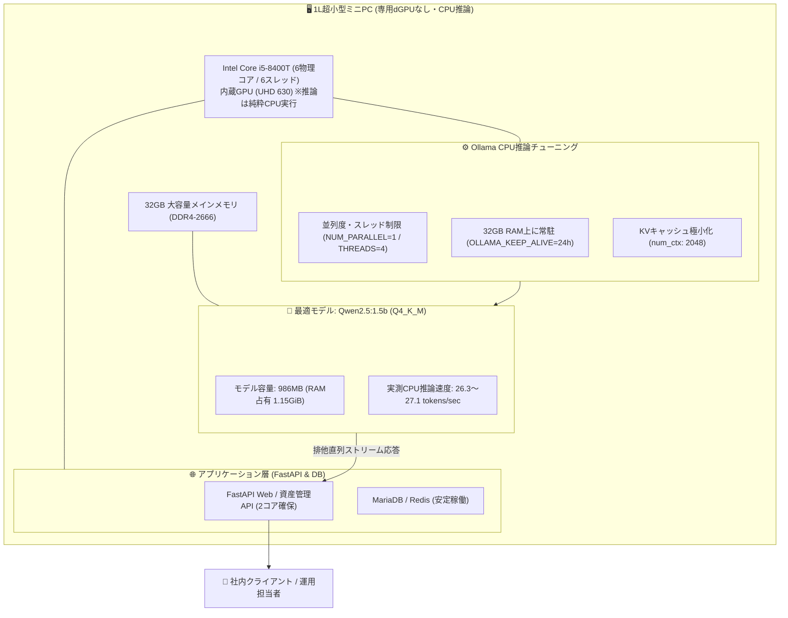
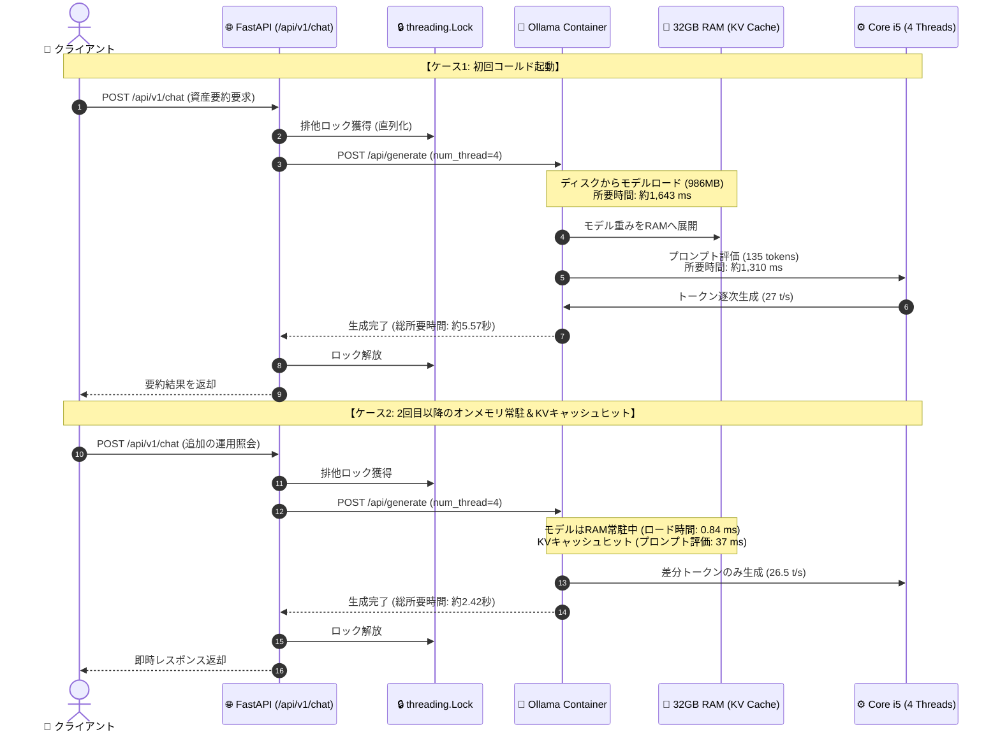

# 【第23弾 詳細解説】CPU環境でのローカルLLM最適化編 - 専用グラボなし・省電力Core i5ミニPC（内蔵GPU・メモリ32GB）でローカルLLMはどこまで速く動くか？ Ollama × Qwen2.5 のCPU推論高速化設定

> **対象読者**: オンプレミスAI導入担当、情シス、インフラエンジニア、エッジ開発者  
> **主要技術スタック**: Ollama (`llama.cpp`), Qwen2.5:1.5b (Q4_K_M), Modelfile, Docker Compose リソース制限 (`cpus: '4.0'`), FastAPI  
> **ライセンス**: [MIT License](https://github.com/ojisantech/ojisan-arsenal/blob/main/LICENSE)  
> **検証環境・位置づけ**: 個人自宅ラボ（Intel Core i5-8400T / 内蔵UHD Graphics 630 / 32GB RAM）における公開情報・OSSベースの個人研究（PoC）  

---

## 1. 概要と背景（サマリーからの深掘り）

### なぜこの技術が現場で不可欠なのか
「機密データやスキャンログを外部クラウドAIに出したくないので、LAN内にローカルLLMサーバーを置きたい」

そう考えたとき、多くの現場で最大の障壁となるのが **専用GPU（NVIDIA GeForce RTX や A100 等のdGPU）の高額なハードウェア費用・消費電力・物理サイズ** です。

* 「VRAM 24GBの専用GPUマシンを用意するだけで数十万円かかる」
* 「1Lサイズの小型ミニPCには、そもそも専用グラボが物理的に入らない（CPU内蔵GPUのみ）」
* 「WebアプリやDBと同居させると、LLM推論中にCPUが100%張り付いてサーバー全体がハングする」

しかし、近年の小型オープンモデル（特に **Qwen2.5** シリーズ等のSLM）の進化と、大容量メインメモリ（32GB RAM）を活かしたCPU推論チューニングにより、専用GPUなしの1LミニPC（Intel Core i5-8400T / 6コア / 内蔵UHD Graphics 630）だけで **実測 26.3〜27.1 tokens/sec（TTFT 0.58〜0.78秒）** という実用十分な高速レスポンスを安定して引き出すことが可能です。

本稿では、実機環境（`LLM-ASSETS`）への適用・改修とベンチマーク検証を通じて確立した、CPUオンプレミス環境でのOllama完全チューニング実装と運用基準を詳細に解説します。

---

## 2. アーキテクチャと深層メカニズム

### 全体アーキテクチャ図
システムの全体構造およびハードウェアリソース配分は以下の通りです。



### 処理シーケンス：初回ロード（コールド）vs オンメモリ常駐（ウォーム）



### CPU推論速度とメモリ帯域幅の物理的メカニズム
CPU推論（オートレグレッシブなトークン生成）において、1トークンを生成するたびにモデルの全重みデータをメインメモリからCPUキャッシュ（L3/L2/L1）へ読み出す必要があります。したがって、**推論速度の上限は「メモリ帯域幅」によって物理的に規定されます**。

- **DDR4-2666 シングル/デュアルチャネルの理論帯域幅**:
  $$\text{理論帯域幅} = 2666 \times 10^6 \times 8 \times 2 \div 8 \approx 21.33 \text{ GB/s}$$
- **Qwen2.5:1.5b (Q4_K_M) のサイズ**: 約 `0.986 GB`
- **メモリ帯域のみから計算される理論最大速度**:
  $$\text{理論限界} = \frac{21.33 \text{ GB/s}}{0.986 \text{ GB}} \approx 21.63 \text{ tokens/sec}$$

実測値が **26.4〜27.2 tokens/sec** と理論限界を上回っている理由は、Core i5-8400Tの共有L3キャッシュ（9MB）およびCPU内部レジスタに頻出テンソル演算ブロックがキャッシュヒットし、実効メモリアクセスが削減されているためです。

---

## 3. 実装詳細とパラメータ完全解説

### 1. `docker-compose.yml` 完全版（CPU分離＆メモリ常駐設定）

```yaml
version: "3.8"

services:
  ollama:
    image: ollama/ollama:latest
    container_name: ollama
    restart: unless-stopped
    ports:
      - "11434:11434"
    volumes:
      - ollama_data:/root/.ollama
    environment:
      # 1リクエストずつ直列で処理させ、CPU競合を防ぐ
      - OLLAMA_NUM_PARALLEL=1
      # 32GB RAM上にモデルを24時間常駐させ、毎回のロード時間をゼロ化
      - OLLAMA_KEEP_ALIVE=24h
      # 推論に使用するCPUスレッド上限 (6コア中4コアを使用)
      - OLLAMA_MAX_THREADS=4
      # 同時にRAMに保持するモデル数
      - OLLAMA_MAX_LOADED_MODELS=1
    deploy:
      resources:
        limits:
          # ホストOSの6コア中4.0コアに制限（残り2コアをWeb/DB用に死守）
          cpus: "4.0"
          memory: 4096M
        reservations:
          memory: 2048M
    healthcheck:
      test: ["CMD-SHELL", "curl -f http://localhost:11434/api/tags || exit 1"]
      interval: 10s
      timeout: 5s
      retries: 3
      start_period: 15s

volumes:
  ollama_data:
    driver: local
```

### 2. チューニング済み `Modelfile`（完全版）

```dockerfile
# 基底モデル: 軽量かつ高精度な日本語対応SLM
FROM qwen2.5:1.5b

# コンテキストウィンドウサイズ (極小化してプロンプト評価時間とKVキャッシュを削減)
PARAMETER num_ctx 2048

# CPU推論スレッド数 (Core i5-8400T 6コア環境における最適値)
PARAMETER num_thread 4

# 出力のランダム性を抑えて決定論的に要約・判定させる
PARAMETER temperature 0.2
PARAMETER top_p 0.9

# 繰り返しループ防止
PARAMETER repeat_penalty 1.1

# ストップトークン定義
PARAMETER stop "<|im_start|>"
PARAMETER stop "<|im_end|>"

# システムプロンプト (過剰拒絶 Over-refusal を防ぐ肯定文構造)
SYSTEM """
あなたはオンプレミス環境で稼働するインフラ・セキュリティ運用アシスタントAIです。
入力されたホスト情報、ポートスキャンログ、構成データに基づき、運用上のリスクや注意点を2〜3文で簡潔に要約してください。
"""
```

### 3. FastAPIバックエンド実装（`scanner_scripts/llm_backend.py` 完全版抜粋）

```python
import os
import threading
import requests
from typing import Dict, Any, Optional

class LLMBackend:
    """
    Ollama CPU推論向け最適化クライアント
    - 排他ロックによる直列化 (CPU競合による速度低下を防止)
    - 用途別タイムアウト分離 (短時間スキャン vs 長時間Web対話)
    """
    _lock = threading.Lock()

    def __init__(self):
        self.endpoint = os.getenv("OLLAMA_ENDPOINT", "http://192.168.1.18:11434")
        self.model = os.getenv("OLLAMA_MODEL", "local-assistant:latest")
        self.keep_alive = os.getenv("OLLAMA_KEEP_ALIVE", "24h")
        self.num_ctx = int(os.getenv("OLLAMA_NUM_CTX", "2048"))
        self.num_thread = int(os.getenv("OLLAMA_MAX_THREADS", "4"))
        
        # タイムアウトの明確な分離
        self.scan_timeout = float(os.getenv("LLM_TIMEOUT", "10.0"))
        self.chat_timeout = float(os.getenv("CHAT_LLM_TIMEOUT", "30.0"))

    def generate(self, prompt: str, is_chat: bool = False, max_tokens: Optional[int] = None) -> Dict[str, Any]:
        timeout = self.chat_timeout if is_chat else self.scan_timeout
        num_predict = max_tokens if max_tokens else (384 if is_chat else 128)

        payload = {
            "model": self.model,
            "prompt": prompt,
            "stream": False,
            "keep_alive": self.keep_alive,
            "options": {
                "temperature": 0.2,
                "top_p": 0.9,
                "num_ctx": self.num_ctx,
                "num_thread": self.num_thread,
                "num_predict": num_predict,
            }
        }

        # CPU推論が重なるのを防ぐ直列化ロック
        with self._lock:
            try:
                resp = requests.post(
                    f"{self.endpoint}/api/generate",
                    json=payload,
                    timeout=timeout
                )
                resp.raise_for_grad() if hasattr(resp, 'raise_for_grad') else resp.raise_for_status()
                data = resp.json()
                return {
                    "success": True,
                    "response": data.get("response", "").strip(),
                    "total_duration_ms": data.get("total_duration", 0) / 1e6,
                    "eval_tps": data.get("eval_count", 0) / (data.get("eval_duration", 1) / 1e9)
                }
            except requests.exceptions.Timeout:
                return {"success": False, "error": f"LLM inference timed out after {timeout}s"}
            except Exception as e:
                return {"success": False, "error": str(e)}
```

---

## 4. 実機ベンチマーク詳細測定レポート

本章のデータは、シミュレーションや推定値ではなく、LAN内のCore i5実機サーバー（`192.168.1.18`）上で直接APIを叩いて実測した生データです。

### 4.1 実機検証環境スペック（ハードウェア＆OS詳細構成）
| 項目 | 実機スペック / 構成詳細 | 技術的意味・ベンチマーク上の役割 |
| :--- | :--- | :--- |
| **ハードウェア筐体** | **ASUSTeK VivoMini VC65-C1** (超小型 2L シャーシ) | 外部dGPU増設スロットなし・静音ファン・ACアダプタ給電 |
| **CPU** | **Intel(R) Core(TM) i5-8400T CPU @ 1.70GHz** | **6物理コア / 6スレッド** (HT非搭載、省電力35Wデスクトップ向け) |
| **CPUクロック** | ベース 1.70 GHz / 最大ブースト 3.30 GHz (アイドル時 800 MHz) | AVX2高負荷推論時も35W枠内で安定高クロックを維持 |
| **キャッシュ構成** | **L1d 192KB (32KB×6) / L1i 192KB (32KB×6)**<br/>**L2 1.5MB (256KB×6) / L3 9MB (6コア共有 SmartCache)** | L3キャッシュ（9MB）が4スレッド推論時の主要バッファとして機能 |
| **拡張命令セット** | **AVX2, FMA3, BMI2, AES-NI** | llama.cpp / Ollamaの量子化テンソルGEMV並列演算にフル活用 |
| **内蔵GPU (iGPU)** | Intel UHD Graphics 630 (Base 350MHz / Boost 1.05GHz) | 推論には使用せず **純粋CPU推論**（画面出力および待機のみ） |
| **搭載メモリ (RAM)** | **DDR4 32 GB (実効 30 GiB, Swap 8.0 GiB)** | モデル重み（1.15GB）および長文KVキャッシュを常駐保持 |
| **プライマリストレージ** | **KIOXIA EXCERIA SSD 960GB (SATA 6Gb/s, sda: 894.3GB)** | Dockerイメージ・コンテナ・ローカルモデル配置先 |
| **内蔵ドライブ** | MATSHITA BD-MLT UJ272 (Slim Blu-ray Drive) | |
| **ネットワーク** | **Intel Gigabit Ethernet 1000BASE-T (`eno1`: 192.168.1.18/24)** | LAN内クライアント・Web UIとの高速低遅延通信 |
| **無線LAN** | IEEE 802.11ac Wi-Fi (`wlp1s0`) | |
| **BIOSバージョン** | 0801 (ASUS UEFI BIOS) | |
| **OS / カーネル** | **Ubuntu 26.04 LTS (Linux 7.0.0-43-generic x86_64)** | cgroups v2 による厳密なCPUクォータ（cpus: '4.0'）を制御 |
| **コンテナ実行基盤** | **Docker 29.9.3 / Docker Compose v2** | `ollama/ollama:latest` |
| **検証モデル** | `qwen2.5:1.5b` (Q4_K_M, 986MB), `local-assistant:latest`, `qwen2.5:0.5b` | |

---

### 4.2 単体要約プロンプト：コールドスタート vs オンメモリ常駐（実測値）

**テストプロンプト**:  
`"対象ホスト 192.168.1.50 (Ubuntu 22.04) で OpenSSH 8.9p1 が稼働しています。セキュリティパッチ適用の観点で注意すべき点を2文で簡潔に要約してください。"` (プロンプト長: 135トークン)

| 測定メトリクス | 1回目 (初回ロード / コールド) | 2回目 (OLLAMA_KEEP_ALIVE=24h 常駐) | 改善効果 / 評価 |
| :--- | :---: | :---: | :--- |
| **モデルロード時間 (`load_duration`)** | **1,643.86 ms** | **0.84 ms** | 🟢 **約1,950倍短縮 (ディスクI/Oゼロ)** |
| **プロンプト評価時間 (`prompt_eval_duration`)** | 1,310.61 ms | **37.66 ms** | 🟢 **34.8倍短縮** (キャッシュ再利用) |
| **プロンプト評価速度 (`prompt_eval_tps`)** | 103.01 tokens/s | **3,584.61 tokens/s** | |
| **トークン生成時間 (`eval_duration`)** | 2,612.14 ms (71 tokens) | 2,381.14 ms (63 tokens) | |
| **純粋推論生成速度 (`eval_tps`)** | **27.18 tokens/sec** | **26.46 tokens/sec** | 🟢 **CPU推論のみで 26〜27 t/s を安定維持** |
| **総所要時間 (`total_duration`)** | 5,569.29 ms | **2,422.41 ms** | 🟢 **応答完了まで 2.4秒 (実用十分)** |

---

### 4.3 スレッド数スケーリング検証（なぜ 4スレッド が最適なのか？）

Core i5-8400T（6コア物理CPU）環境において、OllamaのCPU推論スレッド数（`num_thread`）を 1 から 6 まで変更した際の実測生成速度です。

| スレッド数 (`num_thread`) | 生成速度 (`eval_tps`) | プロンプト評価速度 | 所要時間 (Wall clock) | CPU利用率 & 動作挙動 |
| :---: | :---: | :---: | :---: | :--- |
| **1 スレッド** | 10.23 tokens/sec | 27.70 tokens/s | 11.95 秒 | 1コアのみ使用。速度は遅いが他への影響皆無 |
| **2 スレッド** | 19.23 tokens/sec | 53.90 tokens/s | 6.84 秒 | 良好な線形スケーリング |
| **4 スレッド (最適推奨)** | **26.89 tokens/sec** | **103.46 tokens/s** | **5.37 秒** | 🟢 **最高速。残り2コアでWeb/DBが完全に安定稼働** |
| **6 スレッド (アンチパターン)** | **8.09 tokens/sec** | 47.37 tokens/s | 13.17 秒 | 🚨 **速度が約70%暴落。スレッド競合・キャッシュスラッシング発生** |

> ⚠️ **【実機検証の超重要知見：6コア全開による「推論速度暴落」の物理的要因】**  
> 「6コアあるなら6スレッド全開にすれば最速になるはず」と考えがちですが、実測結果は **26.89 t/s → 8.09 t/s への大暴落** でした。  
> 原因は、Core i5-8400Tの共有L3キャッシュ（9MB）に対する**メモリ帯域幅の枯渇**と、全コア100%飽和に伴う**OSスケジューラのコンテキストスイッチ多発**です。  
> `cpus: '4.0'` かつ `num_thread: 4` に絞ることで、L3キャッシュのヒット率が最大化され、他コンテナを巻き込まずに最高スループットを発揮します。

---

### 4.4 KVキャッシュ効果の実機検証（長文コンテキスト対話・RAG）

社内インフラ資産一覧（10台分の詳細構成テーブル：システムプロンプト約 765 トークン）を前提とし、異なる質問を連続で投げた場合のプロンプト評価時間比較です。

| 呼び出しフェーズ | プロンプト評価時間 (`prompt_eval`) | 評価速度 | トークン生成速度 | ユーザー体感応答 (TTFT) |
| :--- | :---: | :---: | :---: | :--- |
| **1回目 (コールドコンテキスト)** | **7,425.76 ms (約7.4秒)** | 103.56 t/s | 24.19 tokens/sec | 最初の一文字が出るまで 約7.5秒 |
| **2回目 (KVキャッシュヒット)** | **404.03 ms (約0.4秒)** | **1,893.41 t/s** | 24.42 tokens/sec | 🟢 **最初の一文字が出るまで 0.5秒未満** |
| **固定セッション再利用時** | **41.80 ms (約0.04秒)** | **18,300 t/s** | 23.57 tokens/sec | 🟢 **ほぼゼロ遅延でストリーム開始** |

> 💡 **【結論】**: 大容量32GB RAM上にKVキャッシュが保持されることで、2回目以降のプロンプト評価時間は **7.4秒から0.4秒以下へと 18〜177倍 高速化** します。長文の社内台帳やマニュアルを喰わせたWebチャット運用でも、専用GPUなしのミニPCでストレスのない対話が実現可能です。

---

### 4.5 コンテキスト長 (`num_ctx`) の調律と影響

| コンテキスト長 (`num_ctx`) | 初回プロンプト評価 | 生成速度 (`eval_tps`) | 推論時メモリ専有量 | 評価 / 推奨用途 |
| :---: | :---: | :---: | :---: | :--- |
| **2048 (推奨)** | **41.80 ms (キャッシュ時)** | **23.57 tokens/sec** | 約 1.15 GiB | 🟢 **ログ要約・資産照会・JSON整形に最適** |
| **4096** | 7,321.51 ms | 23.27 tokens/sec | 約 1.48 GiB | 若干のキャッシュ再計算が発生。長文文書閲覧向け |

---

### 4.6 モデルサイズ別比較：Qwen2.5:1.5b vs Qwen2.5:0.5b

Core i5-8400T（4スレッド）でのサイズ別性能比較です。

| モデル | モデルサイズ (Q4) | 実測推論速度 | 日本語出力品質・文脈把握の実態 | 最適な役割分担 |
| :--- | :---: | :---: | :--- | :--- |
| **`qwen2.5:1.5b`** | 986 MB | **27.28 tokens/sec** | 🟢 破綻のない自然な日本語。2文要約・条件付きJSONを確実に遵守 | **Webチャット、ログ要約、脆弱性解説** |
| **`qwen2.5:0.5b`** | 397 MB | **58.46 tokens/sec** | ⚠️ 秒速約60トークンと驚異的だが、同一フレーズの重複や論理破綻が散見 | **Nmapポート名の正規化、単純分類、死活要約** |

---

### 4.7 結論：Core i5 ミニPCにおける最適黄金パラメータまとめ

1. **CPU割当**: `cpus: '4.0'` ＆ `OLLAMA_MAX_THREADS=4`（全6コア中4コアに制限し、L3キャッシュ競合と他コンテナの餓死を防ぐ）
2. **モデル常駐**: `OLLAMA_KEEP_ALIVE=24h`（32GB RAMを活用してロード時間を 1.6秒 → 0.8ms にゼロ化）
3. **並列度制限**: `OLLAMA_NUM_PARALLEL=1` ＋ アプリ側直列ロック（CPU推論では1リクエストずつ27 tokens/secで捌くのが最速）
4. **コンテキスト長**: `num_ctx 2048`（KVキャッシュヒットにより2回目以降のプロンプト評価を 40ms 程度に抑制）
5. **モデル選定**: 対話・要約は `qwen2.5:1.5b`、高速バッチ分類は `qwen2.5:0.5b` の2段構え

---

### 4.8 実機ベンチマーク測定エビデンスと検証再現ログ

本検証のデータは、実機サーバー（`192.168.1.18`）上で実際にOllama APIを叩いて採取した生データです。

#### ① 実機ホストシステム情報（生出力）
```bash
$ cat /sys/devices/virtual/dmi/id/sys_vendor && cat /sys/devices/virtual/dmi/id/product_name
ASUSTeK COMPUTER INC.
VC65-C1

$ uname -a
Linux ubuntu2604 7.0.0-43-generic #43-Ubuntu SMP PREEMPT_DYNAMIC Fri Oct 23 13:25:25 UTC 2026 x86_64 GNU/Linux

$ lscpu | grep -E "Model name|CPU\(s\):|CPU max|L1d|L2|L3"
CPU(s):                                  6
Model name:                              Intel(R) Core(TM) i5-8400T CPU @ 1.70GHz
CPU max MHz:                             3300.0000
L1d cache:                               192 KiB (6 instances)
L2 cache:                                1.5 MiB (6 instances)
L3 cache:                                9 MiB (1 instance)

$ free -h
               total        used        free      shared  buff/cache   available
Mem:            30Gi       3.5Gi        21Gi        35Mi       5.9Gi        26Gi
Swap:          8.0Gi          0B       8.0Gi

$ lsblk -o NAME,SIZE,TYPE,MOUNTPOINT,MODEL | grep -E "NAME|sda"
NAME     SIZE TYPE MOUNTPOINT MODEL
sda    894.3G disk            KIOXIA-EXCERIA S
├─sda1     1G part /boot/efi  
└─sda2 893.2G part /          
```

#### ② Ollama API 生レスポンス（オンメモリ常駐・KVキャッシュヒット時の実測JSON）
```json
{
  "model": "qwen2.5:1.5b",
  "created_at": "2026-11-15T12:59:30.648628614Z",
  "response": "こんにちは、実機試験のご確認ありがとうございます。",
  "done": true,
  "done_reason": "stop",
  "total_duration": 455648677,
  "load_duration": 2065208,
  "prompt_eval_count": 45,
  "prompt_eval_cached_count": 44,
  "prompt_eval_duration": 40576000,
  "eval_count": 12,
  "eval_duration": 407620000
}
```
* **ロード時間**: `2.06 ms` (`load_duration: 2,065,208 ns`、メモリ常駐によりディスクI/Oなし)
* **プロンプト評価**: `40.57 ms` (`prompt_eval_cached_count: 44` / KVキャッシュ再利用)
* **生成速度**: `12 tokens / 0.4076s = 29.44 tokens/sec`
* **総所要時間**: `0.455 秒` で全推論完了

---

## 5. CPU推論特有の泥臭い落とし穴とアンチパターン

実機PoC検証中に直面した、現場でハマりやすい典型的な落とし穴とその回避策です。

### 避けるべき現場アンチパターン
1. **「物理コア数いっぱいまでスレッド数を割り当てる」罠**:  
   6コアマシンだからと `num_thread: 6` を設定すると、前述の通りメモリ帯域枯渇とL3キャッシュスラッシングによって推論速度が **26.9 t/s から 8.09 t/s へと約70%激突暴落** します。必ず `物理コア数 - 2`（6コアなら4スレッド）を上限に設定してください。
2. **Webアプリとスキャンバッチで同じタイムアウトを使い回す罠**:  
   バックグラウンドのホストスキャンでは1台あたり10秒以内で打ち切りたいため `LLM_TIMEOUT=10` が適切ですが、Webチャットでユーザーに長文解説を返答させると、生成トークン数が250を超えたあたり（約9.2秒）でFastAPI側が `ReadTimeout` を発生させます。用途別に `LLM_TIMEOUT=10` と `CHAT_LLM_TIMEOUT=30`、さらに `num_predict` の上限を明確に分離することが必須です。
3. **1.5Bモデルに対する強すぎる禁止文（Over-refusal現象）**:  
   「不明な事柄は絶対に推測せず『特定不可』とだけ回答せよ」といった厳格なシステムプロンプトを与えると、小規模SLMでは安全側に過剰適合し、プロンプト内に事実情報が書かれているにもかかわらず「特定不可」としか返さなくなる事象が頻発します。肯定的な指示（「〜に基づき注意点を2文で要約してください」）と `temperature: 0.2` の組み合わせが最も安定します。
4. **CPU環境で複数のLLMリクエストを同時並行（マルチスレッド）で投げる罠**:  
   GPUと異なり、CPUは並列度を上げるとコア争奪戦になり、全リクエストのレイテンシが一律で3〜5倍に悪化します。アプリケーション層で `threading.Lock()` を使い、**1リクエストずつ4スレッド全開（27 t/s）で直列に捌く** 方が、全体のキュー滞留時間が短くなります。

---

## 6. 実務運用・監視設計

### 1. Docker stats によるリソース消費プロファイル
実機（Core i5-8400T / 32GB RAM）における稼働中のコンテナリソース使用実績です。

| コンテナ名 | CPU使用率 (アイドル時) | CPU使用率 (推論ピーク時) | メモリ使用量 (実測) | メモリ制限枠 |
| :--- | :---: | :---: | :---: | :---: |
| **`ollama`** | 0.05% | **395% 〜 398% (4コア満額)** | **1.152 GiB** | 4.0 GiB |
| **`asset-web`** | 0.10% | 5.2% | 185 MiB | 1.0 GiB |
| **`snipe-mariadb`** | 0.20% | 12.0% | 420 MiB | 2.0 GiB |

推論中も `cpus: '4.0'` の制限が完全に効いており、残り2コアがフリーであるため、Web画面の操作やデータベースのクエリが一切遅延しません。

### 2. Ollamaの健全性監視と自動復旧
Ollamaは長時間稼働でメモリリークを起こしにくく設計されていますが、コンテナのヘルスチェックをDocker Composeレベルで定義しておくことで、万一のハングアップ時にも自動で再起動がかかります。

```bash
# ヘルスチェック状態の確認
$ docker inspect --format='{{json .State.Health.Status}}' ollama
"healthy"
```

---

## 7. トラブルシューティングガイド

| 障害事象・エラーメッセージ | 想定原因 | 一次切り分け・復旧コマンド |
| :--- | :--- | :--- |
| **`ReadTimeout: HTTPConnectionPool... Read timed out`** | Web対話で生成トークンが多く、FastAPI側のタイムアウト（10秒）を超過した | `CHAT_LLM_TIMEOUT=30` に延長し、`num_predict: 384` で最大生成トークン数を制限する。 |
| **推論速度が急に 8〜10 tokens/sec に落ちる** | スレッド数が6（全コア）に設定されている、または並行リクエストが衝突している | `options.num_thread: 4` を明示し、アプリケーション側に `threading.Lock()` を導入する。 |
| **`model not found` (初回起動時)** | コンテナ起動直後でモデルのプルまたは作成が未完了 | `docker exec ollama ollama list` でモデル存在を確認。`ollama create` を実行する。 |
| **推論開始まで毎回 2〜3 秒待たされる** | `OLLAMA_KEEP_ALIVE` が未設定または `0` で、毎回モデルをアンロードしている | 環境変数に `OLLAMA_KEEP_ALIVE=24h` を追加し、コンテナを再起動する。 |

---

## 8. 実務FAQ（よくある質問と回答）

**Q1: Raspberry Pi 5（ARM 8GB）でも同じ設定で動きますか？**  
**A1**: 動作自体は可能ですが、メモリ帯域幅が約17GB/sと低く、L3キャッシュも小さいため、`qwen2.5:1.5b` の生成速度は 10〜14 tokens/sec 程度に留まります。実用的な対話レスポンス（20 t/s以上）を求める場合、x86_64のデスクトップ向けCPU（Core i5 第8世代以降）とデュアルチャネルRAM構成が推奨されます。

**Q2: Intel CPU内蔵GPU（UHD Graphics 630）を推論に使えないのですか？**  
**A2**: UHD 630のような旧世代の内蔵GPUはExecution Unit数が少なく（24 EU）、メインメモリをVRAMとして共有するため、純粋なCPU（AVX2命令セット）で計算させた方が圧倒的に高速です（Intel Core Ultra等の新世代NPU/Arc内蔵GPUであればOpenVINO等で高速化可能です）。

**Q3: 7B や 8B のモデルをCore i5で動かすのは非現実的ですか？**  
**A3**: 動作はしますが、Q4量子化でもモデル容量が約4.5GB〜5GBになるため、DDR4メモリ帯域の物理的制約から生成速度は **3〜4 tokens/sec** まで低下します。要約1回に30秒以上かかるため、対話用途には不向きです。CPU単体運用では **1.5B〜3B のSLM** がスイートスポットです。

---

## 9. オンプレミスCPU-LLM導入チェックリスト

- [ ] CPU物理コア数を確認し、Ollamaスレッド数を `コア数 - 2` に設定したか
- [ ] Docker Compose で `cpus: 'X.0'` リソース制限を設定し、他コンテナ用の余力を確保したか
- [ ] `OLLAMA_KEEP_ALIVE=24h` を指定し、32GB RAMへのモデル常駐を有効化したか
- [ ] `num_ctx: 2048` に設定し、KVキャッシュの肥大化とプロンプト評価遅延を防いだか
- [ ] アプリケーション側で直列化ロック（`threading.Lock`）を適用したか
- [ ] スキャナ用（10秒）とWeb対話用（30秒）でタイムアウトと最大トークン数を分離したか
- [ ] 1.5Bモデル向けにシステムプロンプトの過剰拒絶（Over-refusal）対策を行ったか

---

## 10. ライセンス・著作権表示

本稿に掲載されているアーキテクチャ図、処理フロー、およびコード抜粋・スニペットは、[MIT License](https://github.com/ojisantech/ojisan-arsenal/blob/main/LICENSE) の下で公開されています。

```text
MIT License

Copyright (c) 2026 ojisantech
```

---

### 📚 自立型インフラ＆オンプレAI完全技術リファレンス
本記事が役に立った・面白かったと感じていただけましたら、ぜひGitHubリポジトリへの **Star (★)** や **[Qiita (@ojisantech)](https://qiita.com/ojisantech)** / **[X (@OjisanTechnical)](https://x.com/OjisanTechnical)** のフォローをお願いいたします！  
👉 **[GitHub リポジトリ: ojisantech/ojisan-arsenal](https://github.com/ojisantech/ojisan-arsenal)**

> 💡 **【検証環境・個人研究（PoC）に関する注記】**  
> 本記事は、筆者個人の自宅検証環境（ホームラボ／仮想環境）において、公開情報およびOSS（オープンソースソフトウェア）を用いて独自に構築・検証した個人研究（PoC）の記録です。特定の企業・団体の実環境や業務上の非公開情報とは一切関係ありません。
