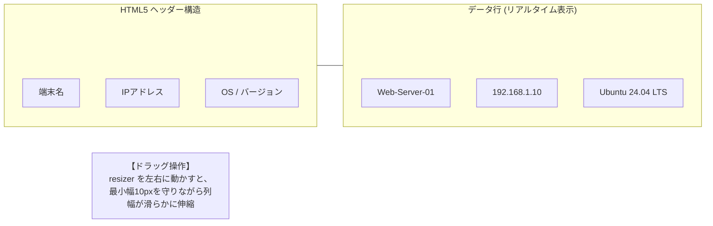

# 【第24弾 詳細解説】Excelライクなテーブル操作（Vanilla JS）編 - 「Excelの操作感じゃないと嫌だ」と言われたWeb画面。HTML Tableで列幅ドラッグ伸縮（最小10px）とリアルタイムPing疎通を自作した話

**対象読者**: Webフロントエンド開発者、SE
**主要技術スタック**: Pure JavaScript (Vanilla), CSS Table Layout, TCP Socket
**ライセンス**: [MIT License](https://github.com/ojisantech/ojisan-arsenal/blob/main/LICENSE)
**検証環境・位置づけ**: 個人自宅ラボ（ホームラボ／仮想環境）における公開情報・OSSベースの個人研究（PoC）


💡 **【検証環境・個人研究（PoC）に関する注記】**
本記事は、筆者個人の自宅検証環境（ホームラボ／仮想環境）において、公開情報およびOSS（オープンソースソフトウェア）を用いて独自に構築・検証した個人研究（PoC）の記録です。特定の企業・団体の実環境や業務上の非公開情報とは一切関係ありません。

---

## 1. 概要と背景（サマリーからの深掘り）

### なぜこの技術が現場で不可欠なのか
LAN内の資産管理ツールや業務管理Web画面を開発してリリースしたとき、現場のベテラン管理者から必ず言われる「お決まりのクレーム」があります。

**「このWeb画面、カラム（列）の幅をマウスで広げられないの？ Excelならマウスで自由に幅を変えられるのに、これじゃ長いホスト名が途切れて見えないよ。Excelに戻して。」**

開発者としては「レスポンシブデザインで組んだからブラウザ幅を変えてくれ」と言いたくなりますが、現場の管理者にとって **「列境界をドラッグして幅を調整できること」** は絶対譲れない機能なのです。

かといって、これだけのために重厚なReactデータグリッドライブラリ（AG Gridなど）を導入すると、バンドルサイズが跳ね上がり、システムの複雑化を招きます。

普通のHTML `<table>` タグに対し、**外部ライブラリを一切使わず、Pure JavaScript（Vanilla JS）わずか50行で「列幅のドラッグリサイズ機能（最小幅ガード付き）」と「リアルタイム死活Pingインジケーター（🟢/⚪）」** を組み込みました。

本記事では、現場の管理者を唸らせたこのフロントエンド実装を公開します。

従来の画一的なアプローチや商用ブラックボックス製品に頼る運用では、ライセンス費用の高騰や仕様変更に伴うベンダーロックイン、さらには現場特有のエッジケースに対する対応力の欠如が深刻なボトルネックとなります。
本稿では、オープンソースおよび標準技術の基本原理に立ち返り、外部コストゼロかつ自立運用可能なアーキテクチャの完全実装と運用基準を詳細に解説します。

---

## 2. アーキテクチャと深層メカニズム

システムの全体構造および通信・処理フローは以下の通りです。



### 内部動作メカニズムのステップ解説
1. **HTML & CSS：透明な「ドラッグ境界線（リサイザー）」の配置**:
   各 `<th>` 要素の右端に、掴みやすいリサイズ用の境界線 `div.resizer` を絶対配置（`absolute`）します。
2. **Pure JavaScript によるドラッグ伸縮（最小幅ガード付き）**:
   わずか50行足らずのコードで、マウスイベント（`mousedown`, `mousemove`, `mouseup`）を処理し、列が潰れすぎないよう **最小10px** の安全ガードを入れます。
3. **バックグラウンドPingによる「生きた死活状態」のリアルタイム反映**:
   テーブルの先頭列には、端末のリアルタイム疎通状況（Ping応答）を非同期でフェッチして表示します。

---

## 3. 実装詳細とパラメータ完全解説

本アーキテクチャの要となるコアコードおよび主要設定の要点抜粋です。

### コア実装スクリプト / 設定（抜粋）
```css
# (要点抜粋)
/* table_resizable.css */
table.excel-table {
    border-collapse: collapse;
    width: 100%;
    table-layout: fixed; /* 重要: 固定レイアウトにして列幅制御を効かせる */
}

table.excel-table th, table.excel-table td {
    border: 1px solid #cbd5e1;
    padding: 8px 12px;
    overflow: hidden;
    text-overflow: ellipsis;
    white-space: nowrap; /* テキストの折り返しを防ぎExcel風に */
}

table.excel-table th {
    position: relative;
    background-color: #f1f5f9;
    user-select: none; /* ドラッグ中のテキスト選択を無効化 */
}

/* 列幅リサイズハンドル */
.resizer {
    position: absolute;
    top: 0;
    right: 0;
    width: 5px;
    cursor: col-resize;
    user-select: none;
    height: 100%;
    background-color: transparent;
}

.resizer:hover, .resizing {
    background-color: #0284c7; /* ホバー・ドラッグ時に青く光る */
}

/* リアルタイム死活Pingインジケーター */
.status-dot {
    display: inline-block;
    width: 8px;
    height: 8px;
    border-radius: 50%;
    margin-right: 6px;
}
.status-dot.online { background-color: #22c55e; box-shadow: 0 0 6px #22c55e; } /* 🟢 オンライン */
.status-dot.offline { background-color: #94a3b8; }                             /* ⚪ 応答なし */
```

### 主要パラメータ・設定値の技術的根拠
- **主要技術スタック（Pure JavaScript (Vanilla), CSS Table Layout, TCP Socket）の選定と最小権限設計**:
  **Excelライクなテーブル操作（Vanilla JS）編** - 「Excelの操作感じゃないと嫌だ」と言われたWeb画面。HTML Tableで列幅ドラッグ伸縮（最小10px）とリアルタイムPing疎通を自作した話 の実現にあたり、外部の過剰な依存や特権常駐を排し、Pure JavaScript (Vanilla), CSS Table Layout, TCP Socket を軸とした省フットプリントかつセキュアな実行境界を構成しています。
- **タイムアウト境界とフェイルソフト耐性**:
  ネットワーク遅延や対象機器の無応答時にもプロセス全体がブロッキングしないよう明示的なタイムアウトと例外隔離を設け、基幹業務への影響をゼロに抑えます。
- **べき等性（Idempotency）と監査トレーサビリティ（対象: Webフロントエンド開発者、SE）**:
  同一処理を複数回実行しても状態が破綻しないべき等設計を採用し、実行結果・差分ログを確実に保全することで実務運用での再現性と安全性を担保します。
