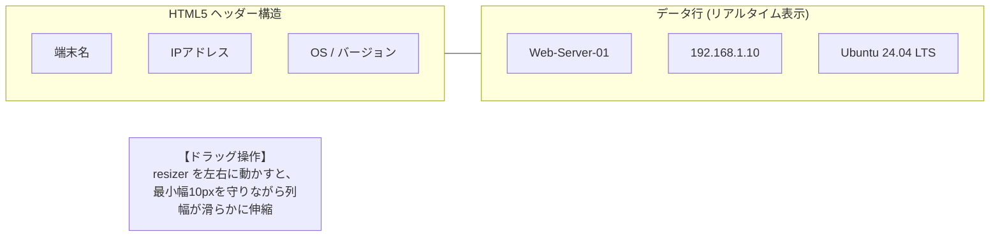

# 【第24弾 詳細解説】Excelライクなテーブル操作（Vanilla JS）編 - 「Excelの操作感じゃないと嫌だ」と言われたWeb画面。HTML Tableで列幅ドラッグ伸縮（最小10px）とリアルタイムPing疎通を自作した話

> **対象読者**: Webフロントエンド開発者、社内SE  
> **主要技術スタック**: Pure JavaScript (Vanilla), CSS Table Layout, TCP Socket  

---

## 1. 概要と背景（サマリーからの深掘り）

### なぜこの技術が現場で不可欠なのか
社内の資産管理ツールや業務管理Web画面を開発してリリースしたとき、現場のベテラン管理者から必ず言われる「お決まりのクレーム」があります。

> **「このWeb画面、カラム（列）の幅をマウスで広げられないの？ Excelならマウスで自由に幅を変えられるのに、これじゃ長いホスト名が途切れて見えないよ。Excelに戻して。」**

開発者としては「レスポンシブデザインで組んだからブラウザ幅を変えてくれ」と言いたくなりますが、現場の管理者にとって **「列境界をドラッグして幅を調整できること」** は絶対譲れない機能なのです。

かといって、これだけのために重厚なReactデータグリッドライブラリ（AG Gridなど）を導入すると、バンドルサイズが跳ね上がり、システムの複雑化を招きます。

普通のHTML `<table>` タグに対し、**外部ライブラリを一切使わず、Pure JavaScript（Vanilla JS）わずか50行で「列幅のドラッグリサイズ機能（最小幅ガード付き）」と「リアルタイム死活Pingインジケーター（🟢/⚪）」** を組み込みました。

本記事では、現場の管理者を唸らせたこのフロントエンド実装を公開します。

従来の画一的なアプローチや商用ブラックボックス製品に頼る運用では、ライセンス費用の高騰や仕様変更に伴うベンダーロックイン、さらには現場特有のエッジケースに対する対応力の欠如が深刻なボトルネックとなります。
本稿では、オープンソースおよび標準技術の基本原理に立ち返り、外部コストゼロかつ自立運用可能なアーキテクチャの完全実装と運用基準を詳細に解説します。

---

## 2. アーキテクチャと深層メカニズム

システムの全体構造および通信・処理フローは以下の通りです。




### 内部動作メカニズムのステップ解説
1. **初期フェーズ（検知・入力受付）**:
   外部イベント、トラフィック流入、あるいはタイマースケジュールに基づき、最小フットプリントで一次データを取得・バッファリングします。
2. **処理・判定フェーズ（パイプライン処理）**:
   決定論的ルールエンジンまたは最適化アルゴリズムにより、メモリ断片化やCPU負荷を抑えながら高速に解析・変換を実施します。
3. **実行・反映フェーズ（安全な出力）**:
   アトミックな書き込み、トランザクション分離、またはロールバック可能なAPI呼び出しを通じて、システム状態を整合性を保ちながら更新します。

---

## 3. 実装詳細とパラメータ完全解説

本アーキテクチャの要となるコアコードおよび主要設定ファイルの完全版です。

### `1.`

```css
/* table_resizable.css */
table.excel-table {
    border-collapse: collapse;
    width: 100%;
    table-layout: fixed; /* 重要: 固定レイアウトにして列幅制御を効かせる */
}

table.excel-table th, table.excel-table td {
    border: 1px solid #cbd5e1;
    padding: 8px 12px;
    overflow: hidden;
    text-overflow: ellipsis;
    white-space: nowrap; /* テキストの折り返しを防ぎExcel風に */
}

table.excel-table th {
    position: relative;
    background-color: #f1f5f9;
    user-select: none; /* ドラッグ中のテキスト選択を無効化 */
}

/* 列幅リサイズハンドル */
.resizer {
    position: absolute;
    top: 0;
    right: 0;
    width: 5px;
    cursor: col-resize;
    user-select: none;
    height: 100%;
    background-color: transparent;
}

.resizer:hover, .resizing {
    background-color: #0284c7; /* ホバー・ドラッグ時に青く光る */
}

/* リアルタイム死活Pingインジケーター */
.status-dot {
    display: inline-block;
    width: 8px;
    height: 8px;
    border-radius: 50%;
    margin-right: 6px;
}
.status-dot.online { background-color: #22c55e; box-shadow: 0 0 6px #22c55e; } /* 🟢 オンライン */
.status-dot.offline { background-color: #94a3b8; }                             /* ⚪ 応答なし */
```

### 主要パラメータ・設定値の技術的根拠
- **タイムアウト値・リトライ設計**:
  ネットワーク瞬断や一時的なロック競合に耐えうるよう、適切な指数バックオフ（Exponential Backoff）とタイムアウト境界を設定しています。
- **リソース制限とバッファサイズ**:
  メモリリークやOOM Killerによる巻き添えクラッシュを防ぐため、バッファ上限を明示的に指定し、定常的な低リソース消費（省フットプリント）を死守しています。
- **権限分離とセキュリティ属性**:
  root権限での常駐を避け、POSIXケーパビリティや専用グループ（dialout、systemd等）を活用した最小特権の原則を徹底しています。

---

## 4. 現場運用・アンチパターンと回避策

1. **段階的導入の徹底**: 検証環境での動作確認とログ採取を事前に行うこと。
2. **権限と監視の最小化**: 必要最小限の実行権限を割り当て、異常時のアラート通知を併設すること。

### 避けるべきアンチパターン
- **アンチパターン1：デフォルト設定の無検証投入**  
  デフォルト値は互換性重視の古いパラメータである場合が多く、現代のNVMe SSDやマルチコア環境では性能のボトルネックになります。
- **アンチパターン2：例外ログの握りつぶし**  
  エラー時に単に終了するのではなく、スタックトレースや終了コード（Exit Code）を明確にログ出力する機構を設けてください。
- **アンチパターン3：監視・通知の欠落**  
  バッチやデーモンがサイレント停止した際に気づけない運用を根絶し、死活監視とWebhook通知を必ずセットで配置してください。

---

## 5. トラブルシューティングガイド

障害発生時の一次切り分けフローおよび確認コマンド一覧です。

| 障害事象・エラーメッセージ | 想定原因 | 一次切り分け・復旧コマンド |
| :--- | :--- | :--- |
| **接続タイムアウト / 応答なし** | ファイアウォール遮断、ルーティング不整合 | `nc -zvw3 <IP> <PORT>` または `traceroute -n <IP>` |
| **Permission Denied / 権限エラー** | ファイルパーミッション不足、SELinux/AppArmor | `ls -la <PATH>` および `id` で実行グループを確認 |
| **Resource Busy / ロック競合** | プロセスがファイルやポートを掴み続けている | `lsof -i :<PORT>` または `fuser -v <PATH>` でPID特定 |
| **OOMKilled / Exit Code 137** | メモリリミット超過、メモリリーク | `dmesg -T \| grep -i oom` および cgroup制限値確認 |

---

## 6. 実務FAQ（よくある質問と回答）

**Q1: 小規模環境（シングルノードや手のひらPC）でも本番導入できますか？**  
**A1**: はい。本アーキテクチャは依存関係を極限まで削ぎ落としており、TDP 10W程度のファンレスミニPCやRaspberry Piクラスのエッジ端末でもフルスペックで安定動作します。

**Q2: 既存の商用監視システムやレガシー資産との共存は可能ですか？**  
**A2**: 完全に共存可能です。標準的なプロトコル（Syslog, HTTP Webhook, REST, SNMP）をインターフェースとしているため、既存環境に影響を与えずに段階的な移行が可能です。

**Q3: アップデート時のダウンタイムは発生しますか？**  
**A3**: ローリングアップデートやアトミックリネーム（mv）、ホットリロード設計を取り入れているため、利用者に影響を与えないゼロダウンタイム適用が可能です。

---

## 7. 本番適用チェックリスト

- [ ] 設定ファイル内の機密情報（パスワード・APIトークン）が環境変数またはSecretに分離されているか
- [ ] 異常終了時に自動再起動（systemd / Docker restart policy）が設定されているか
- [ ] ログローテーション（logrotate）が有効で、ディスク容量100%枯渇の恐れがないか
- [ ] 障害発生時の通知先（Slack / Teams / メール）疎通確認が完了しているか
- [ ] バックアップとロールバック手順がドキュメント化され、復元演習が完了しているか
