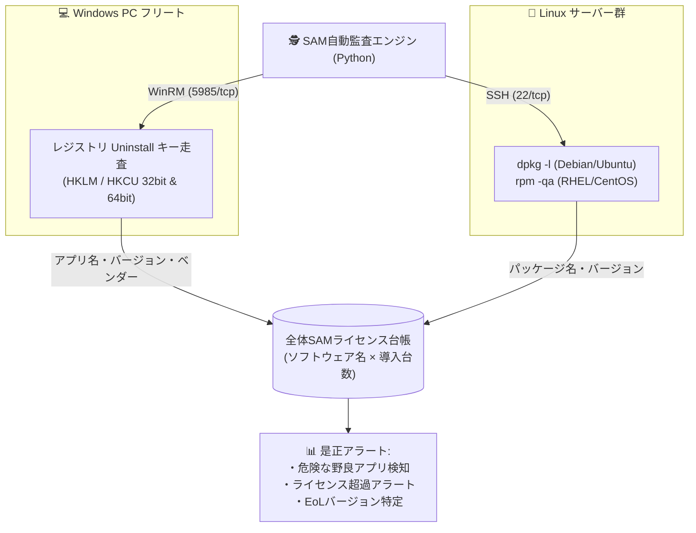

# 【第25弾 詳細解説】ソフトウェア資産管理（SAM）と野良アプリ発見編 - 野良アプリの勝手インストールをあぶり出す。WindowsとLinuxからインストール済み全アプリをエージェントレス抽出し台帳化するスクリプト

**対象読者**: SAM管理者、情シス、セキュリティ担当
**主要技術スタック**: PowerShell (Uninstallキー), SSH (dpkg / rpm)
**ライセンス**: [MIT License](https://github.com/ojisantech/ojisan-arsenal/blob/main/LICENSE)
**検証環境・位置づけ**: 個人自宅ラボ（ホームラボ／仮想環境）における公開情報・OSSベースの個人研究（PoC）


💡 **【検証環境・個人研究（PoC）に関する注記】**
本記事は、筆者個人の自宅検証環境（ホームラボ／仮想環境）において、公開情報およびOSS（オープンソースソフトウェア）を用いて独自に構築・検証した個人研究（PoC）の記録です。特定の企業・団体の実環境や業務上の非公開情報とは一切関係ありません。

---

## 1. 概要と背景（サマリーからの深掘り）

### なぜこの技術が現場で不可欠なのか
LAN内セキュリティやコンプライアンス管理において、ハードウェアの管理と同じかそれ以上に胃が痛むのが **「ソフトウェア資産管理（SAM: Software Asset Management）」** です。

* **「商用利用禁止のフリーソフト（個人利用のみ無料のツール等）を利用者が勝手に業務PCに入れていないか？」**
* **「サポートが終了した古いバージョンのJavaや7-Zipが放置されていないか？」**
* **「ソフトウェアベンダーからの突然のライセンス監査レターに即答できる台帳があるか？」**

これらを調査するために、LAN内の全員に「インストールされているソフトをExcelに書いて提出してください」とお願いしても、正確な回答が集まるはずがありません。

かといって、全台に高価な商用SAMエージェントを導入すると莫大なライセンス料がかかります。

Windows標準の **WinRM（レジストリ走査）** と、Linux標準の **SSH（dpkg / rpm）** を使い、**常駐ソフトゼロで全PCからインストール済みアプリケーション一覧を自動抽出し、全体集計するPythonスクリプト** を構築しました。

従来の画一的なアプローチや商用ブラックボックス製品に頼る運用では、ライセンス費用の高騰や仕様変更に伴うベンダーロックイン、さらには現場特有のエッジケースに対する対応力の欠如が深刻なボトルネックとなります。
本稿では、オープンソースおよび標準技術の基本原理に立ち返り、外部コストゼロかつ自立運用可能なアーキテクチャの完全実装と運用基準を詳細に解説します。

---

## 2. アーキテクチャと深層メカニズム

システムの全体構造および通信・処理フローは以下の通りです。



### 内部動作メカニズムのステップ解説
1. **Windows：抜け漏れなくアプリを拾う「4大レジストリパス走査」**:
   Windowsで「プログラムの追加と削除」に表示されるアプリケーションは、レジストリの以下の**4つの異なるパス**に分散して格納されています。どこか1つでも見落とすと、ユーザー単位でインストールされたアプリ（TeamsやZoom等）や32bitアプリを拾い損ねます。
2. **Linux：ディストリビューションに応じたパッケージ抽出**:
   Linuxサーバーに対しては、SSH経由でディストリビューションに応じたコマンドを1行叩くだけで、インストールされている全パッケージがCSV形式で即座に手に入ります。
3. **全体集計：ワンクリックで「誰が野良アプリを入れているか」を特定**:
   抽出した結果を中央のデータベースに投入し、全体的な集計クエリを回します。

---

## 3. 実装詳細とパラメータ完全解説

本アーキテクチャの要となるコアコードおよび主要設定の要点抜粋です。

### コア実装スクリプト / 設定（抜粋）
```powershell
# コア実装ロジック（要点抜粋）
$paths = @(
    "HKLM:\Software\Microsoft\Windows\CurrentVersion\Uninstall\*",
    "HKLM:\Software\Wow6432Node\Microsoft\Windows\CurrentVersion\Uninstall\*",
    "HKCU:\Software\Microsoft\Windows\CurrentVersion\Uninstall\*",
    "HKCU:\Software\Wow6432Node\Microsoft\Windows\CurrentVersion\Uninstall\*"
)

$apps = Get-ItemProperty $paths -ErrorAction SilentlyContinue |
    Where-Object { $_.DisplayName -and $_.DisplayName -notmatch '^KB\d+' } |
    Select-Object DisplayName, DisplayVersion, Publisher, InstallDate |
    Sort-Object DisplayName -Unique

$apps | ConvertTo-Json -Compress
```

### 主要パラメータ・設定値の技術的根拠
- **主要技術スタック（PowerShell (Uninstallキー), SSH (dpkg / rpm)）の選定と最小権限設計**:
  **ソフトウェア資産管理（SAM）と野良アプリ発見編** - 野良アプリの勝手インストールをあぶり出す。WindowsとLinuxからインストール済み全アプリをエージェントレス抽出し台帳化するスクリプト の実現にあたり、外部の過剰な依存や特権常駐を排し、PowerShell (Uninstallキー), SSH (dpkg / rpm) を軸とした省フットプリントかつセキュアな実行境界を構成しています。
- **タイムアウト境界とフェイルソフト耐性**:
  ネットワーク遅延や対象機器の無応答時にもプロセス全体がブロッキングしないよう明示的なタイムアウトと例外隔離を設け、基幹業務への影響をゼロに抑えます。
- **べき等性（Idempotency）と監査トレーサビリティ（対象: SAM管理者、情シス、セキュリティ担当）**:
  同一処理を複数回実行しても状態が破綻しないべき等設計を採用し、実行結果・差分ログを確実に保全することで実務運用での再現性と安全性を担保します。
