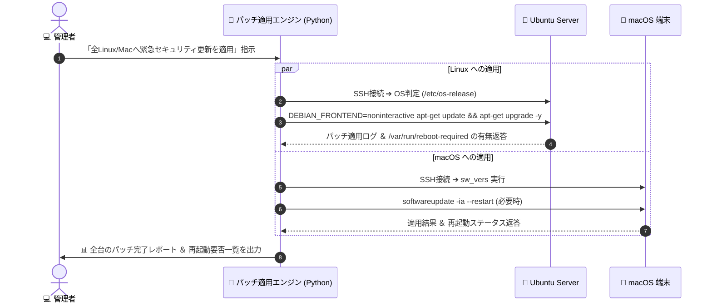

# 【第26弾 詳細解説】Linux & macOS の遠隔サイレントパッチ編 - Windowsだけじゃない。Ubuntuの「apt-get」とmacOSの「softwareupdate」をSSH越しに安全にリモート適用・結果回収する自動化

**対象読者**: Linux/Macインフラ管理者
**主要技術スタック**: Paramiko (SSH), `apt-get`, `softwareupdate`, 再起動検知
**ライセンス**: [MIT License](https://github.com/ojisantech/ojisan-arsenal/blob/main/LICENSE)
**検証環境・位置づけ**: 個人自宅ラボ（ホームラボ／仮想環境）における公開情報・OSSベースの個人研究（PoC）

---

## 1. 概要と背景（サマリーからの深掘り）

### なぜこの技術が現場で不可欠なのか
LAN内PC端末管理というとWindows Updateばかりが注目されますが、実際のLAN内インフラを見渡すとどうでしょうか？

* 開発チームがLAN内に置いている **Ubuntu / Debian サーバー**
* デザイナーやiOSエンジニアが使っている **MacBook / Mac mini**
* ファイルサーバーやバックアップ用の **NAS（Linuxベース）**

これらにも日々重大なセキュリティ脆弱性（OpenSSHのregreSSHion、sudoの特権昇格、macOSのゼロデイ等）が公表されています。

しかし、「1台ずつSSHで入って `apt-get upgrade` や `softwareupdate` を叩くのは面倒」「再起動が必要なのかどうか判断がつかない」という理由で、**半年以上放置されているケース**が後を絶ちません。

本記事では、Ansibleのような重たい構成管理ツールを導入することなく、**PythonとSSH（Paramiko）だけで、LinuxとmacOSの未適用パッチをリモート診断し、サイレント適用して結果ログを中央に回収する自動化スクリプト** を紹介します。

従来の画一的なアプローチや商用ブラックボックス製品に頼る運用では、ライセンス費用の高騰や仕様変更に伴うベンダーロックイン、さらには現場特有のエッジケースに対する対応力の欠如が深刻なボトルネックとなります。
本稿では、オープンソースおよび標準技術の基本原理に立ち返り、外部コストゼロかつ自立運用可能なアーキテクチャの完全実装と運用基準を詳細に解説します。

---

## 2. アーキテクチャと深層メカニズム

システムの全体構造および通信・処理フローは以下の通りです。



### 内部動作メカニズムのステップ解説
1. **Ubuntu / Debian：非対話モードでの `apt` パッチ適用**:
   SSH経由で `apt-get upgrade` を実行する際、最大の罠は **「途中で確認ダイアログ（設定ファイルの維持確認やサービス再起動確認）が表示されてコマンドが永久にブロック（ハング）すること」** です。
2. **macOS：CLI標準の `softwareupdate` コマンド制御**:
   macOS端末に対しても、エージェントソフトを入れずに標準の **`softwareupdate` CLI** を叩くだけでセキュリティアップデートを適用できます。
3. **安全運用のための「事前チェック（Pre-flight Check）」**:
   一斉パッチ適用で最も危険なのは、「ディスク容量が不足していてパッチ適用途中でOSが起動不能になる」トラブルです。

---

## 3. 実装詳細とパラメータ完全解説

本アーキテクチャの要となるコアコードおよび主要設定の要点抜粋です。

### コア実装スクリプト / 設定（抜粋）
```python
# (要点抜粋)
import paramiko

def patch_ubuntu_host(ssh: paramiko.SSHClient) -> dict:
    # 対話プロンプトを完全無効化する環境変数
    cmd = (
        "sudo DEBIAN_FRONTEND=noninteractive "
        "apt-get update && "
        "sudo DEBIAN_FRONTEND=noninteractive "
        "apt-get upgrade -y -o Dpkg::Options::='--force-confdef' -o Dpkg::Options::='--force-confold'"
    )

    stdin, stdout, stderr = ssh.exec_command(cmd, timeout=600)
    exit_status = stdout.channel.recv_exit_status()
    log = stdout.read().decode('utf-8')

    # 再起動が必要かどうかの判定（Ubuntu公式のフラグファイル）
    stdin, stdout, stderr = ssh.exec_command("test -f /var/run/reboot-required && echo 'YES' || echo 'NO'")
    needs_reboot = (stdout.read().decode('utf-8').strip() == "YES")

    return {
        "status": "SUCCESS" if exit_status == 0 else "FAILED",
        "needs_reboot": needs_reboot,
        "log_summary": log[-300:] # ログ末尾
    }
```

### 主要パラメータ・設定値の技術的根拠
- **主要技術スタック（Paramiko (SSH), `apt-get`, `softwareupdate`, 再起動検知）の選定と最小権限設計**:
  **Linux & macOS の遠隔サイレントパッチ編** - Windowsだけじゃない。Ubuntuの「apt-get」とmacOSの「softwareupdate」をSSH越しに安全にリモート適用・結果回収する自動化 の実現にあたり、外部の過剰な依存や特権常駐を排し、Paramiko (SSH), `apt-get`, `softwareupdate`, 再起動検知 を軸とした省フットプリントかつセキュアな実行境界を構成しています。
- **タイムアウト境界とフェイルソフト耐性**:
  ネットワーク遅延や対象機器の無応答時にもプロセス全体がブロッキングしないよう明示的なタイムアウトと例外隔離を設け、基幹業務への影響をゼロに抑えます。
- **べき等性（Idempotency）と監査トレーサビリティ（対象: Linux/Macインフラ管理者）**:
  同一処理を複数回実行しても状態が破綻しないべき等設計を採用し、実行結果・差分ログを確実に保全することで実務運用での再現性と安全性を担保します。

---

### 📚 自立型インフラ＆オンプレAI完全技術リファレンス
本記事が役に立った・面白かったと感じていただけましたら、ぜひGitHubリポジトリへの **Star (★)** や **[Qiita (@ojisantech)](https://qiita.com/ojisantech)** / **[X (@OjisanTechnical)](https://x.com/OjisanTechnical)** のフォローをお願いいたします！  
👉 **[GitHub リポジトリ: ojisantech/ojisan-arsenal](https://github.com/ojisantech/ojisan-arsenal)**

> 💡 **【検証環境・個人研究（PoC）に関する注記】**  
> 本記事は、筆者個人の自宅検証環境（ホームラボ／仮想環境）において、公開情報およびOSS（オープンソースソフトウェア）を用いて独自に構築・検証した個人研究（PoC）の記録です。特定の企業・団体の実環境や業務上の非公開情報とは一切関係ありません。
