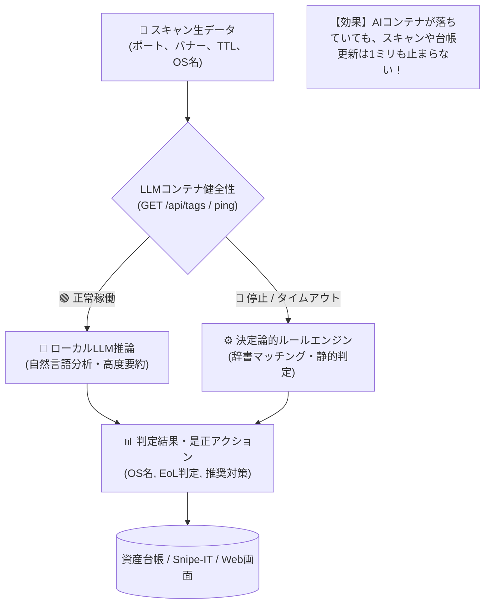

# 【第27弾 詳細解説】AI不在時フェイルソフト設計編 - 重たいLLMコンテナが突然落ちてもシステムを止めない。AI不在時に決定論的ルールエンジンへ瞬時にフォールバックする耐障害性設計

**対象読者**: システムアーキテクト、SRE
**主要技術スタック**: 決定論的辞書ルール, ヘルスチェック, 自動フォールバック
**ライセンス**: [MIT License](https://github.com/ojisantech/ojisan-arsenal/blob/main/LICENSE)
**検証環境・位置づけ**: 個人自宅ラボ（ホームラボ／仮想環境）における公開情報・OSSベースの個人研究（PoC）

---

## 1. 概要と背景（サマリーからの深掘り）

### なぜこの技術が現場で不可欠なのか
LAN内システムや自動化ツールにローカルLLM（Ollama等）やクラウドAI APIを組み込む動きが盛んです。
「OSの判定」「脆弱性の要約」「機器のリプレース提案」などをAIに任せることで、柔軟なシステムが作れます。

しかし、現場で運用し始めたとき、インフラエンジニアなら誰もが**背筋の凍るリスク**に気づきます。

* **「Ollamaコンテナがメモリ不足（OOM）で突然落ちたらどうなる？」**
* **「AIの推論サーバーが過負荷でタイムアウトしたら、毎朝のスキャン処理が全台エラーで止まるのか？」**
* **「クラウドAIの障害やAPI制限のせいで、LAN内資産の棚卸し業務がストップするのか？」**

AIがダウンしたからといって、システム全体のコア機能（資産の検出、台帳登録、トポロジー表示）まで道連れにして落とす設計は、**エンタープライズの現場では「絶対悪」** です。

AIはあくまで「付加価値（アドオン）」であるべきです。AIが死んでも、**従来の「静的辞書・決定論的ルールエンジン」にミリ秒単位で切り替わり、100%の業務を継続できるフェイルソフト設計** を組み込みました。

従来の画一的なアプローチや商用ブラックボックス製品に頼る運用では、ライセンス費用の高騰や仕様変更に伴うベンダーロックイン、さらには現場特有のエッジケースに対する対応力の欠如が深刻なボトルネックとなります。
本稿では、オープンソースおよび標準技術の基本原理に立ち返り、外部コストゼロかつ自立運用可能なアーキテクチャの完全実装と運用基準を詳細に解説します。

---

## 2. アーキテクチャと深層メカニズム

システムの全体構造および通信・処理フローは以下の通りです。



### 内部動作メカニズムのステップ解説
1. **決定論的ルールエンジンの実装**:
   AIが不在でも、OSのバージョン判定やサポート終了（EoL）の警告は、正規表現と辞書テーブルを使えば完全に決定論的（100%の再現性）に判定できます。
2. **スキャナー側の二重フォールバック制御**:
   スキャナー本体では、LLMの呼び出しを `try-except` およびヘルスチェックでラップし、**異常発生時は1秒以内にルールエンジンへフォールバック** させます。
3. **CI/CDでの「フェイルソフト自動検証テスト」**:
   この耐障害性が本番で確実に機能することを保証するため、単体テストスイートを用意しています。

---

## 3. 実装詳細とパラメータ完全解説

本アーキテクチャの要となるコアコードおよび主要設定の要点抜粋です。

### コア実装スクリプト / 設定（抜粋）
```python
# コア実装ロジック（要点抜粋）
import re

# サポート終了 (EoL) 日時辞書
EOL_DATABASE = {
    "windows 10": {"eol": True, "date": "2025-10-14", "msg": "Windows 10 はサポート終了間近です。Win11へ移行してください。"},
    "windows 7":  {"eol": True, "date": "2020-01-14", "msg": "サポート終了済みOSです。ネットワークから即時遮断してください。"},
    "ubuntu 18.04": {"eol": True, "date": "2023-05-31", "msg": "Ubuntu 18.04 LTS は標準サポート終了済みです。"},
    "ubuntu 20.04": {"eol": False, "date": "2025-04-02", "msg": "間もなくサポート終了予定です。"},
}

def analyze_asset_by_rules(raw_os: str, ports: list, banners: dict) -> dict:
    """
    LLMを一切使わず、高速かつ決定論的に資産分類・EoL判定を行う
    処理時間: 0.1ミリ秒
    """
    clean_os = (raw_os or "不明").lower()

    # 1. OSおよびEoL判定
    is_eol = False
    eol_message = "サポート期間内です。"
    for os_key, eol_info in EOL_DATABASE.items():
        if os_key in clean_os:
            is_eol = eol_info["eol"]
            eol_message = eol_info["msg"]
            break

    # 2. 稼働ポートに基づくデバイス分類
    device_category = "一般端末"
    if 445 in ports and 548 in ports:
        device_category = "NASストレージ (Synology/QNAP等)"
    elif 9100 in ports or 515 in ports:
        device_category = "プリンタ・複合機"
    elif 22 in ports and "linux" in clean_os:
        device_category = "Linuxサーバー"
    elif 3389 in ports:
        device_category = "Windowsクライアント/サーバー"

    return {
        "engine": "DETERMINISTIC_RULES", # ルールベース判定であることを明記
        "device_category": device_category,
        "is_eol": is_eol,
        "recommendation": eol_message
    }
```

### 主要パラメータ・設定値の技術的根拠
- **主要技術スタック（決定論的辞書ルール, ヘルスチェック, 自動フォールバック）の選定と最小権限設計**:
  **AI不在時フェイルソフト設計編** - 重たいLLMコンテナが突然落ちてもシステムを止めない。AI不在時に決定論的ルールエンジンへ瞬時にフォールバックする耐障害性設計 の実現にあたり、外部の過剰な依存や特権常駐を排し、決定論的辞書ルール, ヘルスチェック, 自動フォールバック を軸とした省フットプリントかつセキュアな実行境界を構成しています。
- **タイムアウト境界とフェイルソフト耐性**:
  ネットワーク遅延や対象機器の無応答時にもプロセス全体がブロッキングしないよう明示的なタイムアウトと例外隔離を設け、基幹業務への影響をゼロに抑えます。
- **べき等性（Idempotency）と監査トレーサビリティ（対象: システムアーキテクト、SRE）**:
  同一処理を複数回実行しても状態が破綻しないべき等設計を採用し、実行結果・差分ログを確実に保全することで実務運用での再現性と安全性を担保します。

---

### 📚 自立型インフラ＆オンプレAI完全技術リファレンス
本記事が役に立った・面白かったと感じていただけましたら、ぜひGitHubリポジトリへの **Star (★)** や **[Qiita (@ojisantech)](https://qiita.com/ojisantech)** / **[X (@OjisanTechnical)](https://x.com/OjisanTechnical)** のフォローをお願いいたします！  
👉 **[GitHub リポジトリ: ojisantech/ojisan-arsenal](https://github.com/ojisantech/ojisan-arsenal)**

> 💡 **【検証環境・個人研究（PoC）に関する注記】**  
> 本記事は、筆者個人の自宅検証環境（ホームラボ／仮想環境）において、公開情報およびOSS（オープンソースソフトウェア）を用いて独自に構築・検証した個人研究（PoC）の記録です。特定の企業・団体の実環境や業務上の非公開情報とは一切関係ありません。
