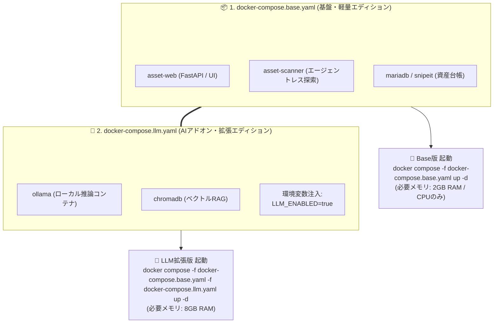

# 【第28弾 詳細解説】Docker Composeの物理分割とオーバーライド編 - 「AI機能付き」と「AIなしBase版」をどう作り分けるか？ Docker Composeの物理分割とオーバーライド設計で保守コストを半減させた話

**対象読者**: Docker運用者、インフラ設計者
**主要技術スタック**: `docker-compose.base.yaml`, `docker-compose.llm.yaml`, `-f`
**ライセンス**: [MIT License](https://github.com/ojisantech/ojisan-arsenal/blob/main/LICENSE)
**検証環境・位置づけ**: 個人自宅ラボ（ホームラボ／仮想環境）における公開情報・OSSベースの個人研究（PoC）

---

## 1. 概要と背景（サマリーからの深掘り）

### なぜこの技術が現場で不可欠なのか
ソフトウェアを開発していると、必ず「エディション違い」を提供したくなる場面があります。

* **「軽量Base版」**: CPUのみ・メモリ2GBで動く、AI機能なしの高速資産スキャンツール
* **「LLM拡張版」**: ローカルAIモデル（Ollama）やRAGエンジンを同梱したフル機能版

これを実現しようとして、初心者がやってしまいがちな最大の失敗が **「Gitブランチを分けること（`branch: base` と `branch: llm-pro`）」** です。

ブランチを分けると、コア機能（バグ修正や画面改善）を修正するたびに双方向へのマージ作業（コンフリクト解消）が発生し、わずか数ヶ月で保守が破綻します。

絶対にブランチを分けてはいけません。
**「コードベースは完全に単一（`main` ブランチのみ）」** を維持し、**Docker Composeの「物理分割」と「オーバーライド（`-f` オプション）」** を使ってデプロイ時に構成を切り替えるのがプロのインフラ設計です。

本記事では、2GB RAMで自立稼働する「Base版」と、AIアドオンを重ねる「LLM版」をスマートに両立させるDocker Compose設計を公開します。

従来の画一的なアプローチや商用ブラックボックス製品に頼る運用では、ライセンス費用の高騰や仕様変更に伴うベンダーロックイン、さらには現場特有のエッジケースに対する対応力の欠如が深刻なボトルネックとなります。
本稿では、オープンソースおよび標準技術の基本原理に立ち返り、外部コストゼロかつ自立運用可能なアーキテクチャの完全実装と運用基準を詳細に解説します。

---

## 2. アーキテクチャと深層メカニズム

システムの全体構造および通信・処理フローは以下の通りです。



### 内部動作メカニズムのステップ解説
1. **基盤層：`docker-compose.base.yaml`（AI完全除外・軽量自立）**:
   基盤ファイルには、システムが動作するために最低限必要なサービスのみを定義します。
2. **拡張層：`docker-compose.llm.yaml`（AIアドオン）**:
   AI機能を有効化したい環境でのみ、差分ファイルとしてこのYAMLを重ねます。
3. **コマンド1発で切り替える運用（Makefile / スクリプト）**:
   利用者は、起動コマンドを使い分けるだけです。

---

## 3. 実装詳細とパラメータ完全解説

本アーキテクチャの要となるコアコードおよび主要設定の要点抜粋です。

### コア実装スクリプト / 設定（抜粋）
```yaml
# docker-compose.base.yaml (軽量Base版)
version: '3.8'

services:
  db:
    image: mariadb:10.6
    container_name: asset-db
    environment:
      - MYSQL_DATABASE=snipeit
      - MYSQL_USER=snipeit
      - MYSQL_PASSWORD=secret
    volumes:
      - db_data:/var/lib/mysql

  snipeit:
    image: snipe/snipe-it:latest
    container_name: asset-snipeit
    depends_on:
      - db
    ports:
      - "8080:80"

  web:
    build:
      context: .
      dockerfile: web/Dockerfile.base
    container_name: asset-web
    ports:
      - "8000:8000"
    environment:
      - LLM_ENABLED=false # AI機能を無効化（決定論的ルールで稼働）
      - DATABASE_URL=sqlite:////app/data/scan_queue.db

  scanner:
    build:
      context: .
      dockerfile: scanner_scripts/Dockerfile.base
    container_name: asset-scanner
    environment:
      - LLM_ENABLED=false

volumes:
  db_data:
```

### 主要パラメータ・設定値の技術的根拠
- **主要技術スタック（`docker-compose.base.yaml`, `docker-compose.llm.yaml`, `-f`）の選定と最小権限設計**:
  **Docker Composeの物理分割とオーバーライド編** - 「AI機能付き」と「AIなしBase版」をどう作り分けるか？ Docker Composeの物理分割とオーバーライド設計で保守コストを半減させた話 の実現にあたり、外部の過剰な依存や特権常駐を排し、`docker-compose.base.yaml`, `docker-compose.llm.yaml`, `-f` を軸とした省フットプリントかつセキュアな実行境界を構成しています。
- **タイムアウト境界とフェイルソフト耐性**:
  ネットワーク遅延や対象機器の無応答時にもプロセス全体がブロッキングしないよう明示的なタイムアウトと例外隔離を設け、基幹業務への影響をゼロに抑えます。
- **べき等性（Idempotency）と監査トレーサビリティ（対象: Docker運用者、インフラ設計者）**:
  同一処理を複数回実行しても状態が破綻しないべき等設計を採用し、実行結果・差分ログを確実に保全することで実務運用での再現性と安全性を担保します。

---

### 📚 自立型インフラ＆オンプレAI完全技術リファレンス
本記事が役に立った・面白かったと感じていただけましたら、ぜひGitHubリポジトリへの **Star (★)** や **[Qiita (@ojisantech)](https://qiita.com/ojisantech)** / **[X (@OjisanTechnical)](https://x.com/OjisanTechnical)** のフォローをお願いいたします！
👉 **[GitHub リポジトリ: ojisantech/ojisan-arsenal](https://github.com/ojisantech/ojisan-arsenal)**

💡 **【検証環境・個人研究（PoC）に関する注記】**
本記事は、筆者個人の自宅検証環境（ホームラボ／仮想環境）において、公開情報およびOSS（オープンソースソフトウェア）を用いて独自に構築・検証した個人研究（PoC）の記録です。特定の企業・団体の実環境や業務上の非公開情報とは一切関係ありません。
