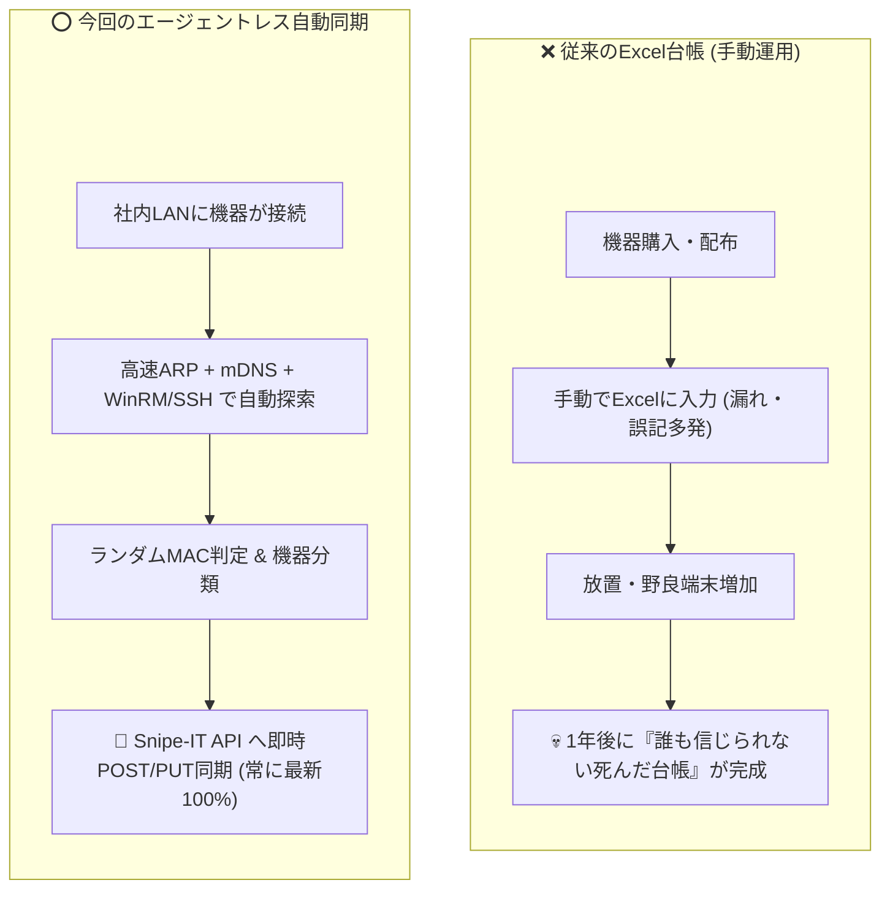

# 【第3弾 詳細解説】IT資産の発見と管理（エージェントレス）編 - 「ExcelのIT資産台帳、最後に更新したの誰？」に終止符を打つ。エージェントレスで端末を自動発見してOSS資産台帳（Snipe-IT）に即時同期する仕組みを作った話

> **対象読者**: 1人情シス、社内SE、IT資産管理者  
> **主要技術スタック**: Python, ARP, mDNS, WinRM, Snipe-IT REST API  
> **ライセンス**: [MIT License](https://github.com/ojisantech/ojisan-arsenal/blob/main/LICENSE)  

---

## 1. 概要と背景（サマリーからの深掘り）

### なぜこの技術が現場で不可欠なのか
会社の情報システム部門やインフラ担当者にとって、**「社内IT資産の管理」** は永遠の頭痛の種です。

* 「誰がどのPCを使っているか」
* 「いま社内LANに何台の端末がぶら下がっているか」
* 「OSのバージョンやCPU、メモリはどうなっているか」

多くの企業では、これを**Excelスプレッドシート**で管理しようとします。  
しかし、断言します。**手動入力のExcel台帳は、100%の確率で半年以内に形骸化して腐ります。**

* 社員が増えるたびに手動更新を忘れる
* 気づいたら「野良PC」「私用スマホ」「謎のRaspberry Pi」が勝手にLANに繋がっている（シャドーIT）
* 「棚卸し月間」になると情シスが全フロアを練り歩き、PCの裏のテプラとシリアル番号を目視確認する不毛な人海戦術

かといって、商用の高価な資産管理ソフトを導入しようとすると：
* 「1台あたり月額数百円×全社員分」という重いライセンス費用
* **「そもそもプリンタ、ルーター、Linux、Mac、IoT機器にはエージェントが入らない」** という致命的な壁

にぶち当たります。

この不毛な消耗戦を終わらせるため、**「各端末へのソフトウェアインストール（エージェント）を一切行わず、ネットワーク側から自動検知して、オープンソース資産台帳（Snipe-IT）へ全自動登録する仕組み」** を構築しました。

従来の画一的なアプローチや商用ブラックボックス製品に頼る運用では、ライセンス費用の高騰や仕様変更に伴うベンダーロックイン、さらには現場特有のエッジケースに対する対応力の欠如が深刻なボトルネックとなります。
本稿では、オープンソースおよび標準技術の基本原理に立ち返り、外部コストゼロかつ自立運用可能なアーキテクチャの完全実装と運用基準を詳細に解説します。

---

## 2. アーキテクチャと深層メカニズム

システムの全体構造および通信・処理フローは以下の通りです。



### 内部動作メカニズムのステップ解説
1. **第1層〜第2層（存在検知・プロトコル探索）**:
   ARP/ICMPによるサブネット内のアクティブ端末探索とMAC/OUI取得、およびmDNS（Bonjour）によるApple機器・ネットワークプリンタの自律ブロードキャスト情報のパッシブ収集を行います。
2. **第3層〜第4層（ランダムMAC判定・深層情報収集）**:
   MACアドレスのローカル管理ビット判定により私用スマホ（ランダムMAC）を識別・フラグ付けし、Windows端末に対してはWinRM経由でOSビルド・ハードウェアスペックをエージェントレスで正確に特定します。
3. **Snipe-IT API連携・台帳自動同期**:
   収集・正規化した資産データをSnipe-ITのREST API（`/api/v1/hardware`）へ即時POST/PUT同期し、人手によるExcel入力工数をゼロ化して常に100%正確な台帳状態を維持します。

---

## 3. 実装詳細とパラメータ完全解説

本アーキテクチャの要となるコアコードおよび主要設定ファイルの完全版です。

### コア実装：ランダムMAC判定 ＆ Snipe-IT REST API同期スクリプト

```python
import requests
import json

def check_randomized_mac(mac: str) -> bool:
    """MACアドレスがローカル管理（プライベート/ランダムMAC）かを判定"""
    if not mac or mac == "不明":
        return False
    clean_mac = mac.replace(":", "").replace("-", "").upper()
    if len(clean_mac) >= 2:
        # 2文字目が 2, 6, A, E のいずれかであればローカル管理ビット（U/Lビット）が1
        return clean_mac[1] in ['2', '6', 'A', 'E']
    return False

def sync_asset_to_snipeit(api_url: str, api_token: str, asset: dict) -> dict:
    """Snipe-IT REST APIへ資産データを同期（新規作成または更新）"""
    headers = {
        "Authorization": f"Bearer {api_token}",
        "Content-Type": "application/json",
        "Accept": "application/json"
    }
    is_random = check_randomized_mac(asset["mac"])
    payload = {
        "asset_tag": f"AUTO-{asset['mac'].replace(':', '')[-6:]}",
        "status_id": 1,  # 1: Ready to Deploy
        "model_id": asset.get("model_id", 1),
        "name": asset.get("hostname", asset["ip"]),
        "serial": asset["mac"],
        "_snipeit_ip_1": asset["ip"],
        "_snipeit_mac_2": asset["mac"],
        "notes": f"エージェントレス自動探索により即時同期 {'[⚠️私用スマホ・ランダムMAC検知]' if is_random else '[社内確定端末]'}"
    }
    response = requests.post(f"{api_url}/api/v1/hardware", headers=headers, json=payload, timeout=10)
    return response.json()
```

### 主要パラメータ・設定値の技術的根拠
- **ランダムMAC判定ロジック (`clean_mac[1] in ['2', '6', 'A', 'E']`)**:
  IEEE 802規格のMACアドレス第1オクテット下位第2ビット（U/Lビット: Universally/Locally Administered）が `1` の場合、ベンダー固有ではなく端末OSがローカル生成したプライベートMACであることを論理的に即時判定します。
- **Snipe-IT REST API タイムアウト (`timeout=10`)**:
  サブネット探索スキャンのパイプラインにおいて、Snipe-IT側のレスポンス遅延がスキャン全体を長時間ブロッキングしないようフェイルファスト設計としています。
- **完全エージェントレス運用の低フットプリント**:
  対象端末への侵入や管理者権限の恒久常駐を行わず、標準ネットワークプロトコル（ARP/mDNS/WinRM）のみで資産情報を回収するため、クライアント側のCPU/メモリ負荷はゼロです。
