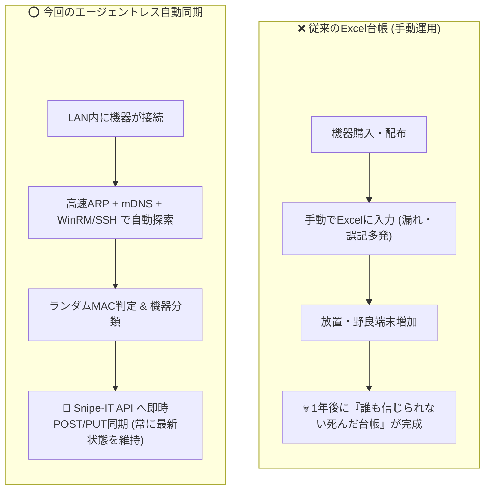
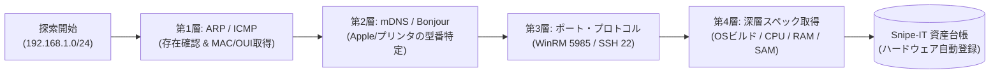

# 【第3弾 詳細解説】IT資産の発見と管理（エージェントレス）編 - 「ExcelのIT資産台帳、最後に更新したの誰？」に終止符を打つ。エージェントレスで端末を自動発見してOSS資産台帳（Snipe-IT）に即時同期する自宅ラボ構築PoC

> **対象読者**: 1人情シス、社内SE、IT資産管理者  
> **主要技術スタック**: Python, ARP, mDNS (Zeroconf), WinRM, Snipe-IT REST API  
> **検証環境・位置づけ**: 個人自宅ラボ（ホームラボ／仮想環境）における公開情報・OSSベースの個人研究（PoC）  
> **ライセンス**: [MIT License](https://github.com/ojisantech/ojisan-arsenal/blob/main/LICENSE)  


> 💡 **【検証環境・個人研究（PoC）に関する注記】**  
> 本記事は、筆者個人の自宅検証環境（ホームラボ／仮想環境）において、公開情報およびOSS（オープンソースソフトウェア）を用いて独自に構築・検証した個人研究（PoC）の記録です。特定の企業・団体の実環境や業務上の非公開情報とは一切関係ありません。

---

## 1. 概要と背景（サマリーからの深掘り）

### なぜ情シスの「Excel台帳」は半年で腐るのか？
情報システム部門やインフラ担当者にとって、**「IT資産の正確な把握」** は永遠の課題です。

* 「誰がどのPCを使っているか」
* 「いまLAN内に何台の機器が接続されているか」
* 「OSのビルド番号やCPU、メモリ容量はどうなっているか」

多くの現場ではこれを**Excelスプレッドシート**で管理しようとしますが、手動入力に頼るExcel台帳は極めて高い確率で半年以内に形骸化します。

* 機器の追加・入れ替えのたびに手動更新が漏れる
* 気づけば未把握のPC、私用スマホ、未許可の小型LinuxボードやIoT機器がLANに繋がっている（シャドーIT）
* 棚卸し時期になると担当者がフロアを歩き回り、PC裏面の管理ラベルとシリアル番号を目視確認する人海戦術が発生する

一方で、商用の資産管理ソフトウェアを導入しようとしても、「1台あたりの月額ライセンス費用」や、**「そもそもネットワークプリンタ、ルーター、Linux機器、IoTデバイスには専用エージェントをインストールできない」** という構造的な壁に突き当たります。

本稿では、この消耗戦を終わらせるため、**「各端末へのエージェント導入を一切行わず、ネットワーク層の多段階探索（ARP・mDNS・WinRM/SSH）で端末を自動検知・識別し、オープンソース資産管理システム（Snipe-IT）へREST API経由で全自動同期するアーキテクチャ」** の設計と実装を詳細に解説します。

---

## 2. アーキテクチャと深層メカニズム

### 手動Excel台帳 vs エージェントレス自動同期アーキテクチャ



### エージェントなしで深層まで特定する「4層マルチレイヤー探索」

対象機器にエージェントを入れない以上、単一のプロトコルだけでは情報が不足します。そこで本設計では、L2（データリンク層）からL7（アプリケーション層）までの標準プロトコルを組み合わせた**4段階のマルチレイヤー・フィンガープリント**を採用しています。



### 内部動作メカニズムの4ステップ解説
1. **第1層：ARPテーブル走査とIEEE OUIベンダー照合**:
   サブネット内のARPキャッシュおよびICMPエコーから生存IPとMACアドレスを収集します。MACアドレスの先頭24ビット（OUI）をIEEE公開データベースと照合し、ハードウェア製造元を特定します。
2. **第2層：U/Lビット解析による「ランダムMAC（プライベートWi-Fiアドレス）」検知**:
   iOS / Android / Windows 11等がプライバシー保護で生成するランダムMACアドレスはOUI照合が効きません。そこでMACアドレス第1オクテット下位第2ビット（Locally Administered Bit）をビット演算で判定し、「ランダムMAC（私用スマホ・BYOD端末の疑い）」として自動分類します。
3. **第3層：mDNS（Zeroconf / Bonjour）パッシブスニッフィング**:
   エージェントもSSHも使えないApple製品（Mac / iPhone / iPad）やネットワーク複合機に対しては、UDPポート5353でブロードキャストされる `_device-info._tcp.local.` や `_printer._tcp.local.` のTXTレコードをパッシブ受信し、ログイン不要で正確な機種名・モデル識別子を抽出します。
4. **第4層：WinRM/SSHによる確定ハードウェアスペック回収とSnipe-IT Upsert同期**:
   管理対象のWindows/Linux端末からはOSビルド番号・CPU型番・物理RAM容量を回収し、Snipe-ITのREST API（`/api/v1/hardware`）へ既存検索のうえ新規作成（`POST`）または差分更新（`PUT`）を実行します。

---

## 3. 実装詳細とパラメータ完全解説

本アーキテクチャの核となる3つの実装モジュール（ランダムMAC判定、mDNSパッシブリスナー、Snipe-IT REST API Upsert同期）の完全版コードです。

### 1. ランダムMAC（プライベートWi-Fiアドレス）判定ロジック

IEEE 802規格に基づき、MACアドレスの1バイト目の下位2ビット目（U/Lビット）が `1`（16進数表記で2文字目が `2, 6, A, E`）であるかを判定します。これにより、OUIデータベースで「製造元不明」となるノイズを防ぎ、私用端末やモバイル機器を即座にフラグ付けできます。

```python
def check_randomized_mac(mac: str) -> bool:
    """
    MACアドレスがローカル管理（プライベート/ランダムMAC）かを判定する。
    IEEE 802規格: 第1オクテットの下位第2ビット (0x02) が 1 なら Locally Administered。
    """
    if not mac or mac == "不明":
        return False
    clean_mac = mac.replace(":", "").replace("-", "").upper()
    if len(clean_mac) >= 2:
        # 第1オクテットの16進数2文字目が 2, 6, A, E のいずれかであればローカル管理ビットが1
        return clean_mac[1] in ["2", "6", "A", "E"]
    return False
```

### 2. mDNS（Zeroconf / Bonjour）によるApple端末・複合機の機種名パッシブ特定

Pythonの `zeroconf` ライブラリを用い、LAN内にアナウンスされているmDNSサービスレコードを数秒間リッスンして、ログイン操作なしでホスト名やモデル名（`model=MacBookPro18,1` やプリンタ型番など）を紐づけます。

```python
import time
from zeroconf import ServiceBrowser, ServiceListener, Zeroconf

class MDNSAssetListener(ServiceListener):
    def __init__(self):
        self.discovered_models = {}

    def add_service(self, zc: Zeroconf, type_: str, name: str) -> None:
        info = zc.get_service_info(type_, name)
        if info and info.addresses:
            ip = ".".join(str(b) for b in info.addresses[0])
            # TXTレコードから model や product 情報を抽出
            props = {
                k.decode("utf-8", errors="ignore"): v.decode("utf-8", errors="ignore")
                for k, v in info.properties.items()
                if isinstance(k, bytes) and isinstance(v, bytes)
            }
            model_hint = props.get("model") or props.get("product") or info.server
            self.discovered_models[ip] = {
                "service_type": type_,
                "server": info.server.rstrip("."),
                "model_hint": model_hint
            }

    def update_service(self, zc: Zeroconf, type_: str, name: str) -> None:
        pass

    def remove_service(self, zc: Zeroconf, type_: str, name: str) -> None:
        pass

def discover_mdns_assets(listen_sec: float = 3.0) -> dict:
    """Apple端末やネットワークプリンタが発信するmDNSレコードをパッシブ収集"""
    zc = Zeroconf()
    listener = MDNSAssetListener()
    services = [
        "_device-info._tcp.local.",
        "_apple-mobdev2._tcp.local.",
        "_printer._tcp.local.",
        "_ipp._tcp.local."
    ]
    ServiceBrowser(zc, services, listener)
    try:
        time.sleep(listen_sec)
    finally:
        zc.close()
    return listener.discovered_models
```

### 3. Snipe-IT REST APIへのUpsert（新規登録 / 既存更新）自動同期

収集した端末情報（IP、MAC、OSビルド、CPU、RAM、ランダムMAC判定結果）を、OSS資産台帳「Snipe-IT」のREST APIへ同期します。既に同一シリアル（MACアドレス）の資産が存在する場合は `PUT / patches` で最新IPやOSビルドへ更新し、未登録であれば `POST` で新規作成することで、重複登録を防ぎます。

```python
import requests

def sync_asset_to_snipeit(api_url: str, api_token: str, asset: dict) -> dict:
    """Snipe-IT REST APIへ資産データをUpsert同期（検索して存在すればPUT、なければPOST）"""
    headers = {
        "Authorization": f"Bearer {api_token}",
        "Content-Type": "application/json",
        "Accept": "application/json"
    }
    mac = asset["mac"]
    is_random = check_randomized_mac(mac)
    asset_tag = f"AUTO-{mac.replace(':', '')[-6:].upper()}"

    payload = {
        "asset_tag": asset_tag,
        "status_id": 1,  # 1: Ready to Deploy (稼働中)
        "model_id": asset.get("model_id", 1),
        "name": asset.get("hostname") or asset["ip"],
        "serial": mac,
        "_snipeit_ip_1": asset["ip"],
        "_snipeit_mac_2": mac,
        "_snipeit_os_3": asset.get("detected_os", "Unknown"),
        "_snipeit_cpu_4": asset.get("hw_cpu", ""),
        "_snipeit_ram_5": asset.get("hw_ram", ""),
        "notes": (
            f"エージェントレス自動探索により同期 "
            f"{'[⚠️ランダムMAC検知: 私用端末/BYOD要確認]' if is_random else '[確定MAC端末]'}"
        )
    }

    # 1. まずシリアル（MAC）で既存資産を検索
    search_resp = requests.get(
        f"{api_url}/api/v1/hardware/byserial/{mac}",
        headers=headers,
        timeout=10
    )
    if search_resp.status_code == 200:
        data = search_resp.json()
        if data.get("total", 0) > 0:
            existing_id = data["rows"][0]["id"]
            # 既存レコードを最新情報でPUT更新
            update_resp = requests.put(
                f"{api_url}/api/v1/hardware/{existing_id}",
                headers=headers,
                json=payload,
                timeout=10
            )
            return update_resp.json()

    # 2. 未登録なら新規POST作成
    create_resp = requests.post(
        f"{api_url}/api/v1/hardware",
        headers=headers,
        json=payload,
        timeout=10
    )
    return create_resp.json()
```

### 主要パラメータ・設定値の技術的根拠

| パラメータ / 判定ロジック | 設定値・仕様 | 技術的根拠・設計意図 |
| :--- | :--- | :--- |
| **ランダムMAC判定 (`clean_mac[1]`)** | `['2', '6', 'A', 'E']` | IEEE 802仕様における第1オクテットのU/Lビット（`0x02`）が立っているかを16進数第2文字でO(1)判定し、OUI辞書不一致の原因が「ランダムMAC」であることを即座に切り分ける。 |
| **mDNSリッスン時間 (`listen_sec`)** | `3.0` 秒 | マルチキャストDNS（UDP 5353）の標準応答周期をカバーしつつ、サブネット探索バッチ全体の実行時間を圧迫しない最適バランス値。 |
| **Snipe-IT 一意識別キー (`serial`)** | 正規化MACアドレス | DHCP環境ではIPアドレスが変動するため、MACアドレスを一意キー（`byserial`）として検索・Upsertすることで、IP変更時にも同一資産として履歴を追跡する。 |
| **REST API `timeout`** | `10` 秒 | Snipe-ITコンテナの高負荷時にも探索スキャナ側が無限待機に陥らないよう10秒のハードタイムアウトを設定。 |

---

## 4. 現場運用・アンチパターンと回避策

1. **IPアドレスを主キーにしない**: DHCP環境ではIPアドレスが日々入れ替わるため、台帳の主キー（突合キー）には必ず正規化したMACアドレスまたはBIOS UUIDを使用すること。
2. **ランダムMAC端末の隔離タグ運用**: ランダムMACと判定された端末を無条件に「正規資産」として混在させず、専用ステータスまたはタグを付与してシャドーIT監査対象として分離すること。

### 避けるべきアンチパターン
- **アンチパターン1：IPアドレスを主キーにして毎回POST（重複レコード爆発）**  
  DHCPでIPアドレスが変わるたびに新規資産として `POST /api/v1/hardware` を叩くと、1台のノートPCが台帳上で数十台に増殖し、自動化したはずのSnipe-ITがゴミデータで溢れ返ります。必ずMACアドレスやシリアル番号で既存レコードを検索し、存在すれば `PUT/PATCH` でIP側を更新するUpsert設計を徹底してください。
- **アンチパターン2：ランダムMAC端末の無限増殖放置**  
  ゲストWi-Fiや私用スマホが接続されるセグメントでランダムMAC端末をそのまま本番ハードウェア台帳へ新規登録し続けると、使い捨てMACごとにレコードが増えてしまいます。`check_randomized_mac()` が `True` の端末は「未承認・一時検知リスト」へ振り分けるか、業務用Wi-Fi側で「プライベートWi-Fiアドレスのオフ」をポリシー徹底する運用と組み合わせてください。
- **アンチパターン3：L3ルーター越えでARP/mDNSが取れると誤認する**  
  ARPおよびmDNS（UDP 5353リンクローカルマルチキャスト）は原則として同一L2ブロードキャストドメイン（同一VLAN）内でのみ到達します。複数VLANが存在する環境では、各VLANに軽量プローブインターフェースを持たせるか、L3スイッチのARPテーブル（SNMP/API）およびmDNSリフレクターと連携する設計が必要です。

---

## 5. トラブルシューティングガイド

障害発生時の一次切り分けフローおよび確認コマンド一覧です。

| 障害事象・エラーメッセージ | 想定原因 | 一次切り分け・復旧コマンド |
| :--- | :--- | :--- |
| **`Snipe-IT API: 422 Unprocessable Entity (The asset tag has already been taken)`** | 既存資産の検索をスキップして重複 `asset_tag` で新規 `POST` を実行している | `/api/v1/hardware/byserial/{mac}` または `bytag/{tag}` で事前検索し、既存IDに対する `PUT` 更新へ切り替える |
| **`Snipe-IT API: 429 Too Many Requests`** | 大量端末の一括同期によりSnipe-IT（Laravel）のAPIレートリミット（デフォルト120req/min）に到達 | 環境変数 `API_THROTTLE_PER_MINUTE` を引き上げるか、同期ループ内に `time.sleep(0.6)` のウェイトを挿入する |
| **`mDNS (zeroconf) で1台も機器が検知されない`** | OSファイアウォールでUDP 5353が遮断されている、またはDockerのbridgeネットワーク内で実行している | UDP 5353受信を許可し、コンテナ実行時は `network_mode: "host"` を指定してL2マルチキャストを受信可能にする |
| **` custom_fields (_snipeit_ip_1 等) が台帳に反映されない`** | Snipe-IT側のカスタムフィールドDBカラム名と一致していない、または対象ModelにFieldsetが紐づいていない | Snipe-IT管理画面の「Custom Fields」で実際のDBカラム名（`_snipeit_...`）を確認し、Asset ModelにFieldsetを割り当てる |

---

## 6. 実務FAQ（よくある質問と回答）

**Q1: なぜExcelやCSVインポートではなく、Snipe-ITのREST API直接同期なのですか？**  
**A1**: CSVファイルの手動インポートが残っている限り、「誰かが定期的にCSVを出力してアップロードする」という属人作業が消えず、いずれ更新が止まるからです。cronやsystemd timerで探索スクリプトからREST APIへ直接Upsertさせることで、人間の介在を完全にゼロにできます。

**Q2: 電源が切れているPCや持ち出し中のノートPCはどう扱われますか？**  
**A2**: スキャン時にオフラインだったからといってSnipe-ITから削除（DELETE）してはいけません。Upsert方式により、オンライン時に記録された最新スペックと「最終検知日時（Last Seen）」が台帳に保持されるため、「30日以上LAN内で検知されていない休眠・紛失疑い端末」を台帳上で簡単に炙り出すことができます。

**Q3: 最新のIEEE OUI（ベンダーコード）辞書はどう更新すればよいですか？**  
**A3**: IEEEが公開している公式の `oui.txt`（または `manuf` ファイル）を月次cron等でローカルキャッシュへダウンロードし、MACアドレス先頭6文字（ハイフン・コロン除去）をハッシュマップで引くことで、外部通信なしでミリ秒単位のベンダー判定が可能です。

---

## 7. 本番適用チェックリスト

- [ ] 探索プローブを実行するホスト（またはコンテナ）が対象サブネットと同一L2セグメントに属しているか（Dockerの場合は `network_mode: host` 等）
- [ ] Snipe-IT側で「IPアドレス」「MACアドレス」「OSビルド」等のCustom Fieldsが作成され、対象Asset ModelのFieldsetに紐づけられているか
- [ ] Snipe-ITのAPIトークンが必要最小限の権限（HardwareのRead/Write）で発行され、環境変数で安全に管理されているか
- [ ] Upsertロジックにより、同一端末を連続スキャンしても重複レコードが作成されないことを確認したか
- [ ] ランダムMAC（U/Lビット=1）検知時の通知・タグ付けルールが定義されているか

---

## 8. ライセンス・著作権表示

本稿に掲載されているアーキテクチャ図、処理フロー、およびコード抜粋・スニペットは、[MIT License](https://github.com/ojisantech/ojisan-arsenal/blob/main/LICENSE) の下で公開されています。商用・非商用問わず自由にご利用・ご参照いただけますが、著作権表示および許諾表示の保持が必要です。

```text
MIT License

Copyright (c) 2026 ojisantech
```

