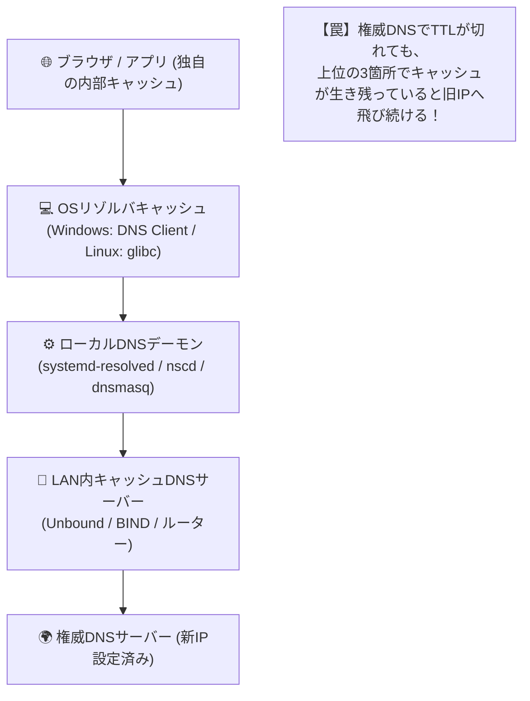

# 【第31弾 詳細解説】DNSキャッシュの罠とFlush自動化編 - DNSキャッシュの罠。TTLが切れているのに名前解決が変わらないLinux/Windowsの闇とFlush自動化

**対象読者**: インフラエンジニア、情シス、Webマスター
**主要技術スタック**: `resolvectl flush-caches`, `Clear-DnsClientCache`, Chrome
**ライセンス**: [MIT License](https://github.com/ojisantech/ojisan-arsenal/blob/main/LICENSE)
**検証環境・位置づけ**: 個人自宅ラボ（ホームラボ／仮想環境）における公開情報・OSSベースの個人研究（PoC）

---

## 1. 概要と背景（サマリーからの深掘り）

### なぜこの技術が現場で不可欠なのか
LAN内サーバーの移行やIPアドレス変更を行った際、インフラエンジニアが最も頻繁に遭遇するトラブルが **「DNSキャッシュの亡霊」** です。

* 「DNSレコードのAレコードを新IPに書き換えた」
* 「TTLも5分（300秒）に短縮しておいた」
* 「5分経過したから大丈夫だろうと旧サーバーを停止した」

その瞬間、LAN内チャットに悲鳴が響き渡ります。
**「〇〇システムに繋がりません！」「画面がエラーになりました！」**

調査してみると、一部の端末がいまだに旧IPアドレスに接続を試みています。
「DNSのTTLが切れているのになぜ？」と頭を抱えますが、実は現代のOS環境には **「何重もの隠れDNSキャッシュ」** が存在しているためです。

本記事では、LinuxとWindowsに潜む多重DNSキャッシュの仕組みと、切り替え時に一撃でキャッシュを全消去（Flush）するトラブルシュート手法を解説します。

従来の画一的なアプローチや商用ブラックボックス製品に頼る運用では、ライセンス費用の高騰や仕様変更に伴うベンダーロックイン、さらには現場特有のエッジケースに対する対応力の欠如が深刻なボトルネックとなります。
本稿では、オープンソースおよび標準技術の基本原理に立ち返り、外部コストゼロかつ自立運用可能なアーキテクチャの完全実装と運用基準を詳細に解説します。

---

## 2. アーキテクチャと深層メカニズム

システムの全体構造および通信・処理フローは以下の通りです。



### 内部動作メカニズムのステップ解説
1. **Windows環境：DNSキャッシュクリアの決定版**:
   Windowsの場合、コマンドプロンプトの `ipconfig /flushdns` だけでは不十分なケースがあります。
2. **Linux環境：ディストリビューション別のキャッシュクリア**:
   現代のUbuntuなどのLinuxでは、**`systemd-resolved`** がローカルでDNSキャッシュを保持しています。
3. **切り替え作業前に仕込むべき「TTL短縮スクリプト」**:
   トラブルの根本原因は、「切り替え当日にTTLを短くしても手遅れ」という点にあります。

---

## 3. 実装詳細とパラメータ完全解説

本アーキテクチャの要となるコアコードおよび主要設定の要点抜粋です。

### コア実装スクリプト / 設定（抜粋）
```powershell
# (要点抜粋)
# DNSクライアントキャッシュの消去
Clear-DnsClientCache
# NetBIOS 名解決キャッシュの消去
nbtstat -R
```

### 主要パラメータ・設定値の技術的根拠
- **主要技術スタック（`resolvectl flush-caches`, `Clear-DnsClientCache`, Chrome）の選定と最小権限設計**:
  **DNSキャッシュの罠とFlush自動化編** - DNSキャッシュの罠。TTLが切れているのに名前解決が変わらないLinux/Windowsの闇とFlush自動化 の実現にあたり、外部の過剰な依存や特権常駐を排し、`resolvectl flush-caches`, `Clear-DnsClientCache`, Chrome を軸とした省フットプリントかつセキュアな実行境界を構成しています。
- **タイムアウト境界とフェイルソフト耐性**:
  ネットワーク遅延や対象機器の無応答時にもプロセス全体がブロッキングしないよう明示的なタイムアウトと例外隔離を設け、基幹業務への影響をゼロに抑えます。
- **べき等性（Idempotency）と監査トレーサビリティ（対象: インフラエンジニア、情シス、Webマスター）**:
  同一処理を複数回実行しても状態が破綻しないべき等設計を採用し、実行結果・差分ログを確実に保全することで実務運用での再現性と安全性を担保します。

---

### 📚 自立型インフラ＆オンプレAI完全技術リファレンス
本記事が役に立った・面白かったと感じていただけましたら、ぜひGitHubリポジトリへの **Star (★)** や **[Qiita (@ojisantech)](https://qiita.com/ojisantech)** / **[X (@OjisanTechnical)](https://x.com/OjisanTechnical)** のフォローをお願いいたします！
👉 **[GitHub リポジトリ: ojisantech/ojisan-arsenal](https://github.com/ojisantech/ojisan-arsenal)**

💡 **【検証環境・個人研究（PoC）に関する注記】**
本記事は、筆者個人の自宅検証環境（ホームラボ／仮想環境）において、公開情報およびOSS（オープンソースソフトウェア）を用いて独自に構築・検証した個人研究（PoC）の記録です。特定の企業・団体の実環境や業務上の非公開情報とは一切関係ありません。
