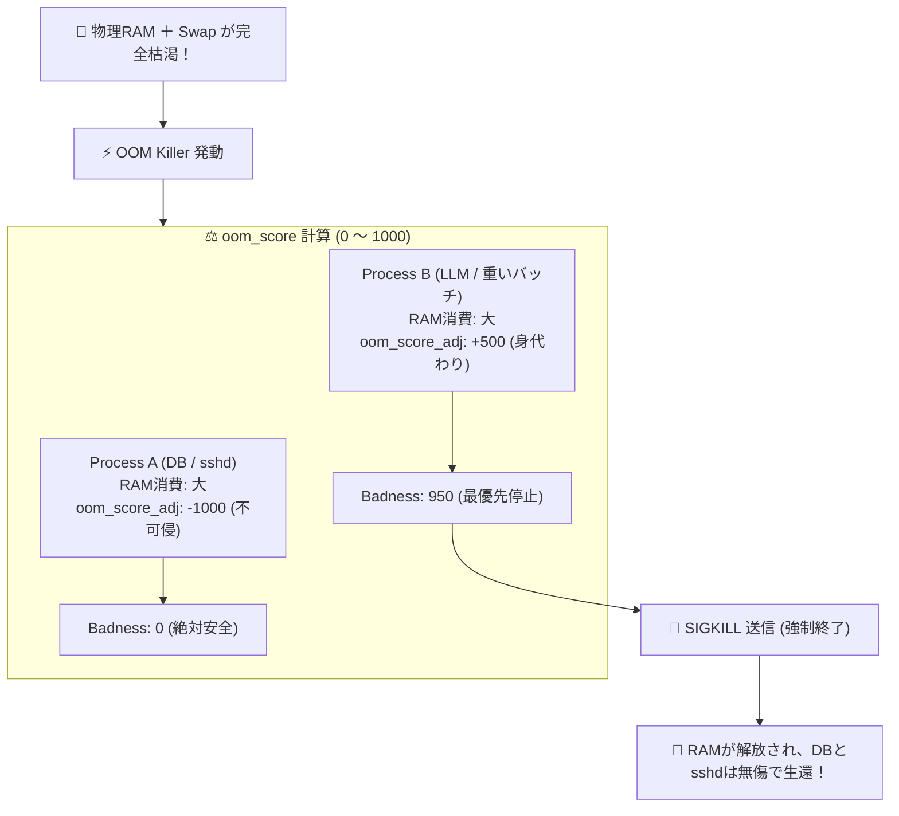

# Linuxカーネルパニック防止とOOM Killer調律編 - Linuxカーネルパニックを防ぐ。OOM Killerの優先度調整（oom_score_adj）とスワップ調律で重要サービスを死守する設計

**対象読者**: インフラエンジニア、DBA、SRE
**主要技術スタック**: `oom_score_adj` (-1000/1000), `vm.swappiness=10`, Docker Compose
**ライセンス**: [MIT License](https://github.com/ojisantech/ojisan-arsenal/blob/main/LICENSE)
**検証環境・位置づけ**: 個人自宅ラボ（ホームラボ／仮想環境）における公開情報・OSSベースの個人研究（PoC）

---

## 1. 概要と背景（サマリーからの深掘り）

### なぜこの技術が現場で不可欠なのか

オンプレミスサーバーや限られたメモリ（4GB〜16GB）のミニPCで、DockerコンテナやローカルLLM、データベースを動かしていると、いつか必ず **「物理メモリの完全枯渇」** に直面します。

その極限状態に達した瞬間、Linuxカーネルの最終防衛機構 **「OOM Killer（Out of Memory Killer）」** が発動します。
```markdown
カーネルはシステム全体のクラッシュを防ぐため、**「適当なプロセスを勝手に選んで強制射倒（kill -9）」** します。

そして、最悪の悲劇が起こります。

* **「なぜかメモリを食っている元凶ではなく、命綱である SSHデーモン（sshd）やデータベース（MySQL）が倒された！」**
* **「リモートからSSHログインすらできなくなり、サーバールームに走って物理電源長押しする羽目になった」**

なぜカーネルは一番倒してはいけない重要プロセスを停止してしまうのか？
どうすれば、元凶のバッチ処理や開発コンテナだけを狙い撃ちで倒させ、管理基盤を守り抜けるのか？

本記事では、**`oom_score_adj` によるプロセスの停止優先度コントロール** と、**`vm.swappiness` の最適調律** を解説します。

従来の画一的なアプローチや商用ブラックボックス製品に頼る運用では、ライセンス費用の高騰や仕様変更に伴うベンダーロックイン、さらには現場特有のエッジケースに対する対応力の欠如が深刻なボトルネックとなります。
本稿では、オープンソースおよび標準技術の基本原理に立ち返り、外部コストゼロかつ自立運用可能なアーキテクチャの完全実装と運用基準を詳細に解説します。

---

## 2. アーキテクチャと深層メカニズム

システムの全体構造および通信・処理フローは以下の通りです。



### 内部動作メカニズムのステップ解説
1. **OOM Killerの採点ロジック：`oom_score` の真実**:
   カーネルは、各プロセスの「悪質度（Badness）」を **0 〜 1000** のスコアで計算します。
2. **重要プロセスを「絶対不可侵」にする：`oom_score_adj = -1000`**:
   Linuxカーネルは、ユーザーが各プロセスの停止優先度を **`-1000（絶対に倒すな）` から `+1000（真っ先に倒せ）`** の範囲で調整できるフックを用意しています。
3. **Docker コンテナ単位での優先度制御**:
   Docker Composeでも、コンテナごとに `oom_score_adj` を設定できます。

---

## 3. 実装詳細とパラメータ完全解説

本アーキテクチャの要となるコアコードおよび主要設定の要点抜粋です。

### コア実装スクリプト / 設定（抜粋）
```ini
# (要点抜粋)
# /etc/sysctl.d/99-memory-tuning.conf

# 既定値 60 -> 10 に引き下げ。
# 物理メモリをギリギリまで使い倒し、無駄なNVMe/SSDへのスワップアウト（速度低下）を防ぐ
vm.swappiness = 10

# メモリの過剰コミット（Overcommit）の挙動調整 (既定: 0 = ヒューリスティック)
vm.overcommit_memory = 0

# パニック時の自動再起動 (万が一カーネルパニックが起きたら 10秒後に自動リブート)
kernel.panic = 10
```

### 主要パラメータ・設定値の技術的根拠
- **主要技術スタック（`oom_score_adj` (-1000/1000), `vm.swappiness=10`, Docker Compose）の選定と最小権限設計**:
  **Linuxカーネルパニック防止とOOM Killer調律編** - Linuxカーネルパニックを防ぐ。OOM Killerの優先度調整（oom_score_adj）とスワップ調律で重要サービスを死守する設計 の実現にあたり、外部の過剰な依存や特権常駐を排し、`oom_score_adj` (-1000/1000), `vm.swappiness=10`, Docker Compose を軸とした省フットプリントかつセキュアな実行境界を構成しています。
- **タイムアウト境界とフェイルソフト耐性**:
  ネットワーク遅延や対象機器の無応答時にもプロセス全体がブロッキングしないよう明示的なタイムアウトと例外隔離を設け、基幹業務への影響をゼロに抑えます。
- **べき等性（Idempotency）と監査トレーサビリティ（対象: インフラエンジニア、DBA、SRE）**:
  同一処理を複数回実行しても状態が破綻しないべき等設計を採用し、実行結果・差分ログを確実に保全することで実務運用での再現性と安全性を担保します。

---

### 📚 自立型インフラ＆オンプレAI完全技術リファレンス
本記事が役に立った・面白かったと感じていただけましたら、ぜひGitHubリポジトリへの **Star (★)** や **[Qiita (@ojisantech)](https://qiita.com/ojisantech)** / **[X (@OjisanTechnical)](https://x.com/OjisanTechnical)** のフォローをお願いいたします！
👉 **[GitHub リポジトリ: ojisantech/ojisan-arsenal](https://github.com/ojisantech/ojisan-arsenal)**

💡 **【検証環境・個人研究（PoC）に関する注記】**
本記事は、筆者個人の自宅検証環境（ホームラボ／仮想環境）において、公開情報およびOSS（オープンソースソフトウェア）を用いて独自に構築・検証した個人研究（PoC）の記録です。特定の企業・団体の実環境や業務上の非公開情報とは一切関係ありません。
