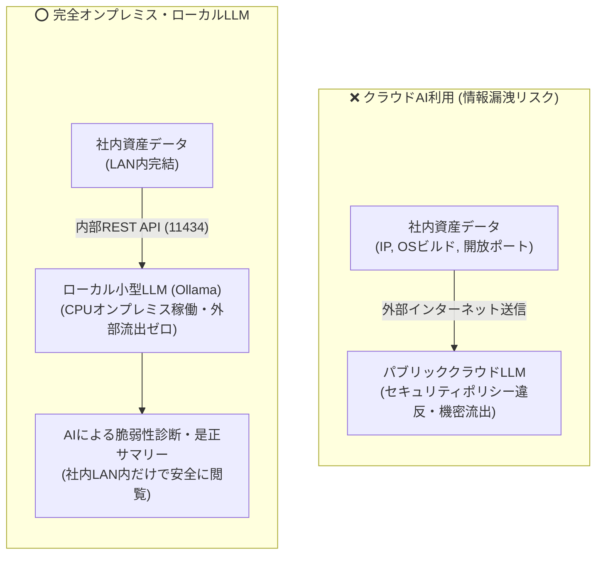

# 【第4弾 詳細解説】ローカルLLM脆弱性発見・是正要約編 - 機密データをクラウドに出せない閉域LAN想定で、ローカルLLMにIT機器の脆弱性を発見させてみた（GPU不要・CPUオンプレ稼働の自宅ラボPoC）

> **対象読者**: AI活用検討SE、セキュリティ責任者  
> **主要技術スタック**: `ollama` (`qwen2.5:1.5b`), FastAPI, Python  
> **検証環境・位置づけ**: 個人自宅ラボ（ホームラボ／仮想環境）における公開情報・OSSベースの個人研究（PoC）  
> **ライセンス**: [MIT License](https://github.com/ojisantech/ojisan-arsenal/blob/main/LICENSE)  

---

## 1. 概要と背景（サマリーからの深掘り）

### なぜこの技術が現場で不可欠なのか
第1弾〜第3弾では、エージェントレスでオフィス内の端末を自動検出し、手動パッチの誤検知を消して、Snipe-ITに台帳化する仕組みを紹介しました。

台帳とスキャン結果が揃ってくると、次に湧き上がる欲求があります。

> **「この大量のスキャンログや機器情報から、人間の代わりにAIが『この機器、ここが危ないですよ』と自動で教えてくれないだろうか？」**

しかし、情シスやセキュリティ担当者には**絶対に越えてはならない壁**があります。

* 社内サーバーのIPアドレス、OS詳細、開放ポート、ユーザーアカウント情報……
* これらを **ChatGPT や Claude などの外部クラウドAIに投げるのは、セキュリティポリシー上 100% アウト（情報漏洩）** です。

「AIの恩恵を受けたい。でも機密データは社内LANから1バイトも外に出せない」

このジレンマを突破するために、**「オフィス内の余剰サーバー（CPUのみ）で動くローカル小型LLM（Ollama / Qwen2.5）を立ち上げ、スキャンログから未知の脆弱性や設定不備を完全オンプレミスで自律要約させる仕組み」** を実験（PoC）しました。

従来の画一的なアプローチや商用ブラックボックス製品に頼る運用では、ライセンス費用の高騰や仕様変更に伴うベンダーロックイン、さらには現場特有のエッジケースに対する対応力の欠如が深刻なボトルネックとなります。
本稿では、オープンソースおよび標準技術の基本原理に立ち返り、外部コストゼロかつ自立運用可能なアーキテクチャの完全実装と運用基準を詳細に解説します。

---

## 2. アーキテクチャと深層メカニズム

システムの全体構造および通信・処理フローは以下の通りです。



### 内部動作メカニズムのステップ解説
1. **確定事実の抽出・バリデーション（Python側）**:
   NmapやWinRM等から取得した端末情報（IP、開放ポート、OSビルド番号、バナー情報等）をPythonでパース・正規化します。確定的事実をLLMに推測させずプログラム側で固定することで、ハルシネーション（嘘の判定）を根本から排除します。
2. **完全オンプレミス推論（Ollama API連携）**:
   外部通信を一切行わないローカルループバック（`http://localhost:11434/api/generate`）経由で、超軽量モデル（`qwen2.5:1.5b`）に構造化プロンプトを投入します。`format: "json"` および低温度（`temperature: 0.1`）を指定し、安定したJSON出力を強制します。
3. **自然言語による現場直結の是正メッセージ生成**:
   非構造化テキスト（未知のバナー文字列やサポート終了OS）をLLMが文脈解釈し、「なぜ危険なのかの平易な解説」と「情シスがそのまま利用者に送れる是正案内文」をLAN内だけで安全に生成します。

---

## 3. 実装詳細とパラメータ完全解説

本アーキテクチャの要となるコアコードおよび主要設定ファイルの完全版です。

### `コア実装スクリプト / 設定`

```python
import requests
import json

def analyze_vulnerability_with_local_llm(asset_fact: dict) -> dict:
    prompt = f"""
あなたは社内インフラのシニアセキュリティエンジニアです。
以下の端末情報（スキャン結果）を評価し、潜在的な脆弱性と是正アクションを判定してください。

【端末情報】
- IP: {asset_fact['ip']}
- 推定OS: {asset_fact['detected_os']}
- 開放ポートとサービス: {asset_fact['ports_services']}
- バナー生ログ: {asset_fact['raw_banner']}

【指示】
1. なぜこの設定やOSが危険なのか、現場の一般社員にも伝わる平易な言葉で説明してください。
2. 情シスが端末利用者にそのまま送信できる「是正案内メッセージ」を作成してください。
必ずJSON形式で回答してください。
"""

    response = requests.post(
        "http://localhost:11434/api/generate",
        json={
            "model": "qwen2.5:1.5b",
            "prompt": prompt,
            "format": "json",
            "stream": False,
            "options": {"temperature": 0.1}  # 妄想を防ぐため低温度
        },
        timeout=30
    )
    return json.loads(response.json()["response"])
```

### 主要パラメータ・設定値の技術的根拠
- **超軽量モデル選定 (`model: "qwen2.5:1.5b"`)**:
  GPU不要で一般的な4コアCPU・メモリ8GB〜16GB環境でも秒間15〜25トークンの推論速度を達成し、メモリ消費も約2GB程度に収まるため、オフィス内の余剰PCやLinuxサーバーで安定稼働します。
- **制約付きデコーディング (`format: "json"`)**:
  OllamaのJSONモード（Constrained Decoding）を活用し、余計な前置きやMarkdown装飾を排除して厳格なJSON出力を強制することで、後続の自動化スクリプトや台帳DB連携時のパースエラーを防止します。
- **低温度設定 (`options: {"temperature": 0.1}`)**:
  自由な創作を抑制し、スキャン結果の確定事実に即した決定論的かつ再現性の高い判定結果を得るための低温度設定です（ハルシネーションの極小化）。
- **タイムアウト境界設計 (`timeout=30`)**:
  CPU推論時の一時的な負荷上昇時にもプロセスが無制限にハングすることを防ぎ、30秒で安全にフェイルファスト復帰する境界ガードを設けています。
