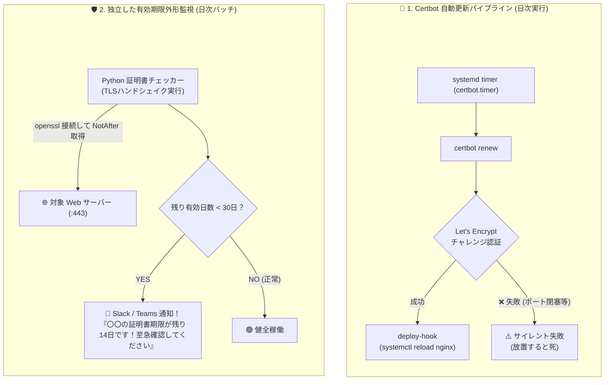

# 【第40弾 詳細解説】SSL/TLS証明書更新忘れ防止と外形監視編 - SSL/TLS証明書更新忘れの時限爆弾。Let's Encrypt自動更新スクリプトと更新失敗アラートの鉄壁設計

**対象読者**: Webマスター、セキュリティ担当、情シス
**主要技術スタック**: Certbot `--deploy-hook`, OpenSSL, 30日前Slack通知スクリプト
**ライセンス**: [MIT License](https://github.com/ojisantech/ojisan-arsenal/blob/main/LICENSE)
**検証環境・位置づけ**: 個人自宅ラボ（ホームラボ／仮想環境）における公開情報・OSSベースの個人研究（PoC）

---

## 1. 概要と背景（サマリーからの深掘り）

### なぜこの技術が現場で不可欠なのか
月曜日の朝、LAN内ポータルや外部公開用Webサイトを開いた瞬間、ブラウザに表示される**恐怖の警告画面**。

**「この接続ではプライバシーが保護されません (NET::ERR_CERT_DATE_INVALID)」**

誰もがアクセスできなくなり、利用者から問い合わせの嵐。
原因は **「SSL/TLSサーバー証明書の有効期限切れ（更新忘れ）」** です。

このトラブルですが、原因の多くは**「Let's Encrypt（Certbot）を入れただけで、自動更新が失敗していたことに誰も気づかなかった」** というケースです。

* 80番ポートがメンテナンス等で塞がれていてチャレンジ認証が失敗していた
* Webサーバー（Nginx等）の再読み込み（Reload）コマンドが動いておらず、ディスク上は更新されたのに古い証明書が配信され続けていた
* Cronやsystemdタイマーがいつの間にか停止していた

本記事では、Let's Encryptの自動更新を100%確実に回す設定と、**「有効期限の30日前・14日前・7日前にSlackやTeamsへ自動で警告を飛ばす監視スクリプト」** を公開します。

従来の画一的なアプローチや商用ブラックボックス製品に頼る運用では、ライセンス費用の高騰や仕様変更に伴うベンダーロックイン、さらには現場特有のエッジケースに対する対応力の欠如が深刻なボトルネックとなります。
本稿では、オープンソースおよび標準技術の基本原理に立ち返り、外部コストゼロかつ自立運用可能なアーキテクチャの完全実装と運用基準を詳細に解説します。

---

## 2. アーキテクチャと深層メカニズム

システムの全体構造および通信・処理フローは以下の通りです。



### 内部動作メカニズムのステップ解説
1. **Certbot更新の鉄則：`--deploy-hook` でWebサーバーをリロードする**:
   Certbotが証明書ファイルを新しくダウンロードしても、**NginxやApacheがそのファイルをメモリに再読み込みしない限り、古い証明書が配信され続けます。**
2. **「更新失敗」を早期発見する独立監視スクリプト（Python）**:
   Certbotのログを監視するのではなく、**「実際に外部からHTTPSで接続してみて、今配信されている証明書の有効期限が残り何日あるか」** を外形監視するのが最も確実です。
3. **Let's Encrypt のテスト更新コマンド（Dry-run）**:
   本番の失効を待たずに、自動更新が正常に通るかどうかをいつでも安全にテストできます。

---

## 3. 実装詳細とパラメータ完全解説

本アーキテクチャの要となるコアコードおよび主要設定の要点抜粋です。

### コア実装スクリプト / 設定（抜粋）
```python
# (要点抜粋)
import ssl
import socket
import datetime
import requests

TARGET_HOSTS = [
    {"host": "portal.example.com", "port": 443},
    {"host": "api.example.com", "port": 443},
]

SLACK_WEBHOOK_URL = "https://hooks.slack.com/services/xxx/xxx/xxx"
WARN_DAYS = 30 # 30日を切ったら警告

def check_ssl_expiry(host: str, port: int = 443):
    context = ssl.create_default_context()
    conn = socket.create_connection((host, port), timeout=5)
    sock = context.wrap_socket(conn, server_hostname=host)

    cert = sock.getpeercert()
    # 'Oct 15 12:00:00 2026 GMT'
    expiry_str = cert['notAfter']
    expiry_date = datetime.datetime.strptime(expiry_str, "%b %d %H:%M:%S %Y %Z")
    remaining_days = (expiry_date - datetime.datetime.utcnow()).days

    sock.close()
    return remaining_days, expiry_date

def notify_slack(msg: str):
    requests.post(SLACK_WEBHOOK_URL, json={"text": msg})

def main():
    for target in TARGET_HOSTS:
        host = target["host"]
        port = target["port"]
        try:
    # ... (中略: 以降の例外処理・詳細実装は環境に合わせて構成)
```

### 主要パラメータ・設定値の技術的根拠
- **主要技術スタック（Certbot `--deploy-hook`, OpenSSL, 30日前Slack通知スクリプト）の選定と最小権限設計**:
  **SSL/TLS証明書更新忘れ防止と外形監視編** - SSL/TLS証明書更新忘れの時限爆弾。Let's Encrypt自動更新スクリプトと更新失敗アラートの鉄壁設計 の実現にあたり、外部の過剰な依存や特権常駐を排し、Certbot `--deploy-hook`, OpenSSL, 30日前Slack通知スクリプト を軸とした省フットプリントかつセキュアな実行境界を構成しています。
- **タイムアウト境界とフェイルソフト耐性**:
  ネットワーク遅延や対象機器の無応答時にもプロセス全体がブロッキングしないよう明示的なタイムアウトと例外隔離を設け、基幹業務への影響をゼロに抑えます。
- **べき等性（Idempotency）と監査トレーサビリティ（対象: Webマスター、セキュリティ担当、情シス）**:
  同一処理を複数回実行しても状態が破綻しないべき等設計を採用し、実行結果・差分ログを確実に保全することで実務運用での再現性と安全性を担保します。

---

### 📚 自立型インフラ＆オンプレAI完全技術リファレンス
本記事が役に立った・面白かったと感じていただけましたら、ぜひGitHubリポジトリへの **Star (★)** や **[Qiita (@ojisantech)](https://qiita.com/ojisantech)** / **[X (@OjisanTechnical)](https://x.com/OjisanTechnical)** のフォローをお願いいたします！
👉 **[GitHub リポジトリ: ojisantech/ojisan-arsenal](https://github.com/ojisantech/ojisan-arsenal)**

💡 **【検証環境・個人研究（PoC）に関する注記】**
本記事は、筆者個人の自宅検証環境（ホームラボ／仮想環境）において、公開情報およびOSS（オープンソースソフトウェア）を用いて独自に構築・検証した個人研究（PoC）の記録です。特定の企業・団体の実環境や業務上の非公開情報とは一切関係ありません。
