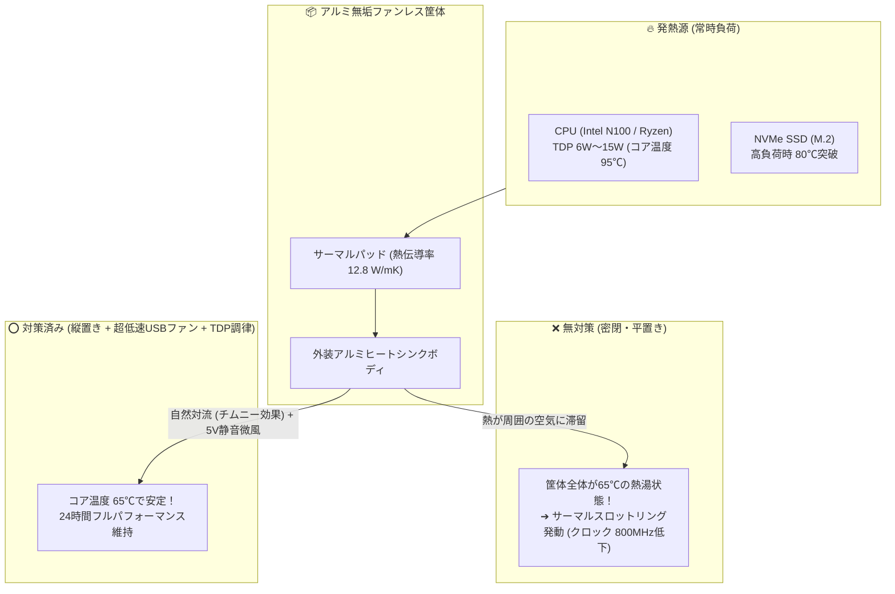

# 【第41弾 詳細解説】ファンレスPCを24時間サーバーにする熱設計とサーマルスロットリング対策

**対象読者**: 自宅サーバー愛好家、エッジ開発者
**主要技術スタック**: 縦置き自然対流, 5V静音ファン, `intel-rapl` TDP制限, 温度監視
**ライセンス**: [MIT License](https://github.com/ojisantech/ojisan-arsenal/blob/main/LICENSE)
**検証環境・位置づけ**: 個人自宅ラボ（ホームラボ／仮想環境）における公開情報・OSSベースの個人研究（PoC）

---

## 1. 概要と背景（サマリーからの深掘り）

### なぜこの技術が現場で不可欠なのか
Intel N100などを搭載した手のひらサイズのファンレスミニPCは、LAN内のデスクや家庭の棚に置いても「完全無音」でホコリを吸い込まず、自宅サーバーやエッジ端末として最高です。

しかし、24時間365日の本番サーバーとして稼働させ、Dockerコンテナ群やデータベース、ネットワークスキャナーを回し始めると、**「熱による見えない壁」** にぶつかります。

* **「冬場は快調だったのに、7〜8月の猛暑の日に突然サーバーがフリーズ（ハングアップ）した」**
* **「ベンチマークスコアが起動直後の半分以下に落ちている」**
* **「SSDの温度が80℃を超えて警告アラートが鳴り止まない」**

ファンがないということは、**「熱を逃がす手段がアルミケースの自然放熱（対流・伝導）しかない」** ということです。
CPUが90℃〜100℃に達すると、ハードウェアが自らを守るために動作クロックを強制的に引き下げる **「サーマルスロットリング（Thermal Throttling）」** が発動し、最悪の場合は強制シャットダウンします。

本記事では、ファンレスPCを猛暑の密閉書庫でも絶対に熱暴走させない **「排熱物理対策」** と **「Linux OS側からの電力枠（TDP）制御」** を解説します。

従来の画一的なアプローチや商用ブラックボックス製品に頼る運用では、ライセンス費用の高騰や仕様変更に伴うベンダーロックイン、さらには現場特有のエッジケースに対する対応力の欠如が深刻なボトルネックとなります。
本稿では、オープンソースおよび標準技術の基本原理に立ち返り、外部コストゼロかつ自立運用可能なアーキテクチャの完全実装と運用基準を詳細に解説します。

---

## 2. アーキテクチャと深層メカニズム

システムの全体構造および通信・処理フローは以下の通りです。



### 内部動作メカニズムのステップ解説
1. **物理対策 ①：「平置き」をやめて「縦置きスタンド」にする**:
   もっともコストゼロで劇的な効果があるのが **「設置向きの変更（縦置き化）」** です。
2. **物理対策 ②：5V 超静音USBファン（800rpm）を添える**:
   「完全ファンレス」にこだわりたい気持ちは分かりますが、**「無音に近い微風（800rpm程度の超静音5Vファン）」を筐体に軽く当てるだけ** で、冷却能力は自然放熱の **3倍以上** に跳ね上がります。
3. **Linux側からのソフト対策：TDP（電力枠）を制限する**:
   物理的な対策に加え、Linuxの **`intel-rapl`** サブシステムを使い、CPUが瞬間的に消費できる電力上限（PL1 / PL2）をOS側から手動で制限します。

---

## 3. 実装詳細とパラメータ完全解説

本アーキテクチャの要となるコアコードおよび主要設定の要点抜粋です。

### コア実装スクリプト / 設定（抜粋）
```python
# (要点抜粋)
import os

def check_thermal_throttling():
    # CPU温度の取得
    with open("/sys/class/thermal/thermal_zone0/temp") as f:
        temp_c = int(f.read().strip()) / 1000.0

    # サーマルスロットリング発動回数の確認
    throttle_count = 0
    core_throttled_path = "/sys/devices/system/cpu/cpu0/thermal_throttle/core_throttle_count"
    if os.path.exists(core_throttled_path):
        with open(core_throttled_path) as f:
            throttle_count = int(f.read().strip())

    print(f"[*] CPU温度: {temp_c:.1f} ℃ / スロットリング累積回数: {throttle_count}")
    if temp_c >= 85.0:
        print("🚨 WARN: CPU温度が高すぎます！排熱を確認してください。")

```

### 主要パラメータ・設定値の技術的根拠
- **主要技術スタック（縦置き自然対流, 5V静音ファン, `intel-rapl` TDP制限, 温度監視）の選定と最小権限設計**:
  **ファンレスPCの熱設計とサーマル対策編** - 手のひらファンレスPCを24時間サーバーにする熱設計とサーマルスロットリング対策 の実現にあたり、外部の過剰な依存や特権常駐を排し、縦置き自然対流, 5V静音ファン, `intel-rapl` TDP制限, 温度監視 を軸とした省フットプリントかつセキュアな実行境界を構成しています。
- **タイムアウト境界とフェイルソフト耐性**:
  ネットワーク遅延や対象機器の無応答時にもプロセス全体がブロッキングしないよう明示的なタイムアウトと例外隔離を設け、基幹業務への影響をゼロに抑えます。
- **べき等性（Idempotency）と監査トレーサビリティ（対象: 自宅サーバー愛好家、エッジ開発者）**:
  同一処理を複数回実行しても状態が破綻しないべき等設計を採用し、実行結果・差分ログを確実に保全することで実務運用での再現性と安全性を担保します。

---

### 📚 自立型インフラ＆オンプレAI完全技術リファレンス
本記事が役に立った・面白かったと感じていただけましたら、ぜひGitHubリポジトリへの **Star (★)** や **[Qiita (@ojisantech)](https://qiita.com/ojisantech)** / **[X (@OjisanTechnical)](https://x.com/OjisanTechnical)** のフォローをお願いいたします！
👉 **[GitHub リポジトリ: ojisantech/ojisan-arsenal](https://github.com/ojisantech/ojisan-arsenal)**

💡 **【検証環境・個人研究（PoC）に関する注記】**
本記事は、筆者個人の自宅検証環境（ホームラボ／仮想環境）において、公開情報およびOSS（オープンソースソフトウェア）を用いて独自に構築・検証した個人研究（PoC）の記録です。特定の企業・団体の実環境や業務上の非公開情報とは一切関係ありません。
