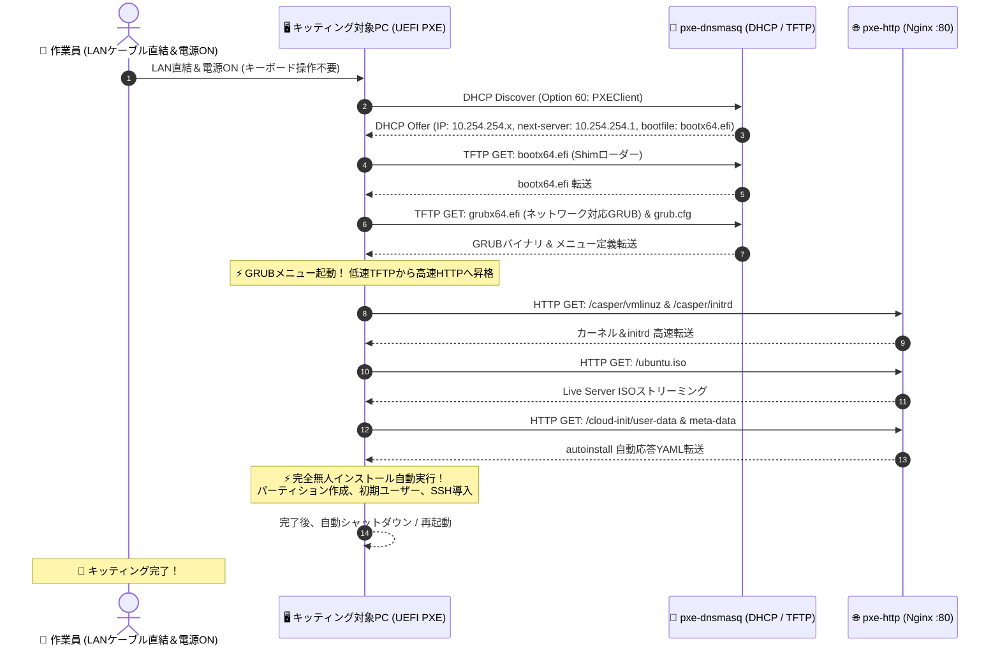

# 【第44弾 詳細解説】PXEネットワークブート無人インストール編 - パソコンと追加NICでPXEネットワークブート環境構築 USBメモリ不要、LAN経由でOSを一発自動インストールする

> **対象読者**: キッティング担当、情シス、製造SE、インフラエンジニア  
> **主要技術スタック**: VirtualBox (USB 3.0 Passthrough), `dnsmasq` (DHCP/TFTP), `nginx` (HTTP), GRUB (`grubnetx64`), Ubuntu `autoinstall` (cloud-init), Docker Compose  
> **ライセンス**: [MIT License](https://github.com/ojisantech/ojisan-arsenal/blob/main/LICENSE)  
> **検証環境・位置づけ**: 個人自宅ラボ（ホームラボ／仮想環境）における公開情報・OSSベースの個人研究（PoC）  

---

## 1. 概要と背景（サマリーからの深掘り）

### なぜこの技術が現場で不可欠なのか
LAN内PC端末入れ替えや、ホワイトボックスサーバー、ミニPCを10台、20台とキッティングする際、多くのエンジニアがこの「不毛な単純作業」で丸一日を潰します。

1. **USBメモリにUbuntuのISOを焼く**
2. **PCのUSBポートに挿す**
3. **キーボードを繋いでF12を連打してブートメニューを出す**
4. **インストーラーの質問（言語、タイムゾーン、ユーザー名、パーティション）に手動で答える**
5. **終わったらUSBを抜いて、次のPCへ……**

台数が増えれば増えるほど、USBメモリの抜き差しと待ち時間で疲弊し、どこかの端末で設定ミス（タイポ）が発生します。

本職のインフラエンジニアは、USBメモリを使いません。  
**「LANケーブルを挿して電源を入れたら、自動的にネットワーク経由でインストーラーが降ってきて、ユーザー入力ゼロでOSインストールが完結するPXE（Preboot eXecution Environment）ネットワークブート」** を使います。

本記事では、手元のWindowsノートPC上のVirtualBox（Ubuntu VM）を活用し、**`dnsmasq` ＋ `nginx`（Docker）＋ `autoinstall (cloud-init)`** を組み合わせた完全無人PXEキッティング環境の構築手順と、現場で必ずハマる「TFTP不達問題」の完全解決策を解説します。

従来の画一的なアプローチや商用ブラックボックス製品に頼る運用では、ライセンス費用の高騰や仕様変更に伴うベンダーロックイン、さらには現場特有のエッジケースに対する対応力の欠如が深刻なボトルネックとなります。
本稿では、オープンソースおよび標準技術の基本原理に立ち返り、外部コストゼロかつ自立運用可能なアーキテクチャの完全実装と運用基準を詳細に解説します。

---

## 2. アーキテクチャと深層メカニズム

システムの全体構造および通信・処理フローは以下の通りです。



### 内部動作メカニズムのステップ解説

1. **完全閉域直結（`10.254.254.0/24`）による野良DHCPの完全防止**:
   社内LANでPXEサーバーを立てると、既存のDHCPと競合して業務端末の通信を破壊する「野良DHCP障害」を起こします。本設計では増設したUSB-C LANアダプターに対象PCをLAN直結し、`10.254.254.0/24` の完全閉域網を敷くことで、社内ネットワークへの影響を物理的にゼロに抑えます。

2. **【現場実証】数時間を溶かした「DHCPは通るのにTFTPだけ停止する」問題とUSBパススルー突破**:
   Windowsホスト上のVirtualBoxで「ブリッジアダプター」を使用して直結PXE環境を組むと、極めて厄介な現象が発生します。
   * **現象**: クライアントPCはDHCP Discoverを送り、`10.254.254.x` のIPは正常に取得できる。しかし直後のTFTP接続要求（UDP 69番）がサーバーに届かず、`TFTP open timeout` で数分間フリーズしたのちSSD起動に落ちる。
   * **苦闘の軌跡**: Windows Defender無効化、プロミスキャスモード変更、LANケーブル交換、dnsmasqのTFTP設定見直しなどを幾度繰り返してもパケットは1つも届かず、数時間以上が完全に空費される。
   * **原因の真相**: Windowsホスト側の VirtualBox NDIS6 Bridged Networking Driver が、USB-C LANアダプター経由の低レイヤUDPパケット（TFTP）を途中で遮断・ドロップしていた。
   * **根本解決策**: 仮想ブリッジを完全無効化し、VirtualBoxの **USB 3.0 (xHCI) フィルター** でUSB-C LANアダプターをLinux VMに直接パススルー。Windowsのネットワークスタックを100%バイパスすることで、TFTP通信が確実に開通する。

3. **Linuxカーネルでの命名規則（`enx<MACアドレス>`）への追従とコンテナ再起動**:
   USBパススルーへ切り替えると、仮想NIC名（`enp0s8`等）が消滅し、Predictable Network Interface Names に従い **`enx<MACアドレス>`（例：`enx806d97194b46`）** として認識されます。
   Netplan（`/etc/netplan/99-static-ip.yaml`）および `dnsmasq.conf` の `interface` 句を直ちに物理NIC名へ更新し、`docker compose up -d --force-recreate` でコンテナを再バインドすることで、TFTP/HTTP配信が即座に起動します。

4. **ネットワーク対応GRUB (`grubnetx64.efi.signed`) の採用**:
   Ubuntu ISO直下の `grubx64.efi` はローカルCD/USB専用でネットワークドライバを持ちません。ISO内のdebパッケージから抽出した `grubnetx64.efi.signed` をTFTPに配置することで、GRUB起動後にHTTPプロトコルへ昇格し、GBクラスのISOイメージを爆速ストリーミングします。

5. **【実戦ドはまり注意点】パソコン＋増設NIC構成における全体の流れ上の落とし穴**:
   「手元のPC＋増設USB NIC」の直結環境において、運用全体のフローの中で以下の実戦トラップに遭遇しました。構築時は以下の挙動にご注意ください：
   * **端末抜き差し・リンクダウンによるコンテナソケット消失**: LANケーブルの抜き差しや対象PC電源OFFで増設NICがリンクダウンすると、`dnsmasq`（`bind-interfaces`）がソケットを見失いコンテナ停止することがあります。対象端末を接続してリンクアップを確認した後に `docker compose restart` を行う運用フローが安定します。
   * **ホストPC側既存ネットワークとのルーティング衝突回避**: 増設NIC側にデフォルトゲートウェイやDNSを一切定義せず、本体Wi-Fi/LANのインターネット経路と完全分離（固定IP `10.254.254.1/24` のみ付与）を死守します。
   * **1対1直結のオートネゴシエーション遅延対策**: ハブなし直結ではリンクアップに数秒を要し、UEFI PXEがリンク確立前にタイムアウトして内蔵SSD起動に落ちる場合があります。BIOSの「PXE Wait Time」設定や事前結線を徹底します。

---

## 3. 実装詳細とパラメータ完全解説

本アーキテクチャの要となるコアコードおよび主要設定の要点抜粋です。

### コア実装スクリプト / 設定（抜粋）

#### 1. Netplan 設定 (`/etc/netplan/99-static-ip.yaml`)
```yaml
network:
  version: 2
  renderer: networkd
  ethernets:
    enx806d97194b46:   # USBパススルーされたキッティング専用NIC
      dhcp4: no
      addresses:
        - 10.254.254.1/24
      # 閉域網のためデフォルトゲートウェイ・DNSは設定しない
```

#### 2. dnsmasq 設定 (`dnsmasq/dnsmasq.conf`)
```ini
port=0
interface=enx806d97194b46
bind-interfaces

# DHCPリース範囲
dhcp-range=10.254.254.50,10.254.254.150,12h
dhcp-option=3
dhcp-option=6

# TFTP有効化
enable-tftp
tftp-root=/srv/tftp

# クライアントアーキテクチャ自動判別 (UEFI x86_64 / BIOS)
dhcp-match=set:efi-x86_64,option:client-arch,7
dhcp-match=set:efi-x86_64,option:client-arch,9
dhcp-match=set:bios,option:client-arch,0

dhcp-boot=tag:efi-x86_64,bootx64.efi
dhcp-boot=tag:bios,pxelinux.0

log-dhcp
```

#### 3. GRUB設定 (`tftp/grub.cfg`)
```text
set default="0"
set timeout=5

menuentry "Ubuntu 24.04 Auto Install (HTTP)" {
    set gfxpayload=keep
    linux (http,10.254.254.1)/casper/vmlinuz ip=dhcp url=http://10.254.254.1/ubuntu.iso autoinstall ds=nocloud-net\;s=http://10.254.254.1/cloud-init/ ---
    initrd (http,10.254.254.1)/casper/initrd
}
```

#### 4. autoinstall 設定 (`html/cloud-init/user-data`)
```yaml
#cloud-config
autoinstall:
  version: 1
  locale: ja_JP.UTF-8
  keyboard:
    layout: jp
  identity:
    hostname: pxe-client
    username: ubuntu
    password: "$6$salt$yjWjuAFfgUnLR2vKIfOlt1kj5vCHf82eTnwff.EaHThL13zSmfxL6elnOnOlLJqhWKI7Iej7KLWS/WW8myUeF1" # 平文: ubuntu
  ssh:
    install-server: yes
    allow-pw: yes
  storage:
    layout:
      name: direct
```

---

## 4. トラブルシューティング対応表と現場アンチパターン

### 網羅的トラブルシューティング対応表

| 現象・エラー | 根本原因 | 現場での回避策・完全解決手順 |
|---|---|---|
| **DHCP取得後に `TFTP open timeout` (PXE-E32) でPXE停止** | Windowsホスト側の VirtualBox NDIS6 Bridged Networking Driver が、リンクアップ直後の低レイヤUDPパケット（UDP 69番）を勝手にドロップ・遮断している。 | VirtualBoxの「ブリッジアダプター」を完全無効化し、**USB 3.0 (xHCI) フィルターでUSB Type-C LANアダプターをLinux VMに直接パススルー**してホストOSのネットワークスタックを完全に迂回する。 |
| **`dnsmasq: unknown interface` でコンテナ起動クラッシュ・再起動ループ** | USBパススルー切り替えに伴い、Linuxカーネル（Predictable Network Interface Names）がNIC名を `enp0s8` 等から **`enx<MACアドレス>`**（例: `enx806d97194b46`）へ自動変更したため。 | `ip link` で認識された物理MACベースのNIC名を確認し、`/etc/netplan/99-static-ip.yaml` および `dnsmasq.conf` の `interface=` 記述を新NIC名へ修正して反映する。 |
| **端末のLAN抜線・電源OFF後に次の端末でDHCPが一切応答しない** | 1対1直結環境で対象PCの抜線や電源OFFにより増設NICが `NO-CARRIER`（リンクダウン）となり、`bind-interfaces` モードの `dnsmasq` がソケットを見失って異常終了・停止する。 | 対象端末をLANケーブルで直結・リンクアップさせた後、`docker ps` で状態を確認し、**`docker compose restart`** を実行してソケットを再バインドする運用フローとする。 |
| **PC本体のWi-Fi/有線LANでのインターネット閲覧が突然切断される** | 増設した閉域網NIC側のNetplan設定で、誤ってデフォルトゲートウェイ（`gateway4` / `routes`）やDNSを設定し、PCのデフォルトルートが閉域網側に奪われたため。 | 増設NIC側は `dhcp4: no`、`addresses: [10.254.254.1/24]` のみ定義し、**ゲートウェイとDNS設定は1行も記述しない（完全閉域化）** を徹底する。 |
| **1対1直結時にPXEブートがスキップされ内蔵SSD/OSが起動してしまう** | ハブを介さない直結接続によるAuto MDI-X・速度交渉（オートネゴシエーション）の確立に数秒要し、せっかちなUEFI PXE ROMがリンクアップ前にタイムアウト判定するため。 | 対象端末のBIOS/UEFIで「Network Boot Delay」や「PXE Wait Time」を数秒設定するか、対象端末の電源を入れる前にLANケーブルを確実に両端結線しておく。 |
| **`bootx64.efi` 読込後にGRUBメニューが出ず内蔵SSDから起動してしまう** | Ubuntu ISOのルート直下にある `grubx64.efi` はローカルCD/USBメディア専用であり、ネットワーク（PXE/TFTP）通信スタックが組み込まれていない。 | ISO内の `pool/main/g/grub2-signed/...` からネットワーク対応バイナリ **`grubnetx64.efi.signed`** を抽出し、TFTPルートに `bootx64.efi` として配置する。 |
| **GRUB起動時に `Unknown command` や autoinstall がスキップされる** | `grub.cfg` のカーネル引数で `ds=nocloud-net;s=http://...` と記述した際、GRUBインタープリターがセミコロン `;` をコマンド区切りと誤認識したため。 | セミコロンの直前にバックスラッシュを付与し、**`ds=nocloud-net\;s=http://10.254.254.1/cloud-init/`** とエスケープする。 |
| **USB Type-C LANアダプターが通信中に突然切断または低速化する** | ホストOS（Windows）の「USBのセレクティブサスペンド」や省電力イーサネット（EEE）により、通信アイドリング時にType-C給電が絞られたため。 | Windowsの電源プラン設定で「USBのセレクティブサスペンド」を無効化し、デバイスマネージャーのNICプロパティで「電力の節電のためにコンピュータがこのデバイスの電源をオフにすることを許可する」をオフにする。 |
| **DHCPブロードキャストがコンテナに届かない** | Dockerのデフォルトブリッジネットワーク（NAT）を使用しているため、L2ブロードキャスト（255.255.255.255 / UDP 67）がコンテナ内に転送されない。 | `docker-compose.yml` で `pxe-dnsmasq` サービスに **`network_mode: "host"`** を指定し、さらにRAWソケット制御用に **`cap_add: [NET_ADMIN]`** を付与する。 |
| **autoinstall 実行時にインストーラーが停止、またはパスワード認証に失敗する** | `user-data` の `password` 欄に平文のパスワードを記述したため、cloud-init のバリデーションエラーまたは不正なハッシュ値として処理された。 | 平文ではなく、ホスト側で `openssl passwd -6 <パスワード>` を実行して生成した **SHA-512 暗号化ハッシュ文字列** を設定する。 |

---

### 現場で絶対にやってはいけないアンチパターン 5選

#### ❌ アンチパターン 1: Windowsホストの仮想ブリッジ（NDIS）経由でPXEを流す
* **実態**: 「手元のVirtualBoxでブリッジ接続すれば手軽に動くだろう」と考えると、WindowsのNDISドライバーがリンク確立直後の低レイヤUDPパケット（TFTP/UDP 69）をドロップし、DHCPだけ通ってTFTPが死ぬという最悪の遅延トラップに陥ります。
* **正解**: USB Type-C LANアダプターを使用し、VirtualBoxの **USB 3.0 (xHCI) フィルターでゲストLinux OSに丸ごとパススルー** すること。ホストOSのネットワークスタックを100%バイパスするのが絶対の鉄則です。

#### ❌ アンチパターン 2: 増設した閉域網NICにデフォルトゲートウェイやDNSを設定する
* **実態**: 普段の癖でNetplanやインターフェース設定に `gateway4` や `routes: default`、`nameservers` を書いてしまうと、作業用PCのインターネット接続経路（Wi-Fi等）が奪われ、作業中に突然ブラウザやSSHが不通になります。
* **正解**: キッティング用の増設NICは `10.254.254.1/24` のIPアドレスのみを与え、**デフォルトルートやDNSは一切定義しない**こと。

#### ❌ アンチパターン 3: 社内LANや既存ネットワークに直結してPXE/DHCPを起動する（野良DHCP事故）
* **実態**: 既存の社内LANや家庭内ルーター配下のスイッチにPXEサーバーを接続してDHCPを有効化すると、フロア全体の一般PCに意図しないIPアドレスやPXEブート情報が配布され、全社的な通信障害（いわゆる「野良DHCP障害」）を引き起こします。
* **正解**: 必ず専用の増設USB-C NICを用意し、**作業端末と対象PCを1対1直結（または完全孤立した独立スイッチ）で隔離した専用閉域網** で実施すること。

#### ❌ アンチパターン 4: ISO付属の `grubx64.efi` をそのままTFTPブートローダーとして使う
* **実態**: Ubuntu公式ISOの `/EFI/BOOT/` に置かれている `grubx64.efi` は、USBメモリやDVDメディアなど「ローカルストレージ」から起動することを前提にビルドされており、PXE/ネットワークプロトコルスタックが省かれています。これを配置してもPXEからGRUBメニューは立ち上がりません。
* **正解**: ISO内部のアーカイブ（`pool/main/g/grub2-signed/...`）に格納されている **ネットワーク対応版 `grubnetx64.efi.signed`** を抽出し、TFTPルートの `bootx64.efi` として配置すること。

#### ❌ アンチパターン 5: LANケーブル抜き差し後にコンテナの生存確認をせず対象PCの電源を入れる
* **実態**: キッティング完了後にLANケーブルを抜いて次のPCに差し替えると、増設NICが一瞬 `NO-CARRIER` となり、`dnsmasq` がインターフェースを見失ってコンテナごと停止することがあります。これに気づかず対象PCを起動するとDHCPが降ってきません。
* **正解**: 直結環境では「ケーブル接続・リンクアップ確認 ➔ `docker ps` でコンテナ確認（必要に応じて `docker compose restart`） ➔ 対象PCの電源ON」という確実なルーティンを守ること。

---

### 📚 自立型インフラ＆オンプレAI完全技術リファレンス
本記事が役に立った・面白かったと感じていただけましたら、ぜひGitHubリポジトリへの **Star (★)** や **[Qiita (@ojisantech)](https://qiita.com/ojisantech)** / **[X (@OjisanTechnical)](https://x.com/OjisanTechnical)** のフォローをお願いいたします！  
👉 **[GitHub リポジトリ: ojisantech/ojisan-arsenal](https://github.com/ojisantech/ojisan-arsenal)**

> 💡 **【検証環境・個人研究（PoC）に関する注記】**  
> 本記事は、筆者個人の自宅検証環境（ホームラボ／仮想環境）において、公開情報およびOSS（オープンソースソフトウェア）を用いて独自に構築・検証した個人研究（PoC）の記録です。特定の企業・団体の実環境や業務上の非公開情報とは一切関係ありません。
