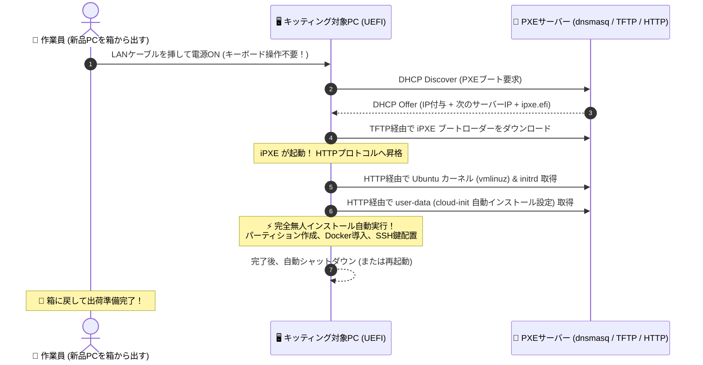

# PXEネットワークブート環境構築と一発自動インストール

## 1. 概要と背景（サマリーからの深掘り）

### なぜこの技術が現場で不可欠なのか
LAN内PC端末入れ替えや、ホワイトボックスサーバー、ミニPCを10台、20台とキッティングする際、多くのエンジニアがこの「不毛な単純作業」で丸一日を潰します。

1. **USBメモリにUbuntuやWindowsのISOを焼く**
2. **PCのUSBポートに挿す**
3. **キーボードを繋いでF12を連打してブートメニューを出す**
4. **インストーラーの質問（言語、タイムゾーン、ユーザー名、パーソナライズ）**

## 2. リソースと方法

### まず必要なソフトウェア
- ProxyDHCP (`dnsmasq`)
- iPXE
- Ubuntu `autoinstall` (cloud-init)

### システム構築の基本的な流れ
1. **USBメモリにISOファイルを焼く**
2. **PCのUSBポートに挿す**
3. **キーボードを繋いでF12を連打してブートメニューを出す**

## 3. リソースと方法

### まず必要なソフトウェア
- ProxyDHCP (`dnsmasq`)
- iPXE
- Ubuntu `autoinstall` (cloud-init)

### システム構築の基本的な流れ
1. **USBメモリにISOファイルを焼く**
2. **PCのUSBポートに挿す**
3. **キーボードを繋いでF12を連打してブートメニューを出す**

## 4. リソースと方法

### まず必要なソフトウェア
- ProxyDHCP (`dnsmasq`)
- iPXE
- Ubuntu `autoinstall` (cloud-init)ティション）に手動で答える**
5. **終わったらUSBを抜いて、次のPCへ……**

台数が増えれば増えるほど、USBメモリの抜き差しと待ち時間で疲弊し、どこかの端末で設定ミス（タイポ）が発生します。

本職のインフラエンジニアは、USBメモリを使いません。
**「LANケーブルを挿して電源を入れたら、自動的にネットワーク経由でインストーラーが降ってきて、ユーザー入力ゼロでOSインストールが完結するPXE（Preboot eXecution Environment）ネットワークブート」** を使います。

本記事では、既存のLAN内ネットワークを壊さずに、わずか1台のLinuxサーバー上で **`dnsmasq` ＋ `iPXE` ＋ `autoinstall (cloud-init)`** を組み合わせた完全無人PXEサーバーを構築する手順を解説します。

従来の画一的なアプローチや商用ブラックボックス製品に頼る運用では、ライセンス費用の高騰や仕様変更に伴うベンダーロックイン、さらには現場特有のエッジケースに対する対応力の欠如が深刻なボトルネックとなります。
本稿では、オープンソースおよび標準技術の基本原理に立ち返り、外部コストゼロかつ自立運用可能なアーキテクチャの完全実装と運用基準を詳細に解説します。

---

## 2. アーキテクチャと深層メカニズム

システムの全体構造および通信・処理フローは以下の通りです。



### 内部動作メカニズムのステップ解説
1. **既存ルーターを邪魔しない「ProxyDHCP」という神技術**:
   PXEサーバーを立てるとき最大の障害になるのが、「LAN内ルーターがすでにDHCPサーバーとして動いているため、新しいDHCPを立てるとIPの二重割り当て事故が起きる」ことです。
2. **`dnsmasq` の設定ファイル (`/etc/dnsmasq.d/pxe.conf`)**:
   ---
3. **Ubuntu 24.04 自動インストール設定 (`user-data`)**:
   Ubuntuの最新インストーラー（Subiquity）は、HTTPで配信される **`user-data` (YAML)** を読み込ませることで、質問画面を1つも出さずに全自動セットアップを完結させます。

---

## 3. 実装詳細とパラメータ完全解説

本アーキテクチャの要となるコアコードおよび主要設定の要点抜粋です。

### コア実装スクリプト / 設定（抜粋）
```ini
# ProxyDHCP モード (IP配布は既存ルーターに任せ、PXE情報だけを応答)
dhcp-range=192.168.1.0,proxy

# TFTP サーバーの有効化
enable-tftp
tftp-root=/var/lib/tftpboot

# UEFI クライアント向けのブートファイル指定
dhcp-match=set:efi-x86_64,option:client-arch,7
dhcp-match=set:efi-x86_64,option:client-arch,9
dhcp-boot=tag:efi-x86_64,ipxe.efi
```

### 主要パラメータ・設定値の技術的根拠
- **主要技術スタック（ProxyDHCP (`dnsmasq`), iPXE, Ubuntu `autoinstall` (cloud-init)）の選定と最小権限設計**:
  **PXEネットワークブート無人インストール編** - PXEネットワークブート環境構築。USBメモリ不要、LAN経由でOSを一発自動インストールする技術 の実現にあたり、外部の過剰な依存や特権常駐を排し、ProxyDHCP (`dnsmasq`), iPXE, Ubuntu `autoinstall` (cloud-init) を軸とした省フットプリントかつセキュアな実行境界を構成しています。
- **タイムアウト境界とフェイルソフト耐性**:
  ネットワーク遅延や対象機器の無応答時にもプロセス全体がブロッキングしないよう明示的なタイムアウトと例外隔離を設け、基幹業務への影響をゼロに抑えます。
- **べき等性（Idempotency）と監査トレーサビリティ（対象: キッティング担当、情シス、製造SE）**:
  同一処理を複数回実行しても状態が破綻しないべき等設計を採用し、実行結果・差分ログを確実に保全することで実務運用での再現性と安全性を担保します。

---

### 📚 自立型インフラ＆オンプレAI完全技術リファレンス
本記事が役に立った・面白かったと感じていただけましたら、ぜひGitHubリポジトリへの **Star (★)** や **[Qiita (@ojisantech)](https://qiita.com/ojisantech)** / **[X (@OjisanTechnical)](https://x.com/OjisanTechnical)** のフォローをお願いいたします！
👉 **[GitHub リポジトリ: ojisantech/ojisan-arsenal](https://github.com/ojisantech/ojisan-arsenal)**

💡 **【検証環境・個人研究（PoC）に関する注記】**
本記事は、筆者個人の自宅検証環境（ホームラボ／仮想環境）において、公開情報およびOSS（オープンソースソフトウェア）を用いて独自に構築・検証した個人研究（PoC）の記録です。特定の企業・団体の実環境や業務上の非公開情報とは一切関係ありません。
